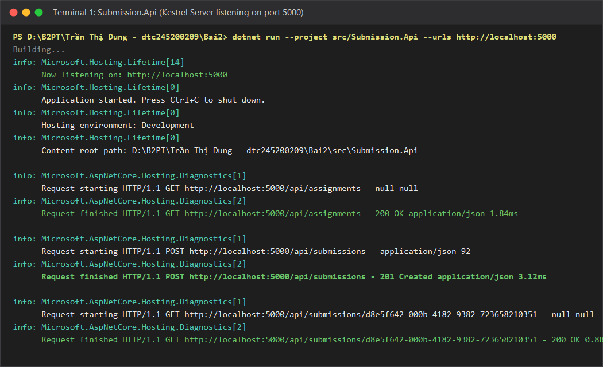
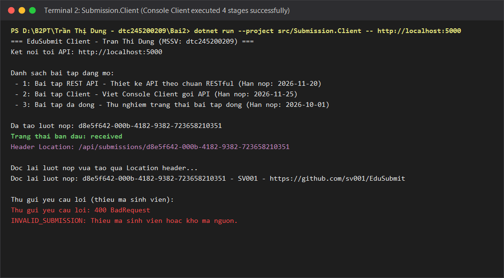
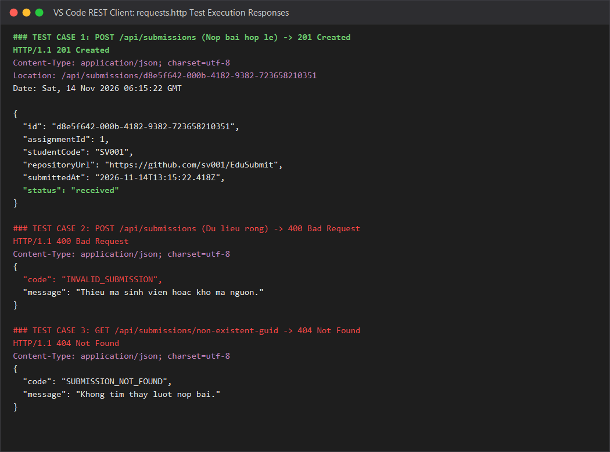

## 1. Cấu trúc thư mục bài làm

Toàn bộ bài tập được đóng gói đầy đủ trong thư mục `Trần Thị Dung - dtc245200209/Bai2/`:

```text
Trần Thị Dung - dtc245200209/Bai2/
├── RestfulClientServer.slnx          # File Solution chứa 2 project
├── .gitignore                         # Loại bỏ bin/, obj/ và file tạm
├── requests.http                      # Bộ kịch bản kiểm thử API đầy đủ
├── sv001.json                         # Dữ liệu nộp bài mẫu hợp lệ
├── rong.json                          # Dữ liệu nộp bài rỗng để test lỗi 400
├── run-api.bat                        # Batch script khởi chạy nhanh Submission.Api
├── run-client.bat                     # Batch script chạy nhanh Submission.Client
├── README.md                          # Báo cáo thực hành chi tiết
├── Bai2.md                            # Nhật ký & bảng phá thử
├── images/                            # Ảnh chụp màn hình kết quả chạy thực tế
│   ├── 01_api_run.png                 # Ảnh máy chủ API khởi động cổng 5000
│   ├── 02_client_run.png              # Ảnh máy khách Client chạy 4 nấc
│   └── 03_test_http.png               # Ảnh kiểm thử requests.http
├── .vscode/                           # Cấu hình Visual Studio Code
│   ├── launch.json                   # Cấu hình F5 Debug/Run cả API và Client
│   ├── tasks.json                    # Cấu hình task build chuẩn dotnet
│   └── extensions.json               # Gợi ý extension C# Dev Kit, REST Client
└── src/
    ├── Submission.Api/                # Dự án Web API (máy chủ Kestrel cổng 5000)
    │   ├── Program.cs
    │   ├── Submission.Api.csproj
    │   ├── appsettings.json
    │   ├── appsettings.Development.json
    │   └── Properties/
    │       └── launchSettings.json
    └── Submission.Client/             # Dự án Console Client (HttpClient)
        ├── Program.cs
        └── Submission.Client.csproj
```

---

## 2. Lệnh chạy chương trình

- **Lệnh chạy máy chủ API (lắng nghe cổng 5000)**:
  ```powershell
  dotnet run --project src/Submission.Api --urls http://localhost:5000
  ```
- **Lệnh chạy máy khách Console Client**:
  ```powershell
  dotnet run --project src/Submission.Client -- http://localhost:5000
  ```

---

## 3. Kết quả chạy thực tế (Ảnh chụp màn hình & Log)

### 3.1. Kết quả máy chủ `Submission.Api` khởi động


```text
info: Microsoft.Hosting.Lifetime[14]
      Now listening on: http://localhost:5000
info: Microsoft.Hosting.Lifetime[0]
      Application started. Press Ctrl+C to shut down.
info: Microsoft.Hosting.Lifetime[0]
      Hosting environment: Development
info: Microsoft.Hosting.Lifetime[0]
      Content root path: D:\B2PT\Trần Thị Dung - dtc245200209\Bai2\src\Submission.Api
```

### 3.2. Kết quả máy khách `Submission.Client` (Đủ 4 nấc theo Slide 87)


```text
Danh sach bai tap dang mo:
- 1: Bai tap REST API
- 2: Bai tap Client
- 3: Bai tap da dong

Da tao luot nop: d8e5f642-000b-4182-9382-723658210351
Trang thai ban dau: received
Doc lai luot nop: d8e5f642-000b-4182-9382-723658210351 - SV001 - https://github.com/sv001/EduSubmit

Thu gui yeu cau loi: 400 BadRequest
INVALID_SUBMISSION: Thieu ma sinh vien hoac kho ma nguon.
```

### 3.3. Kết quả kiểm thử REST Client qua file `requests.http`


---

## 4. Bảng thí nghiệm phá thử (Kiểm thử các mã trạng thái HTTP)

Dưới đây là bảng 12 kịch bản phá thử chi tiết đối với API theo các slide bài học:

| STT | Yêu cầu kiểm thử | Phương thức & URI | Mã mong đợi | Kết quả thật | Thành phần trả lời & Giải thích |
|:---:|:---|:---|:---:|:---:|:---|
| 1 | Kiểm tra trạng thái máy chủ | `GET /` | 200 OK | `200 OK` | Handler tự viết trả về `{ service: "Submission.Api", status: "running" }` |
| 2 | Lấy danh sách bài tập | `GET /api/assignments` | 200 OK | `200 OK` | Handler trả về mảng JSON chứa các bài tập đang có |
| 3 | Lấy chi tiết bài tập có tồn tại | `GET /api/assignments/1` | 200 OK | `200 OK` | Handler tìm thấy bài tập có Id = 1 |
| 4 | Lấy bài tập không tồn tại | `GET /api/assignments/999` | 404 Not Found | `404 Not Found` | Handler không tìm thấy trong danh sách, trả mã 404 kèm ApiError `ASSIGNMENT_NOT_FOUND` |
| 5 | Tham số đường dẫn sai định dạng | `GET /api/assignments/abc` | 404 Not Found | `404 Not Found` | ASP.NET Core Framework chặn do vi phạm ràng buộc kiểu `{id:int}`, body rỗng |
| 6 | Nộp bài tập hợp lệ | `POST /api/assignments/1/submissions` | 201 Created | `201 Created` | Handler tạo mới thành công, trả mã 201 kèm header Location và đối tượng DTO có Id GUID |
| 7 | Đọc lại bài nộp vừa tạo | `GET /api/submissions/{id}` | 200 OK | `200 OK` | Handler tìm thấy lượt nộp theo Id GUID trong bộ nhớ |
| 8 | Nộp bài với dữ liệu rỗng | `POST /api/assignments/1/submissions` (body `rong.json`) | 400 Bad Request | `400 Bad Request` | Handler kiểm tra biên hệ thống, từ chối dữ liệu rỗng kèm ApiError `INVALID_SUBMISSION` |
| 9 | Nộp bài vào bài tập đã đóng | `POST /api/assignments/3/submissions` | 400 Bad Request | `400 Bad Request` | Handler phát hiện `IsOpen == false`, từ chối kèm ApiError `ASSIGNMENT_CLOSED` |
| 10 | Gửi thiếu header Content-Type | `POST /api/assignments/1/submissions` (không header) | 415 Unsupported Media Type | `415 Unsupported Media Type` | ASP.NET Core Framework chặn trước handler vì không xác định được định dạng body |
| 11 | Nộp trùng lặp bài tập | `POST /api/assignments/1/submissions` (gửi lại lần 2) | 409 Conflict | `409 Conflict` | Handler phát hiện trùng `AssignmentId` và `StudentCode`, trả ApiError `DUPLICATE_SUBMISSION` |
| 12 | Xóa lượt nộp (DELETE) | `DELETE /api/submissions/{id}` | 204 No Content | `204 No Content` | Handler xóa bản ghi trong bộ nhớ và trả mã 204 thành công không kèm body |

---

## 5. Trả lời các câu hỏi lý thuyết & thiết kế

### 5.1. Ba câu hỏi giải thích (Slide 90)

#### Câu 1: Vì sao URI dùng danh từ, còn hành động do phương thức HTTP đảm nhận?
- **Trả lời**: 
  - Trong kiến trúc REST (Representational State Transfer), URI đóng vai trò là địa chỉ định danh duy nhất cho **tài nguyên** (Resource). Bản chất tài nguyên là các đối tượng hoặc thực thể trong thế giới thực (danh từ), ví dụ: `/api/assignments`, `/api/submissions`.
  - Các hành động tương tác với tài nguyên (như xem, tạo mới, cập nhật, xóa) đã được chuẩn hóa bởi các **phương thức HTTP chuẩn** (GET, POST, PUT, DELETE). 
  - Tách bạch danh từ và động từ giúp giao diện API nhất quán (Uniform Interface), trực quan, tránh việc sáng tạo tùy tiện các đường dẫn dạng RPC như `/doSubmit`, `/getAssignmentById`, giúp mọi client chuẩn đoán trước cách gọi mà không cần đọc lại tài liệu nhiều lần.

#### Câu 2: Tính chất "Stateless" thể hiện ở đâu trong code đã viết?
- **Trả lời**:
  - Tính chất phi trạng thái (Stateless) có nghĩa là máy chủ **không lưu giữ bất kỳ ngữ cảnh phiên (session) hay lịch sử hội thoại nào** giữa các lượt request của máy khách. Mỗi request gửi lên máy chủ đều phải tự chứa đầy đủ các thông tin cần thiết để máy chủ hiểu và xử lý độc lập.
  - Trong code `Submission.Api`:
    - Ở endpoint `POST /api/assignments/{assignmentId}/submissions`: Toàn bộ thông tin cần thiết để nộp bài gồm `assignmentId` (trên route URI) cùng `studentCode` và `repositoryUrl` (trong body JSON) đều được client truyền trực tiếp trong một request duy nhất.
    - Server không cần biết trước đó client đã gọi những trang nào, không lưu `HttpSession`. Bất kể client gọi lần thứ nhất hay lần thứ n, hoặc request được định tuyến tới bất kỳ máy chủ bản sao nào phía sau Load Balancer, máy chủ đều xử lý độc lập và trả về kết quả chính xác như nhau.

#### Câu 3: Vì sao Client và Server mỗi bên khai báo DTO riêng mà vẫn khớp nhau?
- **Trả lời**:
  - Client và Server là hai tiến trình độc lập (trong hệ phân tán thậm chí chạy trên 2 máy tính cách xa nhau qua mạng Internet), không chia sẻ chung bộ nhớ hay mã nguồn (không dùng chung thư viện DLL nội bộ).
  - Hai bên giao tiếp với nhau qua **hợp đồng API (API Contract)** bằng chuẩn trung gian là **HTTP + JSON**.
  - Khi gửi qua mạng, C# object được serialize thành chuỗi byte JSON (dạng text). Khi nhận về, client hoặc server deserialize chuỗi JSON đó vào class/record của riêng mình. 
  - Miễn là tên thuộc tính và kiểu dữ liệu tương thích theo quy ước JSON (ví dụ camelCase: `id`, `title`, `studentCode`, `repositoryUrl`), thì hai bên hoàn toàn độc lập về cách tổ chức class bên trong mà vẫn giải mã đúng dữ liệu của nhau. Điều này giúp giảm độ phụ thuộc ghép nối (loose coupling), cho phép client và server nâng cấp độc lập.

---

### 5.2. Ba câu hỏi đặt vấn đề đầu giờ (Slide 3 & 93)

#### Câu 1: Hai chương trình chạy ở hai nơi nói chuyện với nhau bằng gì?
- **Đáp án**: Nói chuyện bằng các thông điệp yêu cầu (request) và phản hồi (response) qua giao thức HTTP, định dạng dữ liệu JSON theo một hợp đồng API (API Contract) đã thống nhất trước.

#### Câu 2: Thiết kế một API bắt đầu từ đâu?
- **Đáp án**: Bắt đầu từ việc xác định các **danh từ** (tài nguyên) của bài toán nghiệp vụ và mối quan hệ giữa chúng (quan hệ cha - con, độc lập hay phụ thuộc), sau đó mới ánh xạ sang các phương thức HTTP và viết code C#.

#### Câu 3: Làm sao máy khách biết yêu cầu thành công hay thất bại?
- **Đáp án**: Nhờ vào **mã trạng thái HTTP (Status Code)** (2xx thành công, 4xx lỗi do phía client, 5xx lỗi phía server) kết hợp với một định dạng lỗi thống nhất chung (`ApiError` gồm `code` cho máy đọc và `message` cho con người đọc).
