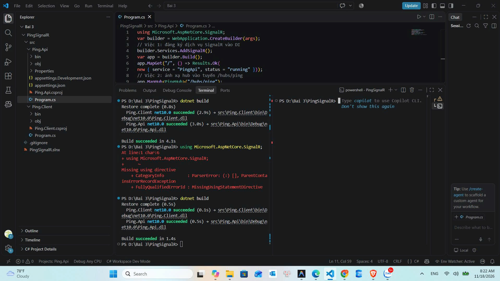
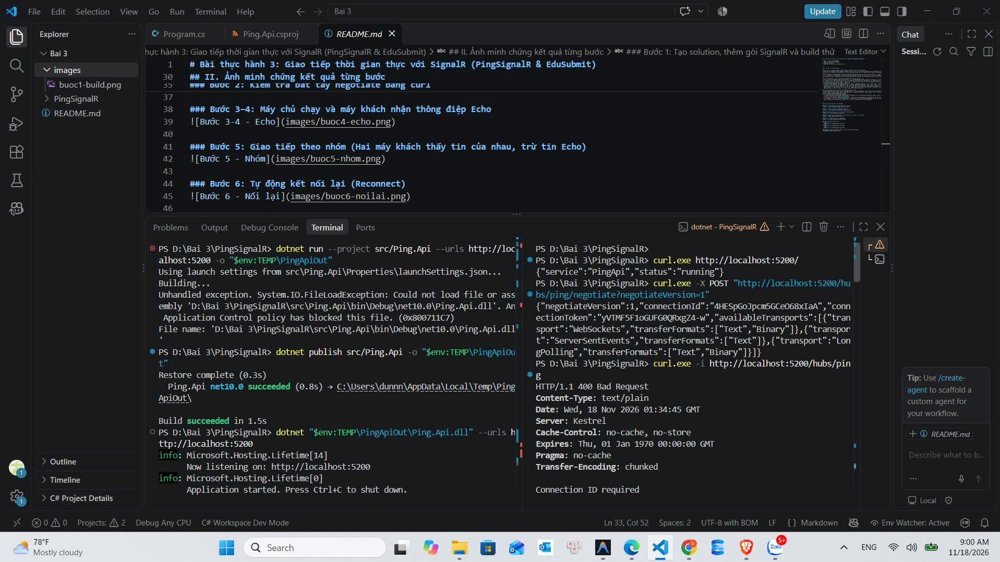
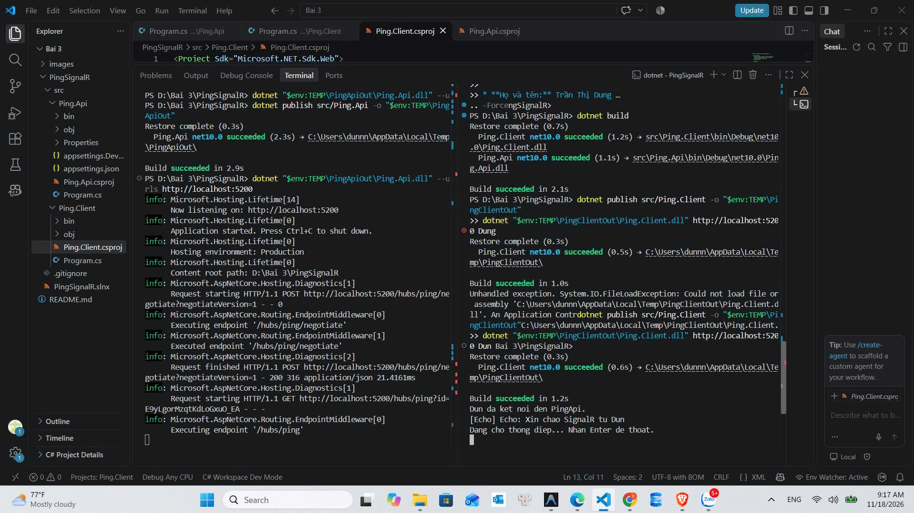
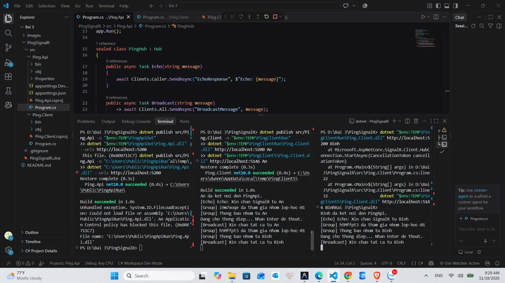
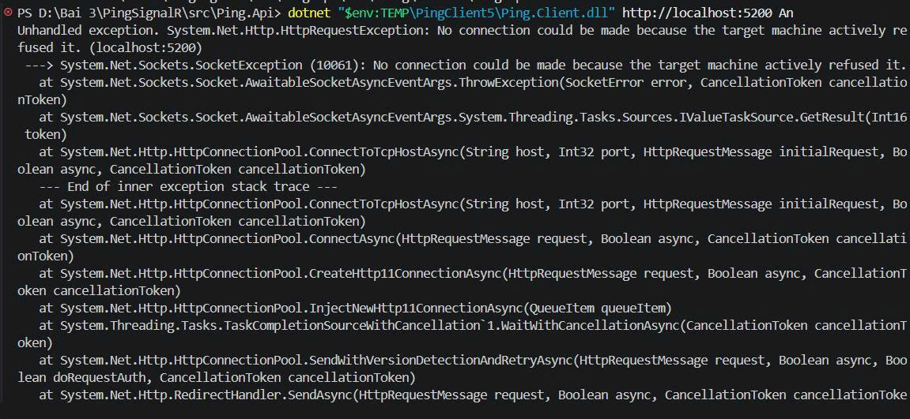
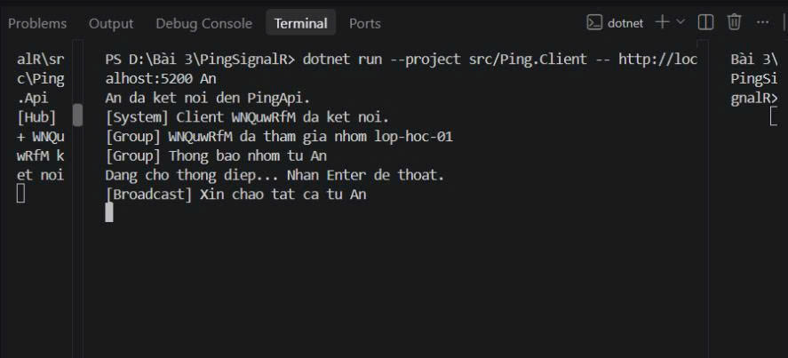
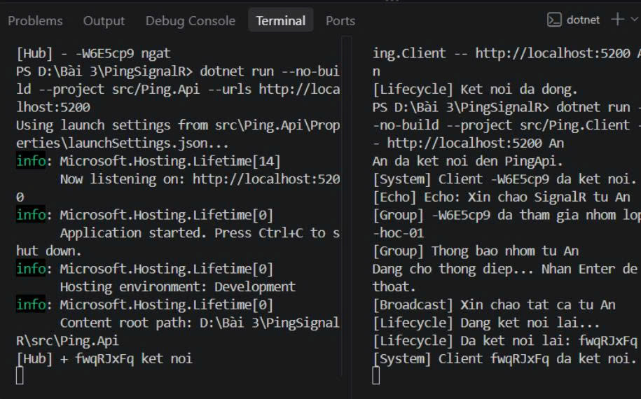

# Bài thực hành 3: Giao tiếp thời gian thực với SignalR (PingSignalR & EduSubmit)

* **Họ và tên:** Trần Thị Dung
* **Mã sinh viên:** dtc245200209
* **Lớp:** CNTT K23E
* **Môn học:** Phát triển ứng dụng phân tán

---

## I. Trả lời câu hỏi đặt vấn đề (Slide 3 & 65)

### 1. Máy chủ có thể chủ động báo cho máy khách mà không cần máy khách hỏi không?
* **Với mô hình HTTP/REST truyền thống:** **Không.** Máy chủ chỉ có thể phản hồi (Response) khi nhận được yêu cầu (Request) từ máy khách. Nếu muốn biết cập nhật mới, máy khách buộc phải tự hỏi liên tục (Polling), gây lãng phí băng thông và tăng độ trễ.
* **Với SignalR (sử dụng WebSockets, Server-Sent Events hoặc Long Polling):** **Có.** Sau bước bắt tay (`negotiate`), máy chủ và máy khách duy trì một kênh kết nối hai chiều (full-duplex) liên tục. Nhờ đó, máy chủ có thể chủ động đẩy (push) dữ liệu qua `Clients.Group(...).SendAsync` (sử dụng `IHubContext` khi gửi từ bên ngoài hub như endpoint REST hay tác vụ nền) ngay khi trạng thái thay đổi mà không cần máy khách gửi yêu cầu hỏi trước.

### 2. Đã có REST rồi, vì sao còn cần thêm SignalR? Hai thứ chia việc thế nào?
* **Vì sao cần thêm SignalR:** REST hoạt động theo cơ chế Request–Response không trạng thái (stateless), rất tối ưu cho các tác vụ CRUD, tải dữ liệu khởi tạo hoặc gửi biểu mẫu nhưng kém hiệu quả khi cần cập nhật tức thì (như thông báo chấm bài xong, chat, theo dõi tiến trình) do độ trễ cao và tốn tài nguyên nếu phải liên tục gửi HTTP request để kiểm tra.
* **Cách phân chia công việc giữa REST và SignalR:**
  * **REST API đảm nhận phần "Hành động & Quản lý tài nguyên" (Command / Query):** Xử lý xác thực, nộp bài (`POST`), lấy danh sách bài nộp (`GET`), cập nhật/xóa dữ liệu, trả về mã trạng thái HTTP chuẩn (`200`, `201`, `400`, `404`). REST đóng vai trò là "nguồn sự thật" (Source of Truth).
  * **SignalR Hub đảm nhận phần "Thông báo sự kiện thời gian thực" (Real-time Push / Notification):** Quản lý kết nối, phân nhóm (`Groups`) và đẩy thông báo tức thì từ máy chủ xuống đúng máy khách hoặc nhóm đang quan tâm ngay khi trạng thái hệ thống thay đổi (ví dụ: báo trạng thái `processing` và `graded` ngay sau khi chấm điểm xong).

### 3. Nếu đứt mạng đúng lúc máy chủ báo "đã chấm xong" thì sao?
* **Hiện tượng xảy ra:** SignalR truyền thông điệp theo cơ chế *fire-and-forget* (bắn và quên) qua kết nối đang mở và không tự lưu hàng đợi tin nhắn bị rớt trong lúc mất mạng. Do đó, thông điệp thông báo `"đã chấm xong"` gửi vào đúng thời điểm đứt mạng sẽ **bị mất (không tới được máy khách)**.
* **Cách khắc phục đảm bảo không mất trạng thái:**
  1. **Lưu trạng thái bền vững (State Persistence) ở Backend:** Kết quả chấm điểm phải được ghi xuống bộ nhớ/cơ sở dữ liệu máy chủ trước khi phát thông báo qua SignalR (nguyên tắc: cập nhật dữ liệu trước, đẩy thông báo sau).
  2. **Tự động kết nối lại (`WithAutomaticReconnect`) + Đồng bộ lại dữ liệu (Re-sync / Catch-up):** Khi máy khách khôi phục kết nối mạng và kích hoạt sự kiện `Reconnected`, máy khách phải đăng ký lại nhóm (vì `ConnectionId` đã đổi) và chủ động gọi lại **REST API** (`GET /api/submissions/{id}`) để đồng bộ lại trạng thái mới nhất từ máy chủ thay vì chỉ ngồi chờ tin nhắn SignalR cũ.
* **Nguyên tắc cốt lõi:** *"Push để nhanh, REST để chắc"*.

---

## II. Ảnh minh chứng kết quả từng bước (PingSignalR)

### Bước 1: Tạo solution, thêm gói SignalR và build thử


### Bước 2: Kiểm tra bắt tay negotiate bằng curl


### Bước 3–4: Máy chủ chạy và máy khách nhận thông điệp Echo


### Bước 5: Giao tiếp theo nhóm (Hai máy khách thấy tin của nhau, trừ tin Echo)


### Bước 6: Tự động kết nối lại (Reconnect)


### Bước 7: Kiểm thử ba lỗi cố ý
* **Lỗi 1 (Máy chủ chưa chạy):**
  
* **Lỗi 2 (Sai đường dẫn hub):**
  
* **Lỗi 3 (Sai tên thông điệp):**
  

---

## III. EduSubmit Realtime: Kết quả thực hành & kiểm thử chi tiết

### 1. Kết quả chạy máy khách `Submission.RealtimeClient` (Đủ 8 dòng chuẩn Slide 57 & 71)

```text
Da ket noi SignalR.
Chon bai tap: 1 - Bai tap SignalR
Da tao luot nop: d6ebc994-867b-4767-9dfa-bae3bb4ba602
Trang thai REST ban dau: received
Dang cho thong bao trang thai tu may chu...
Thong bao SignalR: d6ebc994-867b-4767-9dfa-bae3bb4ba602 -> processing luc 04:44:43
Thong bao SignalR: d6ebc994-867b-4767-9dfa-bae3bb4ba602 -> graded luc 04:44:45
Trang thai doc lai bang REST: graded
```

*Hai thông báo SignalR `processing` và `graded` cách nhau 2 giây theo đúng tiến trình giả lập chấm bài ở nền (`Task.Delay(2s)`), máy khách tự động thoát sau khi chốt trạng thái graded bằng REST.*

### 2. Nhật ký máy chủ `Submission.RealtimeApi` tương ứng (Slide 57)

```text
info: Microsoft.Hosting.Lifetime[14]
      Now listening on: http://localhost:5000
[Hub] pWxAaghj theo doi submission:d6ebc994-867b-4767-9dfa-bae3bb4ba602
[Push] submission:d6ebc994-867b-4767-9dfa-bae3bb4ba602 -> processing
[Push] submission:d6ebc994-867b-4767-9dfa-bae3bb4ba602 -> graded
```

---

## IV. Bảng 5 thí nghiệm phân tán của EduSubmit (Slide 58 & 59)

| STT | Tình huống thí nghiệm | Kết quả dự đoán | Kết quả thực tế khi chạy | Bài học phân tán rút ra |
|:---:|:---|:---|:---|:---|
| 1 | Chạy 2 máy khách SV001 và SV002 cùng lúc | Mỗi máy khách chỉ nhận thông báo về lượt nộp của chính mình, không bị lẫn bài | Mỗi máy khách chỉ thấy lượt nộp vừa tạo | Nhóm `submission:{id}` phân tách người nhận chính xác; đảm bảo tính riêng tư cho sinh viên và tiết kiệm băng thông mạng. |
| 2 | Chạy máy khách khi máy chủ chưa chạy | Kết nối thất bại ngay từ bước đầu tiên | `HttpRequestException: Connection refused (localhost:5000)` | `StartAsync` ném ngoại lệ ngay nếu lần kết nối đầu tiên không thành công; cơ chế `WithAutomaticReconnect` chỉ cứu các kết nối ĐÃ mở thành công trước đó bị rớt. |
| 3 | Sửa `WithUrl` thành `/hub/submissions` (thiếu chữ `s`) | Báo lỗi 404 không tìm thấy hub | `HttpRequestException: Response status code does not indicate success: 404 (Not Found)` | Lỗi xảy ra ngay ở bước bắt tay `negotiate`. Đường dẫn URL của máy khách phải khớp chính xác từng ký tự với `app.MapHub(...)` trên máy chủ. |
| 4 | Sửa `On("SubmissionStatusChanged")` thành `On("SubmissionStatusChange")` (thiếu chữ `d`) | Máy khách không nhận được thông báo trạng thái, bị quá thời gian chờ | Không có ngoại lệ nào; sau 10 giây in ra: `"Qua thoi gian cho thong bao graded."` | Chiều từ máy chủ đẩy xuống (`SendAsync` → `On`), nếu lệch tên thông điệp thì SignalR chỉ im lặng bỏ qua, không ném exception nên rất khó phát hiện. |
| 5 | Chờ 4 giây rồi mới gọi `WatchSubmission` | Máy khách bị lỡ mất các thông báo real-time vì máy chủ đã chấm xong trước | Không nhận được thông điệp SignalR nào; nhưng REST đọc lại vẫn ra: `graded` | Vào nhóm muộn là lỡ tin vì SignalR không lưu trữ hàng đợi tin cũ; REST luôn là "nguồn sự thật" để lấy trạng thái cuối cùng. |

---

## V. Kết quả kiểm thử 9 ca trong `requests.http` (Slide 61 & 71)

| Ca | Phương thức & Tuyến đường | Mã mong đợi | Kết quả thật | Nội dung phản hồi chính |
|:---:|:---|:---:|:---:|:---|
| 1 | `GET /` | 200 OK | `200 OK` | `{"service":"Submission.RealtimeApi","status":"running"}` |
| 2 | `GET /api/assignments` | 200 OK | `200 OK` | Danh sách 3 bài tập (`Bai tap SignalR`, `Client`, `da dong`) |
| 3 | `POST /api/assignments/1/submissions` | 201 Created | `201 Created` | Header `Location: /api/submissions/{id}`, body `status: received` |
| 4 | `GET /api/submissions/{id}` | 200 OK | `200 OK` | Đọc lại thấy trạng thái đổi dần: `received` → `processing` → `graded` |
| 5 | `POST /api/assignments/1/submissions` (body rỗng) | 400 Bad Request | `400 Bad Request` | `{"code":"INVALID_SUBMISSION","message":"Thieu ma sinh vien..."}` |
| 6 | `POST /api/assignments/999/submissions` | 404 Not Found | `404 Not Found` | `{"code":"ASSIGNMENT_NOT_FOUND","message":"Khong tim thay..."}` |
| 7 | `GET /api/submissions/00000000-0000...` | 404 Not Found | `404 Not Found` | `{"code":"SUBMISSION_NOT_FOUND","message":"Khong tim thay..."}` |
| 8 | `POST /hubs/submissions/negotiate?negotiateVersion=1` | 200 OK | `200 OK` | Trả về `connectionId`, `connectionToken` và 3 cơ chế truyền tải |
| 9 | `POST /hub/submissions/negotiate?negotiateVersion=1` | 404 Not Found | `404 Not Found` | Tuyến sai không khớp ánh xạ hub nên trả về mã 404 |

---

## VI. Hướng dẫn chạy nhanh EduSubmit

Có 2 cách thuận tiện để chạy dự án:

### Cách 1: Chạy bằng file script `.bat`
* **Bước 1:** Nháy đúp file `run-api.bat` trong thư mục `RealtimeSubmissionSystem` để khởi động máy chủ tại cổng `http://localhost:5000`.
* **Bước 2:** Nháy đúp file `run-client.bat` để chạy máy khách Client kết nối, nộp bài và nhận thông báo real-time qua SignalR.

### Cách 2: Chạy trực tiếp qua Visual Studio Code (F5)
* Mở thư mục `RealtimeSubmissionSystem` bằng VS Code.
* Bấm phím **F5** hoặc chọn profile **"Chay ca hai (Api + Client)"** trong Run & Debug để chạy song song cả hai tiến trình.
