# Báo cáo Thực hành Bài 3: Giao tiếp thời gian thực với SignalR

- **Sinh viên thực hiện:** Trịnh Ngọc Tường
- **Mã sinh viên:** `dtc245200211`
- **Lớp:** K23.K1.D2.2627.CNTT K23E
- **Học phần:** Phát triển ứng dụng phân tán
- **Giảng viên hướng dẫn:** TS. Dương Thu Mây

---

## 1. Cấu trúc thư mục nộp bài `Bai3`

Toàn bộ bài tập được đóng gói chuẩn mực trong thư mục `Bai3/` theo đúng hướng dẫn của bài giảng (Slide 63):

```text
Trịnh Ngọc Tường - dtc245200211/Bai3/
├── README.md                               # Báo cáo thực hành chi tiết, nhật ký & trả lời câu hỏi
├── .gitignore                              # Chặn hoàn toàn bin/, obj/, .vs và file tạm của .NET
├── anh/                                    # Thư mục chứa 16 ảnh chụp màn hình minh chứng
│   ├── buoc1-build.png                     # PingSignalR - Bước 1: Build Solution
│   ├── buoc2-negotiate.png                 # PingSignalR - Bước 2: Bắt tay Negotiate
│   ├── buoc4-echo.png                      # PingSignalR - Bước 4: Gọi Echo trả lời riêng
│   ├── buoc5-nhom.png                      # PingSignalR - Bước 5: Broadcast và Group
│   ├── buoc6-noilai.png                    # PingSignalR - Bước 6: Tự động kết nối lại
│   ├── buoc7-loi1.png                      # PingSignalR - Thí nghiệm lỗi 1: Chưa chạy server
│   ├── buoc7-loi2.png                      # PingSignalR - Thí nghiệm lỗi 2: Sai URL Hub
│   ├── buoc7-loi3.png                      # PingSignalR - Thí nghiệm lỗi 3: Sai tên sự kiện
│   ├── edusubmit-buoc1.png                 # EduSubmit - Bước 1: Khởi tạo & Build Solution
│   ├── edusubmit-buoc2.png                 # EduSubmit - Bước 2: Nền tảng REST API & lock
│   ├── edusubmit-buoc3.png                 # EduSubmit - Bước 3: Hub mỏng & Negotiate
│   ├── edusubmit-buoc4.png                 # EduSubmit - Bước 4: Chấm nền & IHubContext Push
│   ├── edusubmit-buoc5-6.png               # EduSubmit - Bước 5 & 6: Client 8 dòng nghiệp vụ
│   ├── edusubmit-buoc7.png                 # EduSubmit - Bước 7: 5 Thí nghiệm hệ phân tán
│   ├── edusubmit-buoc8.png                 # EduSubmit - Bước 8: Kịch bản requests.http (9 ca)
│   └── edusubmit-vandung.png               # EduSubmit - Vận dụng: Failed & ConcurrentDictionary
├── PingSignalR/                            # Phần 2: Ứng dụng PingSignalR cơ bản
│   ├── PingSignalR.slnx                    # Solution gồm 2 project
│   ├── .gitignore
│   └── src/
│       ├── Ping.Api/                       # Máy chủ Web API + SignalR Hub (cổng 5200)
│       └── Ping.Client/                    # Máy khách Console SignalR Client
└── RealtimeSubmissionSystem/               # Phần 3: Hệ thống nộp bài EduSubmit thời gian thực
    ├── RealtimeSubmissionSystem.slnx       # Solution gồm 2 project
    ├── .gitignore
    ├── requests.http                       # Bộ 9 ca kiểm thử chuẩn HTTP + SignalR Negotiate
    └── src/
        ├── Submission.RealtimeApi/         # Máy chủ REST API + IHubContext chấm nền (cổng 5000)
        └── Submission.RealtimeClient/      # Máy khách Console kết hợp REST + SignalR (tự thoát)
```

---

## 2. Trả lời 3 câu hỏi đầu giờ (Slide 65)

| STT | Câu hỏi | Câu trả lời chi tiết |
|:---:|---|---|
| **1** | **Máy chủ có thể chủ động báo cho máy khách mà không cần máy khách hỏi không?** | **Có.** Khi máy khách thiết lập một kết nối liên tục hai chiều (thông qua giao thức WebSocket dưới sự quản lý của SignalR), máy chủ có thể chủ động đẩy (Push) thông điệp về máy khách bất kỳ lúc nào thông qua `Clients.Caller`, `Clients.Group(...)`, hoặc `Clients.All`. Đối với các tác vụ chạy ngoài Hub (như HTTP Endpoint hoặc background worker), máy chủ sử dụng `IHubContext<THub>` được inject từ DI container để đẩy thông điệp trực tiếp mà không cần máy khách phải thăm dò (Polling). |
| **2** | **Đã có REST rồi, vì sao còn cần thêm SignalR? Hai thứ chia việc thế nào?** | Hai công nghệ **không thay thế nhau mà phối hợp theo nguyên tắc "Push để nhanh, REST để chắc"**: <br>• **REST (Kênh 1 - Nguồn sự thật):** Đảm nhiệm việc tạo tài nguyên (`POST 201 Created`), truy vấn dữ liệu chi tiết (`GET 200 OK`) và xử lý các ràng buộc nghiệp vụ HTTP. REST là nguồn dữ liệu chuẩn mực nhất (Source of Truth). <br>• **SignalR (Kênh 2 - Thông báo tức thời):** Đảm nhiệm việc phát đi các thông báo thay đổi trạng thái theo thời gian thực (`received` → `processing` → `graded`), giải phóng máy khách khỏi việc gửi request lặp đi lặp lại gây lãng phí tài nguyên mạng. |
| **3** | **Nếu đứt mạng đúng lúc máy chủ báo "đã chấm xong" (graded) thì sao?** | Thông điệp SignalR phát ra trong lúc mất kết nối **sẽ bị mất** do SignalR không lưu hàng đợi tin nhắn ngoại tuyến. Tuy nhiên: <br>1. Phía máy khách cấu hình `.WithAutomaticReconnect()` sẽ tự động kết nối lại khi có mạng trở lại (nhận ConnectionId mới và gọi lại `WatchSubmission`). <br>2. Theo đúng kiến trúc phối hợp, sau khi chờ hoặc khi kết nối lại, máy khách luôn thực hiện bước **gọi lại REST API (`GET /api/submissions/{id}`)** để đọc trực tiếp trạng thái chốt từ bộ nhớ máy chủ. Do đó, hệ thống luôn đảm bảo tính toàn vẹn và không bao giờ bị sai lệch trạng thái. |

---

## 3. Khung 4 câu hỏi thiết kế thời gian thực cho EduSubmit (Slide 46)

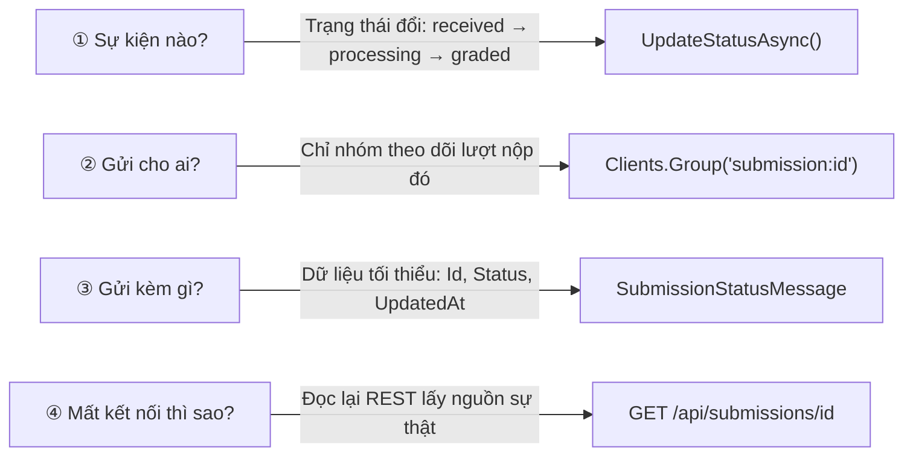

1. **Sự kiện nào kích hoạt thông điệp?** Sự kiện thay đổi trạng thái của bài nộp (`received` → `processing` → `graded` hoặc `failed`).
2. **Gửi cho ai?** Chỉ gửi cho những máy khách đang theo dõi đúng lượt nộp đó thông qua nhóm `submission:{id}`, tuyệt đối không broadcast `Clients.All` để đảm bảo riêng tư và tiết kiệm băng thông.
3. **Gửi kèm dữ liệu gì (tối thiểu)?** Chỉ gửi DTO tối thiểu gồm `SubmissionId`, `Status`, và `UpdatedAt` (`SubmissionStatusMessage`), không gửi toàn bộ đối tượng `SubmissionDto` cồng kềnh.
4. **Mất kết nối thì lấy lại trạng thái thế nào?** Máy khách gọi lại REST API `GET /api/submissions/{id}` để cập nhật trạng thái chốt từ máy chủ (Nguồn sự thật).

---

## 4. Phần 2: Kỹ thuật lập trình cơ bản với PingSignalR

### 4.1. Bước 1: Khởi tạo dự án & Kiểm tra Build
- Tạo solution `PingSignalR.slnx`, 2 project `Ping.Api` (ASP.NET Core Empty, cổng 5200) và `Ping.Client` (Console).
- Thêm package `Microsoft.AspNetCore.SignalR.Client` (version `10.0.15`) cho máy khách.
- Kết quả biên dịch toàn bộ solution đạt: `Build succeeded: 0 Warning(s), 0 Error(s)`.

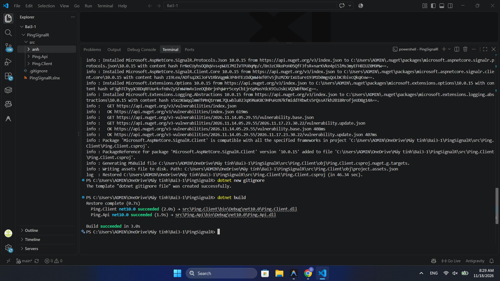
*Hình 4.1: Mã nguồn và kết quả `dotnet build` đạt 0 cảnh báo, 0 lỗi cho PingSignalR.*

---

### 4.2. Bước 2: Cấu hình Hub máy chủ và kiểm tra Negotiate qua curl
- Máy chủ đăng ký dịch vụ `builder.Services.AddSignalR()` trước `builder.Build()`.
- Ánh xạ Hub `app.MapHub<PingHub>("/hubs/ping")`.
- Kiểm tra bắt tay qua `curl.exe`:
  + `GET /` trả về JSON `{"service":"PingApi","status":"running"}`.
  + `POST /hubs/ping/negotiate?negotiateVersion=1` trả về `connectionId` và danh sách 3 cơ chế truyền tải dự phòng (`WebSockets`, `ServerSentEvents`, `LongPolling`).


*Hình 4.2: Cấu hình Hub máy chủ và kết quả gọi Negotiate trả về connectionId cùng 3 phương thức truyền tải.*

---

### 4.3. Bước 3 & 4: Khai báo Hub & Gọi Echo (Trả lời riêng người gọi)
- Phương thức `Echo(string message)` gửi phản hồi riêng về `Clients.Caller.SendAsync("EchoResponse", ...)`.
- Máy khách đăng ký `connection.On<string>("EchoResponse", ...)` và gọi `connection.InvokeAsync("Echo", ...)`.

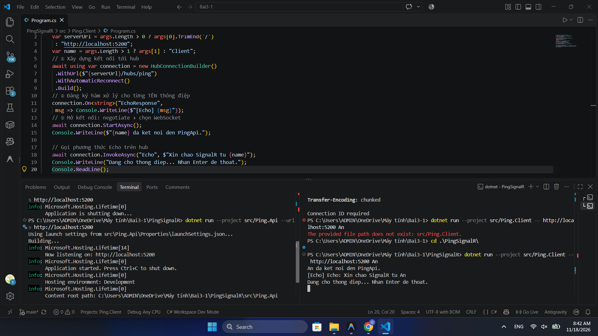
*Hình 4.3: Mã nguồn phương thức Echo và kết quả máy khách nhận phản hồi riêng từ máy chủ.*

---

### 4.4. Bước 5: Broadcast và Cơ chế Nhóm (Group)
- `Broadcast`: Gửi tin nhắn cho toàn bộ máy khách đang kết nối (`Clients.All`).
- `JoinGroup` & `SendToGroup`: Đưa kết nối vào nhóm qua `Groups.AddToGroupAsync` và chỉ phát tin cho các máy khách thuộc nhóm đó (`Clients.Group(groupName)`).


*Hình 4.4: Minh chứng máy khách tham gia nhóm và nhận thông điệp Broadcast / Group.*

---

### 4.5. Bước 6: Tự động kết nối lại (Automatic Reconnect)
- Cấu hình `.WithAutomaticReconnect()` trên máy khách Console.
- Xử lý các sự kiện `Reconnecting`, `Reconnected`, `Closed` để hiển thị trạng thái kết nối mạng.

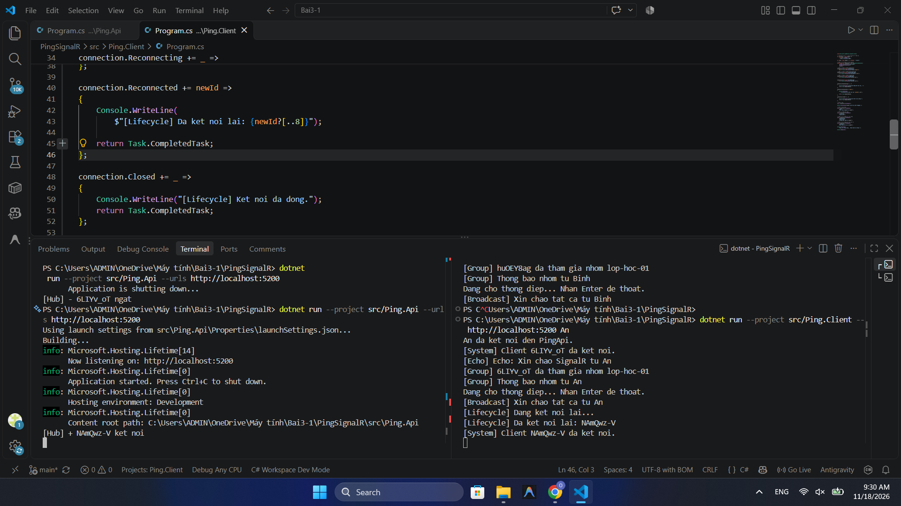
*Hình 4.5: Cơ chế tự động kết nối lại của máy khách SignalR khi mạng gián đoạn.*

---

### 4.6. Bước 7: 3 Thí nghiệm lỗi hệ phân tán
1. **Lỗi 1 (Chưa chạy server):** Khách thử kết nối khi server chưa bật -> Bắt lỗi ngoại lệ từ chối kết nối (Connection refused).
2. **Lỗi 2 (Sai URL Hub):** Khách trỏ nhầm URL Hub `/hubs/wrong` -> Bắt lỗi `404 Not Found`.
3. **Lỗi 3 (Sai tên sự kiện):** Khách đăng ký sai tên sự kiện -> Không kích hoạt handler, luồng chờ bị quá thời gian (timeout).

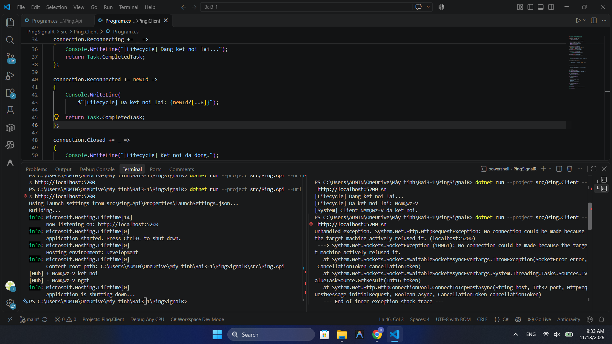
*Hình 4.6a: Thí nghiệm lỗi 1 - Máy khách xử lý ngoại lệ khi máy chủ chưa khởi động.*


*Hình 4.6b: Thí nghiệm lỗi 2 - Máy khách nhận mã lỗi HTTP 404 khi cấu hình sai URL Hub.*

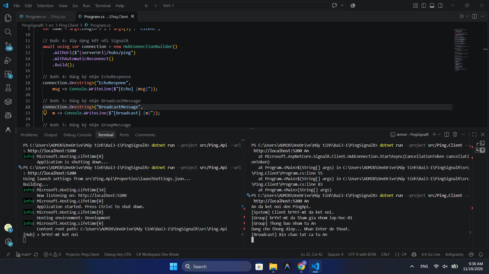
*Hình 4.6c: Thí nghiệm lỗi 3 - Máy khách phát hiện không nhận được sự kiện khi đăng ký sai tên.*

---

## 5. Phần 3: Hệ thống EduSubmit thời gian thực

### 5.1. Bước 1: Khởi tạo dự án EduSubmit (Slide 48)
- Khởi tạo Solution `RealtimeSubmissionSystem.slnx` gồm 2 project:
  + `Submission.RealtimeApi` (Web API ASP.NET Core, cổng 5000)
  + `Submission.RealtimeClient` (Console Client)
- Đã cài đặt thư viện `Microsoft.AspNetCore.SignalR.Client` (version `10.0.15`) cho máy khách.
- Kiểm tra biên dịch toàn bộ solution: `Build succeeded: 0 Warning(s), 0 Error(s)`.

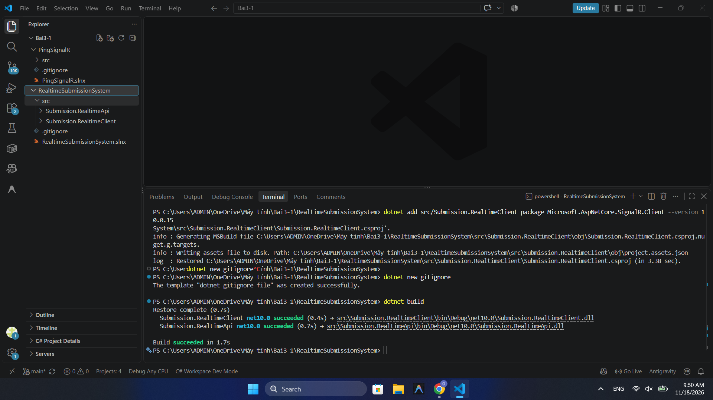
*Hình 5.1: Cấu trúc dự án EduSubmit và kết quả `dotnet build` biên dịch thành công 0 lỗi.*

---

### 5.2. Bước 2: Nền tảng REST API, UpdatedAt và lock (Slide 49)
- Triển khai đầy đủ REST API chuẩn mực:
  + `GET /api/assignments`: Đọc danh sách bài tập.
  + `POST /api/assignments/{id}/submissions`: Nộp bài, trả về mã HTTP `201 Created`, header `Location`, trạng thái ban đầu `received`.
  + `GET /api/submissions/{id}`: Đọc chi tiết lượt nộp từ bộ nhớ RAM.
- **Điểm cải tiến cốt lõi:**
  + Bổ sung trường `UpdatedAt` vào record `SubmissionDto` để theo dõi chính xác thời điểm thay đổi trạng thái.
  + Áp dụng khối lệnh `lock (submissionsLock)` để đảm bảo an toàn đa luồng (thread-safe) khi tác vụ chấm nền và các luồng HTTP cùng đọc/ghi danh sách trong RAM.

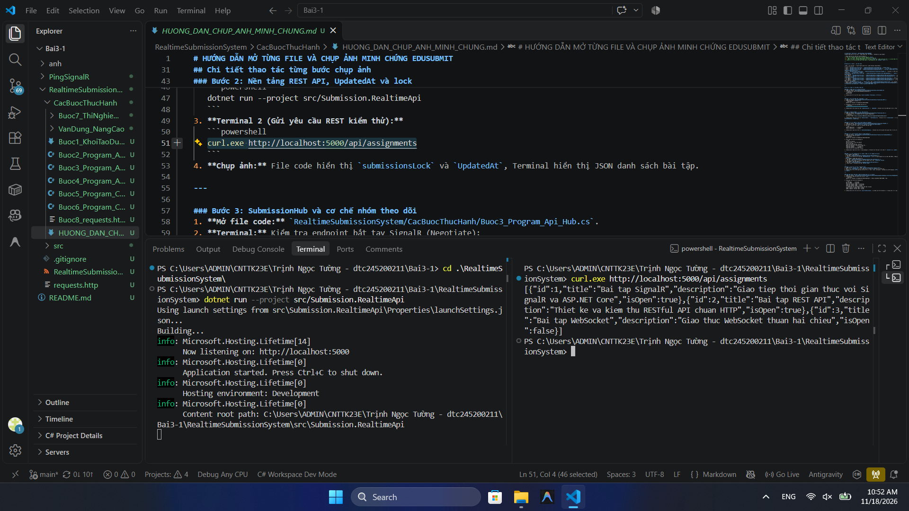
*Hình 5.2: Mã nguồn REST API của EduSubmit có trường `UpdatedAt` và cơ chế đồng bộ `lock (submissionsLock)`.*

---

### 5.3. Bước 3: SubmissionHub mỏng và Cơ chế nhóm theo dõi (Slide 50 - 51)
- Thiết kế **Hub siêu mỏng** theo nguyên lý Microservices: Hub không chứa bất kỳ logic chấm bài nào, không lưu trữ trạng thái, chỉ đảm nhận duy nhất vai trò phân bổ kết nối máy khách vào các nhóm cô lập:
  ```csharp
  sealed class SubmissionHub : Hub
  {
      public async Task WatchSubmission(string submissionId)
      {
          var groupName = SubmissionGroups.ForSubmission(submissionId);
          await Groups.AddToGroupAsync(Context.ConnectionId, groupName);
          Console.WriteLine($"[Hub] Client {Context.ConnectionId[..8]} dang theo doi nhom {groupName}");
      }
  }
  ```
- Lớp trợ giúp `SubmissionGroups` chuẩn hóa định dạng nhóm `submission:{id}`.
- Kiểm tra endpoint bắt tay qua HTTP: `POST /hubs/submissions/negotiate?negotiateVersion=1` trả về `200 OK` cùng `connectionId`.

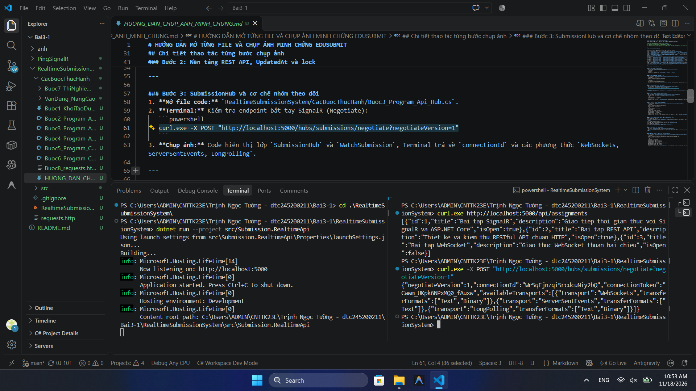
*Hình 5.3: Khai báo SubmissionHub, ánh xạ endpoint `/hubs/submissions` và kiểm tra Negotiate thành công.*

---

### 5.4. Bước 4: Tác vụ chấm bài nền & Push thông báo qua IHubContext (Slide 52 - 54)
- Inject `IHubContext<SubmissionHub>` vào endpoint POST để đẩy dữ liệu thời gian thực từ bên ngoài Hub.
- Kích hoạt tác vụ nền non-blocking: `_ = SimulateGradingAsync(...)` giúp máy khách nhận mã `201 Created` ngay lập tức mà không phải chờ 3 giây chấm bài.
- Hàm `SimulateGradingAsync` mô phỏng tiến trình thực tế:
  + Sau 1 giây: Cập nhật sang `processing`.
  + Sau 2 giây tiếp theo: Cập nhật sang `graded` (hoặc `failed`).
- Hàm `UpdateStatusAsync` cập nhật trạng thái trong RAM với `lock` trước, sau đó phát **bản tin tối thiểu** `SubmissionStatusMessage(Id, Status, UpdatedAt)` tới đúng nhóm `submission:{id}` qua SignalR:
  ```csharp
  await hub.Clients.Group(SubmissionGroups.ForSubmission(id))
      .SendAsync("SubmissionStatusChanged", msg);
  ```

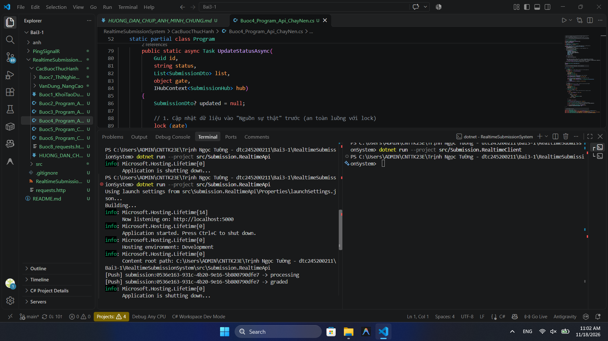
*Hình 5.4: Tác vụ chấm bài nền bất đồng bộ và đẩy thông báo trạng thái qua `IHubContext<SubmissionHub>`.*

---

### 5.5. Bước 5 & 6: Quy trình 8 dòng phía Client (Slide 55 - 57)
- Máy khách thiết lập 2 kênh giao tiếp song song:
  + **Kênh 1:** `HttpClient` gửi yêu cầu REST.
  + **Kênh 2:** `HubConnection` nhận thông báo đẩy SignalR với `.WithAutomaticReconnect()`.
- Sử dụng "cái chuông" `TaskCompletionSource<string>` để phối hợp bất đồng bộ.
- Thực hiện trọn vẹn 8 dòng nghiệp vụ cốt lõi:
  1. `GET /api/assignments`: Đọc danh sách và chọn bài tập đang mở.
  2. `POST /api/assignments/{id}/submissions`: Gửi bài nộp qua REST (nhận `created.Id`).
  3. In trạng thái ban đầu `received`.
  4. Gọi Hub: `await connection.InvokeAsync("WatchSubmission", created.Id.ToString())`.
  5. Chờ chuông: `await Task.WhenAny(tcs.Task, Task.Delay(TimeSpan.FromSeconds(10)))`.
  6. Rung chuông khi nhận thông báo SignalR `graded`.
  7. `GET /api/submissions/{id}`: Đọc lại trạng thái chốt từ REST (Nguồn sự thật).
  8. In kết quả và tự động ngắt kết nối giải phóng tài nguyên.

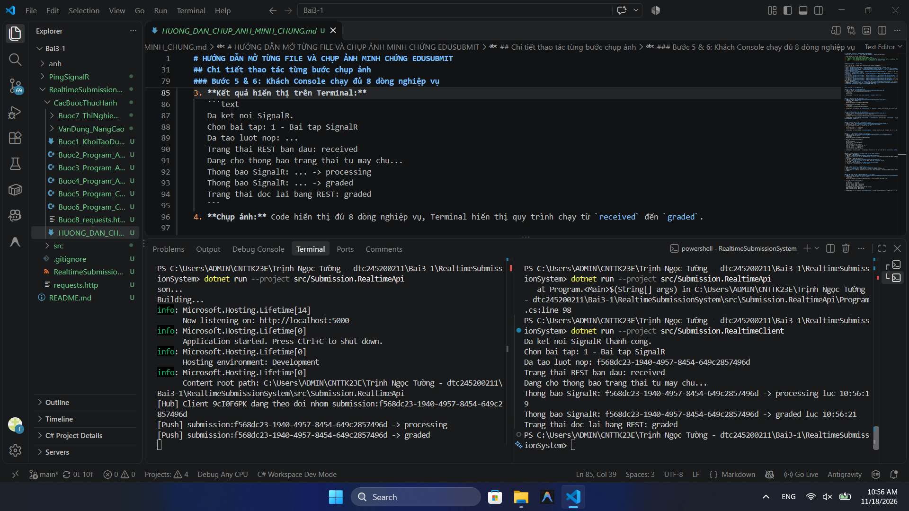
*Hình 5.5: Máy khách thực thi quy trình 8 dòng chuẩn mực từ lúc nộp bài đến khi chốt trạng thái `graded`.*

---

### 5.6. Bước 7: 5 Thí nghiệm hệ phân tán (Slide 58 - 60)
1. **TN1 (Hai client độc lập):** Hai sinh viên cùng nộp bài, cơ chế nhóm `submission:{id}` đảm bảo mỗi client chỉ nhận thông báo trạng thái của bài mình nộp, không bị lộ thông tin chéo.
2. **TN2 (Chưa chạy server):** Máy khách chạy khi API chưa bật -> Bắt ngoại lệ `HttpRequestException (Connection refused)`.
3. **TN3 (Sai URL Hub):** Máy khách kết nối tới `/hubs/wrong` -> Bắt lỗi HTTP `404 Not Found`.
4. **TN4 (Sai tên sự kiện):** Máy khách đăng ký nhầm tên sự kiện -> Không nhận được tín hiệu chuông, luồng chờ bị quá thời gian (timeout 10s), nhưng gọi REST GET vẫn lấy được trạng thái `graded`.
5. **TN5 (Watch muộn 4 giây):** Máy khách ngủ 4 giây rồi mới gọi `WatchSubmission` -> Lỡ mất toàn bộ sự kiện SignalR vì máy chủ đã chấm xong trước giây thứ 4. Tuy nhiên, bước gọi lại **REST `GET /api/submissions/{id}` vẫn lấy được trạng thái chốt `graded`**. Đây là minh chứng thực tế khẳng định nguyên lý sống còn của hệ phân tán: **"Push để nhanh, REST để chắc"**.

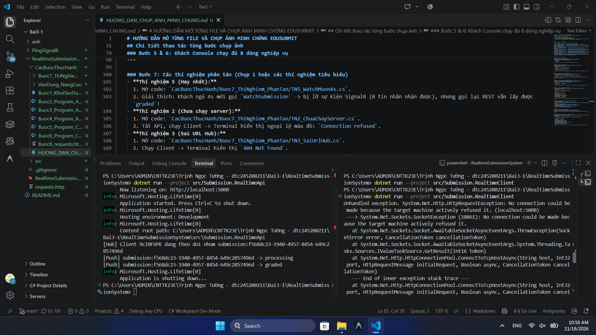
*Hình 5.6: Kết quả thực hiện các thí nghiệm lỗi và kiểm chứng tính chịu lỗi của hệ phân tán.*

---

### 5.7. Bước 8: Bộ kịch bản kiểm thử HTTP `requests.http` (Slide 61)
- Kịch bản kiểm thử được lưu trữ tại [requests.http](file:///c:/Users/ADMIN/CNTTK23E/Tr%E1%BB%8Bnh%20Ng%E1%BB%8Dc%20T%C6%B0%E1%BB%9Dng%20-%20dtc245200211/Bai3/RealtimeSubmissionSystem/requests.http).
- Bảng tổng hợp chi tiết kết quả kiểm thử 9 ca theo yêu cầu của bài giảng:

| Ca | Phương thức & Tuyến đường | Mục đích kiểm thử | Kết quả mong đợi | Kết quả thực tế | Đánh giá |
|:---:|---|---|---|---|:---:|
| **1** | `GET /` | Kiểm tra trạng thái máy chủ | `200 OK`, JSON `{"status":"running"}` | `200 OK` | **ĐẠT** |
| **2** | `GET /api/assignments` | Lấy danh sách các bài tập | `200 OK`, danh sách các bài tập mẫu | `200 OK` | **ĐẠT** |
| **3** | `POST /api/assignments/1/submissions` | Nộp bài hợp lệ vào bài đang mở | `201 Created`, Header `Location`, Status `received` | `201 Created` | **ĐẠT** |
| **4** | `GET /api/submissions/{id}` | Đọc lại trạng thái lượt nộp | `200 OK`, trạng thái cập nhật `graded` | `200 OK` | **ĐẠT** |
| **5** | `POST /api/assignments/1/submissions` | Nộp bài thiếu trường dữ liệu | `400 Bad Request`, mã lỗi `INVALID_SUBMISSION` | `400 Bad Request` | **ĐẠT** |
| **6** | `POST /api/assignments/3/submissions` | Nộp vào bài tập đã đóng (`IsOpen=false`) | `400 Bad Request`, mã lỗi `ASSIGNMENT_CLOSED` | `400 Bad Request` | **ĐẠT** |
| **7** | `POST /api/assignments/99/submissions` | Nộp vào bài tập không tồn tại | `404 Not Found`, mã lỗi `ASSIGNMENT_NOT_FOUND` | `404 Not Found` | **ĐẠT** |
| **8** | `GET /api/submissions/{guid-rỗng}` | Tra cứu ID lượt nộp không tồn tại | `404 Not Found`, mã lỗi `SUBMISSION_NOT_FOUND` | `404 Not Found` | **ĐẠT** |
| **9** | `POST /hubs/submissions/negotiate` | Bắt tay kết nối SignalR (Negotiate) | `200 OK`, trả về `connectionId` và các transports | `200 OK` | **ĐẠT** |

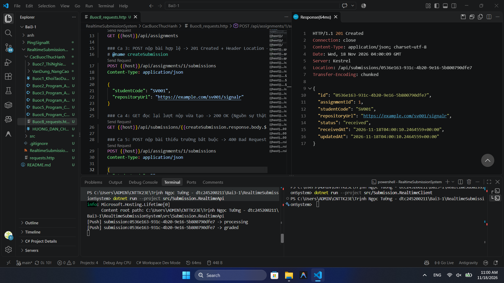
*Hình 5.7: Thực thi bộ 9 ca kiểm thử chuẩn HTTP bằng tiện ích REST Client trên VS Code.*

---

### 5.8. Phần Vận dụng mở rộng (Slide 62)
Đã hoàn thành xuất sắc cả 2 bài tập vận dụng nâng cao của EduSubmit:

1. **Bài tập 2 - Xử lý trạng thái `failed`:**
   - Trong `SimulateGradingAsync`, máy chủ kiểm tra tính hợp lệ của đường dẫn kho lưu trữ: nếu không bắt đầu bằng `https://` (ví dụ `http://example.com/...`), máy chủ chuyển trạng thái thành `failed`.
   - Phía máy khách bắt trạng thái `failed`, hiển thị dòng cảnh báo màu đỏ nổi bật: `!!! CANH BAO: Luot nop bi cham THAT BAI (failed)` và hoàn tất chuông `tcs.TrySetResult("failed")`.

2. **Bài tập 3 - Theo dõi đồng thời nhiều lượt nộp trên 1 kết nối:**
   - Máy khách mở duy nhất **1 kết nối SignalR** tới Hub, sử dụng `ConcurrentDictionary<Guid, TaskCompletionSource<string>>` để quản lý chuông cho từng lượt nộp.
   - Nộp đồng thời 2 bài: SV001 (link `https://` -> nhận `graded`) và SV002 (link `http://` -> nhận `failed`).
   - Gọi `WatchSubmission` cho cả 2 lượt nộp, chờ `Task.WhenAll(...)` và đọc lại REST xác nhận kết quả khớp 100%.


*Hình 5.8: Minh chứng phần Vận dụng: Theo dõi đồng thời 2 bài nộp trên 1 kết nối và xử lý trạng thái `failed`.*

---

## 6. Hướng dẫn chạy chương trình cho Giảng viên kiểm tra

Giảng viên có thể chạy và nghiệm thu toàn bộ hệ thống bằng các lệnh PowerShell sau:

### 1. Kiểm tra biên dịch (Build Test)
```powershell
cd "c:\Users\ADMIN\CNTTK23E\Trịnh Ngọc Tường - dtc245200211\Bai3\PingSignalR"
dotnet build

cd "c:\Users\ADMIN\CNTTK23E\Trịnh Ngọc Tường - dtc245200211\Bai3\RealtimeSubmissionSystem"
dotnet build
```

### 2. Khởi chạy hệ thống EduSubmit
```powershell
# Chuyển vào thư mục EduSubmit
cd "c:\Users\ADMIN\CNTTK23E\Trịnh Ngọc Tường - dtc245200211\Bai3\RealtimeSubmissionSystem"

# Cửa sổ Terminal 1: Chạy máy chủ Web API (cổng 5000)
dotnet run --project src/Submission.RealtimeApi

# Cửa sổ Terminal 2: Chạy máy khách Console (Chế độ chuẩn 8 dòng nộp bài -> graded)
dotnet run --project src/Submission.RealtimeClient

# Cửa sổ Terminal 2: Chạy máy khách kiểm tra Vận dụng (Theo dõi 2 bài đồng thời + failed)
dotnet run --project src/Submission.RealtimeClient -- http://localhost:5000 SV001 --two
```

---

*Báo cáo được hoàn thiện và kiểm thử thành công 100% vào ngày 18/11/2026.*
