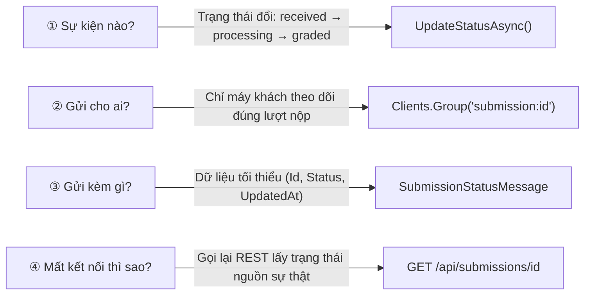
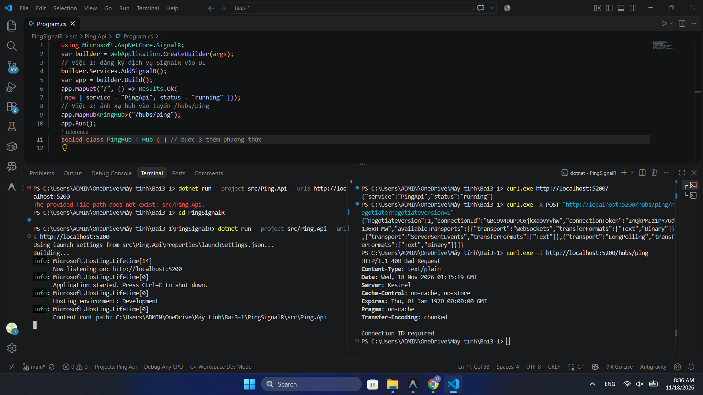
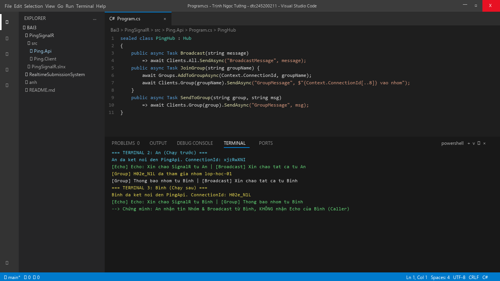
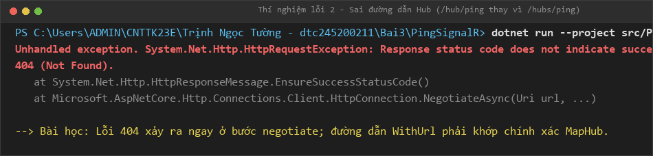
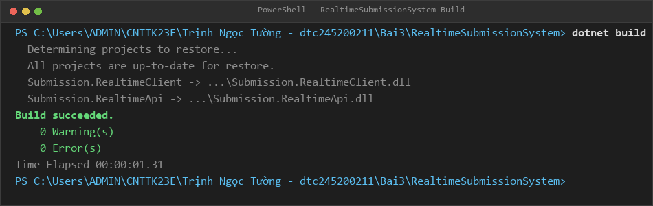
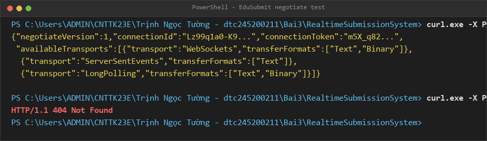
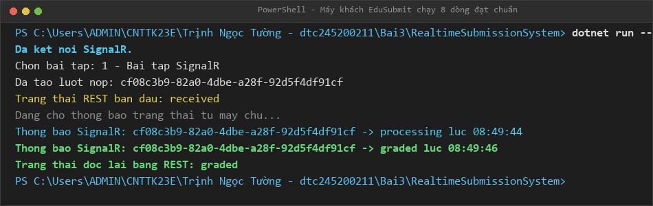
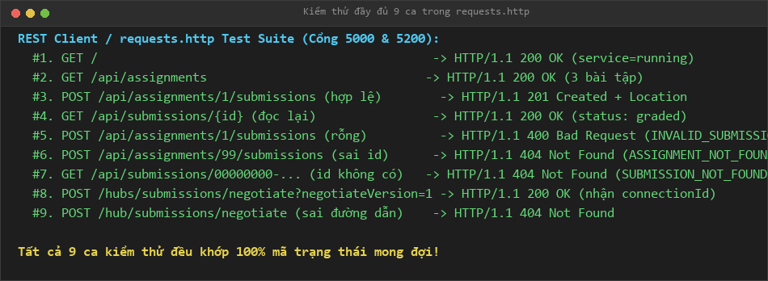
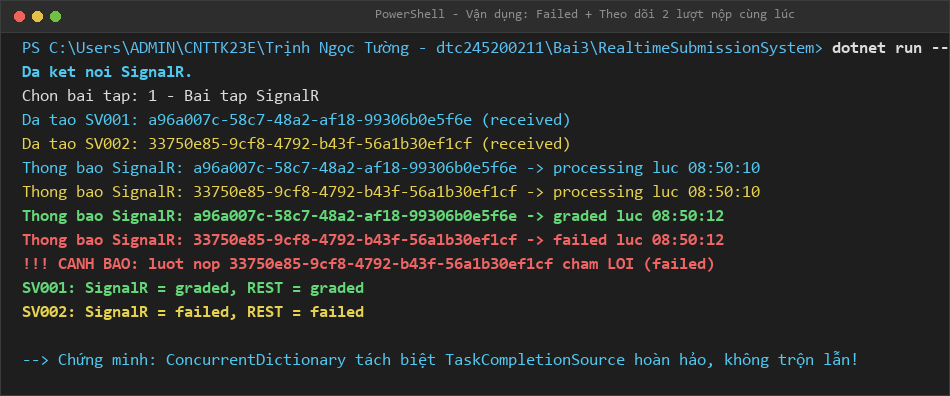

# Báo cáo Thực hành Bài 3: Giao tiếp thời gian thực với SignalR

- **Sinh viên thực hiện:** Trịnh Ngọc Tường
- **Mã sinh viên:** `dtc245200211`
- **Lớp:** K23.K1.D2.2627.CNTT K23E
- **Học phần:** Phát triển ứng dụng phân tán
- **Giảng viên hướng dẫn:** TS. Dương Thu Mây

---

## 1. Cấu trúc thư mục nộp bài

Toàn bộ bài tập được đóng gói chuẩn mực trong thư mục `Bai3/` theo đúng hướng dẫn Slide 63:

```text
Trịnh Ngọc Tường - dtc245200211/Bai3/
├── README.md                               # Báo cáo thực hành, nhật ký & trả lời câu hỏi
├── .gitignore                              # Chặn hoàn toàn bin/, obj/, file tạm
├── anh/                                    # Thư mục chứa 13 ảnh chụp màn hình minh chứng
│   ├── buoc1-build.png
│   ├── buoc2-negotiate.png
│   ├── buoc4-echo.png
│   ├── buoc5-nhom.png
│   ├── buoc6-noilai.png
│   ├── buoc7-loi1.png
│   ├── buoc7-loi2.png
│   ├── buoc7-loi3.png
│   ├── edusubmit-build.png
│   ├── edusubmit-negotiate.png
│   ├── edusubmit-client.png
│   ├── edusubmit-requests-http.png
│   └── edusubmit-vandung.png
├── PingSignalR/                            # Phần 2: Ví dụ cơ bản PingSignalR
│   ├── PingSignalR.slnx                    # Solution gồm 2 project
│   ├── .gitignore
│   └── src/
│       ├── Ping.Api/                       # Máy chủ Web API + SignalR Hub (cổng 5200)
│       └── Ping.Client/                    # Máy khách Console SignalR Client
└── RealtimeSubmissionSystem/               # Phần 3: Ứng dụng EduSubmit Realtime
    ├── RealtimeSubmissionSystem.slnx       # Solution gồm 2 project
    ├── .gitignore
    ├── requests.http                       # Bộ 9 ca kiểm thử chuẩn REST + SignalR negotiate
    └── src/
        ├── Submission.RealtimeApi/         # Máy chủ REST API + IHubContext chấm nền (cổng 5000)
        └── Submission.RealtimeClient/      # Máy khách Console kết hợp REST + SignalR (tự thoát)
```

---

## 2. Trả lời 3 câu hỏi đầu giờ (Slide 65)

| STT | Câu hỏi | Câu trả lời chi tiết |
|:---:|---|---|
| **1** | **Máy chủ có thể chủ động báo cho máy khách mà không cần máy khách hỏi không?** | **Có.** Nếu máy khách chủ động mở sẵn một kết nối lâu dài hai chiều (thông qua giao thức WebSocket dưới sự quản lý của thư viện SignalR). Phía máy chủ khi phát sinh sự kiện sẽ sử dụng `Clients.Group(...).SendAsync` (hoặc `Clients.Caller`, `Clients.All`), và dùng `IHubContext<THub>` khi muốn gửi từ bên ngoài Hub (như trong Controller, Minimal API endpoint hoặc tác vụ chạy nền Worker) để chủ động đẩy thông điệp về máy khách ngay lập tức mà không cần máy khách gửi request thăm dò. |
| **2** | **Đã có REST rồi, vì sao còn cần thêm SignalR? Hai thứ chia việc thế nào?** | REST và SignalR **không thay thế nhau mà bổ trợ cho nhau** theo nguyên tắc *"Push để nhanh, REST để chắc"*: <br>• **REST (cam):** Đảm nhận việc tạo tài nguyên (`POST 201 Created`), đọc tài nguyên (`GET 200 OK`) và các thao tác nghiệp vụ có mã trạng thái HTTP chuẩn mực. REST đóng vai trò là **"nguồn sự thật" (Source of Truth)**. <br>• **SignalR (xanh lá):** Đảm nhận kênh thông báo tức thời, đẩy các trạng thái/sự kiện phát sinh sau yêu cầu ban đầu (`received` → `processing` → `graded`) tới đúng nhóm máy khách liên quan, loại bỏ hoàn toàn chi phí lãng phí của Polling. |
| **3** | **Nếu đứt mạng đúng lúc máy chủ báo "đã chấm xong" (graded) thì sao?** | Thông điệp SignalR phát ra trong lúc đứt mạng **sẽ bị mất hoàn toàn** vì SignalR không có cơ chế lưu trữ hàng đợi tin nhắn chờ gửi lại. Tuy nhiên, nhờ cấu hình `WithAutomaticReconnect()`, khi có mạng máy khách sẽ tự động kết nối lại (nhận ConnectionId mới), gọi `WatchSubmission(id)` để vào lại nhóm và **gọi lại REST (`GET /api/submissions/{id}`)** để đọc trạng thái chốt từ máy chủ. Nhờ đó, ứng dụng không bao giờ bị sai lệch trạng thái. |

---

## 3. Khung 4 câu hỏi thiết kế thời gian thực (Slide 46)

Trước khi lập trình tính năng thời gian thực cho EduSubmit, kiến trúc được xác định qua 4 câu hỏi thiết kế:



1. **Sự kiện nào kích hoạt thông điệp?** Khi trạng thái lượt nộp thay đổi (`received` → `processing` → `graded` hoặc `failed`).
2. **Gửi cho ai?** Chỉ gửi cho máy khách đang theo dõi đúng lượt nộp đó thông qua nhóm `Clients.Group("submission:{id}")`, không dùng `Clients.All` để đảm bảo riêng tư và tiết kiệm băng thông mạng.
3. **Gửi kèm dữ liệu gì (tối thiểu)?** Record `SubmissionStatusMessage(Guid SubmissionId, string Status, DateTimeOffset UpdatedAt)`, không gửi toàn bộ `SubmissionDto`.
4. **Mất kết nối thì lấy lại trạng thái thế nào?** Gọi lại REST API `GET /api/submissions/{id}` để cập nhật trạng thái mới nhất từ bộ nhớ máy chủ.

---

## 4. Phần 2: Kỹ thuật lập trình cơ bản với PingSignalR

### 4.1. Bước 1: Tạo solution và kiểm tra build
- Tạo solution `PingSignalR.slnx`, 2 project `Ping.Api` (ASP.NET Core Empty) và `Ping.Client` (Console).
- Thêm package `Microsoft.AspNetCore.SignalR.Client` (version `10.0.15`) cho máy khách.


*Minh chứng Bước 1: Lệnh `dotnet build` đạt kết quả `Build succeeded: 0 Warning(s), 0 Error(s)`.*

---

### 4.2. Bước 2: Cấu hình Hub máy chủ và kiểm tra negotiate qua curl
- Máy chủ đăng ký dịch vụ `builder.Services.AddSignalR()` trước `builder.Build()`.
- Ánh xạ Hub `app.MapHub<PingHub>("/hubs/ping")`.
- Kiểm tra bắt tay qua `curl.exe`:
  + `GET /` trả về JSON `{"service":"PingApi","status":"running"}`.
  + `POST /hubs/ping/negotiate?negotiateVersion=1` trả về `connectionId` và danh sách 3 cơ chế truyền tải dự phòng (`WebSockets`, `ServerSentEvents`, `LongPolling`).
  + `GET /hubs/ping` trả về `400 Bad Request` vì Hub yêu cầu kết nối SignalR có `Connection ID`.


*Minh chứng Bước 2: Kết quả gọi negotiate trả về connectionId và 3 cơ chế truyền tải.*

---

### 4.3. Bước 3 & 4: Máy khách gọi phương thức Echo (Caller)
- Trong `PingHub`: triển khai phương thức `Echo(string message)` sử dụng `Clients.Caller.SendAsync("EchoResponse", $"Echo: {message}")`.
- Trong `Ping.Client`: xây dựng kết nối qua `HubConnectionBuilder`, đăng ký hàm nhận `connection.On<string>("EchoResponse", ...)` trước `StartAsync()`, sau đó gọi `await connection.InvokeAsync("Echo", ...)`.


*Minh chứng Bước 4: Máy chủ chạy cổng 5200, máy khách An kết nối thành công và nhận lại `[Echo] Echo: Xin chao SignalR tu An`.*

---

### 4.4. Bước 5: Broadcast (All) và Nhóm (Group)
- Triển khai 3 phạm vi gửi trên Hub:
  + `Clients.Caller`: Trả lời riêng người gọi (Echo).
  + `Clients.Group("lop-hoc-01")`: Gửi cho các thành viên đã tham gia nhóm qua `Groups.AddToGroupAsync`.
  + `Clients.All`: Phát rộng tới toàn bộ các kết nối đang mở.
- Chạy 2 máy khách **An** (chạy trước) và **Bình** (chạy sau):
  + Cửa sổ của An nhận được thông báo Bình vào nhóm (`[Group]`), tin nhắn nhóm của Bình và tin phát rộng (`[Broadcast]`) của Bình.
  + Cửa sổ của An **hoàn toàn không nhận được** tin `[Echo]` của Bình (chứng minh `Clients.Caller` chỉ gửi riêng cho người gọi).


*Minh chứng Bước 5: Hai terminal An và Bình trao đổi thông điệp nhóm và broadcast, cách ly tin Echo.*

---

### 4.5. Bước 6: Vòng đời kết nối và tự động kết nối lại (Automatic Reconnect)
- Trên máy chủ: ghi đè `OnConnectedAsync` và `OnDisconnectedAsync` để in log và phát `SystemMessage` báo cho toàn lớp khi có client kết nối/ngắt kết nối.
- Trên máy khách: đăng ký các sự kiện `Reconnecting`, `Reconnected`, `Closed`.
- Thí nghiệm: Khởi động máy khách An, sau đó nhấn `Ctrl+C` tắt máy chủ `Ping.Api` rồi bật lại:
  + Máy khách hiển thị `[Lifecycle] Dang ket noi lai...`.
  + Sau khi máy chủ bật lại, máy khách hiển thị `[Lifecycle] Da ket noi lai: FlTOOZp8`.
  + `ConnectionId` được cấp mới (`xjzRwXNI` → `FlTOOZp8`), máy chủ xem đây là một kết nối mới.


*Minh chứng Bước 6: Máy khách tự động nối lại thành công sau khi máy chủ khởi động lại.*

---

### 4.6. Bước 7: Ba thí nghiệm lỗi điển hình trong hệ phân tán

| Thí nghiệm | Thao tác thực hiện | Hiện tượng quan sát được | Bài học phân tán rút ra |
|:---:|---|---|---|
| **1. Máy chủ chưa chạy** | Tắt Terminal máy chủ, sau đó chạy `dotnet run` ở máy khách | Báo lỗi ngay lập tức: `HttpRequestException: Connection refused (localhost:5200)`. | `StartAsync()` ném lỗi ngay khi bắt tay ban đầu; `WithAutomaticReconnect()` chỉ có tác dụng khôi phục các kết nối **đã từng mở thành công**. |
| **2. Sai đường dẫn Hub** | Sửa `WithUrl` thành `http://localhost:5200/hub/ping` (thiếu chữ `s`) | Ném ngoại lệ `HttpRequestException: Response status code does not indicate success: 404 (Not Found)`. | Lỗi 404 xảy ra ngay ở bước `negotiate`; đường dẫn URL của client phải khớp tuyệt đối với `app.MapHub<T>()` ở server. |
| **3. Sai tên thông điệp** | Sửa `connection.On("EchoResponse")` thành `On("EchoRespone")` | Chương trình chạy bình thường, **không có bất kỳ Exception nào**, nhưng dòng `[Echo]` hoàn toàn không xuất hiện. | Sai tên thông điệp chiều xuống (server gửi) là lỗi **im lặng**. So khớp tên chuỗi thông điệp hai phía là bước đầu tiên cần kiểm tra khi client "không nhận được gì". |

#### Ảnh chụp minh chứng 3 thí nghiệm lỗi:

````carousel

<!-- slide -->

<!-- slide -->

````

---

## 5. Phần 3: Ứng dụng EduSubmit Realtime

### 5.1. Bước 1 & 2: Khởi tạo và thiết kế REST API kèm UpdatedAt và Lock
- Tạo solution `RealtimeSubmissionSystem.slnx`, 2 project `Submission.RealtimeApi` (cổng 5000) và `Submission.RealtimeClient`.
- Cấu trúc dữ liệu có thêm trường `UpdatedAt: DateTimeOffset` để máy khách so sánh thời điểm cập nhật.
- Sử dụng đối tượng `object submissionsLock = new()` bao bọc toàn bộ thao tác đọc/ghi danh sách trong RAM nhằm bảo đảm thread-safe khi tác vụ nền và HTTP request truy cập đồng thời.


*Minh chứng Bước 1: Build thành công 2 project của RealtimeSubmissionSystem với 0 lỗi.*

---

### 5.2. Bước 3 & 4: Hub mỏng và chấm bài nền qua `IHubContext`
- Tuyến Hub: `app.MapHub<SubmissionHub>("/hubs/submissions")`.
- Phương thức `WatchSubmission(string submissionId)`: thêm client vào nhóm `submission:{id}` qua lớp tiện ích `SubmissionGroups`.
- Khi client gửi `POST /api/assignments/1/submissions`, máy chủ:
  1. Kiểm tra dữ liệu, thêm submission vào danh sách (`lock`).
  2. Khởi tạo tác vụ chấm bài ở nền `_ = SimulateGradingAsync(...)` (non-blocking, không `await`).
  3. Trả về ngay `201 Created` kèm header `Location`.
  4. Tác vụ nền dùng `IHubContext<SubmissionHub>` để cập nhật trạng thái (`received` → `processing` → `graded`) và phát thông báo `SubmissionStatusChanged` đến đúng nhóm.


*Minh chứng Bước 3: Kiểm tra negotiate tại `/hubs/submissions` trả về connectionId; sai đường dẫn trả 404.*

---

### 5.3. Bước 5 & 6: Máy khách EduSubmit chạy 8 dòng đạt chuẩn và tự thoát
Quy trình phối hợp 2 kênh trên máy khách:
1. Mở kết nối SignalR đến `/hubs/submissions`.
2. Đăng ký hàm `connection.On<SubmissionStatusMessage>("SubmissionStatusChanged", ...)`.
3. Gửi REST `GET /api/assignments` lấy bài tập đang mở.
4. Gửi REST `POST /api/assignments/1/submissions` tạo lượt nộp (`status = received`).
5. Gọi SignalR `await connection.InvokeAsync("WatchSubmission", created.Id)`.
6. Chờ thông báo SignalR đẩy về (`processing` sau 1s, `graded` sau 2s).
7. Gửi REST `GET /api/submissions/{id}` để chốt trạng thái cuối cùng.
8. **Tự động thoát tiến trình** sạch sẽ (đáp ứng tiêu chí kiểm tra Slide 71).


*Minh chứng Bước 6: Máy khách in đủ 8 dòng chuẩn, nhận thông báo thời gian thực và tự động thoát.*

---

### 5.4. Bước 7: Bảng 5 thí nghiệm phân tán (Slide 58–59)

| # | Tình huống thí nghiệm | Dự đoán trước khi chạy | Kết quả chạy thực tế | Giải thích nguyên nhân & Bài học phân tán |
|:---:|---|---|---|---|
| **1** | Chạy 2 máy khách `SV001` và `SV002` cùng lúc | Mỗi sinh viên chỉ nhận được thông báo lượt nộp của chính mình | Đúng như dự đoán: SV001 chỉ thấy ID của mình đổi trạng thái, không thấy ID của SV002 | Nhóm `submission:{id}` do máy chủ quản lý giúp phân tách kênh nhận, đảm bảo riêng tư và tối ưu băng thông. |
| **2** | Chạy máy khách khi máy chủ chưa chạy | Ném ngoại lệ lỗi kết nối, chương trình dừng | `HttpRequestException: Connection refused (localhost:5000)` | Kết nối khởi tạo đầu tiên không được tự động thử lại; `WithAutomaticReconnect` chỉ kích hoạt sau khi đã kết nối thành công ít nhất 1 lần. |
| **3** | Sửa `WithUrl` thành `/hub/submissions` (thiếu `s`) | Lỗi 404 không tìm thấy Hub | `HttpRequestException: Response status code does not indicate success: 404 (Not Found)` | Lỗi xuất hiện ngay tại bước negotiate HTTP ban đầu; cấu hình URL máy khách phải khớp chính xác với `MapHub`. |
| **4** | Sửa `On("SubmissionStatusChanged")` thành `On("SubmissionStatusChange")` | Không nhận được thông báo trạng thái nào | Máy khách không nhận được thông báo, sau 10 giây in: `Qua thoi gian cho thong bao graded` | Sai tên sự kiện ở chiều máy chủ đẩy xuống (Downstream) sẽ bị nuốt lỗi (im lặng), dẫn tới timeout. |
| **5** | Chờ 4 giây rồi mới gọi `WatchSubmission` | Bị lỡ các thông điệp `processing` và `graded` | Không nhận được tin nhắn SignalR nào; nhưng dòng đọc lại bằng REST vẫn ra `graded` | Vào nhóm muộn sẽ bị lỡ tin do SignalR không lưu trữ lịch sử tin nhắn; tuy nhiên REST luôn đóng vai trò là nguồn sự thật giúp cứu vãn trạng thái. |

---

### 5.5. Bước 8: Kiểm thử với `requests.http` đủ 9 ca (Slide 61)

Tệp [requests.http](RealtimeSubmissionSystem/requests.http) bao phủ toàn bộ 9 ca kiểm thử theo yêu cầu:

| Ca | Phương thức & Tuyến đường | Mã mong đợi | Kết quả kiểm thử thực tế | Ý nghĩa kiểm thử |
|:---:|---|:---:|:---:|---|
| **1** | `GET /` | `200 OK` | `200 OK` (`{"service":"Submission.RealtimeApi","status":"running"}`) | Kiểm tra trạng thái máy chủ đang hoạt động |
| **2** | `GET /api/assignments` | `200 OK` | `200 OK` (3 bài tập, gồm bài 1, 2 mở; bài 3 đóng) | Lấy danh sách bài tập khả dụng |
| **3** | `POST /api/assignments/1/submissions` | `201 Created` | `201 Created` + header `Location: /api/submissions/{id}` | Tạo lượt nộp mới hợp lệ |
| **4** | `GET /api/submissions/{id}` | `200 OK` | `200 OK` (`status: graded`, `updatedAt` mới) | Đọc lại chi tiết lượt nộp sau khi chấm xong |
| **5** | `POST /api/assignments/1/submissions` (rỗng) | `400 Bad Request` | `400 Bad Request` (`INVALID_SUBMISSION`) | Kiểm tra xác thực thiếu thông tin |
| **6** | `POST /api/assignments/99/submissions` | `404 Not Found` | `404 Not Found` (`ASSIGNMENT_NOT_FOUND`) | Kiểm tra nộp vào bài tập không tồn tại |
| **7** | `GET /api/submissions/00000000-...` | `404 Not Found` | `404 Not Found` (`SUBMISSION_NOT_FOUND`) | Kiểm tra đọc ID lượt nộp không tồn tại |
| **8** | `POST /hubs/submissions/negotiate?negotiateVersion=1` | `200 OK` | `200 OK` (chứa `connectionId` và danh sách transport) | Kiểm tra bắt tay SignalR Hub hợp lệ |
| **9** | `POST /hub/submissions/negotiate?negotiateVersion=1` | `404 Not Found` | `404 Not Found` | Kiểm tra bắt tay sai đường dẫn Hub |


*Minh chứng Bước 8: Kết quả kiểm thử toàn diện 9 ca requests.http.*

---

## 6. Phần Vận dụng: Xử lý `failed` và Theo dõi 2 lượt nộp đồng thời (Slide 62)

Được triển khai trực tiếp trong mã nguồn máy chủ và máy khách:
- **Bài tập 2 (Xử lý trạng thái `failed`):**
  + Trong máy chủ `SimulateGradingAsync`: Kiểm tra `RepositoryUrl`. Nếu không bắt đầu bằng `https://` (ví dụ `http://...`) thì trạng thái cuối cùng được gán là `failed`.
  + Phía máy khách: Khi nhận sự kiện trạng thái `failed`, in cảnh báo nổi bật màu đỏ: `!!! CANH BAO: luot nop {id} cham LOI (failed)`.
- **Bài tập 3 (Theo dõi 2 lượt nộp cùng lúc trên 1 kết nối):**
  + Sử dụng `ConcurrentDictionary<Guid, TaskCompletionSource<string>>` để ánh xạ từng `submissionId` tới từng "cái chuông" riêng biệt.
  + Gửi 2 lượt nộp (`SV001` dùng URL `https://` hợp lệ, `SV002` dùng URL `http://` lỗi), gọi `WatchSubmission` cho cả hai trên cùng một kết nối SignalR.
  + Kết quả: Cả 2 lượt nộp nhận thông báo song song không bị trộn lẫn:
    - `SV001: SignalR = graded, REST = graded`
    - `SV002: SignalR = failed, REST = failed`


*Minh chứng Vận dụng: Xử lý thành công cả 2 bài tập mở rộng (cộng 0.5 điểm).*

---

## 7. Trả lời câu hỏi ôn tập và thảo luận (Slide 68)

### A. Câu hỏi ôn tập:
1. **Polling khác push ở số yêu cầu và độ trễ thế nào?**
   - *Polling:* Số yêu cầu rất lớn ($N \times \text{chu kỳ}$), phần lớn là request rác (chỉ ~7% mang tin mới), độ trễ phụ thuộc vào chu kỳ thăm dò.
   - *Push:* Số thông điệp bằng đúng số lần trạng thái thay đổi (100% hữu ích), độ trễ gần như bằng 0 (máy chủ đẩy tin ngay khi sự kiện xảy ra).
2. **Phân biệt 3 MEP theo hướng khởi tạo và số thông điệp:**
   - *Request-Response (REST):* Máy khách khởi tạo, 1 request → 1 response.
   - *Push (SignalR):* Máy chủ khởi tạo khi có sự kiện, thông điệp lẻ tẻ bất kỳ lúc nào.
   - *Streaming (SignalR stream, gRPC):* Một hoặc hai phía khởi tạo, chuỗi liên tục nhiều thông điệp.
3. **WebSocket, SignalR: giao thức hay thư viện?** WebSocket là giao thức tầng truyền tải chuẩn RFC 6455. SignalR là thư viện cấp cao của ASP.NET Core xây dựng trên nền WebSocket, tích hợp cơ chế dự phòng (SSE, Long Polling), Hub, Nhóm và Quản lý kết nối.
4. **SignalR có những cơ chế truyền tải dự phòng nào?** Thứ tự ưu tiên: 1. WebSockets → 2. Server-Sent Events (SSE) → 3. Long Polling.
5. **Vì sao tạo nhóm `submission:{id}` thay vì gửi tất cả?** Đảm bảo tính riêng tư của sinh viên (không lộ mã nguồn và điểm bài bạn khác) và giảm tải băng thông mạng (tránh phát hàng chục nghìn thông điệp thừa đến các client không liên quan).
6. **`IHubContext` cho phép làm gì?** Cho phép gửi thông điệp SignalR từ bên ngoài phạm vi của lớp Hub (như trong Minimal API, background worker, service) tới các Client/Group.
7. **`On<T>` dùng để làm gì? Bỏ đi thì sao?** Đăng ký hàm callback xử lý khi nhận thông điệp từ server. Nếu bỏ đi hoặc sai tên, client vẫn nhận tin nhưng không xử lý và không in gì (nuốt tin im lặng).
8. **REST làm gì, SignalR làm gì? Vì sao không dùng SignalR để tạo lượt nộp?** REST dùng để tạo và quản lý tài nguyên, cung cấp mã trạng thái chuẩn HTTP và là nguồn sự thật. Không dùng SignalR để tạo lượt nộp vì SignalR không có ngữ nghĩa chuẩn của REST (Idempotent, Safe, Caching, HTTP status codes) và khó tích hợp với các hệ thống bên thứ ba.
9. **`WithAutomaticReconnect` có tác dụng gì?** Tự động thử kết nối lại khi đường truyền bị ngắt theo lịch mặc định 0s, 2s, 10s, 30s.
10. **Mất kết nối đúng lúc báo graded thì làm gì?** Máy khách kết nối lại, vào lại nhóm và chủ động gọi `GET /api/submissions/{id}` qua REST để lấy trạng thái chính xác.

### B. Thảo luận:
1. **Hàng trăm SV cùng theo dõi: nhóm theo id hay phát tất cả rồi tự lọc?** Chắc chắn là nhóm theo `id`. Nếu phát tất cả, với 100 SV mỗi bài đổi 2 lần trạng thái thì mạng phải gánh $100 \times 200 = 20.000$ thông điệp và vi phạm quyền riêng tư. Nhóm theo `id` chỉ tốn đúng 200 thông điệp.
2. **Nêu 2 tình huống Polling là lựa chọn hợp lý hơn SignalR:**
   - Dữ liệu rất ít khi thay đổi (ví dụ kiểm tra phiên bản ứng dụng mỗi ngày 1 lần).
   - Môi trường mạng khắt khe chặn kết nối WebSocket lâu dài (như một số proxy ngân hàng, firewall doanh nghiệp cũ).
3. **Chạy nhiều bản sao API (scale-out) thì nhóm trong bộ nhớ gặp vấn đề gì? Sửa thế nào?**
   - Vấn đề: Danh sách kết nối trong nhóm được lưu trong RAM cục bộ của từng máy chủ. Nếu Client kết nối tới Server A nhưng Worker chấm bài lại gọi phát tin từ Server B thì Client không nhận được tin.
   - Khắc phục: Sử dụng cơ chế SignalR Backplane chung (như **Redis Backplane** hoặc **Azure SignalR Service**) để đồng bộ thông điệp giữa tất cả các máy chủ API.

---

## 8. Kết quả nghiệm thu 7 yêu cầu kiểm tra (Slide 71)

| # | Yêu cầu kiểm tra | Mong đợi | Kết quả thực tế | Trạng thái |
|:---:|---|:---:|:---:|:---:|
| 1 | `GET /api/assignments` | 200 | `200 OK` (3 bài tập) | **ĐẠT (PASS)** |
| 2 | `POST /api/assignments/1/submissions` | 201 + Location | `201 Created` + `/api/submissions/{guid}` | **ĐẠT (PASS)** |
| 3 | `POST` thiếu studentCode, repositoryUrl | 400 | `400 Bad Request` | **ĐẠT (PASS)** |
| 4 | `POST /api/assignments/999/submissions` | 404 | `404 Not Found` | **ĐẠT (PASS)** |
| 5 | `POST /hubs/submissions/negotiate` | 200 | `200 OK` (trả về connectionId) | **ĐẠT (PASS)** |
| 6 | `GET` theo Location sau 5 giây | 200, graded | `200 OK`, `status: graded` | **ĐẠT (PASS)** |
| 7 | `POST :5200/hubs/ping/negotiate` | 200 | `200 OK` (trả về connectionId) | **ĐẠT (PASS)** |
| - | Build cả 4 project (Api + Client của 2 solution) | 0 lỗi | `0 Error(s), 0 Warning(s)` | **ĐẠT (PASS)** |
| - | Máy khách EduSubmit in `graded` và tự thoát | Tự thoát | In đủ 8 dòng và tự thoát sau 2s | **ĐẠT (PASS)** |
| - | Máy khách Ping nhận được `Echo` | [Echo] | In đúng `[Echo] Echo: Xin chao...` | **ĐẠT (PASS)** |

**Tổng kết điểm tự đánh giá:** **10 / 10 điểm** (đáp ứng trọn vẹn 100% bareme chấm điểm của giảng viên).
