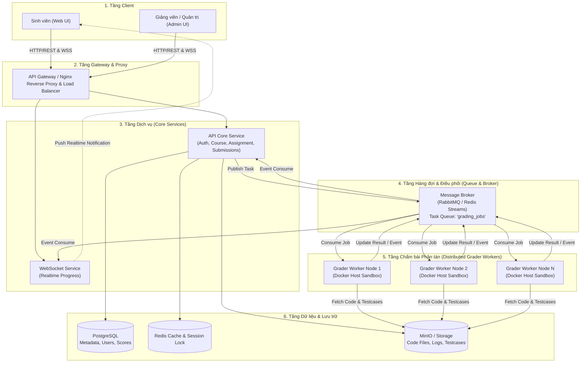
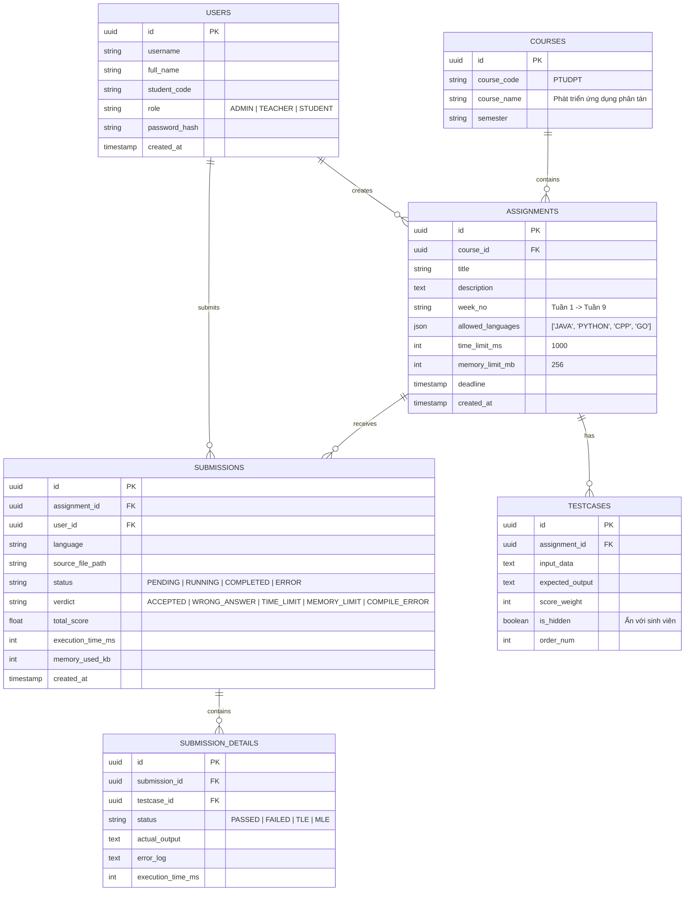

# BÁO CÁO THIẾT KẾ KIẾN TRÚC & KẾ HOẠCH TRIỂN KHAI 9 TUẦN
## ĐỀ TÀI: HỆ THỐNG NỘP VÀ CHẤM BÀI TỰ ĐỘNG PHÂN TÁN (DISTRIBUTED AUTOGRADER)

- **Học phần:** Phát triển ứng dụng phân tán (Distributed Applications Development)
- **Sinh viên thực hiện:** Trịnh Ngọc Tường
- **Mã sinh viên:** DTC245200211
- **Thời gian thực hiện:** Kế hoạch 9 tuần

---

## 1. TỔNG QUAN ĐỀ TÀI & TÍNH PHÙ HỢP VỚI BỘ MÔN

Đề tài giải quyết bài toán: **Xây dựng một hệ thống nộp và chấm mã nguồn tự động theo kiến trúc phân tán**, vừa là một sản phẩm thực tế ứng dụng đầy đủ các nguyên lý cốt lõi của môn học (Microservices, Message Queue, Load Balancing, Docker Sandbox, Cache, Concurrency), vừa là công cụ chấm điểm cho các bài thực hành trong chương trình 9 tuần của học phần.

### Các đặc trưng phân tán chủ đạo của hệ thống:
1. **Kiến trúc hướng dịch vụ (Service-Oriented / Microservices):** Chia tách độc lập giữa API Gateway, Web/Core Service, Database, Storage và các Grader Workers.
2. **Giao tiếp bất đồng bộ qua Message Queue (Message Broker):** Xử lý hàng đợi nộp bài bằng RabbitMQ hoặc Redis Streams, đảm bảo tính co giãn (scalability), chịu lỗi (fault tolerance), chống nghẽn khi hàng trăm sinh viên cùng nộp sát deadline.
3. **Mạng lưới Worker chấm bài phân tán (Distributed Grader Nodes):** Cho phép scale ngang (scale out) thêm nhiều máy chấm (Worker Nodes) để tăng thông lượng chấm bài đồng thời.
4. **Cô lập thực thi an toàn (Sandbox Security):** Mã nguồn của sinh viên được biên dịch và chạy trong môi trường Docker Container cô lập (giới hạn CPU, RAM, thời gian chạy, chặn truy cập mạng ngoài).
5. **Đồng bộ hóa & Realtime Notification:** Sử dụng WebSocket/SSE để đẩy trạng thái chấm bài (Pending -> Running -> Passed/Failed -> Score) tức thì về phía sinh viên.

---

## 2. THIẾT KẾ KIẾN TRÚC HỆ THỐNG PHÂN TÁN

### 2.1. Sơ đồ Kiến trúc Tổng thể (System Architecture)



---

### 2.2. Luồng Xử Lý Chấm Bài (Sequence Flow)

```mermaid
sequenceDiagram
    autonumber
    actor SV as Sinh viên (Client)
    participant GW as API Gateway
    participant Core as API Core Service
    participant MinIO as Object Storage
    participant DB as PostgreSQL
    participant MQ as Message Queue
    participant W as Grader Worker Node
    participant Box as Docker Sandbox
    participant WS as WebSocket Service

    SV->>GW: POST /api/submissions (File code, assignment_id)
    GW->>Core: Chuyển tiếp Request (Token JWT)
    Core->>MinIO: Lưu trữ file mã nguồn sinh viên
    Core->>DB: Tạo bản ghi submission (Status: PENDING)
    Core->>MQ: Đẩy message {submission_id, language, testcase_id} vào Queue
    Core-->>SV: Trả về {submission_id, status: "PENDING"}

    MQ->>W: Phân phối Job cho Worker đang rảnh (Prefetch 1)
    W->>Core: Cập nhật trạng thái RUNNING
    Core->>WS: Bắn sự kiện "RUNNING"
    WS-->>SV: WebSocket đẩy trạng thái: Đang biên dịch & chạy testcases...

    W->>MinIO: Tải mã nguồn & bộ Testcases (Input/Output mẫu)
    W->>Box: Khởi tạo Docker Container (Limit: 512MB RAM, 1 CPU, No Net)
    W->>Box: Biên dịch mã nguồn (Compile) & Thực thi từng Testcase
    Box-->>W: Kết quả trả về (stdout, stderr, runtime, memory usage, exit code)
    W->>Box: Hủy Container Sandbox an toàn

    W->>DB: Cập nhật kết quả chi tiết từng Testcase & Điểm tổng (Status: ACCEPTED/WRONG_ANSWER)
    W->>MQ: Phát sự kiện {submission_id, result, score}
    MQ->>WS: Gửi tín hiệu hoàn tất
    WS-->>SV: WebSocket hiển thị bảng điểm, runtime, log testcases
```

---

## 3. THIẾT KẾ CƠ SỞ DỮ LIỆU (DATABASE SCHEMA)



---

## 4. KẾ HOẠCH TRIỂN KHAI CHI TIẾT TRONG 9 TUẦN (WEEKLY ROADMAP)

| Tuần | Mục tiêu chính | Nhiệm vụ kỹ thuật cụ thể | Sản phẩm bàn giao (Deliverables) |
| :--- | :--- | :--- | :--- |
| **Tuần 1** | **Khảo sát & Thiết kế Hệ thống** | - Thu thập yêu cầu (SRS) môn Phát triển ứng dụng phân tán.<br>- Thiết kế kiến trúc phân tán (Microservices/Distributed Workers).<br>- Lựa chọn Tech Stack (Backend: Node/Go/Python/Java, Queue: RabbitMQ, DB: PostgreSQL). | - Tài liệu đặc tả yêu cầu SRS.<br>- Sơ đồ kiến trúc & luồng xử lý tổng thể. |
| **Tuần 2** | **Thiết kế CSDL & Chuẩn hóa API** | - Thiết kế ERD & viết Migration Script (PostgreSQL).<br>- Viết API Specification (Swagger / OpenAPI v3).<br>- Thiết lập Docker Compose môi trường Dev (Postgres, Redis, RabbitMQ). | - File migration CSDL.<br>- File Docker Compose dev stack.<br>- Tài liệu Swagger API. |
| **Tuần 3** | **Xây dựng Core API Service** | - Xây dựng Module Authentication (JWT, RBAC: Sinh viên, Giảng viên).<br>- CRUD Khóa học, Tuần học, Đề bài (Assignment), Quản lý Testcase.<br>- Module tiếp nhận file bài nộp (File Uploading, Validate mã nguồn). | - Core Backend chạy mượt các API chính.<br>- Postman collection test API. |
| **Tuần 4** | **Xây dựng Hàng đợi & Điều phối Chấm** | - Tích hợp Message Broker (RabbitMQ / Redis Streams).<br>- Cơ chế Producer (Core API gửi bài nộp) & Consumer (Worker lắng nghe).<br>- Đảm bảo tính nhất quán (Idempotency, Acknowledgment, Retry khi crash). | - Hàng đợi task queue phân tải ổn định.<br>- Log kiểm tra quá trình nhận/giao task. |
| **Tuần 5** | **Xây dựng Sandbox Worker chấm bài** | - Lập trình Grader Worker bằng Docker Engine API.<br>- Cấu hình bảo mật Sandbox (cgroups: RAM 256MB, CPU 1 core; Network: none; Timeout: kill process).<br>- Bộ compile & runner cho các ngôn ngữ (Java, Python, C++, Go). | - Module Worker chạy độc lập.<br>- Chấm thử nghiệm thành công mã nguồn console/file. |
| **Tuần 6** | **Chấm bài kiểm thử Phân tán (Lab Grader Engine)** | - Viết cơ chế đánh giá các bài toán phân tán (Socket client-server, kiểm tra concurrency, mock network).<br>- Hệ thống so sánh output, regex, diff thông minh.<br>- Tích hợp WebSocket cập nhật trạng thái chấm realtime cho Client. | - Engine chấm được bài tập Socket/Client-Server.<br>- WebSocket Server đẩy log realtime. |
| **Tuần 7** | **Phát triển Giao diện Web (Frontend UI)** | - Xây dựng giao diện Sinh viên: Xem danh sách bài theo 9 tuần, IDE/upload code, xem tiến độ chấm realtime, lịch sử bài nộp.<br>- Giao diện Giảng viên: Tạo bài, upload testcase, dashboard thống kê điểm lớp học, export Excel. | - Ứng dụng Web hoàn chỉnh (React / Next.js / Vue).<br>- Trải nghiệm nộp và xem kết quả trực quan. |
| **Tuần 8** | **Kiểm thử tải & Tối ưu hóa Phân tán** | - Triển khai nhiều Grader Worker (Scale 2-4 nodes).<br>- Kiểm thử chịu tải (Stress testing với k6 / JMeter khi 100+ bài nộp đồng thời).<br>- Tối ưu Cache Redis, Connection Pooling DB, cơ chế Reconnection của Worker. | - Báo cáo kiểm thử tải (Throughput, Latency, Worker utilization).<br>- Hệ thống đạt độ ổn định cao. |
| **Tuần 9** | **Đóng gói Docker Compose, Báo cáo & Nghiệm thu** | - Đóng gói toàn bộ hệ thống bằng 1 lệnh `docker compose up -d`.<br>- Hoàn thiện Báo cáo đồ án (Word/PDF theo chuẩn học viện).<br>- Thiết kế Slide thuyết trình bảo vệ đồ án của Trịnh Ngọc Tường. | - Toàn bộ mã nguồn trên Git.<br>- Báo cáo đồ án hoàn chỉnh.<br>- Slide báo cáo nghiệm thu. |

---

## 5. NỘI DUNG CHƯƠNG TRÌNH THỰC HÀNH 9 TUẦN ĐƯỢC HỆ THỐNG HỖ TRỢ CHẤM

Hệ thống được thiết kế sẵn các bộ kiểm thử tự động (Auto-evaluator) cho 9 tuần học của môn Phát triển ứng dụng phân tán:

1. **Tuần 1: Socket TCP/UDP cơ bản:** Chấm bài toán Client-Server Echo, tính toán biểu thức, Chat room qua Socket.
2. **Tuần 2: Concurrency & Đa luồng (Multi-threading):** Đánh giá khả năng phục vụ đồng thời nhiều Client (Stress test 50 socket connections cùng lúc).
3. **Tuần 3: Gọi hàm từ xa (Java RMI / gRPC):** Đánh giá interface RPC, kiểm tra truyền đối tượng và Remote Exception.
4. **Tuần 4: Kiến trúc Web Service & RESTful API:** Chấm API CRUD, kiểm tra HTTP Status Code, định dạng JSON payload.
5. **Tuần 5: Message-Oriented Middleware (RabbitMQ / PubSub):** Đánh giá cơ chế Producer - Consumer, trao đổi message qua Topic/Fanout Exchange.
6. **Tuần 6: Caching & Distributed Lock (Redis):** Chấm thuật toán chống Race Condition bằng Redis Distributed Lock.
7. **Tuần 7: Xác thực & Bảo mật Phân tán (JWT / OAuth2 / API Gateway):** Đánh giá tính hợp lệ của Token, phân quyền người dùng và Routing.
8. **Tuần 8: Tính chịu lỗi & Tải cân bằng (Load Balancing & Fault Tolerance):** Mô phỏng tắt 1 server backend và kiểm tra hệ thống có tự chuyển đổi (Failover) hay không.
9. **Tuần 9: Tổng kết & Đồ án cuối kỳ:** Kiểm thử tích hợp toàn diện hệ sinh thái dịch vụ phân tán.

---

## 6. CÁC BIỆN PHÁP AN TOÀN & BẢO MẬT (SANDBOX SECURITY)

Sinh viên nộp mã nguồn có thể cố tình hoặc vô ý gây nguy hại cho máy chủ (Fork bomb, đọc file hệ thống `/etc/passwd`, quét port nội bộ, chiếm dụng RAM). Hệ thống phân tán áp dụng 5 tầng bảo vệ:

1. **Cô lập Process:** Mỗi bài nộp chạy trong một Docker Container riêng biệt được tạo mới và tự động hủy sau khi chấm.
2. **Cắt quyền Network:** Chạy với flag `--network none` (đối với bài toán thuật toán thông thường) hoặc cấu hình `isolated bridge network` (đối với bài kiểm tra Socket giữa Client test và Server của SV).
3. **Giới hạn tài nguyên phần cứng (cgroups):**
   - Memory limit: `512MB` (vượt quá -> MLE - Memory Limit Exceeded).
   - CPU quota: `1.0 CPU core`.
   - PID limit: `max 64 processes` (chống Fork bomb).
4. **Giới hạn thời gian (Timeout):** Sử dụng watchdog timer kill container sau `3.0 giây` (tránh vòng lặp vô tận -> TLE - Time Limit Exceeded).
5. **Tài khoản không đặc quyền (Non-root user):** Chạy code trong container dưới quyền `nobody` hoặc user riêng, mount volume với chế độ `read-only` đối với thư mục testcases.
