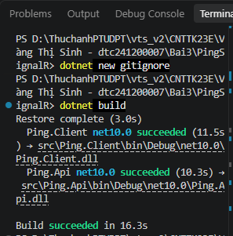
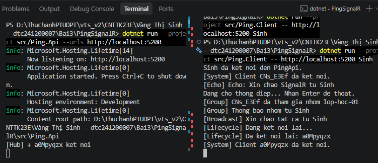
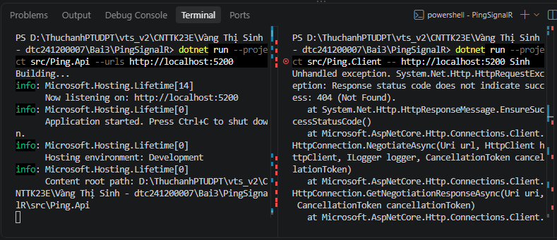

@"
# Bài 3: Giao tiếp thời gian thực với SignalR

## Thông tin sinh viên

- Họ và tên: Vàng Thị Sinh
- Mã sinh viên: dtc241200007
- Lớp: CNTT K23E
- Môn học: Phát triển ứng dụng phân tán
## Phần 1: Nhật ký thực hành PingSignalR

### Bước 1: Tạo solution, hai project, thêm gói SignalR Client và build

* **Thấy:** `dotnet build` báo `Build succeeded. 0 Warning(s), 0 Error(s)`. `Ping.Client.csproj` có `PackageReference Microsoft.AspNetCore.SignalR.Client` bản `10.0.15`.
* **Giải thích:** Máy chủ dùng ASP.NET Core đã tích hợp sẵn SignalR; chỉ máy khách console cần cài thêm gói `Microsoft.AspNetCore.SignalR.Client`.

### Bước 2: negotiate

* **Thấy:** `curl.exe -X POST "http://localhost:5200/hubs/ping/negotiate?negotiateVersion=1"` trả về `connectionId` và danh sách `availableTransports` gồm `WebSockets`, `ServerSentEvents`, `LongPolling`.
* **Giải thích:** Máy chủ thực hiện bước bắt tay negotiate và báo các cơ chế truyền tải được hỗ trợ (ưu tiên WebSocket, dự phòng SSE và Long Polling).

### Bước 3-4: Echo (Clients.Caller)

* **Thấy:** Máy chủ chạy ở cổng `5200`; máy khách `Sinh` kết nối thành công và in `[Echo] Echo: Xin chao SignalR tu Sinh`.
* **Giải thích:** Máy khách gọi phương thức `Echo` trên Hub, Hub nhận được và gọi ngược lại phương thức `EchoResponse` trên chính máy khách đó qua `Clients.Caller`.

### Bước 5-6: Broadcast, Groups và Vòng đời kết nối


* **Thấy:** Máy chủ in log `[Hub] + <ConnectionId> ket noi`, máy khách nhận được thông điệp nhóm `[Group]` và phát rộng `[Broadcast]`. Khi nhấn Enter, máy chủ ghi nhận sự kiện ngắt kết nối `[Hub] - <ConnectionId> ngat`.
* **Giải thích:** Hub quản lý danh sách kết nối theo nhóm (`Groups.AddToGroupAsync`) và hỗ trợ phát thông điệp tới toàn bộ client đang kết nối hoặc từng nhóm cụ thể.

---

## Bước 7: Ba thí nghiệm lỗi và bài học phân tán

### 1. Máy chủ chưa chạy

* **Thấy:** Lệnh `StartAsync` văng ngoại lệ `HttpRequestException: Connection refused`.
* **Giải thích:** Tính năng tự động kết nối lại (`WithAutomaticReconnect`) chỉ cứu các kết nối đã từng thành công rồi bị rớt mạng sau đó, chứ không cứu được kết nối từ đầu khi server chưa khởi động.

### 2. Sai đường dẫn Hub

* **Thấy:** Trả về mã lỗi `404 (Not Found)`.
* **Giải thích:** Lỗi xảy ra ngay ở bước bắt tay (`negotiate`). Đường dẫn URL ở Client phải khớp tuyệt đối với cấu hình `MapHub` trên Server.

### 3. Sai tên thông điệp

* **Thấy:** Chương trình chạy bình thường, không có lỗi đỏ nhưng hoàn toàn im lặng (không in ra dòng `[Echo]`).
* **Giải thích:** Trong lập trình hướng sự kiện, sai chuỗi tên phương thức khiến hệ thống không tìm thấy hàm xử lý phù hợp và bỏ qua âm thầm mà không bắn ngoại lệ.

## Tổng hợp Phần 1: Bốn phạm vi gửi trong SignalR

| Phạm vi | Ai nhận | Ví dụ thực tế (trong EduSubmit) |
| :--- | :--- | :--- |
| `Clients.All` | Mọi kết nối đang mở | Thông báo máy chủ sắp bảo trì hoặc có bài tập mới được đăng |
| `Clients.Caller` | Chỉ người vừa gọi hub | Xác nhận "đã đăng ký theo dõi lượt nộp" cho chính người gửi yêu cầu |
| `Clients.Group(tên)` | Thành viên của nhóm | Cập nhật trạng thái lượt nộp gửi riêng cho nhóm `submission:{id}` |
| `Clients.Client(id)` | Một `ConnectionId` cụ thể | Gửi thông báo riêng cho một phiên làm việc cụ thể (hiếm dùng) |

---

## Phần 2: Hệ thống nộp bài thời gian thực RealtimeSubmissionSystem

### 1. Kiến trúc hệ thống và Thiết kế API
- **Cấu trúc Solution:** Gồm 2 project chính là `Submission.RealtimeApi` (xử lý REST API, tác vụ nền và SignalR Hub) và `Submission.RealtimeClient` (mô phỏng máy khách tương tác).
- **REST API:**
  - `GET /`: Kiểm tra trạng thái máy chủ (`200 OK`).
  - `GET /api/assignments`: Lấy danh sách bài tập hiện có.
  - `POST /api/assignments/{id}/submissions`: Tạo lượt nộp bài mới, trả về mã `201 Created` kèm đường dẫn `Location` và kích hoạt tác vụ nền chấm bài không đồng bộ.
  - `GET /api/submissions/{id}`: Truy vấn trạng thái chi tiết của lượt nộp.

### 2. Tác vụ nền (Background Grading) và Đồng bộ luồng (Thread Safety)
- **Tác vụ nền (`SimulateGradingAsync`):** Mô phỏng quá trình chấm bài tự động với các mốc thời gian: chuyển từ `received` $\rightarrow$ `processing` (sau 1 giây) $\rightarrow$ `graded` (sau 3 giây tiếp theo).
- **An toàn luồng (`Thread Safety`):** Sử dụng đối tượng khóa `lock (submissionsLock)` kết hợp với `List<SubmissionDto>` để đảm bảo không xảy ra hiện tượng tranh chấp dữ liệu khi nhiều client cùng tạo và đọc trạng thái lượt nộp đồng thời.

### 3. SignalR Hub và Quản lý Nhóm (Groups)
- **Hub (`SubmissionHub`):** Cung cấp phương thức `WatchSubmission(string submissionId)` cho phép máy khách đăng ký tham gia vào một nhóm riêng biệt cho từng bài nộp (`submission:{id}`).
- **Thông báo thời gian thực:** Sử dụng `IHubContext<SubmissionHub>` trong tác vụ nền để đẩy thông điệp trạng thái tối thiểu (`SubmissionStatusMessage`) tới đúng nhóm (`Clients.Group(...)`) ngay khi trạng thái thay đổi.

### 4. Máy khách (RealtimeClient) và Mô hình Hai Kênh
- **Kênh 1 (REST):** Gửi yêu cầu tạo lượt nộp (`POST`) và chốt lại trạng thái cuối cùng (`GET`).
- **Kênh 2 (SignalR):** Lắng nghe sự kiện `SubmissionStatusChanged` qua Hub.
- **Cơ chế "Cái chuông" (`TaskCompletionSource`):** Sử dụng `TaskCompletionSource` để đồng bộ hóa luồng bất đồng bộ, đứng chờ sự kiện `graded` từ SignalR với cơ chế timeout an toàn (`Task.WhenAny`), đảm bảo tính chính xác theo quy tắc vàng: *Trạng thái cuối cùng luôn được xác thực lại từ REST*.

- Kết quả chạy máy khách (Đúng chuẩn 8 dòng)
Dưới đây là kết quả thực tế thu được trên màn hình console của máy khách (`Submission.RealtimeClient`):
```text
Đã chọn bài tập ID: 1 - Bài tập SignalR
Đã kết nối thành công tới SignalR Hub.
Trạng thái REST ban đầu: received
Đang theo dõi SignalR Group cho submission: 3bddd459-1784-4e07-9904-f7590297731c
[SignalR Realtime] Bài nộp 3bddd459-1784-4e07-9904-f7590297731c -> Trạng thái: PROCESSING
[SignalR Realtime] Bài nộp 3bddd459-1784-4e07-9904-f7590297731c -> Trạng thái: GRADED
==> TRẠNG THÁI CUỐI LẤY TỪ REST: GRADED (Cập nhật lúc: 10:25:41) 
```

### 5. Kiểm thử toàn diện với `requests.http` (9 ca)
- Xây dựng tệp `requests.http` tại thư mục gốc với các ca kiểm thử từ `GET /`, `GET danh sách`, `POST hợp lệ (201)`, `GET đọc lại trạng thái`, `POST thiếu dữ liệu (400)`, `POST bài 99 không tồn tại (404)`, `GET id rỗng (404)` cho đến bắt tay SignalR Hub (`negotiate -> 200`) và kiểm tra đường dẫn sai (`sai hub -> 404`).

### 6. Trả lời 3 câu hỏi đầu giờ

- **Câu hỏi 1:** Máy chủ có thể chủ động báo cho máy khách mà không cần máy khách hỏi không?[cite: 19]
  - *Trả lời:* Có thể, nếu máy khách mở sẵn một kết nối lâu dài (WebSocket qua SignalR)[cite: 81]. Máy chủ có thể chủ động gửi thông điệp thông qua phương thức `Clients.Group(...).SendAsync`, và sử dụng `IHubContext` khi cần gửi từ bên ngoài Hub.

- **Câu hỏi 2:** Đã có REST rồi, vì sao còn cần thêm SignalR? Hai thứ chia việc thế nào?
  - *Trả lời:* REST đảm nhiệm việc tạo lập và đọc tài nguyên với các mã trạng thái HTTP rõ ràng. Trong khi đó, SignalR đóng vai trò đẩy các thay đổi phát sinh ngay sau yêu cầu ban đầu theo thời gian thực. SignalR không thay thế REST mà cả hai bổ sung cho nhau để giải quyết trọn vẹn bài toán.

- **Câu hỏi 3:** Nếu đứt mạng đúng lúc máy chủ báo "đã chấm xong" thì sao?
  - *Trả lời:* Thông điệp thời gian thực đó sẽ bị lỡ. Khi đó, tính năng `WithAutomaticReconnect` sẽ giúp kết nối lại với một `ConnectionId` mới, máy khách tiến hành đăng ký theo dõi lại (`Watch`) và gọi thực hiện lệnh `GET /api/submissions/{id}` qua REST để lấy trạng thái mới nhất.
"@ | Set-Content -Encoding utf8 README.md