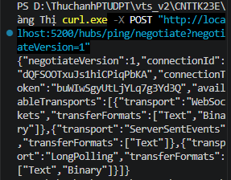
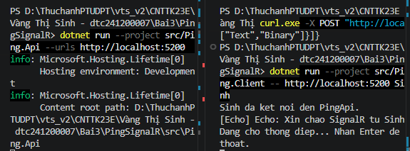
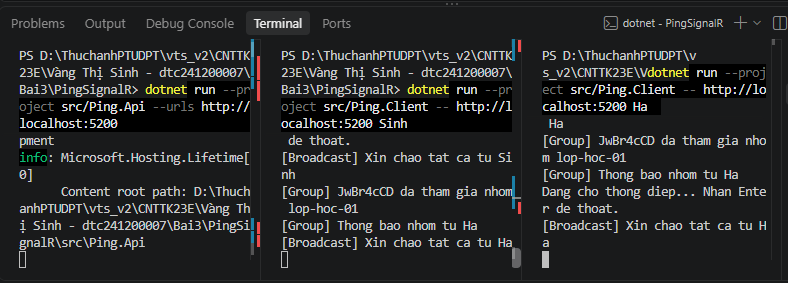
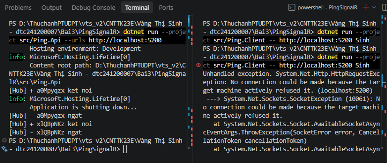
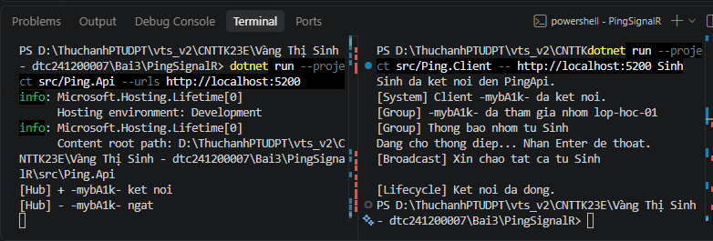

@"
# Bài 3: Giao tiếp thời gian thực với SignalR

## Phần 1: Nhật ký thực hành PingSignalR

### Bước 1: Tạo solution, hai project, thêm gói SignalR Client và build

* **Thấy:** `dotnet build` báo `Build succeeded. 0 Warning(s), 0 Error(s)`. `Ping.Client.csproj` có `PackageReference Microsoft.AspNetCore.SignalR.Client` bản `10.0.15`.
* **Giải thích:** Máy chủ dùng ASP.NET Core đã tích hợp sẵn SignalR; chỉ máy khách console cần cài thêm gói `Microsoft.AspNetCore.SignalR.Client`.

### Bước 2: negotiate

* **Thấy:** `curl.exe -X POST "http://localhost:5200/hubs/ping/negotiate?negotiateVersion=1"` trả về `connectionId` và danh sách `availableTransports` gồm `WebSockets`, `ServerSentEvents`, `LongPolling`.
* **Giải thích:** Máy chủ thực hiện bước bắt tay negotiate và báo các cơ chế truyền tải được hỗ trợ (ưu tiên WebSocket, dự phòng SSE và Long Polling).

### Bước 3-4: Echo (Clients.Caller)

* **Thấy:** Máy chủ chạy ở cổng `5200`; máy khách `Sinh` kết nối thành công và in `[Echo] Echo: Xin chao SignalR tu Sinh`.
* **Giải thích:** Máy khách gọi phương thức `Echo` trên Hub, Hub nhận được và gọi ngược lại phương thức `EchoResponse` trên chính máy khách đó qua `Clients.Caller`.

### Bước 5-6: Broadcast, Groups và Vòng đời kết nối

* **Thấy:** Máy chủ in log `[Hub] + <ConnectionId> ket noi`, máy khách nhận được thông điệp nhóm `[Group]` và phát rộng `[Broadcast]`. Khi nhấn Enter, máy chủ ghi nhận sự kiện ngắt kết nối `[Hub] - <ConnectionId> ngat`.
* **Giải thích:** Hub quản lý danh sách kết nối theo nhóm (`Groups.AddToGroupAsync`) và hỗ trợ phát thông điệp tới toàn bộ client đang kết nối hoặc từng nhóm cụ thể.

---

## Bước 7: Ba thí nghiệm lỗi và bài học phân tán

### 1. Máy chủ chưa chạy

* **Thấy:** Lệnh `StartAsync` văng ngoại lệ `HttpRequestException: Connection refused`.
* **Giải thích:** Tính năng tự động kết nối lại (`WithAutomaticReconnect`) chỉ cứu các kết nối đã từng thành công rồi bị rớt mạng sau đó, chứ không cứu được kết nối từ đầu khi server chưa khởi động.

### 2. Sai đường dẫn Hub

* **Thấy:** Trả về mã lỗi `404 (Not Found)`.
* **Giải thích:** Lỗi xảy ra ngay ở bước bắt tay (`negotiate`). Đường dẫn URL ở Client phải khớp tuyệt đối với cấu hình `MapHub` trên Server.

### 3. Sai tên thông điệp

* **Thấy:** Chương trình chạy bình thường, không có lỗi đỏ nhưng hoàn toàn im lặng (không in ra dòng `[Echo]`).
* **Giải thích:** Trong lập trình hướng sự kiện, sai chuỗi tên phương thức khiến hệ thống không tìm thấy hàm xử lý phù hợp và bỏ qua âm thầm mà không bắn ngoại lệ.

## Tổng hợp Phần 1: Bốn phạm vi gửi trong SignalR

| Phạm vi | Ai nhận | Ví dụ thực tế (trong EduSubmit) |
| :--- | :--- | :--- |
| `Clients.All` | Mọi kết nối đang mở | Thông báo máy chủ sắp bảo trì hoặc có bài tập mới được đăng |
| `Clients.Caller` | Chỉ người vừa gọi hub | Xác nhận "đã đăng ký theo dõi lượt nộp" cho chính người gửi yêu cầu |
| `Clients.Group(tên)` | Thành viên của nhóm | Cập nhật trạng thái lượt nộp gửi riêng cho nhóm `submission:{id}` |
| `Clients.Client(id)` | Một `ConnectionId` cụ thể | Gửi thông báo riêng cho một phiên làm việc cụ thể (hiếm dùng) |
"@ | Set-Content -Encoding utf8 README.md