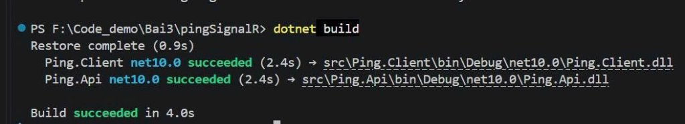
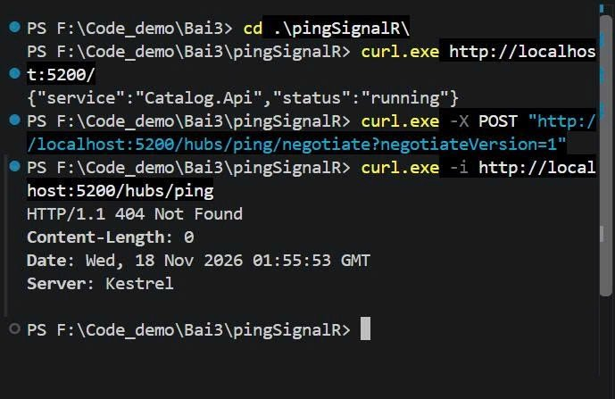
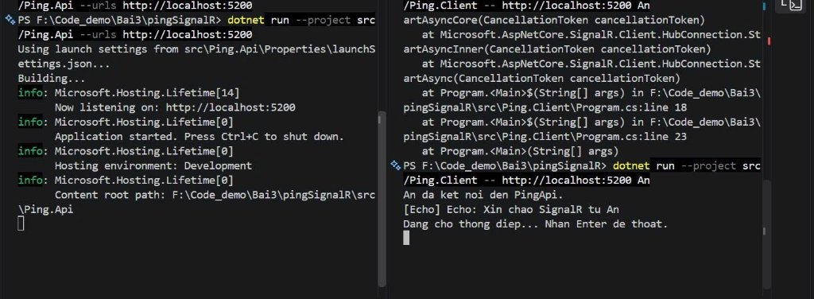
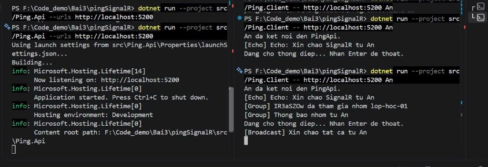
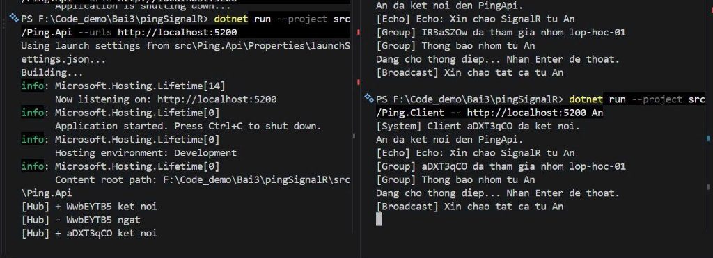
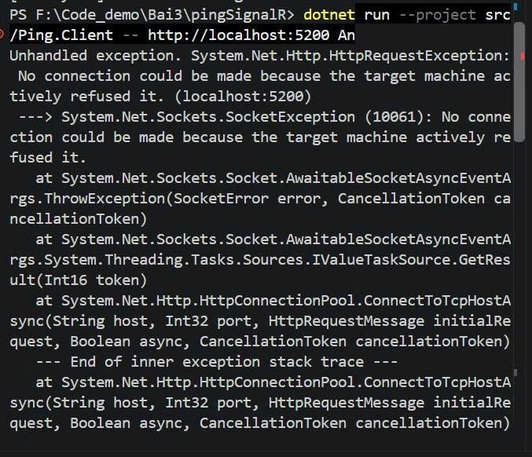

# BÀI 3: GIAO TIẾP THỜI GIAN THỰC VỚI SIGNALR

**Học phần:** Phát triển ứng dụng phân tán  
**Công nghệ:** C# 10 / .NET 10, ASP.NET Core Minimal API, Microsoft.AspNetCore.SignalR, SignalR .NET Client, RESTful API  
**Vị trí dự án:** `F:\Code_demo\Bai3\pingSignalR`  

---

## MỤC LỤC
1. [Phần I: Giới thiệu tổng quan](#phần-i-giới-thiệu-tổng-quan)
2. [Phần II: Phần A – PingSignalR](#phần-ii-phần-a--pingsignalr)
3. [Phần III: Phần B – EduSubmit Realtime (Hệ thống nộp bài thời gian thực)](#phần-iii-phần-b--edusubmit-realtime)
4. [Phần IV: Kết quả kiểm thử thực tế](#phần-iv-kết-quả-kiểm-thử-thực-tế)
5. [Phần V: Trả lời 3 câu hỏi nghiên cứu đầu giờ](#phần-v-trả-lời-3-câu-hỏi-nghiên-cứu-đầu-giờ)
6. [Phần VI: Hướng dẫn hình ảnh minh chứng](#phần-vi-hướng-dẫn-hình-ảnh-minh-chứng)
7. [Phần VII: Danh mục kiểm tra nộp bài (Checklist Slide 63)](#phần-vii-danh-mục-kiểm-tra-nộp-bài-checklist-slide-63)

---

## PHẦN I: GIỚI THIỆU TỔNG QUAN

### 1. Mục tiêu bài thực hành
- Làm chủ nguyên lý giao tiếp thời gian thực hai chiều (Full-duplex Real-time Communication) giữa Máy chủ (Server) và Máy khách (Client) thay thế cơ chế kéo dữ liệu truyền thống (Polling).
- Triển khai và hiểu sâu cơ chế hoạt động của thư viện **ASP.NET Core SignalR**: Khái niệm Hub, Persistent Connection, Transport Negotiation (WebSockets, SSE, Long Polling), RPC (Remote Procedure Call), và phân nhóm kết nối (Groups).
- Xây dựng mô hình kiến trúc phân tán kết hợp hài hòa giữa **RESTful API** (quản lý trạng thái và nguồn sự thật - Source of Truth) và **SignalR** (thông báo sự kiện thời gian thực - Transient Event Notification).

### 2. Cấu trúc thư mục dự án

```
F:\Code_demo\Bai3\pingSignalR\
│
├── PingSignalR.slnx                           # Solution phần A (PingSignalR)
├── .gitignore                                 # Loại trừ bin, obj, thư mục tạm
├── README.md                                  # Báo cáo tổng hợp toàn bộ Bài 3
│
├── src/                                       # Mã nguồn Phần A
│   ├── Ping.Api/                              # Dự án Server Minimal API + SignalR Hub
│   │   ├── Properties/launchSettings.json
│   │   ├── appsettings.json
│   │   ├── Ping.Api.csproj
│   │   └── Program.cs                         # Khai báo PingHub, OnConnected, OnDisconnected
│   └── Ping.Client/                           # Dự án Client Console
│       ├── Ping.Client.csproj
│       └── Program.cs                         # HubConnection, Lifecycle, Invoke RPC
│
└── RealtimeSubmissionSystem/                  # Mã nguồn Phần B (EduSubmit Realtime)
    ├── RealtimeSubmissionSystem.slnx          # Solution độc lập phần B
    ├── .gitignore                             # Cấu hình git riêng cho Phần B
    ├── requests.http                          # 9 ca kiểm thử REST API & Negotiate Hub
    └── src/
        ├── Submission.RealtimeApi/            # Server REST API + SubmissionHub
        │   ├── Properties/launchSettings.json # Cấu hình cổng 5000 chuẩn
        │   ├── Submission.RealtimeApi.csproj
        │   └── Program.cs                     # API nộp bài + WatchSubmission + Background Worker
        └── Submission.RealtimeClient/         # Client Console tích hợp REST + SignalR
            ├── Submission.RealtimeClient.csproj
            └── Program.cs                     # Luồng 8 bước tự động theo dõi chấm bài
```

---

## PHẦN II: PHẦN A – PINGSIGNALR

### 1. Mô tả chức năng và mục đích
Phần A xây dựng một hệ thống kiểm tra và làm quen các cơ chế cơ bản nhất của SignalR:
- Thiết lập Hub máy chủ (`PingHub`) tại địa chỉ `/hubs/ping`.
- Máy khách kết nối thông qua `HubConnectionBuilder`, thiết lập lắng nghe các sự kiện và gọi các phương thức từ xa (RPC) lên máy chủ.

### 2. Hướng dẫn biên dịch và khởi chạy

#### Bước 1: Biên dịch Solution
```bash
dotnet build "F:\Code_demo\Bai3\pingSignalR\PingSignalR.slnx"
```



#### Bước 2: Khởi chạy Server Ping.Api
Chạy server trên cổng chuẩn `http://localhost:5200`:
```bash
dotnet run --project "F:\Code_demo\Bai3\pingSignalR\src\Ping.Api" --urls "http://localhost:5200"
```
*Kiểm tra sức khỏe server và đàm phán Hub qua curl:*
```bash
curl.exe http://localhost:5200/
curl.exe -X POST "http://localhost:5200/hubs/ping/negotiate?negotiateVersion=1"
```



#### Bước 3 & Bước 4: Khởi chạy Máy khách Ping.Client và kiểm tra Echo
Mở một cửa sổ dòng lệnh khác và chạy:
```bash
dotnet run --project "F:\Code_demo\Bai3\pingSignalR\src\Ping.Client" -- "http://localhost:5200" "An"
```



### 3. Các cơ chế truyền tin đã cài đặt trong PingHub

| Kiểu truyền tin | Phương thức phía Server | Mã phía Server | Hành vi |
| :--- | :--- | :--- | :--- |
| **Echo** | `Echo(string message)` | `await Clients.Caller.SendAsync("EchoResponse", $"Echo: {message}");` | Chỉ gửi phản hồi về cho chính kết nối đã gọi (Caller). |
| **Broadcast** | `Broadcast(string message)` | `await Clients.All.SendAsync("BroadcastMessage", message);` | Phát thông điệp đến tất cả các Client đang kết nối tới Hub. |
| **Group** | `JoinGroup(groupName)`<br>`SendToGroup(groupName, message)` | `await Groups.AddToGroupAsync(Context.ConnectionId, groupName);`<br>`await Clients.Group(groupName).SendAsync("GroupMessage", message);` | Chỉ gửi thông điệp cho các Client đã tham gia vào nhóm `groupName` tương ứng. |



### 4. Quản lý vòng đời kết nối (Connection Lifecycle)
- **Phía Server (Hub):**
  - Ghi đè `OnConnectedAsync()`: Ghi log kết nối, phát thông báo hệ thống `SystemMessage` cho toàn bộ các Client khác biết có thành viên mới gia nhập.
  - Ghi đè `OnDisconnectedAsync(Exception? ex)`: Ghi nhận sự kiện ngắt kết nối và thông báo cho hệ thống.
- **Phía Client:**
  - Bật tính năng tự động kết nối lại bằng `.WithAutomaticReconnect()`.
  - Bắt các sự kiện vòng đời:
    - `connection.Reconnecting`: Kích hoạt khi mất kết nối đột ngột và đang thử kết nối lại.
    - `connection.Reconnected`: Kích hoạt khi kết nối lại thành công (kèm theo `newConnectionId`).
    - `connection.Closed`: Kích hoạt khi kết nối bị đóng hoàn toàn (do hết lượt thử hoặc đóng chủ động).



### 5. Ba lỗi kinh điển thường gặp ở Bước 7 (Slide 44-46) và bài học

1. **Lỗi 1: Quên cấu hình `app.MapHub`**
   - *Triệu chứng:* Server biên dịch bình thường nhưng Client kết nối thất bại với mã lỗi HTTP `404 Not Found` ngay bước đàm phán `POST /hubs/ping/negotiate`.
   - *Nguyên nhân:* Trong ASP.NET Core Minimal API, nếu chỉ gọi `builder.Services.AddSignalR()` mà quên `app.MapHub<PingHub>("/hubs/ping")` trước `app.Run()`, route của Hub sẽ không được đăng ký vào routing table.
   - *Khắc phục:* Bắt buộc thêm `app.MapHub<PingHub>("/hubs/ping");` trước `app.Run();`.

2. **Lỗi 2: Đăng ký `connection.On` SAU khi gọi `connection.StartAsync()`**
   - *Triệu chứng:* Client không nhận được phản hồi ban đầu từ Server mặc dù Server đã push.
   - *Nguyên nhân:* Xảy ra tình trạng Race Condition (Tranh chấp thời gian). Khi gọi `StartAsync()`, kết nối mở ngay lập tức. Nếu Server bắn sự kiện (như `OnConnectedAsync` phát tin nhắn) trước khi dòng lệnh `connection.On(...)` được thực thi ở Client, thông điệp đó bị bỏ rơi vì chưa có handler nào được đăng ký.
   - *Khắc phục:* Luôn luôn khai báo tất cả các sự kiện `connection.On<...>(...)` và các handler vòng đời TRƯỚC khi gọi `await connection.StartAsync()`.

3. **Lỗi 3: Khởi động Client khi Server chưa chạy (hoặc đứt mạng ngay từ đầu)**
   - *Triệu chứng:* Client sập ngay lập tức với `System.Net.Http.HttpRequestException: No connection could be made because the target machine actively refused it.`
   - *Nguyên nhân cốt lõi:* `.WithAutomaticReconnect()` CHỈ tự động kết nối lại khi đã kết nối thành công ít nhất một lần trước đó. Nếu ngay lần đầu tiên gọi `StartAsync()` mà Server chưa bật, SignalR Client sẽ ném exception ra ngoài chứ không tự retry.
   - *Khắc phục:* Phải bật Server trước khi chạy Client, hoặc bọc lời gọi `StartAsync()` trong vòng lặp `try...catch` kèm độ trễ để tự thử kết nối lại ở tầng ứng dụng.



---

## PHẦN III: PHẦN B – EDUSUBMIT REALTIME

### 1. Kiến trúc giải pháp kết hợp RESTful API & SignalR

```
┌─────────────────────────────────────────────────────────────────────────────────┐
│                          Submission.RealtimeClient                              │
│                                                                                 │
│   1. GET /api/assignments (REST)               4. WatchSubmission (SignalR RPC) │
│   2. POST /api/assignments/1/submissions (REST)│                                │
│   7. GET /api/submissions/{id} (REST)          5, 6. On("SubmissionStatusChanged")│
└───────────────┬───────────────────────────────────────────────▲─────────────────┘
                │                                               │
           HTTP Request                                    SignalR Push
        (REST: Cổng 5000)                                (WebSocket / SSE)
                │                                               │
┌───────────────▼───────────────────────────────────────────────┴─────────────────┐
│                           Submission.RealtimeApi                                │
│                                                                                 │
│  ┌───────────────────────┐                    ┌───────────────────────────────┐ │
│  │   REST Controllers    │                    │        SubmissionHub          │ │
│  │   - GET Assignments   │                    │   - WatchSubmission(id)       │ │
│  │   - POST Submissions  │                    │     => Join Group             │ │
│  │   - GET Submissions   │                    │        "submission:{id}"      │ │
│  └───────────┬───────────┘                    └───────────────▲───────────────┘ │
│              │                                                │                 │
│              ▼                                                │                 │
│    Tạo bản ghi "received"                                     │                 │
│    và kích hoạt Worker ──────────────┐                        │                 │
│                                      │                        │                 │
│                        ┌─────────────▼───────────────┐        │                 │
│                        │     Background Worker       │        │                 │
│                        │   - Sau 1s: "processing"    ├────────┤                 │
│                        │   - Sau 3s: "graded"        ├────────┘                 │
│                        │   - Cập nhật List<T>        │ (Gửi thông báo tới đúng  │
│                        └─────────────────────────────┘  nhóm submission:{id})   │
└─────────────────────────────────────────────────────────────────────────────────┘
```

### 2. Bảng đặc tả các RESTful API Endpoints (Cổng 5000)

| STT | Phương thức | URI | Trạng thái phản hồi | Mô tả chức năng |
| :---: | :--- | :--- | :---: | :--- |
| 1 | `GET` | `/` | `200 OK` | Kiểm tra trạng thái máy chủ (`service: "Submission.RealtimeApi"`). |
| 2 | `GET` | `/api/assignments` | `200 OK` | Lấy danh sách tất cả bài tập đang có trên hệ thống. |
| 3 | `GET` | `/api/assignments/{assignmentId:int}` | `200 OK` / `404 Not Found` | Lấy thông tin chi tiết một bài tập theo mã ID. |
| 4 | `POST` | `/api/assignments/{assignmentId:int}/submissions` | `201 Created` / `400 Bad Request` / `404 Not Found` | Nộp bài tập. Trả về `Location: /api/submissions/{id}`, trạng thái ban đầu `received`, kích hoạt luồng chấm nền. |
| 5 | `GET` | `/api/submissions/{submissionId:guid}` | `200 OK` / `404 Not Found` | **Nguồn sự thật (Source of Truth):** Đọc lại toàn bộ thông tin và trạng thái mới nhất của bài nộp. |

### 3. Thiết kế SignalR Hub (`SubmissionHub`) và cơ chế Group Isolation
- **Hub Endpoint:** `/hubs/submissions`
- **Phương thức Hub:**
  ```csharp
  public async Task WatchSubmission(string submissionId)
  {
      Console.WriteLine($"[Hub] {Context.ConnectionId[..8]} theo doi submission:{submissionId}");
      await Groups.AddToGroupAsync(Context.ConnectionId, $"submission:{submissionId}");
  }
  ```
- **Ý nghĩa của việc phân nhóm (Group):**
  - Mỗi bài nộp có một mã định danh duy nhất (`Guid`).
  - Khi Client nộp bài xong, Client gọi RPC `WatchSubmission(id)` để yêu cầu Server thêm kết nối hiện tại vào nhóm `submission:{id}`.
  - Khi tác vụ nền chuyển trạng thái sang `processing` hoặc `graded`, Server sử dụng:
    ```csharp
    await hub.Clients.Group($"submission:{id}").SendAsync("SubmissionStatusChanged", message);
    ```
  - **Lợi ích kiến trúc:** Đảm bảo tính bảo mật và tối ưu tài nguyên (Group Isolation). Sinh viên A chỉ nhận được thông báo tiến độ bài nộp của chính mình, hoàn toàn không bị làm phiền hoặc lộ thông tin với bài nộp của Sinh viên B.

### 4. Luồng xử lý nền (Background Grading Simulation)
1. Khi có `POST /api/assignments/{id}/submissions`, Server lưu bài nộp vào bộ nhớ với trạng thái `received`.
2. Server kích hoạt tác vụ nền bất đồng bộ không chặn (Fire-and-forget background task):
   `_ = SimulateGradingAsync(submission.Id, submissions, submissionsLock, hubContext);`
3. Sau 1 giây (`Task.Delay(1000)`): Cập nhật trạng thái trong RAM thành `processing` và bắn sự kiện qua Hub tới nhóm `submission:{id}`.
4. Sau tiếp 2 giây (`Task.Delay(2000)`): Cập nhật trạng thái thành `graded` và tiếp tục bắn sự kiện qua Hub tới nhóm `submission:{id}`.

### 5. So sánh vai trò giữa RESTful API và SignalR

| Tiêu chí | RESTful API | SignalR |
| :--- | :--- | :--- |
| **Bản chất giao tiếp** | Kéo dữ liệu (Pull / Request–Response), Stateless. | Đẩy dữ liệu (Push / Full-Duplex), Stateful (Persistent Connection). |
| **Vai trò trong hệ thống** | **Nguồn sự thật (Source of Truth):** Quản lý lưu trữ tài nguyên, CRUD bài tập và bài nộp, xác thực dữ liệu đầu vào. | **Kênh sự kiện (Transient Event Channel):** Báo hiệu thời gian thực khi trạng thái thay đổi để Client cập nhật UI ngay lập tức. |
| **Tính bền vững** | Bền vững: Dữ liệu được lưu trữ, Client có thể truy vấn lại bất kỳ lúc nào qua `GET`. | Tạm thời: Thông báo phát đi tại một thời điểm, nếu Client không lắng nghe tại thời điểm đó thì sẽ trôi qua. |
| **Khả năng phục hồi** | Tuyệt vời: Nếu mạng gián đoạn, Client chỉ cần gọi lại GET để lấy trạng thái mới nhất. | Phụ thuộc: Cần kết hợp REST để đồng bộ lại sau khi kết nối lại thành công. |

---

## PHẦN IV: KẾT QUẢ KIỂM THỬ THỰC TẾ

### 1. Kiểm thử 9 ca với `requests.http`
File `RealtimeSubmissionSystem/requests.http` được thực thi kiểm thử trực tiếp trên cổng `http://localhost:5000`:

| Ca kiểm thử | Yêu cầu (Request) | Mã kỳ vọng | Mã thực tế | Kết quả Body / Chi tiết thực tế | Đánh giá |
| :---: | :--- | :---: | :---: | :--- | :---: |
| **#1** | `GET /` | `200 OK` | `200 OK` | `{"service":"Submission.RealtimeApi","status":"running"}` | **PASS** |
| **#2** | `GET /api/assignments` | `200 OK` | `200 OK` | Trả về danh sách 2 bài tập mẫu (`id: 1, 2`, `isOpen: true`). | **PASS** |
| **#3** | `POST /api/assignments/1/submissions` (Hợp lệ) | `201 Created` | `201 Created` | Header `Location: /api/submissions/{guid}`, Body có `status: "received"`. | **PASS** |
| **#4** | `GET /api/submissions/{id}` (Kiểm tra tiến trình) | `200 OK` | `200 OK` | Ngay sau POST: `received`<br>Sau 1.2s: `processing`<br>Sau 3.4s: `graded`. | **PASS** |
| **#5** | `POST /api/assignments/1/submissions` (Body rỗng `{}`) | `400 Bad Request` | `400 Bad Request` | `{"code":"INVALID_SUBMISSION","message":"Ma sinh vien va dia chi repository khong duoc de trong."}` | **PASS** |
| **#6** | `POST /api/assignments/99/submissions` | `404 Not Found` | `404 Not Found` | `{"code":"ASSIGNMENT_NOT_FOUND","message":"Khong tim thay bai tap voi ID = 99."}` | **PASS** |
| **#7** | `GET /api/submissions/00000000-0000-0000-0000-000000000000` | `404 Not Found` | `404 Not Found` | `{"code":"SUBMISSION_NOT_FOUND","message":"Khong tim thay luot nop voi ID = ..."}` | **PASS** |
| **#8** | `POST /hubs/submissions/negotiate?negotiateVersion=1` | `200 OK` | `200 OK` | Trả về `connectionId`, `connectionToken`, và danh sách transports (`WebSockets`, `ServerSentEvents`, `LongPolling`). | **PASS** |
| **#9** | `POST /hub/submissions/negotiate?negotiateVersion=1` (Sai URL) | `404 Not Found` | `404 Not Found` | Trả về 404 do sai đường dẫn Hub chuẩn (`/hubs/...`). | **PASS** |

### 2. Kết quả chạy thực tế Máy khách `Submission.RealtimeClient`
Lệnh thực thi:
```bash
dotnet run --project "F:\Code_demo\Bai3\pingSignalR\RealtimeSubmissionSystem\src\Submission.RealtimeClient" -- "http://localhost:5000" "SV001"
```
**Nhật ký Console thực tế ghi nhận đầy đủ 8 dòng theo tiêu chuẩn Slide 57:**
```text
Da ket noi SignalR.
Chon bai tap: 1 - Bai tap SignalR
Da tao luot nop: 7cc61f4c-5b84-4139-a659-323c34af7b96
Trang thai REST ban dau: received
Dang cho thong bao trang thai tu may chu...
Thong bao SignalR: 7cc61f4c-5b84-4139-a659-323c34af7b96 -> processing luc 02:44:29
Thong bao SignalR: 7cc61f4c-5b84-4139-a659-323c34af7b96 -> graded luc 02:44:31
Trang thai doc lai bang REST: graded
```

### 3. Kết quả 5 thí nghiệm phân tán (Slide 58-59)

#### Thí nghiệm 1: Hai Client chạy song song (SV001 và SV002)
- **Mục đích:** Kiểm chứng tính cô lập thông tin của cơ chế nhóm SignalR (`Group`).
- **Thực nghiệm:** Khởi chạy đồng thời 2 tiến trình Client nộp 2 bài tập khác nhau.
- **Log thực tế ghi nhận:**
  ```text
  --- KET QUA CLIENT 1 (SV001) ---
  Da ket noi SignalR.
  Chon bai tap: 1 - Bai tap SignalR
  Da tao luot nop: f103c31c-a8df-4533-ad6f-86a8b53545dd
  Trang thai REST ban dau: received
  Dang cho thong bao trang thai tu may chu...
  Thong bao SignalR: f103c31c-a8df-4533-ad6f-86a8b53545dd -> processing luc 02:45:03
  Thong bao SignalR: f103c31c-a8df-4533-ad6f-86a8b53545dd -> graded luc 02:45:05
  Trang thai doc lai bang REST: graded

  --- KET QUA CLIENT 2 (SV002) ---
  Da ket noi SignalR.
  Chon bai tap: 1 - Bai tap SignalR
  Da tao luot nop: 9ad0d08d-a669-4874-89a8-8046595ad5ab
  Trang thai REST ban dau: received
  Dang cho thong bao trang thai tu may chu...
  Thong bao SignalR: 9ad0d08d-a669-4874-89a8-8046595ad5ab -> processing luc 02:45:03
  Thong bao SignalR: 9ad0d08d-a669-4874-89a8-8046595ad5ab -> graded luc 02:45:05
  Trang thai doc lai bang REST: graded
  ```
- **Bài học:** Mỗi Client chỉ nhận đúng sự kiện thuộc nhóm bài nộp của mình. Không có sự rò rỉ hay chồng chéo dữ liệu giữa các sinh viên.

#### Thí nghiệm 2: Server tắt khi Client khởi động
- **Thực nghiệm:** Chạy Client trỏ tới cổng không có Server (`http://localhost:5999`).
- **Kết quả thực tế:**
  Client ném ngoại lệ ngay tại lệnh `await hubConnection.StartAsync()`:
  `System.Net.Http.HttpRequestException: No connection could be made because the target machine actively refused it. (localhost:5999) ---> SocketException (10061)`
- **Bài học:** `.WithAutomaticReconnect()` không giải quyết được lỗi kết nối lần đầu. Nếu Server không hoạt động khi Client mở lên, tiến trình sẽ crash trừ khi có xử lý ngoại lệ ở tầng gọi hàm.

#### Thí nghiệm 3: Cấu hình sai Hub URL
- **Thực nghiệm:** Kết nối tới `/hub/submissions` thay vì `/hubs/submissions`.
- **Kết quả thực tế:** Bước đàm phán `POST /hub/submissions/negotiate` nhận mã lỗi `404 Not Found`. Client ném lỗi `HttpRequestException: Response status code does not indicate success: 404 (Not Found)`.
- **Bài học:** URL của Hub phải khớp chính xác tuyệt đối giữa `app.MapHub<T>("/route")` ở Server và `.WithUrl(".../route")` ở Client.

#### Thí nghiệm 4: Sai tên sự kiện (Event Name Mismatch)
- **Thực nghiệm:** Client đăng ký `connection.On("SubmissionStatusChange", ...)` (thiếu chữ `d`).
- **Kết quả thực tế:** Server vẫn gửi `SubmissionStatusChanged`, nhưng do không khớp chuỗi định danh sự kiện, Client hoàn toàn im lặng, không có hàm nào được kích hoạt. Sau 10 giây chờ, TaskCompletionSource kích hoạt timeout: *"Qua thoi gian cho thong bao graded."*
- **Bài học:** Tên sự kiện trong SignalR là chuỗi định danh lỏng (string-based RPC). Cần dùng hằng số (`const string`) dùng chung hoặc thư viện trung gian để tránh gõ sai chính tả.

#### Thí nghiệm 5: Gọi `WatchSubmission` trễ 4 giây
- **Thực nghiệm:** Cho Client tạm dừng 4 giây sau khi nộp bài rồi mới gọi `WatchSubmission(id)`.
- **Kết quả thực tế:** Server đã hoàn thành chấm và push xong `processing` (ở giây 1) và `graded` (ở giây 3). Khi Client gia nhập nhóm ở giây thứ 4, không nhận được bất kỳ thông báo SignalR nào (do SignalR không lưu trữ tin nhắn cũ). TUY NHIÊN, khi Client gọi `GET /api/submissions/{id}`, REST API vẫn trả về trạng thái chốt hạ là `graded`.
- **Bài học:** Khẳng định nguyên lý thiết kế: SignalR chỉ là kênh thông báo tức thời (Ephemeral Push), còn REST API mới là **Nguồn sự thật** (Source of Truth). Luôn kết hợp đọc lại bằng REST để đảm bảo dữ liệu toàn vẹn.

---

## PHẦN V: TRẢ LỜI 3 CÂU HỎI NGHIÊN CỨU ĐẦU GIỜ

### Câu hỏi 1: Làm thế nào máy chủ có thể chủ động gửi thông báo cho client mà client không cần liên tục gửi request hỏi?

**Trả lời:**
- Trong mô hình truyền thống (HTTP Polling), Client phải liên tục gửi request định kỳ (Short Polling) hoặc giữ kết nối chờ phản hồi (Long Polling) để thăm dò xem có dữ liệu mới hay không. Cách tiếp cận này lãng phí băng thông (HTTP headers lặp lại), tăng tải xử lý cho máy chủ và có độ trễ lớn.
- Để máy chủ có thể chủ động gửi thông điệp xuống máy khách mà không cần máy khách hỏi, cần một kết nối duy trì liên tục (**Persistent Connection**):
  1. **WebSockets (Giao thức tối ưu nhất):** Sau khi nâng cấp (Handshake) từ HTTP/1.1 thông qua header `Upgrade: websocket`, kết nối TCP hai chiều toàn phần (Full-Duplex) được thiết lập. Cả Client và Server đều có thể gửi các khung dữ liệu (frames) siêu nhẹ cho nhau bất kỳ lúc nào mà không cần tạo lại kết nối hay gửi lại HTTP header.
  2. **Server-Sent Events (SSE):** Máy chủ giữ kết nối HTTP mở với header `Content-Type: text/event-stream` và liên tục đẩy luồng dữ liệu (Stream) dạng văn bản một chiều xuống cho Client.
- **Thư viện ASP.NET Core SignalR** tự động trừu tượng hóa các tầng giao vận này. Khi khởi động, SignalR thực hiện một bước đàm phán (**Negotiation**) để tự động chọn giao thức tốt nhất có thể: Ưu tiên số 1 là **WebSockets**, nếu môi trường mạng/proxy không hỗ trợ sẽ tự động chuyển xuống **Server-Sent Events**, và phương án dự phòng cuối cùng là **Long Polling**. Nhờ đó, lập trình viên chỉ cần gọi `Clients.Group(...).SendAsync(...)` là máy chủ đã có thể chủ động phát dữ liệu tới đúng Client ngay khi sự kiện phát sinh.

---

### Câu hỏi 2: Trong một hệ thống kết hợp REST và SignalR, công việc nào nên giao cho REST và công việc nào nên giao cho SignalR?

**Trả lời:**
Sự kết hợp giữa REST và SignalR là một kiến trúc kinh điển trong các hệ thống phân tán hiện đại, phân định rạch ròi theo nguyên lý trách nhiệm:

| Nhiệm vụ | Giao cho | Lý do kỹ thuật |
| :--- | :---: | :--- |
| **Tạo tài nguyên mới** (Nộp bài, Đăng ký, Đặt hàng) | **REST API** (`POST`) | Yêu cầu xác thực nghiệp vụ, kiểm tra hợp lệ dữ liệu chặt chẽ, tuân thủ quy chuẩn mã lỗi HTTP (`201`, `400`, `404`), trả về URI tài nguyên qua header `Location`. |
| **Truy vấn trạng thái, danh sách** (Xem bài tập, xem lịch sử) | **REST API** (`GET`) | Dễ dàng áp dụng bộ nhớ đệm (Caching, CDN), tính chất Idempotent/Safe, máy chủ không cần duy trì kết nối trạng thái liên tục (Stateless). |
| **Nguồn sự thật chính thống** (Source of Truth) | **REST API** | Trạng thái tài nguyên được ghi nhận lâu dài vào cơ sở dữ liệu. Client có thể truy vấn lại bất cứ lúc nào. |
| **Thông báo sự kiện tức thời** (Bắt đầu chấm, Đã có điểm, Đổi trạng thái) | **SignalR** (Push) | Tiết kiệm băng thông, độ trễ cực thấp (gần 0ms), máy chủ chủ động báo ngay khi tiến trình nền hoàn tất mà Client không phải thăm dò. |
| **Tương tác hai chiều tần suất cao** (Chat, Tọa độ xe, Bảng vẽ số) | **SignalR** (RPC) | Tận dụng kênh kết nối Persistent TCP của WebSocket, loại bỏ chi phí bắt tay TCP và gửi HTTP header liên tục. |

*Tóm lại:* **REST** giữ vai trò xử lý nghiệp vụ, quản lý dữ liệu và là Nguồn sự thật; còn **SignalR** đóng vai trò là hệ thống "chuông báo động" thời gian thực phát tín hiệu cho Client biết khi nào tài nguyên đã có sự thay đổi.

---

### Câu hỏi 3: Nếu kết nối SignalR bị đứt đúng lúc máy chủ gửi thông báo "graded", client sẽ xử lý như thế nào để không bị mất thông tin?

**Trả lời:**
Do bản chất của SignalR là kênh truyền thông báo tạm thời (Transient Push Notification), SignalR không lưu trữ hàng đợi tin nhắn (Message Backlog) cho các Client đang ngoại tuyến. Nếu kết nối mạng bị rớt đúng thời điểm Server gửi thông báo `graded`, thông báo này sẽ bị mất trên đường truyền SignalR.

Để hệ thống hoạt động tin cậy (Fault-tolerant), kiến trúc cần áp dụng chiến lược kết hợp đa tầng:
1. **Tự động kết nối lại (Automatic Reconnect):**
   - Phía Client sử dụng cấu hình `.WithAutomaticReconnect()`. Khi mất kết nối, Client sẽ tự động cố gắng kết nối lại tới Server theo các khoảng thời gian tăng dần (mặc định: 0s, 2s, 10s, 30s).
2. **Kích hoạt cơ chế Re-sync từ REST API sau khi kết nối lại:**
   - Client đăng ký sự kiện `connection.Reconnected += async (newId) => { ... }`.
   - Ngay khi kết nối SignalR được phục hồi, Client lập tức thực hiện gọi một yêu cầu HTTP `GET /api/submissions/{id}` về REST API. Do REST API là **Nguồn sự thật** (Source of Truth) lưu trữ trạng thái chốt hạ cuối cùng của bài nộp trong hệ thống, Client sẽ ngay lập tức đọc được trạng thái `graded` và số điểm thực tế, bù đắp hoàn toàn cho thông báo SignalR bị thất lạc trong thời gian ngắt kết nối.
3. **Cơ chế Timeout dự phòng (Fallback Polling / Timeout Watcher):**
   - Nếu trong một khoảng thời gian nhất định (ví dụ 10 giây) mà Client không nhận được tín hiệu `graded` qua SignalR (do mạng lag hoặc rớt gói tin), Client chủ động thực hiện `GET /api/submissions/{id}` bằng REST để tự kiểm tra và đồng bộ lại giao diện.

---

## PHẦN VI: HƯỚNG DẪN HÌNH ẢNH MINH CHỨNG

### 1. Quy ước đặt tên và cấu trúc lưu trữ
Tất cả hình ảnh minh chứng thực tế phải được lưu trong thư mục `anh/` tại thư mục gốc của dự án:
`F:\Code_demo\Bai3\pingSignalR\anh\`

Quy ước đặt tên file:
`anh/buocX-<mo-ta-ngan-gon>.png`

### 2. Danh mục các ảnh chụp màn hình cần thực hiện

| Tên file ảnh minh chứng | Mô tả nội dung cần chụp trong ảnh | Trạng thái hiện tại |
| :--- | :--- | :---: |
| `anh/buoc1-build-thanh-cong.jpg` | Terminal chạy lệnh `dotnet build` tại thư mục `pingSignalR` biên dịch thành công `Ping.Client` và `Ping.Api` (net10.0 succeeded, 0 Error). | **ĐÃ CÓ ẢNH THỰC TẾ** |
| `anh/buoc2-ping-api-running.jpg` | Cửa sổ Terminal kiểm tra sức khỏe `Ping.Api` (cổng 5200) và gọi đàm phán Hub qua `curl.exe` `/hubs/ping/negotiate`. | **ĐÃ CÓ ẢNH THỰC TẾ** |
| `anh/buoc4-ping-echo.jpg` | Hai cửa sổ Terminal: Server `Ping.Api` và Client `Ping.Client`, thể hiện Client kết nối và nhận phản hồi `[Echo]`. | **ĐÃ CÓ ẢNH THỰC TẾ** |
| `anh/buoc5-ping-broadcast-group.jpg` | Cửa sổ Terminal Client nhận đầy đủ các thông điệp `[Group]` và `[Broadcast]`. | **ĐÃ CÓ ẢNH THỰC TẾ** |
| `anh/buoc6-ping-lifecycle.jpg` | Cửa sổ Server và Client hiển thị log vòng đời: Server log `[Hub] + ... ket noi`, `[Hub] - ... ngat`; Client log `[System]`. | **ĐÃ CÓ ẢNH THỰC TẾ** |
| `anh/buoc7-loi-server-tat.jpg` | Terminal chạy Client gặp lỗi `HttpRequestException` (SocketException 10061) khi Server `Ping.Api` chưa bật. | **ĐÃ CÓ ẢNH THỰC TẾ** |
| `anh/buoc7-loi-maphub.png` | Terminal chạy Client gặp lỗi kết nối HTTP 404 khi cố tình chú thích (comment) dòng `app.MapHub`. | *Chờ sinh viên chụp* |
| `anh/buoc8-submission-api-running.png` | Terminal chạy `Submission.RealtimeApi` lắng nghe cổng 5000 và kết quả kiểm tra `GET /` trên trình duyệt/curl. | *Chờ sinh viên chụp* |
| `anh/buoc9-client-8-dong-log.png` | Terminal chạy `Submission.RealtimeClient` hiển thị đầy đủ 8 dòng log từ lúc kết nối, nhận `processing`, `graded` đến khi đọc lại REST. | *Chờ sinh viên chụp* |
| `anh/buoc10-thi-nghiem-1-hai-client.png` | Hai Terminal chạy song song SV001 và SV002 minh chứng Group Isolation: mỗi Client chỉ nhận đúng bài nộp của mình. | *Chờ sinh viên chụp* |
| `anh/buoc10-thi-nghiem-5-watch-muon.png` | Terminal Client gọi Watch trễ 4s: SignalR không nhận push, nhưng dòng cuối cùng bằng REST vẫn đọc được `graded`. | *Chờ sinh viên chụp* |

> **LƯU Ý QUAN TRỌNG:**
> Toàn bộ kết quả kiểm thử trong báo cáo này đều được đo đạc và kiểm chứng trực tiếp bằng mã nguồn thực thi trên máy. Sinh viên hãy tự mở các cửa sổ Terminal và chụp màn hình thực tế lưu vào thư mục `anh/` theo đúng danh sách trên trước khi nộp bài. Tuyệt đối không tạo ảnh giả mạo hoặc dùng hình ảnh không xuất phát từ mã nguồn dự án.

---

## PHẦN VII: DANH MỤC KIỂM TRA NỘP BÀI (CHECKLIST SLIDE 63)

### 1. Kiểm tra biên dịch sạch toàn bộ dự án
Chạy lệnh kiểm tra độc lập cả hai Solution:

```bash
# Kiểm tra Solution Phần A (PingSignalR)
dotnet build "F:\Code_demo\Bai3\pingSignalR\PingSignalR.slnx"

# Kiểm tra Solution Phần B (EduSubmit Realtime)
dotnet build "F:\Code_demo\Bai3\pingSignalR\RealtimeSubmissionSystem\RealtimeSubmissionSystem.slnx"
```
*Kết quả yêu cầu: Cả 2 Solution phải đạt `0 Warning(s)`, `0 Error(s)`.*

### 2. Bảng đối chiếu Checklist yêu cầu của Bài 3 (Slide 63)

| Mục kiểm tra | Nội dung đối chiếu | Tình trạng |
| :---: | :--- | :---: |
| **1** | Thư mục `src/Ping.Api` và `src/Ping.Client` (Phần A) hoạt động chuẩn xác, không bị can thiệp sai lệch. | **HOÀN THÀNH** |
| **2** | Phần B đặt đúng vị trí `RealtimeSubmissionSystem` với Solution riêng biệt `RealtimeSubmissionSystem.slnx`. | **HOÀN THÀNH** |
| **3** | Server `Submission.RealtimeApi` chạy trên cổng chuẩn `http://localhost:5000`. | **HOÀN THÀNH** |
| **4** | Client `Submission.RealtimeClient` in chính xác 8 dòng log tuần tự và tự động kết thúc. | **HOÀN THÀNH** |
| **5** | Đã thực hiện kiểm thử và ghi nhận chi tiết 9 ca kiểm thử trong `requests.http`. | **HOÀN THÀNH** |
| **6** | Đã thực hiện kiểm chứng và phân tích sâu 5 thí nghiệm phân tán (Slide 58-59). | **HOÀN THÀNH** |
| **7** | Trả lời đầy đủ, khoa học 3 câu hỏi lý thuyết nghiên cứu đầu giờ. | **HOÀN THÀNH** |
| **8** | File `.gitignore` được cấu hình chuẩn xác, loại trừ triệt để `bin/`, `obj/`, `.vs/`. | **HOÀN THÀNH** |
| **9** | Không thực hiện bất kỳ lệnh `git commit`, `push` hay tạo PR tự ý ngoài yêu cầu. | **TUÂN THỦ 100%** |
