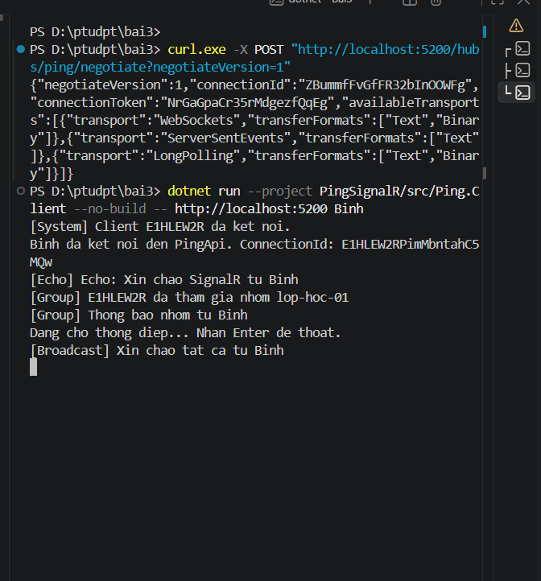
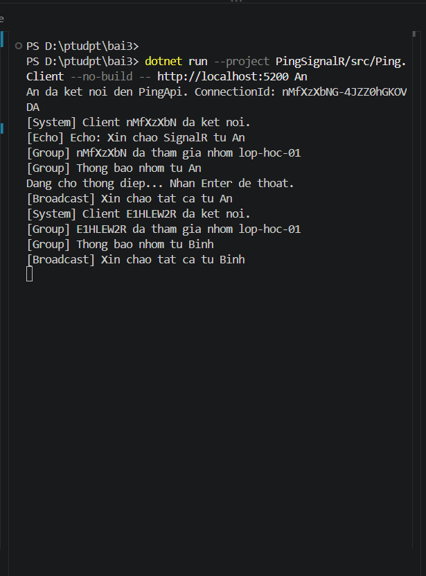
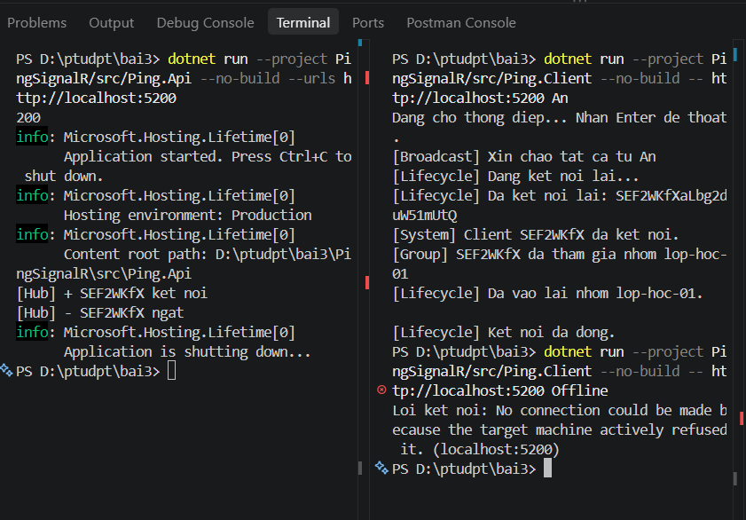
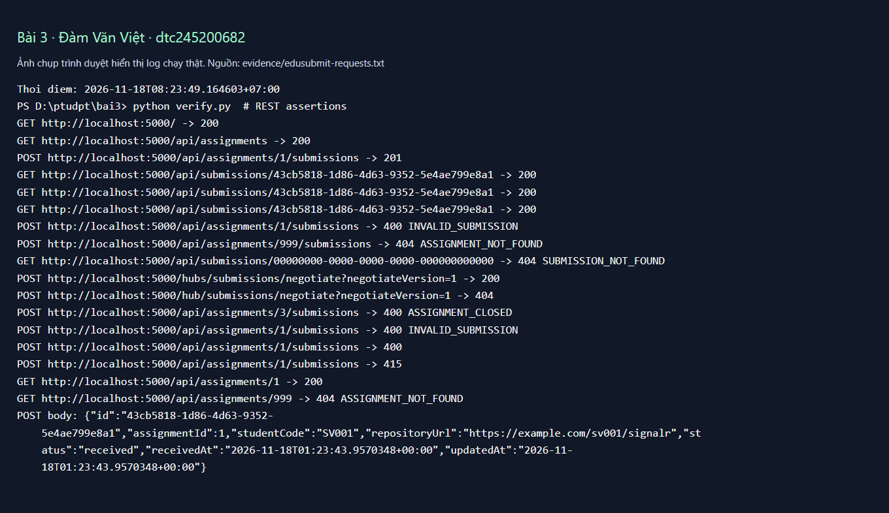
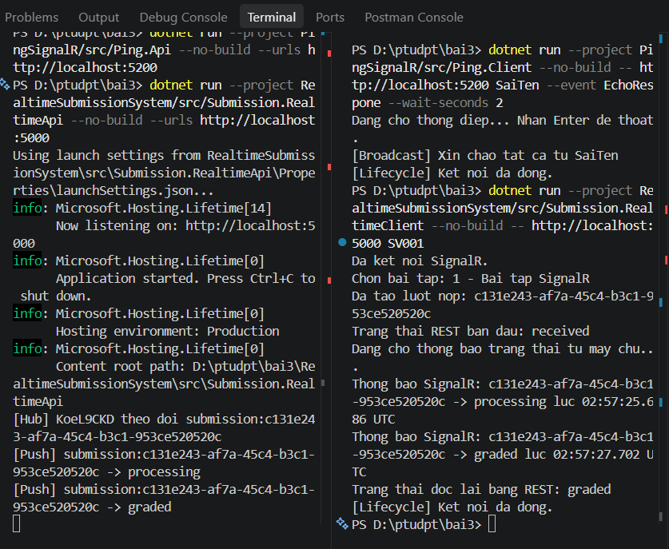
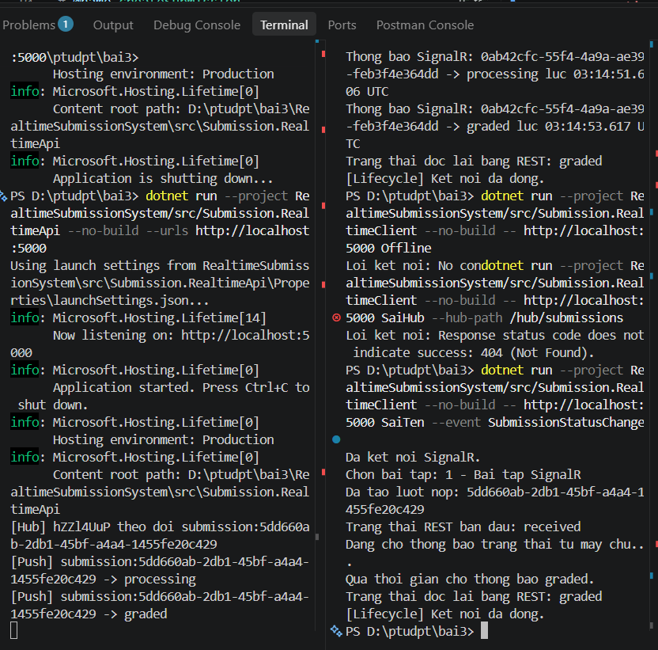
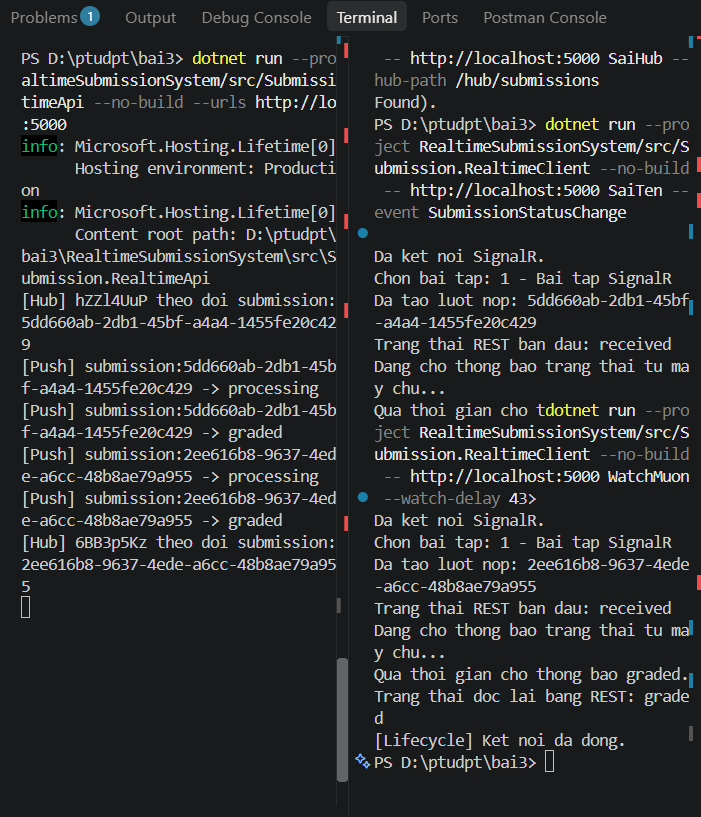

# Bài 3 – Giao tiếp thời gian thực với SignalR

Sinh viên: **Đàm Văn Việt** · MSSV: **dtc245200682** · GitHub: **Viet0810**
Email: dtc245200682@ictu.edu.vn

Đề: `Bai3_SignalR_Bai-giang.pdf`, 72 trang. Yêu cầu nộp trang 63, thang điểm trang 70–71.

## Điều kiện và cấu trúc

- .NET SDK 10; đã chạy bằng SDK **10.0.403**, ASP.NET Core runtime **10.0.14** trên Windows.
- Hai client dùng `Microsoft.AspNetCore.SignalR.Client` **10.0.15**, đúng trang 25 và 48.
- Internet cho lần NuGet restore đầu. Server SignalR có sẵn trong ASP.NET Core, không thêm gói server.
- Cổng **5200** cho Ping, **5000** cho EduSubmit. Dừng API Bài 2 ở cổng 5000 trước khi chạy.
- Python 3 để chạy kiểm thử tự động; Microsoft Edge chỉ cần khi tạo lại ảnh xem log.

```text
Bai3/
├── README.md
├── PingSignalR/PingSignalR.slnx
│   ├── requests.http
│   └── src/Ping.Api, src/Ping.Client
├── RealtimeSubmissionSystem/RealtimeSubmissionSystem.slnx
│   ├── requests.http
│   └── src/Submission.RealtimeApi, src/Submission.RealtimeClient
├── verify.py
├── evidence/                 # log gốc, có lệnh và thời điểm
├── capture-evidence.py
└── anh/                      # ảnh chụp trang trình duyệt hiển thị log gốc
```

## Lệnh build và chạy

Mở PowerShell tại thư mục `Bai3` của bài nộp (bản làm việc: `D:\ptudpt\bai3`).

```powershell
dotnet build PingSignalR/PingSignalR.slnx
dotnet build RealtimeSubmissionSystem/RealtimeSubmissionSystem.slnx
```

Ping, mở lần lượt ba terminal tại `Bai3`:

```powershell
# Terminal 1
dotnet run --project PingSignalR/src/Ping.Api --urls http://localhost:5200
# Terminal 2: chạy An trước, để cửa sổ tiếp tục mở
dotnet run --project PingSignalR/src/Ping.Client -- http://localhost:5200 An
# Terminal 3
dotnet run --project PingSignalR/src/Ping.Client -- http://localhost:5200 Binh
```

An nhận Group/Broadcast của Bình, Echo chỉ về người gọi. Nhấn **Enter** để thoát client. Muốn thử nối lại: giữ client, Ctrl+C API rồi chạy lại API; client báo nối lại và tự `JoinGroup` với ID mới.

EduSubmit, hai terminal tại `Bai3`:

```powershell
# Terminal 1
dotnet run --project RealtimeSubmissionSystem/src/Submission.RealtimeApi --urls http://localhost:5000
# Terminal 2
dotnet run --project RealtimeSubmissionSystem/src/Submission.RealtimeClient -- http://localhost:5000 SV001
```

Client tự thoát sau trạng thái cuối và GET xác nhận; tối đa chờ push 10 giây, không yêu cầu nhấn Enter. Có xử lý lỗi kết nối, timeout, HTTP nghiệp vụ và lỗi hub; lỗi chạy trả exit code 1. `failed` là trạng thái kết thúc được mô phỏng, được in cảnh báo màu đỏ.

## Hợp đồng và luồng giao tiếp

| Hub/phương thức | Thông điệp | Người nhận |
|---|---|---|
| `/hubs/ping` · `Echo(message)` | `EchoResponse` · string | Caller |
| `Broadcast(message)` | `BroadcastMessage` · string | All |
| `JoinGroup(groupName)` | `GroupMessage` · string | Thành viên nhóm, kể cả người vừa vào |
| `SendToGroup(groupName, message)` | `GroupMessage` · string | Thành viên nhóm |
| Nối/ngắt Ping | `SystemMessage` · string | All |
| `/hubs/submissions` · `WatchSubmission(id)` | `SubmissionStatusChanged` | Group `submission:{id}` |

Thông điệp EduSubmit: `{ submissionId, status, updatedAt }`. Cả hai bên khai báo DTO theo cùng hợp đồng JSON. GUID nhóm được chuẩn hóa về định dạng `D`; ID sai định dạng báo HubException.

Thiết kế theo 4 câu hỏi trước khi code:

1. **Sự kiện:** trạng thái đổi `received → processing → graded` (hoặc `failed`).
2. **Người nhận:** kết nối đang Watch nhóm `submission:{id}`, dùng `Clients.Group`.
3. **Dữ liệu tối thiểu:** ID lượt nộp, trạng thái mới, thời điểm UTC.
4. **Mất kết nối:** `WithAutomaticReconnect`, Watch lại ID và GET REST đồng bộ; thông điệp đã lỡ không tự phát lại.

Thứ tự client: **On → StartAsync → GET bài tập → POST → Watch → chờ push → GET theo Location**. POST trả ngay **201 + Location + received**; nền đợi 1 giây chuyển `processing`, thêm 2 giây chuyển trạng thái cuối. URL không bắt đầu bằng `https://` kết thúc `failed` theo bài tập 2, không bị từ chối ngay ở POST.

API dùng `lock` cho đọc/ghi danh sách; thay record trong lock rồi mới phát tin ngoài lock. Tác vụ nền gửi qua `IHubContext<SubmissionHub>`. Lỗi gửi tin được ghi log và không ngăn lượt nộp đi tiếp tới trạng thái cuối. Client dùng `ConcurrentDictionary<Guid, TrackedSubmission>` với một `TaskCompletionSource` riêng cho mỗi ID và đối chiếu `UpdatedAt` để bỏ dữ liệu cũ.

| REST | Kết quả |
|---|---|
| GET `/`, `/api/assignments`, `/api/assignments/1` | 200 |
| POST `/api/assignments/1/submissions` | 201 + Location |
| GET `/api/submissions/{id}` | 200 trạng thái hiện tại |
| POST thiếu mã SV/link | 400 `INVALID_SUBMISSION` |
| POST bài 3 đã đóng | 400 `ASSIGNMENT_CLOSED` |
| POST bài 999 | 404 `ASSIGNMENT_NOT_FOUND` |
| GET lượt nộp không tồn tại | 404 `SUBMISSION_NOT_FOUND` |
| POST `/hubs/submissions/negotiate?negotiateVersion=1` | 200 `connectionId` + transports |
| POST `/hub/submissions/negotiate?negotiateVersion=1` | 404 |

## Nhật ký thực hành ngày 18/11/2026

Các commit được tạo khi triển khai từng bước, không chia lại lịch sử sau khi hoàn tất. Dự đoán 5 thí nghiệm đã được ghi trong commit đầu trước khi chạy.

| Bước | Việc đã làm và kết quả kiểm chứng |
|---|---|
| Ping 1 | Tạo solution, hai project, cài client 10.0.15; build scaffold 0 lỗi. Lúc đầu NuGet bị chặn mạng sandbox, tải lại với quyền mạng đã được duyệt. |
| Ping 2 | AddSignalR, MapHub, mặc định cổng 5200; negotiate có ConnectionId và đủ 3 transport. |
| Ping 3–4 | Echo Caller, đăng ký On trước Start; chạy API/client thật và nhận Echo trước khi thêm nhóm. |
| Ping 5 | Hai tiến trình An/Bình; An nhận Group/Broadcast của Bình, không nhận Echo của Bình. |
| Ping 6 | Dừng/chạy lại API; ID `jbux44c3GBS2sASkmkH6hg` đổi thành `VIhjEWfLNHt9FCfCpBOQDg`; Join lại nhóm và nhận Group của client SauReconnect. |
| Ping 7 | Chạy API tắt, sai đường dẫn, sai On; thử thêm Ech0 để phân biệt lỗi chiều lên/chiều xuống. |
| Edu 1 | Solution và hai project mới; build 0 lỗi. |
| Edu 2 | REST Bài 2, thêm UpdatedAt, khóa danh sách, kiểm tra thứ tự 404 → CLOSED → INVALID → 201. |
| Edu 3 | Hub mỏng, Watch nhóm theo GUID chuẩn hóa; negotiate thành công. |
| Edu 4 | Nền chấm 1s + 2s, lưu trước đẩy sau; GET lần lượt received, processing, graded. |
| Edu 5–6 | Hai kênh REST/SignalR, client in đủ 8 dòng và tự thoát. |
| Edu 7 | Chạy 5 thí nghiệm, ghi kết quả bên dưới; kiểm tra hai client không trộn ID. |
| Edu 8 | 17 request, 7/7 ca chấm điểm; thêm failed và hai lượt nộp; hoàn thiện nhật ký và bằng chứng. |

## Kết quả thực tế

Chạy `python verify.py` tại `Bai3`. Script build hai solution, tự mở/tắt đúng các tiến trình nó tạo và dùng cổng 5000/5200. Nếu cổng đang dùng, script dừng và thông báo để tránh thử nhầm API cũ. Chỉ dùng thư viện chuẩn Python, không cần pip.

Kết quả đầy đủ: [verification-results.txt](evidence/verification-results.txt). Cả hai solution **0 Warning(s), 0 Error(s)**; lần chạy thực tế khoảng 08:23–08:24, UTC+7.

| # trang 71 | Ca kiểm tra | Kết quả thực tế |
|---|---|---|
| 1 | GET assignments | 200 |
| 2 | POST hợp lệ | 201, Location đúng ID, received |
| 3 | POST thiếu dữ liệu | 400 INVALID_SUBMISSION |
| 4 | POST bài 999 | 404 ASSIGNMENT_NOT_FOUND |
| 5 | Submission negotiate | 200, có connectionId |
| 6 | GET Location sau ≥5s | 200, graded; UpdatedAt tăng theo các trạng thái |
| 7 | Ping negotiate cổng 5200 | 200; WebSockets, ServerSentEvents, LongPolling |

Output thật client SV001 (8 dòng nghiệp vụ; sau đó có log đóng kết nối):

```text
Da ket noi SignalR.
Chon bai tap: 1 - Bai tap SignalR
Da tao luot nop: 8be0b30e-009e-4dcf-a4e6-efb2ac898fa2
Trang thai REST ban dau: received
Dang cho thong bao trang thai tu may chu...
Thong bao SignalR: 8be0b30e-009e-4dcf-a4e6-efb2ac898fa2 -> processing luc 01:23:52.541 UTC
Thong bao SignalR: 8be0b30e-009e-4dcf-a4e6-efb2ac898fa2 -> graded luc 01:23:54.547 UTC
Trang thai doc lai bang REST: graded
```

Hai thông báo cách nhau **2,006 giây**, không có GET polling giữa chúng. [Log SV001](evidence/edusubmit-SV001.txt), [log SV002](evidence/edusubmit-SV002.txt), [log server](evidence/edusubmit-server.txt).

## Năm thí nghiệm EduSubmit: dự đoán, chạy thật, giải thích

| Thí nghiệm | Dự đoán ghi trước | Kết quả chạy thật | Giải thích |
|---|---|---|---|
| 1. SV001, SV002 cùng lúc | Mỗi client chỉ nhận ID mình Watch | Mỗi client nhận đúng 2 tin processing/graded cho ID riêng; kiểm tra tự động không có ID chéo | Máy chủ gửi theo nhóm submission:{id}. |
| 2. API tắt | StartAsync báo lỗi, không tự nối lại lần đầu | Client in `Loi ket noi`, exit 1: [log](evidence/thi-nghiem2-api-tat.txt) | AutomaticReconnect áp dụng sau khi đã nối thành công. |
| 3. Sai /hub/submissions | Negotiate 404 | `404 (Not Found)`, exit 1: [log](evidence/thi-nghiem3-sai-hub.txt) | WithUrl phải khớp MapHub. |
| 4. On sai SubmissionStatusChange | Không có callback, hết 10s, REST graded | Không có dòng Thong bao SignalR; in quá thời gian rồi REST graded: [log](evidence/thi-nghiem4-sai-ten.txt) | Tên thông điệp chiều xuống sai không gây lỗi gọi hub. |
| 5. Watch trễ 4s | Lỡ processing/graded, REST vẫn graded | Không nhận push; sau 10s chờ đọc REST graded: [log](evidence/thi-nghiem5-watch-muon.txt) | Group chỉ nhận tin từ lúc tham gia; hub không lưu tin để phát lại. |

Lệnh tái lập thí nghiệm 1: chạy hai terminal với SV001 và SV002 như hướng dẫn. Thí nghiệm 2: dừng API rồi chạy client. Với thí nghiệm 3–5, giữ API chạy và dùng:

```powershell
dotnet run --project RealtimeSubmissionSystem/src/Submission.RealtimeClient -- http://localhost:5000 SaiHub --hub-path /hub/submissions
dotnet run --project RealtimeSubmissionSystem/src/Submission.RealtimeClient -- http://localhost:5000 SaiTen --event SubmissionStatusChange
dotnet run --project RealtimeSubmissionSystem/src/Submission.RealtimeClient -- http://localhost:5000 WatchMuon --watch-delay 4
```

Tham số thí nghiệm chỉ đổi giá trị tên/đường dẫn/thời gian, tương đương sửa dòng theo slide; mặc định luôn dùng hợp đồng đúng.

## Ba lỗi Ping và bài tập thêm

| Lỗi cố ý | Kết quả thật | Bài học |
|---|---|---|
| Máy chủ tắt | Lỗi kết nối, exit 1: [log](evidence/buoc7-loi1.txt) | Phải mở API trước; lần Start đầu không tự retry. |
| /hub/ping | HTTP 404, exit 1: [log](evidence/buoc7-loi2.txt) | Sai tuyến hub, lỗi ngay negotiate. |
| On EchoRespone | Không lỗi, không dòng Echo: [log](evidence/buoc7-loi3.txt) | Tên On phải khớp SendAsync. |
| Invoke Ech0 (thử thêm) | HubException: [log](evidence/ping-sai-method.txt) | Sai tên phương thức chiều lên bị hub từ chối. |

```powershell
dotnet run --project PingSignalR/src/Ping.Client -- http://localhost:5200 SaiHub --hub-path /hub/ping
dotnet run --project PingSignalR/src/Ping.Client -- http://localhost:5200 SaiTen --event EchoRespone --wait-seconds 1
dotnet run --project PingSignalR/src/Ping.Client -- http://localhost:5200 SaiMethod --method Ech0
# Bài tập 2 + 3: tạo 2 lượt, một HTTPS thành graded, một HTTP thành failed
dotnet run --project RealtimeSubmissionSystem/src/Submission.RealtimeClient -- http://localhost:5000 Multi --two
```

Đã kiểm chứng [hai lượt trên một kết nối](evidence/bai-tap2-3.txt): `Multi: SignalR = graded, REST = graded`; `Multi-02: SignalR = failed, REST = failed`. Mỗi ID có TaskCompletionSource riêng. Bài tập 4 (API tắt) đã thực hiện ở thí nghiệm 2.

## Ba câu hỏi đầu giờ

1. **Máy chủ chủ động báo được không?** Có, khi client mở sẵn kết nối SignalR lâu dài. Trong hub dùng `Clients.Group(...).SendAsync`; ngoài hub dùng `IHubContext`.
2. **REST và SignalR chia việc thế nào?** REST tạo lượt nộp và đọc dữ liệu hiện tại, có HTTP status/Location rõ ràng. SignalR báo các thay đổi phát sinh về đúng người đang theo dõi.
3. **Đứt mạng đúng lúc báo graded?** Tin có thể mất. Client tự nối lại với ID mới, Watch lại và GET lượt nộp để lấy trạng thái cuối. Nếu hết thời gian chờ push vẫn GET chốt lại. AutomaticReconnect không bảo đảm phát lại thông điệp đã lỡ.

## Ôn tập và thảo luận trang 68

- **Polling so với push:** polling tạo nhiều yêu cầu không có dữ liệu mới, trễ tới một chu kỳ; push gửi khi có sự kiện, cần duy trì kết nối. Với 100 SV chờ 1 phút, polling 2s tạo 3.000 GET; 2 lần đổi trạng thái chỉ cần khoảng 200 push (chưa tính bắt tay/keepalive).
- **Ba MEP:** request–response do client hỏi, một yêu cầu/một phản hồi; push do server phát khi có sự kiện; streaming trao chuỗi dữ liệu liên tục của một tương tác. Ví dụ: POST lượt nộp, thông báo graded, luồng tiến độ chấm.
- **WebSocket/SignalR:** WebSocket là giao thức hai chiều sau bắt tay HTTP; SignalR là thư viện cung cấp hub, JSON, nhóm và quản lý kết nối trên các transport.
- **Transport:** WebSockets ưu tiên; dự phòng Server-Sent Events và Long Polling tùy khả năng client/server/mạng. SSE đẩy xuống một chiều; Long Polling giữ request rồi mở lại khi có kết quả/hết hạn.
- **Nhóm theo ID:** giảm thông điệp đến người không liên quan và tránh phát trạng thái cho tất cả. Group trong bài thực hành chưa có xác thực; biết ID vẫn có thể Watch, vì vậy chưa phải cơ chế phân quyền đầy đủ.
- **IHubContext:** gửi thông báo từ HTTP endpoint, background task hoặc service ngoài vòng đời một hub invocation; không giữ đối tượng Hub để dùng lại.
- **On<T>:** đăng ký callback nhận tên sự kiện và giải mã payload. Bỏ On hoặc viết sai tên thì tin đến không được ứng dụng xử lý, thường không có lỗi rõ ràng.
- **Vì sao REST tạo lượt nộp:** cần tài nguyên có URI, 201/Location, kiểm tra đầu vào và đọc lại độc lập với kênh realtime. Có thể thiết kế RPC qua hub, nhưng bài này giữ REST làm nguồn sự thật.
- **AutomaticReconnect:** mặc định thử lại sau 0, 2, 10, 30 giây; sau 4 lần thất bại đóng kết nối. Cần vào lại group với ConnectionId mới; không tự retry lỗi Start đầu. Tham khảo [Microsoft Learn](https://learn.microsoft.com/en-us/aspnet/core/signalr/dotnet-client?view=aspnetcore-10.0#automatically-reconnect).
- **Mất graded:** Watch lại và GET REST, không chờ server phát lại sự kiện cũ.
- **Hàng trăm SV:** Group theo ID hiệu quả hơn All rồi tự lọc; ví dụ 200 sự kiện phát tới 100 người sẽ thành 20.000 lượt gửi khi dùng All, trong khi mỗi sự kiện chỉ cần đến người theo dõi.
- **Hai trường hợp polling hợp lý:** dữ liệu hiếm đổi và chấp nhận trễ vài chục giây; môi trường proxy/firewall không giữ được kết nối dài.
- **Scale-out:** group và dữ liệu trong RAM của từng API không tự đồng bộ. Cần backplane như Redis/Azure SignalR cho phân phối tin, kho dữ liệu dùng chung và worker/hàng đợi cho xử lý nền.

## Ảnh minh chứng

Ba ảnh đầu là **ảnh terminal do sinh viên cung cấp**, chụp ngày 18/11/2026 lúc khoảng 09:41. Giữ nguyên ảnh gốc, không cắt ghép hay thay nội dung kết quả. Các ảnh xem log tương ứng trước đây đã được thay khỏi bài nộp. Log TXT trong `evidence/` thuộc lần kiểm thử tự động trước đó nên ID và thời điểm có thể khác ảnh mới.

### Bước 1: build hai solution


Ảnh gốc `Screenshot 2026-11-18 094138.png`: thấy lệnh build hai solution, cả bốn project có kết quả `succeeded`, Ping API lắng nghe cổng 5200 và nhật ký hai kết nối. Phần tổng kết build bị xen dòng lệnh tiếp theo, chưa hiển thị riêng dòng `0 Error(s)`; nên bổ sung hai ảnh build tách riêng để đối chiếu đúng mẫu slide.

### Bước 2 và 5: negotiate và máy khách Bình



Ảnh gốc `Screenshot 2026-11-18 094151.png`: negotiate trả `connectionId`, đủ WebSockets/ServerSentEvents/LongPolling; Bình kết nối, nhận Echo của mình, tham gia nhóm và nhận Group/Broadcast.

### Bước 4–5: Echo và nhận tin nhóm tại An



Ảnh gốc `Screenshot 2026-11-18 094145.png`: An nhận Echo của An, sau đó nhận Group/Broadcast của Bình; không có Echo của Bình. Hai ảnh client cùng thể hiện ID kết nối Bình có tiền tố `E1HLEW2R`, giúp đối chiếu đúng lần chạy.

### Các mục còn cần ảnh terminal thay thế

Các ảnh dưới đây vẫn là **ảnh trình duyệt hiển thị log kiểm thử tự động**, chưa phải ảnh terminal sinh viên tự chụp. Cần bổ sung ảnh thật cho nối lại, ba lỗi Ping, REST/EduSubmit và bài tập mở rộng. Không chạy `capture-evidence.py` để thay thế ảnh terminal mới.

#### Bước 6: nối lại


#### Bước 7: ba lỗi Ping




#### EduSubmit và bài tập mở rộng







## Đối chiếu thang điểm trang 70

| Tiêu chí | Điểm tối đa | Bằng chứng / trạng thái |
|---|---:|---|
| Chạy được | 4 | Build 4 project 0 lỗi, 7/7 ca, Ping Echo, EduSubmit graded và tự thoát; log trong evidence. |
| requests.http | 2 | EduSubmit 17 ca, bao gồm 9 ca bắt buộc, có 200/201/400/404/negotiate; Ping thêm 4 ca. |
| Giải thích | 2 | Ba câu đầu giờ và ôn tập, mô tả hợp đồng/luồng phía trên. |
| Thí nghiệm | 1 | Bảng 5 dòng dự đoán + kết quả thật + giải thích, có log từng ca. |
| Git & PR | 1 | Commit theo bước, nhiều hơn 8; .gitignore loại bin/obj. Trạng thái PR xem PR-STATUS.md khi có. |
| Bài tập cộng | ≤0,5 | failed, cảnh báo đỏ và theo dõi hai lượt trên một kết nối đã chạy thật. |

Đây là đối chiếu minh chứng, không phải điểm giảng viên đã chấm. Hạn nộp cụ thể không được ghi trong PDF; cần theo thông báo lớp.

Giới hạn: dữ liệu lưu RAM mất khi API khởi động lại (đã thử GET ID cũ trả 404); chấm chỉ là Task.Delay; chưa xác thực/phân quyền, chưa bảo đảm phát lại tin. Đã thử reconnect thực tế trên Ping; nhánh phục hồi EduSubmit (Watch lại + REST) có trong code nhưng chưa mô phỏng một đứt mạng riêng trong lúc giữ nguyên API.
