# Bài 3 – Giao tiếp thời gian thực với SignalR

Sinh viên: **Đàm Văn Việt** · MSSV: **dtc245200682** · GitHub: **Viet0810**
Email: dtc245200682@ictu.edu.vn

Bài thực hành gồm hai phần: PingSignalR để tìm hiểu Echo, gửi nhóm và kết nối lại; EduSubmit để kết hợp REST với thông báo trạng thái qua SignalR. Nội dung thực hiện theo `Bai3_SignalR_Bai-giang.pdf`.

## Điều kiện và cấu trúc

- .NET SDK 10; đã chạy bằng SDK **10.0.403**, ASP.NET Core runtime **10.0.14** trên Windows.
- Hai client dùng `Microsoft.AspNetCore.SignalR.Client` **10.0.15**.
- Internet cho lần NuGet restore đầu. Server SignalR có sẵn trong ASP.NET Core, không thêm gói server.
- Cổng **5200** cho Ping, **5000** cho EduSubmit. Dừng API Bài 2 ở cổng 5000 trước khi chạy.
- Python 3 để chạy kiểm thử tự động; Microsoft Edge chỉ cần khi tạo lại ảnh xem log.

```text
Bai3/
├── README.md
├── PingSignalR/PingSignalR.slnx
│   ├── requests.http
│   └── src/Ping.Api, src/Ping.Client
├── RealtimeSubmissionSystem/RealtimeSubmissionSystem.slnx
│   ├── requests.http
│   └── src/Submission.RealtimeApi, src/Submission.RealtimeClient
├── verify.py
├── evidence/                 # log gốc, có lệnh và thời điểm
├── capture-evidence.py
└── anh/                      # ảnh terminal và ảnh hiển thị log kiểm thử
```

## Lệnh build và chạy

Mở PowerShell tại thư mục `Bai3` của bài nộp (bản làm việc: `D:\ptudpt\bai3`).

```powershell
dotnet build PingSignalR/PingSignalR.slnx
dotnet build RealtimeSubmissionSystem/RealtimeSubmissionSystem.slnx
```

Ping, mở lần lượt ba terminal tại `Bai3`:

```powershell
# Terminal 1
dotnet run --project PingSignalR/src/Ping.Api --urls http://localhost:5200
# Terminal 2: chạy An trước, để cửa sổ tiếp tục mở
dotnet run --project PingSignalR/src/Ping.Client -- http://localhost:5200 An
# Terminal 3
dotnet run --project PingSignalR/src/Ping.Client -- http://localhost:5200 Binh
```

An nhận Group/Broadcast của Bình, Echo chỉ về người gọi. Nhấn **Enter** để thoát client. Muốn thử nối lại: giữ client, Ctrl+C API rồi chạy lại API; client báo nối lại và tự `JoinGroup` với ID mới.

EduSubmit, hai terminal tại `Bai3`:

```powershell
# Terminal 1
dotnet run --project RealtimeSubmissionSystem/src/Submission.RealtimeApi --urls http://localhost:5000
# Terminal 2
dotnet run --project RealtimeSubmissionSystem/src/Submission.RealtimeClient -- http://localhost:5000 SV001
```

Client tự thoát sau trạng thái cuối và GET xác nhận; tối đa chờ push 10 giây, không yêu cầu nhấn Enter. Có xử lý lỗi kết nối, timeout, HTTP nghiệp vụ và lỗi hub; lỗi chạy trả exit code 1. `failed` là trạng thái kết thúc được mô phỏng, được in cảnh báo màu đỏ.

## Hợp đồng và luồng giao tiếp

| Hub/phương thức | Thông điệp | Người nhận |
|---|---|---|
| `/hubs/ping` · `Echo(message)` | `EchoResponse` · string | Caller |
| `Broadcast(message)` | `BroadcastMessage` · string | All |
| `JoinGroup(groupName)` | `GroupMessage` · string | Thành viên nhóm, kể cả người vừa vào |
| `SendToGroup(groupName, message)` | `GroupMessage` · string | Thành viên nhóm |
| Nối/ngắt Ping | `SystemMessage` · string | All |
| `/hubs/submissions` · `WatchSubmission(id)` | `SubmissionStatusChanged` | Group `submission:{id}` |

Thông điệp EduSubmit: `{ submissionId, status, updatedAt }`. Cả hai bên khai báo DTO theo cùng hợp đồng JSON. GUID nhóm được chuẩn hóa về định dạng `D`; ID sai định dạng báo HubException.

Phần thông báo trạng thái được thiết kế như sau:

1. **Sự kiện:** trạng thái đổi `received → processing → graded` (hoặc `failed`).
2. **Người nhận:** kết nối đang Watch nhóm `submission:{id}`, dùng `Clients.Group`.
3. **Dữ liệu tối thiểu:** ID lượt nộp, trạng thái mới, thời điểm UTC.
4. **Mất kết nối:** `WithAutomaticReconnect`, Watch lại ID và GET REST đồng bộ; thông điệp đã lỡ không tự phát lại.

Thứ tự client: **On → StartAsync → GET bài tập → POST → Watch → chờ push → GET theo Location**. POST trả ngay **201 + Location + received**; nền đợi 1 giây chuyển `processing`, thêm 2 giây chuyển trạng thái cuối. URL không bắt đầu bằng `https://` kết thúc `failed` theo bài tập 2, không bị từ chối ngay ở POST.

API dùng `lock` cho đọc/ghi danh sách; thay record trong lock rồi mới phát tin ngoài lock. Tác vụ nền gửi qua `IHubContext<SubmissionHub>`. Lỗi gửi tin được ghi log và không ngăn lượt nộp đi tiếp tới trạng thái cuối. Client dùng `ConcurrentDictionary<Guid, TrackedSubmission>` với một `TaskCompletionSource` riêng cho mỗi ID và đối chiếu `UpdatedAt` để bỏ dữ liệu cũ.

| REST | Kết quả |
|---|---|
| GET `/`, `/api/assignments`, `/api/assignments/1` | 200 |
| POST `/api/assignments/1/submissions` | 201 + Location |
| GET `/api/submissions/{id}` | 200 trạng thái hiện tại |
| POST thiếu mã SV/link | 400 `INVALID_SUBMISSION` |
| POST bài 3 đã đóng | 400 `ASSIGNMENT_CLOSED` |
| POST bài 999 | 404 `ASSIGNMENT_NOT_FOUND` |
| GET lượt nộp không tồn tại | 404 `SUBMISSION_NOT_FOUND` |
| POST `/hubs/submissions/negotiate?negotiateVersion=1` | 200 `connectionId` + transports |
| POST `/hub/submissions/negotiate?negotiateVersion=1` | 404 |

## Nhật ký thực hành ngày 18/11/2026

Các bước thực hiện và kết quả được ghi lại trong bảng dưới đây. Phần dự đoán thí nghiệm được lưu trước lần chạy kiểm thử.

| Bước | Việc đã làm và kết quả kiểm chứng |
|---|---|
| Ping 1 | Tạo solution gồm API và console client, thêm gói SignalR.Client 10.0.15; build ban đầu thành công. |
| Ping 2 | AddSignalR, MapHub, mặc định cổng 5200; negotiate có ConnectionId và đủ 3 transport. |
| Ping 3–4 | Thêm Echo trả về Caller, đăng ký On trước Start; chạy client và nhận Echo. |
| Ping 5 | Hai tiến trình An/Bình; An nhận Group/Broadcast của Bình, không nhận Echo của Bình. |
| Ping 6 | Dừng/chạy lại API; ID `jbux44c3GBS2sASkmkH6hg` đổi thành `VIhjEWfLNHt9FCfCpBOQDg`; Join lại nhóm và nhận Group của client SauReconnect. |
| Ping 7 | Chạy API tắt, sai đường dẫn, sai On; thử thêm Ech0 để phân biệt lỗi chiều lên/chiều xuống. |
| Edu 1 | Solution và hai project mới; build 0 lỗi. |
| Edu 2 | REST Bài 2, thêm UpdatedAt, khóa danh sách, kiểm tra thứ tự 404 → CLOSED → INVALID → 201. |
| Edu 3 | Hub mỏng, Watch nhóm theo GUID chuẩn hóa; negotiate thành công. |
| Edu 4 | Nền chấm 1s + 2s, lưu trước đẩy sau; GET lần lượt received, processing, graded. |
| Edu 5–6 | Hai kênh REST/SignalR, client in đủ 8 dòng và tự thoát. |
| Edu 7 | Chạy 5 thí nghiệm, ghi kết quả bên dưới; kiểm tra hai client không trộn ID. |
| Edu 8 | Chuẩn bị 17 request, kiểm tra đủ 7 ca trong đề; thêm failed và theo dõi hai lượt nộp trên một kết nối. |

## Kết quả kiểm thử

Chạy `python verify.py` tại `Bai3`. Script build hai solution, tự mở/tắt đúng các tiến trình nó tạo và dùng cổng 5000/5200. Nếu cổng đang dùng, script dừng và thông báo để tránh thử nhầm API cũ. Chỉ dùng thư viện chuẩn Python, không cần pip.

Kết quả đầy đủ: [verification-results.txt](evidence/verification-results.txt). Cả hai solution **0 Warning(s), 0 Error(s)**; lần chạy thực tế khoảng 08:23–08:24, UTC+7.

| # trang 71 | Ca kiểm tra | Kết quả thực tế |
|---|---|---|
| 1 | GET assignments | 200 |
| 2 | POST hợp lệ | 201, Location đúng ID, received |
| 3 | POST thiếu dữ liệu | 400 INVALID_SUBMISSION |
| 4 | POST bài 999 | 404 ASSIGNMENT_NOT_FOUND |
| 5 | Submission negotiate | 200, có connectionId |
| 6 | GET Location sau ≥5s | 200, graded; UpdatedAt tăng theo các trạng thái |
| 7 | Ping negotiate cổng 5200 | 200; WebSockets, ServerSentEvents, LongPolling |

Kết quả client SV001 trong lần kiểm thử tự động (8 dòng nghiệp vụ, sau đó có log đóng kết nối):

```text
Da ket noi SignalR.
Chon bai tap: 1 - Bai tap SignalR
Da tao luot nop: 8be0b30e-009e-4dcf-a4e6-efb2ac898fa2
Trang thai REST ban dau: received
Dang cho thong bao trang thai tu may chu...
Thong bao SignalR: 8be0b30e-009e-4dcf-a4e6-efb2ac898fa2 -> processing luc 01:23:52.541 UTC
Thong bao SignalR: 8be0b30e-009e-4dcf-a4e6-efb2ac898fa2 -> graded luc 01:23:54.547 UTC
Trang thai doc lai bang REST: graded
```

Hai thông báo cách nhau **2,006 giây**, không có GET polling giữa chúng. [Log SV001](evidence/edusubmit-SV001.txt), [log SV002](evidence/edusubmit-SV002.txt), [log server](evidence/edusubmit-server.txt).

## Thí nghiệm EduSubmit

| Thí nghiệm | Dự đoán | Kết quả kiểm thử | Giải thích |
|---|---|---|---|
| 1. SV001, SV002 cùng lúc | Mỗi client chỉ nhận ID mình Watch | Mỗi client nhận đúng 2 tin processing/graded cho ID riêng; kiểm tra tự động không có ID chéo | Máy chủ gửi theo nhóm submission:{id}. |
| 2. API tắt | StartAsync báo lỗi, không tự nối lại lần đầu | Client in `Loi ket noi`, exit 1: [log](evidence/thi-nghiem2-api-tat.txt) | AutomaticReconnect áp dụng sau khi đã nối thành công. |
| 3. Sai /hub/submissions | Negotiate 404 | `404 (Not Found)`, exit 1: [log](evidence/thi-nghiem3-sai-hub.txt) | WithUrl phải khớp MapHub. |
| 4. On sai SubmissionStatusChange | Không có callback, hết 10s, REST graded | Không có dòng Thong bao SignalR; in quá thời gian rồi REST graded: [log](evidence/thi-nghiem4-sai-ten.txt) | Tên thông điệp chiều xuống sai không gây lỗi gọi hub. |
| 5. Watch trễ 4s | Lỡ processing/graded, REST vẫn graded | Không nhận push; sau 10s chờ đọc REST graded: [log](evidence/thi-nghiem5-watch-muon.txt) | Group chỉ nhận tin từ lúc tham gia; hub không lưu tin để phát lại. |

Thí nghiệm 1 chạy hai client SV001 và SV002 ở hai terminal. Thí nghiệm 2 dừng API trước khi chạy client. Thí nghiệm 3–5 giữ API chạy và dùng các lệnh sau:

```powershell
dotnet run --project RealtimeSubmissionSystem/src/Submission.RealtimeClient -- http://localhost:5000 SaiHub --hub-path /hub/submissions
dotnet run --project RealtimeSubmissionSystem/src/Submission.RealtimeClient -- http://localhost:5000 SaiTen --event SubmissionStatusChange
dotnet run --project RealtimeSubmissionSystem/src/Submission.RealtimeClient -- http://localhost:5000 WatchMuon --watch-delay 4
```

Các tùy chọn `--hub-path`, `--event` và `--watch-delay` dùng để thử lần lượt lỗi đường dẫn, lỗi tên thông điệp và theo dõi muộn. Khi không truyền các tùy chọn này, client chạy luồng bình thường.

## Ba lỗi Ping và bài tập thêm

| Lỗi cố ý | Kết quả kiểm thử | Bài học |
|---|---|---|
| Máy chủ tắt | Lỗi kết nối, exit 1: [log](evidence/buoc7-loi1.txt) | Phải mở API trước; lần Start đầu không tự retry. |
| /hub/ping | HTTP 404, exit 1: [log](evidence/buoc7-loi2.txt) | Sai tuyến hub, lỗi ngay negotiate. |
| On EchoRespone | Không lỗi, không dòng Echo: [log](evidence/buoc7-loi3.txt) | Tên On phải khớp SendAsync. |
| Invoke Ech0 (thử thêm) | HubException: [log](evidence/ping-sai-method.txt) | Sai tên phương thức chiều lên bị hub từ chối. |

```powershell
dotnet run --project PingSignalR/src/Ping.Client -- http://localhost:5200 SaiHub --hub-path /hub/ping
dotnet run --project PingSignalR/src/Ping.Client -- http://localhost:5200 SaiTen --event EchoRespone --wait-seconds 1
dotnet run --project PingSignalR/src/Ping.Client -- http://localhost:5200 SaiMethod --method Ech0
# Bài tập 2 + 3: tạo 2 lượt, một HTTPS thành graded, một HTTP thành failed
dotnet run --project RealtimeSubmissionSystem/src/Submission.RealtimeClient -- http://localhost:5000 Multi --two
```

Đã kiểm chứng [hai lượt trên một kết nối](evidence/bai-tap2-3.txt): `Multi: SignalR = graded, REST = graded`; `Multi-02: SignalR = failed, REST = failed`. Mỗi ID có TaskCompletionSource riêng. Bài tập 4 (API tắt) đã thực hiện ở thí nghiệm 2.

## Ba câu hỏi đầu giờ

1. **Máy chủ chủ động báo được không?** Có, khi client mở sẵn kết nối SignalR lâu dài. Trong hub dùng `Clients.Group(...).SendAsync`; ngoài hub dùng `IHubContext`.
2. **REST và SignalR chia việc thế nào?** REST tạo lượt nộp và đọc dữ liệu hiện tại, có HTTP status/Location rõ ràng. SignalR báo các thay đổi phát sinh về đúng người đang theo dõi.
3. **Đứt mạng đúng lúc báo graded?** Tin có thể mất. Client tự nối lại với ID mới, Watch lại và GET lượt nộp để lấy trạng thái cuối. Nếu hết thời gian chờ push vẫn GET chốt lại. AutomaticReconnect không bảo đảm phát lại thông điệp đã lỡ.

## Ôn tập và thảo luận trang 68

- **Polling so với push:** polling tạo nhiều yêu cầu không có dữ liệu mới, trễ tới một chu kỳ; push gửi khi có sự kiện, cần duy trì kết nối. Với 100 SV chờ 1 phút, polling 2s tạo 3.000 GET; 2 lần đổi trạng thái chỉ cần khoảng 200 push (chưa tính bắt tay/keepalive).
- **Ba MEP:** request–response do client hỏi, một yêu cầu/một phản hồi; push do server phát khi có sự kiện; streaming trao chuỗi dữ liệu liên tục của một tương tác. Ví dụ: POST lượt nộp, thông báo graded, luồng tiến độ chấm.
- **WebSocket/SignalR:** WebSocket là giao thức hai chiều sau bắt tay HTTP; SignalR là thư viện cung cấp hub, JSON, nhóm và quản lý kết nối trên các transport.
- **Transport:** WebSockets ưu tiên; dự phòng Server-Sent Events và Long Polling tùy khả năng client/server/mạng. SSE đẩy xuống một chiều; Long Polling giữ request rồi mở lại khi có kết quả/hết hạn.
- **Nhóm theo ID:** giảm thông điệp đến người không liên quan và tránh phát trạng thái cho tất cả. Group trong bài thực hành chưa có xác thực; biết ID vẫn có thể Watch, vì vậy chưa phải cơ chế phân quyền đầy đủ.
- **IHubContext:** gửi thông báo từ HTTP endpoint, background task hoặc service ngoài vòng đời một hub invocation; không giữ đối tượng Hub để dùng lại.
- **On<T>:** đăng ký callback nhận tên sự kiện và giải mã payload. Bỏ On hoặc viết sai tên thì tin đến không được ứng dụng xử lý, thường không có lỗi rõ ràng.
- **Vì sao REST tạo lượt nộp:** cần tài nguyên có URI, 201/Location, kiểm tra đầu vào và đọc lại độc lập với kênh realtime. Có thể thiết kế RPC qua hub, nhưng bài này giữ REST làm nguồn sự thật.
- **AutomaticReconnect:** mặc định thử lại sau 0, 2, 10, 30 giây; sau 4 lần thất bại đóng kết nối. Cần vào lại group với ConnectionId mới; không tự retry lỗi Start đầu. Tham khảo [Microsoft Learn](https://learn.microsoft.com/en-us/aspnet/core/signalr/dotnet-client?view=aspnetcore-10.0#automatically-reconnect).
- **Mất graded:** Watch lại và GET REST, không chờ server phát lại sự kiện cũ.
- **Hàng trăm SV:** Group theo ID hiệu quả hơn All rồi tự lọc; ví dụ 200 sự kiện phát tới 100 người sẽ thành 20.000 lượt gửi khi dùng All, trong khi mỗi sự kiện chỉ cần đến người theo dõi.
- **Hai trường hợp polling hợp lý:** dữ liệu hiếm đổi và chấp nhận trễ vài chục giây; môi trường proxy/firewall không giữ được kết nối dài.
- **Scale-out:** group và dữ liệu trong RAM của từng API không tự đồng bộ. Cần backplane như Redis/Azure SignalR cho phân phối tin, kho dữ liệu dùng chung và worker/hàng đợi cho xử lý nền.

## Ảnh minh chứng

Các ảnh terminal Ping dưới đây ghi lại các lần chạy từ khoảng 09:41 đến 09:55 ngày 18/11/2026. Log trong `evidence/` thuộc lần kiểm thử tự động lúc 08:23–08:24 nên ID và thời điểm khác với ảnh terminal.

### Bước 1: build hai solution

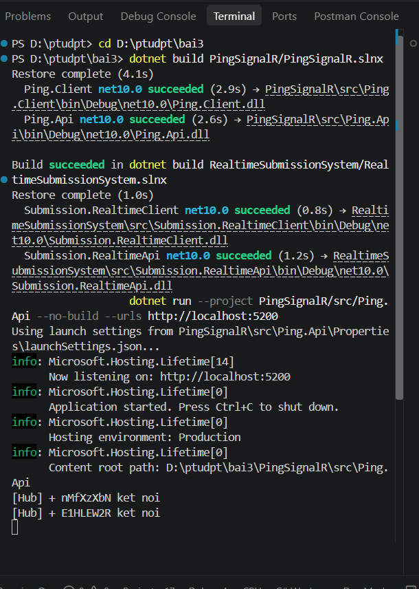

Sau khi build hai solution, cả bốn project đều hiện `succeeded`. Ping API chạy tại cổng 5200 và ghi nhận hai client kết nối. Ảnh không hiển thị riêng dòng tổng kết `0 Error(s)`; kết quả build đầy đủ của lần kiểm thử tự động nằm trong [log Ping](evidence/build-PingSignalR.txt) và [log EduSubmit](evidence/build-RealtimeSubmissionSystem.txt).

### Bước 2 và 5: negotiate và máy khách Bình


Lệnh negotiate trả về `connectionId` và ba transport: WebSockets, ServerSentEvents, LongPolling. Client Bình nhận Echo của mình, tham gia nhóm `lop-hoc-01` và nhận Group/Broadcast.

### Bước 4–5: Echo và nhận tin nhóm tại An


An nhận Echo riêng, sau đó nhận Group/Broadcast từ Bình. Cửa sổ An không có Echo của Bình vì Echo dùng `Clients.Caller`. ID kết nối của Bình có tiền tố `E1HLEW2R` xuất hiện ở cả hai cửa sổ.

### Bước 6: nối lại

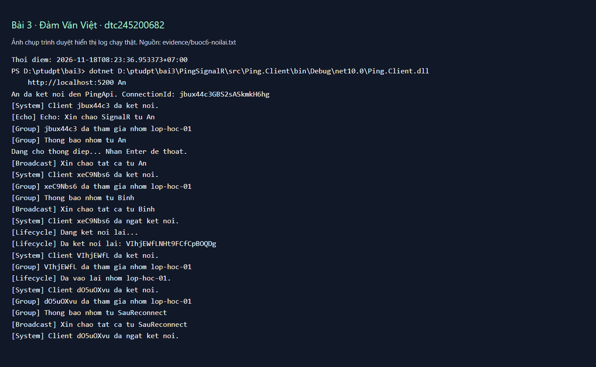

Sau khi dừng và khởi động lại API, client An hiện `Dang ket noi lai...`, sau đó `Da ket noi lai`. ConnectionId đổi từ tiền tố `9BVB2HnH` sang `SEF2WKfX`; client tham gia lại nhóm `lop-hoc-01` thành công.

### Bước 7: ba lỗi Ping


Khi API đã dừng, client Offline báo kết nối bị từ chối tại `localhost:5200`.

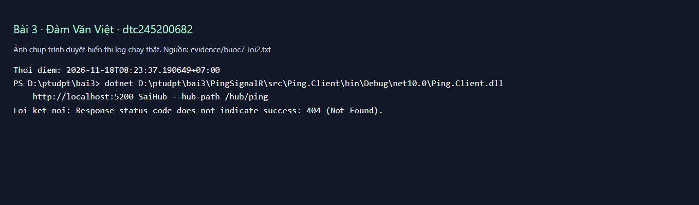

API đang chạy nhưng client dùng `/hub/ping` thay cho `/hubs/ping`, nên bước bắt tay trả `404 (Not Found)`.

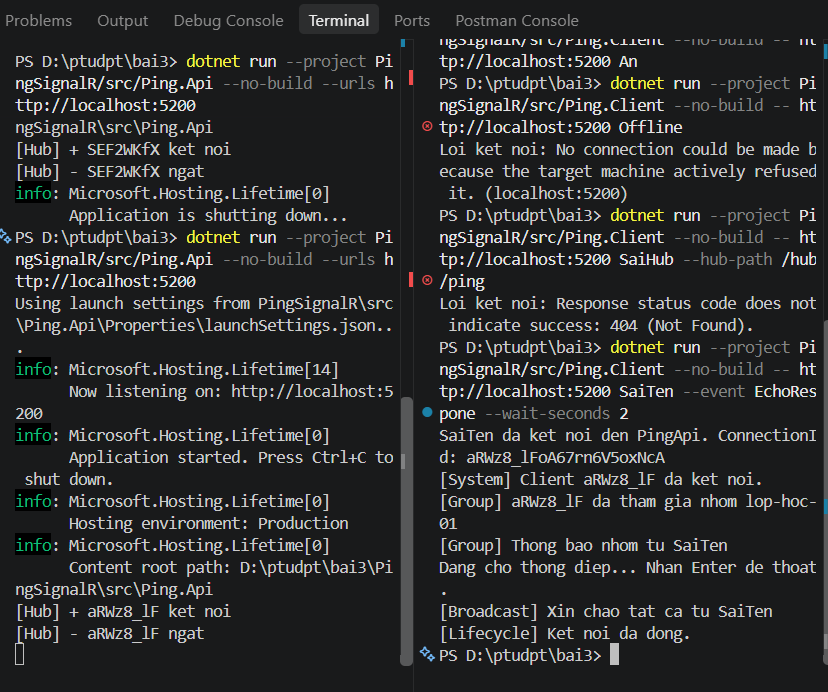

Client SaiTen đăng ký `EchoRespone`, vẫn kết nối và nhận Group/Broadcast, nhưng không nhận dòng Echo trong lần chạy này. Sau 2 giây client tự đóng kết nối.

### EduSubmit và bài tập mở rộng


Ảnh terminal lúc khoảng 09:57 ngày 18/11/2026: API chạy cổng 5000; client SV001 tạo lượt nộp `c131e243-af7a-45c4-b3c1-953ce520520c` với trạng thái `received`. Server đẩy `processing` rồi `graded`, client nhận đủ hai thông báo và đọc lại REST được `graded`, sau đó tự thoát. Hai thông báo có thời điểm 02:57:25.686 và 02:57:27.702 UTC, cách nhau khoảng 2 giây.

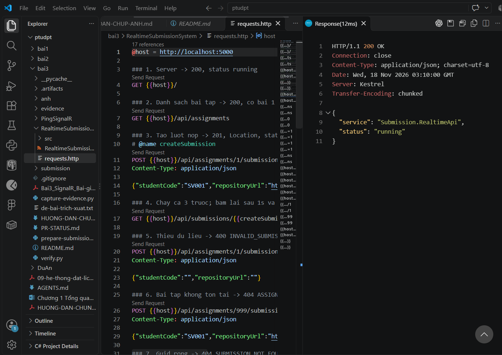

Ca 1 kiểm tra API tại `/`, nhận `200 OK` với service `Submission.RealtimeApi` và trạng thái `running`.

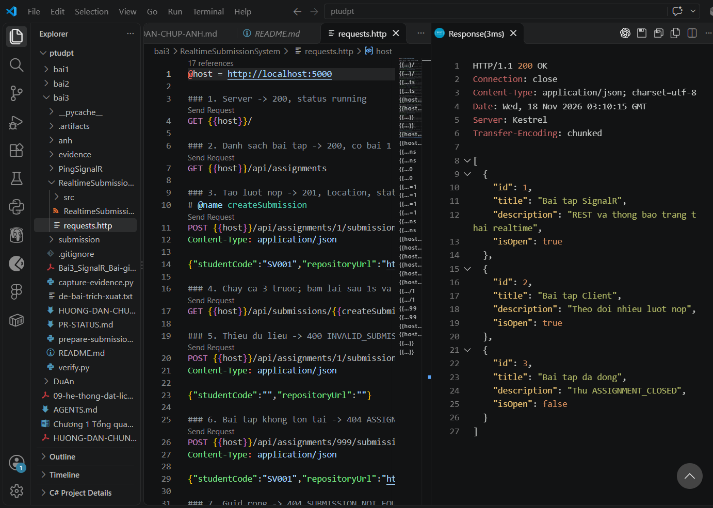

Ca 2 đọc `/api/assignments`, nhận `200 OK` và ba bài tập. Bài 1, 2 đang mở; bài 3 đã đóng.

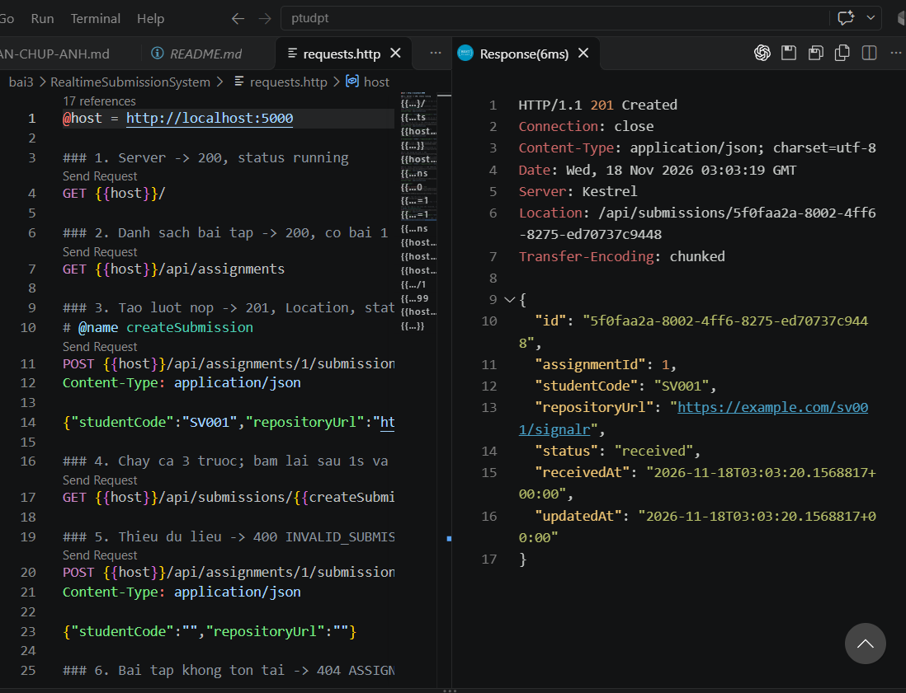

Ca 3 trong `requests.http` gửi mã sinh viên SV001 và đường dẫn repository. Response trả `201 Created`, header `Location` trỏ tới `/api/submissions/5f0faa2a-8002-4ff6-8275-ed70737c9448`, body có trạng thái `received` cùng thời điểm nhận và cập nhật. Ảnh chụp trực tiếp request/response trong VS Code lúc khoảng 10:03 ngày 18/11/2026.

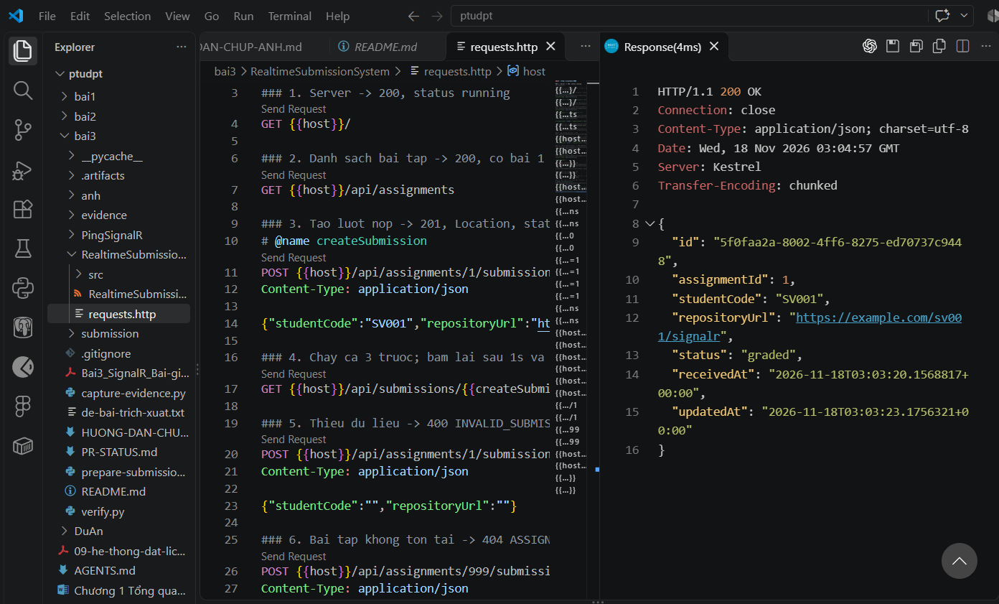

Ca 4 đọc lại lượt nộp vừa tạo ở ca 3. Response trả `200 OK`, trạng thái `graded`; `updatedAt` đã tăng so với `receivedAt`.

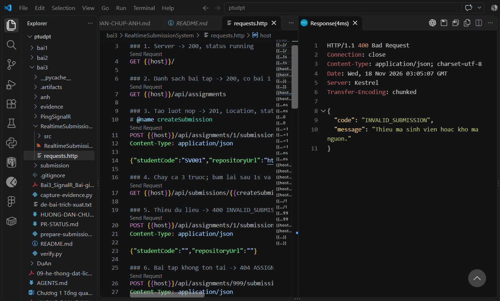

Ca 5 gửi mã sinh viên và repository rỗng, nhận `400 Bad Request` với mã lỗi `INVALID_SUBMISSION`.

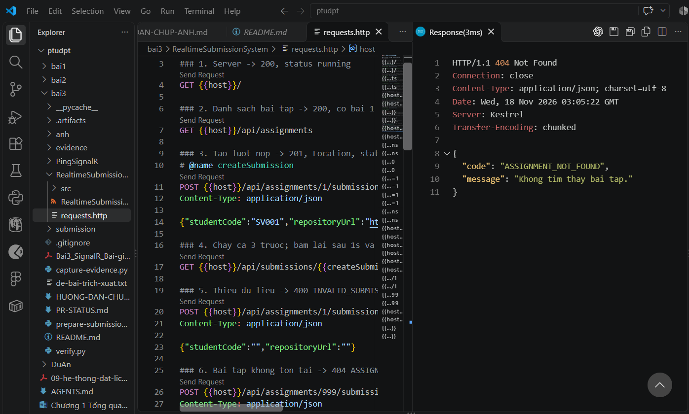

Ca 6 nộp bài vào assignment 999, nhận `404 Not Found` với mã lỗi `ASSIGNMENT_NOT_FOUND`.

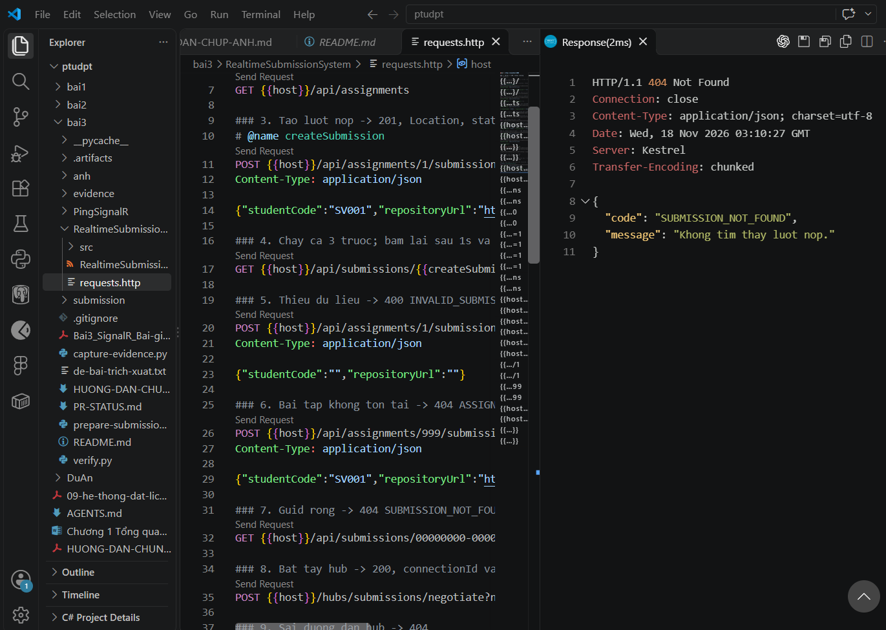

Ca 7 tìm lượt nộp có GUID rỗng, nhận `404 Not Found` với mã lỗi `SUBMISSION_NOT_FOUND`. Các ảnh ca 1, 2, 7 chụp trong VS Code lúc khoảng 10:10 ngày 18/11/2026. Như vậy cả 9 ca REST bắt buộc đều có ảnh chụp trực tiếp.

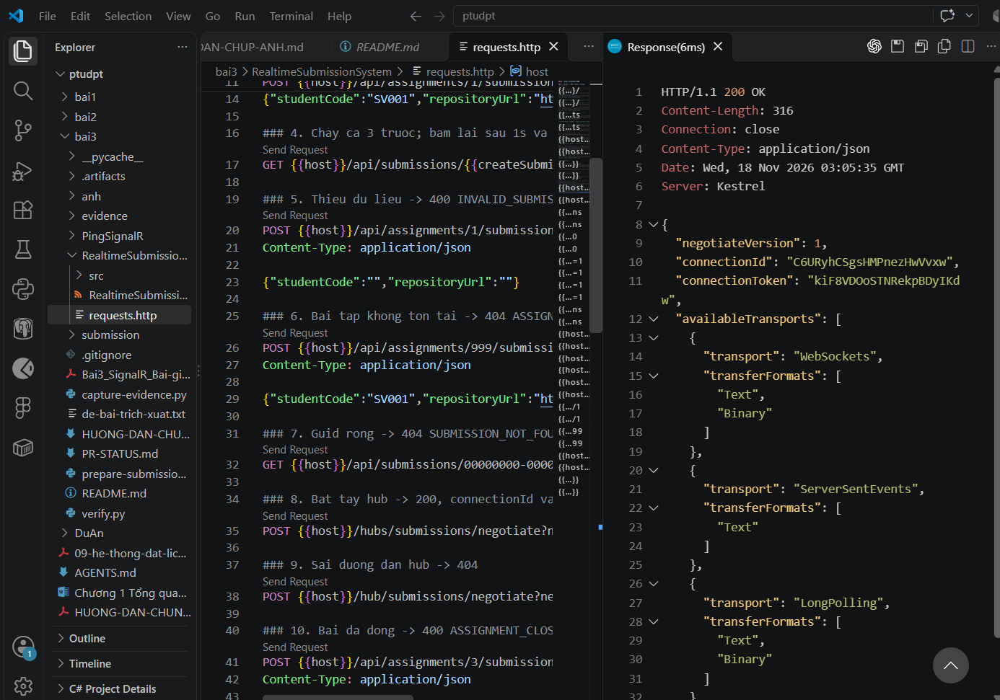

Ca 8 bắt tay tại `/hubs/submissions/negotiate`, nhận `200 OK`, `connectionId` và đủ WebSockets, ServerSentEvents, LongPolling.

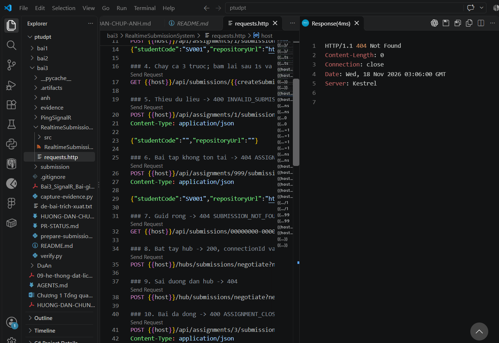

Ca 9 dùng `/hub/submissions/negotiate`, nhận `404 Not Found`, body rỗng vì không khớp route. Các ảnh ca 4, 5, 6, 8, 9 chụp trực tiếp trong VS Code lúc khoảng 10:05–10:06 ngày 18/11/2026.

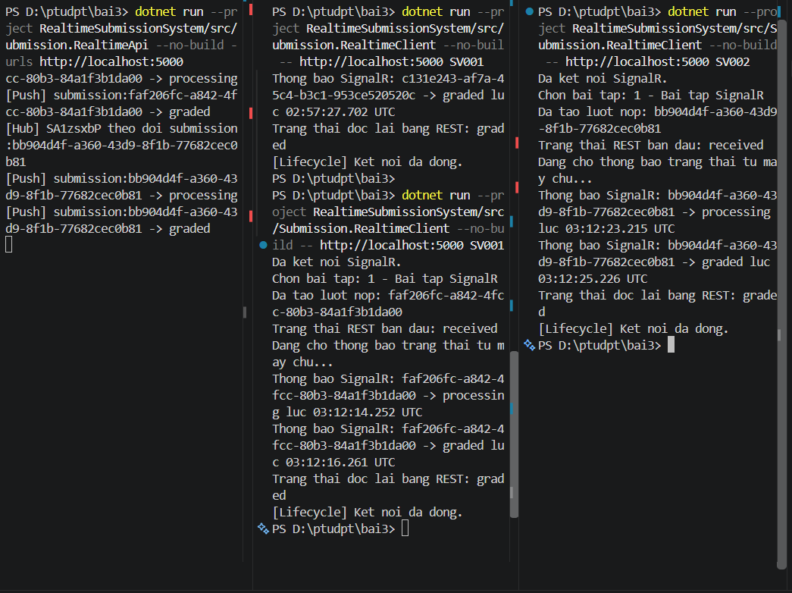

SV001 nhận `processing` và `graded` cho ID `faf206fc-a842-4fcc-80b3-84a1f3b1da00`; SV002 nhận hai trạng thái cho ID `bb904d4f-a360-43d9-8f1b-77682cec0b81`. Mỗi client đọc lại REST được `graded`. Trong ảnh này SV001 hoàn tất lúc 03:12:16.261 UTC, SV002 bắt đầu nhận `processing` lúc 03:12:23.215 UTC, nên hai lượt chưa chạy chồng thời gian. Ảnh minh họa việc nhận đúng ID ở hai client; kiểm tra hai client đồng thời được lưu riêng trong log kiểm thử tự động.

Các ảnh còn lại dưới đây hiển thị log kiểm thử tự động qua trình duyệt. Bài tập hai lượt nộp và thí nghiệm sai tên/Watch muộn chưa có ảnh chụp trực tiếp. Log gốc nằm trong `evidence/`.

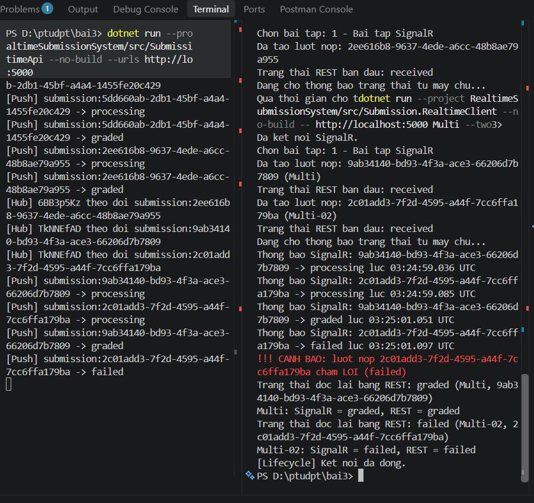


## Đối chiếu thang điểm trang 70

| Tiêu chí | Điểm tối đa | Bằng chứng / trạng thái |
|---|---:|---|
| Chạy được | 4 | Build 4 project 0 lỗi, 7/7 ca, Ping Echo, EduSubmit graded và tự thoát; log trong evidence. |
| requests.http | 2 | EduSubmit 17 ca, bao gồm 9 ca bắt buộc, có 200/201/400/404/negotiate; Ping thêm 4 ca. |
| Giải thích | 2 | Ba câu đầu giờ và ôn tập, mô tả hợp đồng/luồng phía trên. |
| Thí nghiệm | 1 | Bảng 5 dòng dự đoán + kết quả thật + giải thích, có log từng ca. |
| Git & PR | 1 | Có hơn 8 commit cục bộ; .gitignore loại bin/obj. Chưa push và chưa mở PR. Xem [trạng thái Git](PR-STATUS.md). |
| Bài tập cộng | ≤0,5 | failed, cảnh báo đỏ và theo dõi hai lượt trên một kết nối đã chạy thật. |

Hạn nộp theo thông báo của lớp; PDF không ghi ngày cụ thể.

## Hạn chế và điều rút ra

Dữ liệu hiện được lưu trong RAM nên mất khi API khởi động lại; kiểm tra GET với ID cũ trả về 404. Phần chấm bài dùng `Task.Delay` để mô phỏng, chưa có bộ chấm thật hay xác thực và phân quyền.

Kết quả Ping cho thấy kết nối lại tạo ConnectionId mới nên phải tham gia lại nhóm. EduSubmit đã có xử lý Watch lại và đọc REST khi nối lại, nhưng chưa kiểm thử riêng tình huống đứt mạng trong lúc giữ nguyên API.

Qua các thí nghiệm sai tên sự kiện và Watch muộn, có thể thấy kết nối thành công không có nghĩa là luôn nhận đủ thông báo. SignalR giúp nhận thay đổi sớm, còn REST dùng để đọc lại trạng thái hiện tại khi thông báo bị lỡ.
