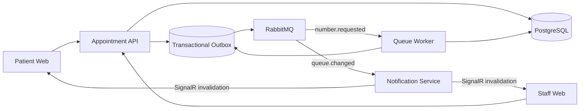
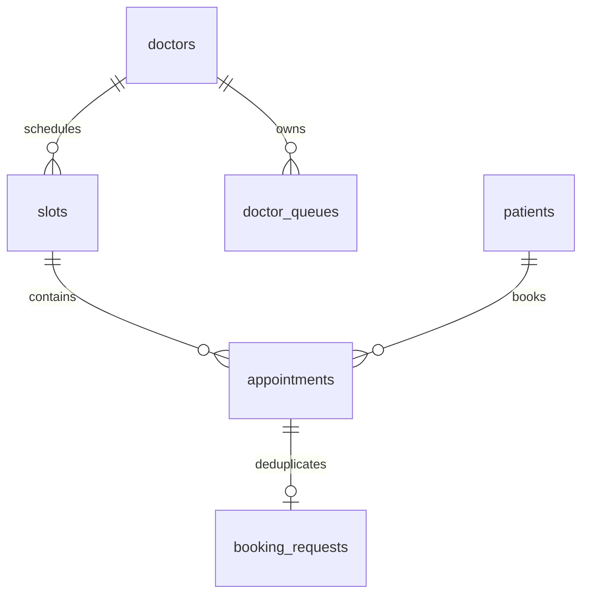
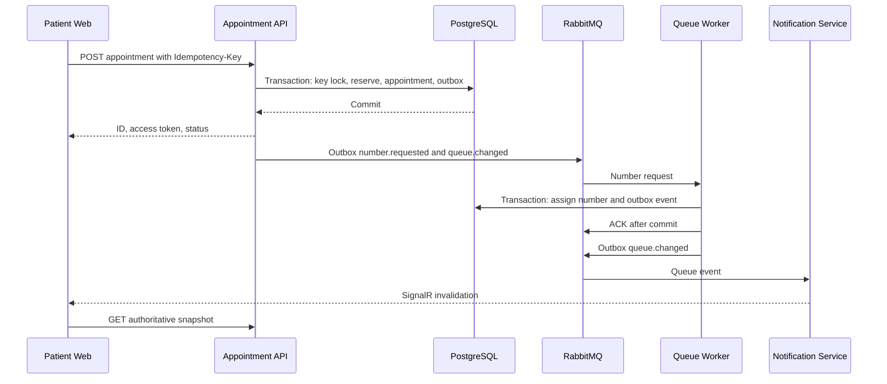

# Báo cáo kỹ thuật — Đề tài 09

## Bài toán và phạm vi

Hệ thống hỗ trợ bệnh nhân tìm bác sĩ, giữ chỗ theo khung giờ, nhận số và theo dõi tiến độ khám. Nhân viên điều phối một lượt khám tại một thời điểm cho mỗi bác sĩ trong ngày. Việc cấp số tách khỏi request đặt lịch, cho phép tiếp nhận lịch khi Worker hoặc broker tạm ngừng. Thông tin bệnh nhân không xuất hiện trên bảng hàng đợi công khai.

Sinh viên: **Đàm Văn Việt**. Tác giả Git: **Viet0810**, email **dtc245200682@ictu.edu.vn**.

Hai PDF gốc quy định .NET 10, C#, Minimal API, service độc lập, Dockerfile/Compose và hai chặng RabbitMQ. README ghi rõ các quy tắc bổ sung khi đề chưa quy định. Bản báo cáo này mô tả mã nguồn sau tối ưu ngày 17/11/2026. Repository cục bộ bắt đầu từ bản bàn giao; GitHub cần được bổ sung khi đã chọn repository đích. Không có lịch sử phát triển trước đó để tái dựng.

## Phân tích yêu cầu

Hai tác nhân chính là bệnh nhân và nhân viên điều phối. Bệnh nhân xem bác sĩ/khung giờ, đặt lịch, nhận số, tra cứu và hủy. Nhân viên gọi và hoàn thành lượt khám của từng bác sĩ. Thông tin cá nhân chỉ được truy cập bằng khóa lịch hoặc quyền Staff.

| Yêu cầu trong đề 09 | Thành phần thực hiện | Cách kiểm chứng |
|---|---|---|
| Tra cứu bác sĩ và khung giờ còn chỗ | GET /doctors, GET /doctors/{id}/slots | UI chọn bác sĩ/ngày, kiểm tra capacity-reserved |
| Đặt và hủy lịch | POST /appointments, DELETE /appointments/{id} | Tranh chấp chỗ cuối, hủy lặp chỉ trả chỗ một lần |
| Yêu cầu cấp số qua RabbitMQ | Outbox, route number.requested, Queue Worker | Dừng Worker: Pending; bật lại: Waiting có số |
| Worker sinh số và cập nhật trạng thái | AssignNumber, doctor_queues, appointments | Redelivery không tăng counter lần hai |
| Cập nhật lượt đang phục vụ từng bác sĩ | API nội bộ next/complete | Chỉ một Serving trong mỗi bác sĩ/ngày |
| Phát sự kiện khi số/lượt thay đổi | Outbox, route queue.changed | Theo dõi publisher/consumer và thay đổi UI |
| Notification gửi SignalR | Nhóm bác sĩ/ngày và nhóm lịch cá nhân | Hai cửa sổ cập nhật, reconnect lấy snapshot |
| Tra cứu lịch và hàng đợi | GET /appointments/{id}, GET /queues/{doctorId} | Khóa riêng đúng/sai, bảng số công khai |

Yêu cầu chung được đáp ứng bằng C#/.NET 10 Minimal API, ba tiến trình service, Dockerfile riêng, Compose và cấu hình qua environment. Logging có ID message/lịch và lỗi retry. Phần nộp GitHub cần đối chiếu theo GIT-HANDOFF.md; báo cáo không coi repository cục bộ là đã upload.

Các quy tắc nghiệp vụ do dự án lựa chọn: một hàng đợi cho mỗi bác sĩ/ngày theo giờ Việt Nam; số tăng từ 1 và không dùng lại số đã hủy; ưu tiên khung giờ sớm đã bắt đầu, rồi số trong khung; không gọi lượt mới khi đang Serving. Chỉ ngày hôm nay được điều phối. Khung giờ hết hạn không được đặt thêm; lịch Waiting trong ngày vẫn được gọi khi khung đã qua. Đây là quy tắc triển khai bổ sung, không phải toàn bộ đều được PDF quy định chi tiết.

## Các thành phần

| Thành phần | Trách nhiệm |
|---|---|
| Patient/Staff Web | Giao diện HTML/CSS/JS phục vụ bởi API; SignalR client được lưu trong dự án |
| Appointment API | Danh mục bác sĩ/khung giờ, đặt/hủy/tra cứu lịch, xem/gọi/hoàn thành hàng đợi, đăng nhập nhân viên |
| Queue Worker | Nhận `number.requested`, kiểm tra trạng thái, cấp số trong transaction, tạo sự kiện trong Outbox |
| Notification Service | Nhận `queue.changed`, gửi invalidation qua SignalR cho nhóm bác sĩ/ngày và nhóm lịch được phép xem |
| PostgreSQL | Trạng thái nghiệp vụ, counter cấp số, Outbox, lịch sử migration |
| RabbitMQ | Durable direct exchange `clinic`, hai queue nghiệp vụ và dead-letter exchange/queue `clinic.dead` |

Sơ đồ kiến trúc và lệnh khởi động trong README. Mỗi service có Dockerfile riêng và cấu hình môi trường; các container giao tiếp bằng service name. Thư viện Core chia sẻ mô hình/nghiệp vụ, không thay thế tiến trình service độc lập.

REST phục vụ request/response và truy vấn snapshot. RabbitMQ truyền yêu cầu cấp số và sự kiện giữa service; SignalR truyền thông báo tới trình duyệt đã tham gia nhóm. API và Worker có publisher outbox riêng; PostgreSQL SKIP LOCKED giúp hai publisher không giữ cùng row đồng thời. Notification không được API gọi trực tiếp để phát thay đổi nghiệp vụ.

## Thiết kế dữ liệu

`doctors` có các `slots` (ngày, thời gian bắt đầu/kết thúc, capacity/reserved). `patients` lưu tên/điện thoại. `appointments` liên kết bệnh nhân với khung giờ, giữ trạng thái, mã UUID, hash khóa truy cập và số. Khóa ngoại kép đảm bảo bác sĩ/ngày trên lịch trùng với khung giờ. `doctor_queues` lưu số cuối mỗi bác sĩ/ngày. `outbox` lưu body JSON, loại sự kiện và thời điểm gửi thành công. `schema_migrations` lưu các migration SQL đã áp dụng.

`booking_requests` bổ sung hash khóa HTTP retry, hash nội dung và ID lịch; khóa ngoại ON DELETE CASCADE để việc xóa fixture lịch cũng dọn khóa tương ứng. Không lưu khóa retry hoặc access token dạng rõ.

Migration SQL được nhúng trong Clinic.Core và thực thi theo tên có thứ tự, ghi phiên bản vào schema_migrations. Advisory lock khi khởi động tránh ba service cùng migrate. Bản tối ưu thêm 002_booking_requests.sql, không sửa nội dung migration 001 đã áp dụng. Seed chỉ thêm dữ liệu còn thiếu, không xóa lịch đã đặt.

Ràng buộc DB: reserved trong [0,capacity], thời gian kết thúc sau bắt đầu, số dương và duy nhất trong queue, tối đa một lịch Serving mỗi queue. Waiting/Serving/Completed bắt buộc có số. Token truy cập không lưu dạng rõ trong DB.

## Luồng phân tán và tính đúng đắn

Đặt lịch khóa row queue, giữ chỗ bằng conditional UPDATE, ghi bệnh nhân/lịch Pending và outbox cùng transaction. Hai request khác nhau tranh chấp chỗ cuối được tuần tự hóa; request thua trả 409. API trả mã và capability token; client có khóa idempotency có thể lấy lại cùng kết quả khi thử lại.

Web tạo khóa 256 bit ngẫu nhiên trước POST và lưu cùng nội dung trong sessionStorage. API kiểm tra định dạng 64 ký tự hex, tính hash khóa/nội dung đã trim tên/điện thoại, lấy advisory lock theo khóa rồi kiểm tra bản ghi cũ. Nếu có cùng nội dung, trả cùng ID/token và trạng thái hiện tại; khác nội dung trả 409. Nếu chưa có, tạo lịch và booking_requests trong cùng transaction. Vì thế crash trước commit không giữ chỗ; crash sau commit trước trả HTTP vẫn có thể replay. Request không có header giữ tương thích API cũ nhưng không có bảo đảm chống trùng HTTP.

Token replay được tính bằng HMAC-SHA256 với SigningKey và khóa retry, có tiền tố riêng cho nghiệp vụ đặt lịch. Khi đổi SigningKey, token lịch cũ vẫn được xác thực theo hash đã lưu; replay khóa cũ bị từ chối 409 vì không thể tái tạo token cũ. Không tự tạo lịch mới trong trường hợp này. Khóa retry cần giữ bí mật như thông tin truy cập lịch.

Publisher đọc Outbox bằng `FOR UPDATE SKIP LOCKED`, publish persistent message với confirm và mandatory routing rồi mới đánh dấu đã gửi. Không xóa request nếu broker lỗi. Nếu crash sau confirm trước commit, message được gửi lại; đây là at-least-once, không tuyên bố exactly-once delivery.

Worker chỉ chuyển Pending sang Waiting trong transaction có khóa queue/lịch. Counter và số tăng cùng transaction; consumer chỉ ACK sau commit. Message trùng hoặc redelivery thấy trạng thái đã đổi thì bỏ qua, không tăng counter. Nếu hủy thắng khóa trước Worker thì Worker thấy Cancelled và không cấp số; nếu Worker thắng trước, hủy vẫn có thể chuyển Waiting sang Cancelled và trả đúng một chỗ.

Gọi lượt khóa cùng queue, chọn Waiting có khung giờ đã bắt đầu, sắp theo thời gian khung rồi số. Không gọi khi còn Serving. Hoàn thành cũng ghi sự kiện trong cùng transaction, được gửi qua RabbitMQ. Notification gửi tín hiệu yêu cầu lấy snapshot; sự kiện không chứa danh sách số để tránh áp dụng trực tiếp một sự kiện cũ. Client có bộ đếm request để phản hồi cũ không ghi đè kết quả mới đã yêu cầu. Sau reconnect, client tham gia lại nhóm và tải queue, lịch cá nhân, slots. Màn hình vẫn có thể chậm khi mạng gián đoạn; giao diện báo trạng thái kết nối và có nút cập nhật thủ công.

Luồng đặt lịch còn phát queue.changed ngay khi giữ chỗ để màn hình khác cập nhật availability trước khi Worker cấp số. Refresh slots giữ lựa chọn nếu khung còn chỗ. Reload đọc lịch đã lưu, lấy bác sĩ/ngày thật từ API rồi chọn đúng nhóm SignalR. Nếu POST thành công nhưng bước cập nhật UI lỗi, giao diện thông báo lịch đã lưu thay vì gợi ý đặt mới. Nếu phản hồi POST bị mất, nút thử lại dùng nguyên nội dung và khóa còn lưu trong tab.

Lỗi kết nối được retry có log message/appointment ID. Message JSON không hợp lệ được đưa vào DLQ. Log không ghi capability token, mật khẩu hay body chứa dữ liệu bệnh nhân. Outbox và durable queues/volumes bảo vệ luồng khi container khởi động lại.

## Phân quyền

Bảng queue công khai chỉ có số/khung giờ. REST lịch riêng và SignalR JoinAppointment kiểm tra khóa truy cập; nhóm cá nhân không thể tham gia chỉ bằng UUID. Nhân viên đăng nhập lấy bearer có role Staff, chữ ký HMAC SHA-256 và thời hạn bốn giờ; API nội bộ bắt buộc role. Cấu hình demo lưu riêng trong appsettings/.env và chỉ bind port loopback. Đây là cơ chế demo; triển khai thực tế cần quản lý người dùng, TLS, quản lý secrets và audit phù hợp.

## Kiểm chứng và đánh giá

Bộ kiểm thử `tests/Clinic.Smoke` gửi HTTP đồng thời, truy vấn PostgreSQL để kiểm tra ràng buộc, dừng/bật container, gây redelivery thật bằng đóng channel chưa ACK và chạy hai browser context độc lập. Chi tiết từng kết quả đã quan sát nằm ở [VERIFICATION.md](VERIFICATION.md), dữ liệu máy đọc được tại `TestResults/smoke-results.json` và ảnh tại `TestResults/`.

Lần xác minh mới nhất hoàn tất 08:17:39 ngày 17/11/2026 (UTC+7), run ID 478dcef3: **14/14 ca PASS**, exit code 0, failed=false. Build đạt 0 warning/0 error; ba image service được build và chạy trên Docker. Kết quả gồm mười ca hồi quy và bốn ca bổ sung cho HTTP retry, availability khi Worker dừng, reload đúng bác sĩ/ngày và mất phản hồi sau khi server lưu. Bằng chứng này chỉ áp dụng cho môi trường demo, không thay thế đo tải/kiểm chứng production.

Giới hạn: demo một Notification instance, chưa có SignalR backplane cho nhiều replica, chưa kiểm chứng tải lớn hoặc lỗi phần cứng. Không bao gồm SMS/email, quản trị lịch bác sĩ hoặc quản lý tài khoản bệnh nhân. Các giới hạn này không được ghi là đã kiểm thử đạt.

## Triển khai và API

Yêu cầu Docker Desktop Linux containers; native build cần SDK .NET 10. Từ DuAn chạy `Copy-Item .env.example .env` nếu chưa có .env, rồi `docker compose up -d --build`. Patient ở localhost:5080, Staff ở localhost:5080/staff.html, SignalR ở localhost:5081/hubs/queue. Compose sử dụng service names postgres/rabbitmq; port host chỉ bind loopback. Không chạy native và Compose cùng port.

| Method | Endpoint | Quyền và kết quả chính |
|---|---|---|
| GET | /doctors | Công khai; danh sách bác sĩ |
| GET | /doctors/{id}/slots?date=yyyy-MM-dd | Công khai; khung chưa kết thúc, số chỗ còn lại |
| POST | /appointments | Body slotId/patientName/phone; header Idempotency-Key tùy chọn; 201 |
| GET | /appointments/{id} | X-Appointment-Token hoặc Staff; 200 |
| DELETE | /appointments/{id} | X-Appointment-Token hoặc Staff; 204, hủy lặp không trả thêm chỗ |
| GET | /queues/{doctorId}?date=yyyy-MM-dd | Công khai; số đang phục vụ và danh sách Waiting |
| POST | /staff/login | Mật khẩu cấu hình; bearer hết hạn sau 4 giờ |
| POST | /internal/queues/{doctorId}/next | Staff; gọi lượt đủ điều kiện |
| POST | /internal/queues/{doctorId}/complete | Staff; hoàn thành lượt đang phục vụ |

HTTP 400 cho nội dung/khóa retry không hợp lệ, 401 cho thao tác Staff chưa xác thực, 403 cho lịch thiếu/sai khóa, 404 cho đối tượng không tìm thấy, 409 cho hết chỗ hoặc chuyển trạng thái/khóa retry xung đột. UUID lịch không thay thế khóa truy cập. Không trả tên/điện thoại trong queue public.

Trạng thái: Pending → Waiting → Serving → Completed. Pending/Waiting có thể Cancelled. Pending của ngày trước được Worker chuyển Expired khi xử lý message và trả chỗ. API không tự cấp số trong HTTP request.

## Phương pháp kiểm thử và bằng chứng

Bộ smoke là executable integration suite; dùng `dotnet run --project tests/Clinic.Smoke`, không dùng dotnet test để kết luận suite đã chạy. Cần stack Compose riêng vì test dừng/bật Worker, RabbitMQ và restart API. Dữ liệu fixture có bác sĩ riêng cho từng lần chạy và được dọn theo ID, không reset volume. Playwright chạy Chromium thật, không giả lập broker/database.

Ngoài các ca tranh chấp chỗ, redelivery, hủy, SignalR, reconnect và phân quyền, bản tối ưu thêm:

1. Tám POST cùng Idempotency-Key đồng thời: cùng ID/token, một lịch/một chỗ/một number.requested; đổi nội dung trả 409, khóa sai trả 400.
2. Restart API rồi retry: vẫn lịch cũ. Hủy rồi retry: trả Cancelled, không đặt lại.
3. Worker dừng: cửa sổ khác đặt/hủy vẫn cập nhật số chỗ; lựa chọn khung còn chỗ được giữ. Reconnect lấy lại availability.
4. Lưu lịch ngày mai của bác sĩ khác rồi reload: bác sĩ/ngày và lịch cá nhân khớp.
5. Chặn phản hồi POST sau khi server xử lý, reload rồi thử lại: chỉ một lịch/một chỗ.

Kết quả có thời gian và run ID trong TestResults/smoke-results.json; VERIFICATION.md ghi kết quả quan sát cuối cùng. Không dùng số ca của lần chạy cũ để chứng minh mã mới. Kịch bản trình bày trực tiếp ở DEMO.md.

## Hạn chế và hướng phát triển

Lịch bác sĩ được seed bảy ngày khi service khởi động, chưa có lịch nghỉ hoặc tác vụ bổ sung hằng ngày. Consumer dùng BasicGet theo vòng lặp và outbox gửi từng row, phù hợp demo nhưng cần đo tải trước khi tối ưu batching/BasicConsume. Outbox đã gửi và booking_requests chưa có chính sách lưu trữ/xóa định kỳ. Health Notification chỉ xác nhận HTTP process, chưa phản ánh kết nối broker. Chạy nhiều Notification instance cần thay đổi fanout/backplane để tất cả client được thông báo.

Hướng phát triển ưu tiên là quản lý lịch bác sĩ, health readiness theo dependency, đo độ trễ/tải, retry có giới hạn và công cụ xử lý DLQ. OTP, SMS và hồ sơ bệnh án nằm ngoài yêu cầu bắt buộc. Những tính năng tương lai không được tính là đã triển khai trong báo cáo này.
