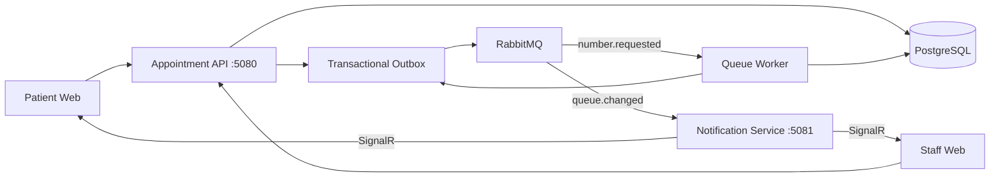

# Đề tài 09 — Hệ thống đặt lịch khám và quản lý hàng đợi

Ứng dụng demo C# / **.NET 10 Minimal API**, PostgreSQL, RabbitMQ, Worker Service và SignalR. Giao diện web tiếng Việt, không cần Node.js. Đối chiếu hai tài liệu gốc: `09-he-thong-dat-lich-kham-va-hang-doi.md.pdf` và `HUONG-DAN-CHUNG.md.pdf`. Báo cáo đầy đủ ở [BAO-CAO.md](BAO-CAO.md), kịch bản thuyết trình ở [DEMO.md](DEMO.md). Git bắt đầu ghi nhận từ bản bàn giao tối ưu; không tái tạo lịch sử phát triển trước đó. Hướng dẫn chuẩn bị repository GitHub ở [GIT-HANDOFF.md](GIT-HANDOFF.md).

## Khởi động nhanh

Cần Docker Desktop chạy Linux containers. Lần đầu cần mạng để tải image và NuGet. Chạy từ `D:\ptudpt\DuAn`:

```powershell
Copy-Item .env.example .env
docker compose up -d --build
docker compose ps
```

Hoặc `powershell -ExecutionPolicy Bypass -File scripts/start.ps1`. Chờ API sẵn sàng tại `http://localhost:5080/health`.

| Thành phần | URL / thông tin demo |
|---|---|
| Bệnh nhân | http://localhost:5080/ |
| Nhân viên | http://localhost:5080/staff.html |
| Mật khẩu nhân viên mặc định | `demo-staff-2026` |
| SignalR hub | http://localhost:5081/hubs/queue |
| RabbitMQ Management | http://localhost:15672/ — `clinic` / `clinic-demo-password` |
| PostgreSQL | localhost:5432, database/user `clinic`, password `clinic-demo-password` |

Các giá trị trên dành cho demo tại localhost. `.env.example` chứa biến mẫu; đổi mật khẩu và signing key khi dùng ngoài máy cá nhân. Mật khẩu RabbitMQ trong URI cần URL encode nếu dùng ký tự đặc biệt. Compose chỉ bind port trên loopback. Khi đổi API_PORT, truy cập bằng port mới; script start hiện kiểm tra port mặc định 5080.

Database tự áp dụng migration SQL nhúng `src/Clinic.Core/Migrations/001_initial.sql`, ghi phiên bản vào `schema_migrations`, có advisory lock để các service không migrate đồng thời. Seed idempotent: hai bác sĩ và lịch trong bảy ngày, ba khung mỗi ngày: 00–08 (1 chỗ), 08–12 (8 chỗ), 12–24 (8 chỗ). API chỉ liệt kê khung chưa kết thúc. Khung rộng giúp demo theo thời gian thực; chọn khung đang diễn ra để có thể gọi ngay. Khởi động lại service để bổ sung bảy ngày tính từ hôm nay; không cần xóa volume.

## Cách demo

1. Mở cửa sổ bệnh nhân, chọn bác sĩ, ngày hôm nay, khung còn chỗ; nhập tên và điện thoại, xác nhận đặt lịch. API trả trạng thái **Chờ cấp số**; Worker sau đó cấp số. Lưu **cả mã UUID và khóa truy cập** bằng nút sao chép. Session chỉ lưu lịch gần nhất trong từng tab.
2. Mở cửa sổ nhân viên, đăng nhập bằng mật khẩu trên, chọn cùng bác sĩ/ngày. Bấm **Gọi lượt tiếp theo**. Cửa sổ bệnh nhân đổi lượt đang phục vụ và trạng thái lịch qua SignalR.
3. Bấm **Hoàn thành lượt khám**, rồi gọi người tiếp theo. Không gọi chồng hai lượt. Hủy chỉ áp dụng trước khi đang khám; bấm hủy nhiều lần không trả chỗ nhiều lần.
4. Dùng `docker compose stop worker`, đặt lịch: giữ trạng thái Chờ cấp số. `docker compose start worker`: số được cấp từ thông điệp đang chờ.
5. Tắt mạng của tab bệnh nhân trong DevTools, thao tác ở nhân viên, bật lại mạng: client tham gia lại nhóm SignalR và GET API để đồng bộ lượt hiện tại. Có thể mô phỏng dừng Notification Service bằng `docker compose stop notification` và `docker compose start notification`.

```powershell
docker compose logs -f api worker notification
docker compose stop
docker compose start
```

`docker compose down` dừng/xóa container, giữ volume dữ liệu. Không cần xóa volume để demo.

## Kiến trúc và quyết định



Ba service chạy độc lập, có Dockerfile riêng, dùng service names `postgres`/`rabbitmq` trên Docker network. Shared library `Clinic.Core` chứa hợp đồng, nghiệp vụ, database và messaging; mỗi service dùng kết nối riêng. Notification chỉ nhận sự kiện đã đi qua RabbitMQ, không nhận trực tiếp từ API/Worker.

- **Một hàng đợi mỗi bác sĩ/ngày khám**, ngày tính theo Asia/Ho_Chi_Minh (UTC+7). Số tăng từ 1, duy nhất toàn hàng đợi, không tái sử dụng số đã hủy. Gọi theo `starts_at <= now()`, ưu tiên khung sớm rồi số trong khung. Chỉ gọi ngày hôm nay; lịch ngày mai được cấp số trước nhưng chưa được gọi. Lịch đang đợi vẫn được khám nếu khung giờ đã qua trong cùng ngày. Worker bỏ qua lịch hủy; lịch Pending từ ngày trước chuyển Expired và trả chỗ.
- Trạng thái: `Pending` (Chờ cấp số) → `Waiting` → `Serving` → `Completed`; Pending/Waiting → `Cancelled`. Pending quá ngày → `Expired`.
- **Giữ chỗ và tạo lịch cùng giao dịch**: khóa hàng đợi, UPDATE `reserved=reserved+1 WHERE reserved<capacity AND ends_at>now()`, tạo bệnh nhân/lịch/outbox rồi commit. Capacity có CHECK ở database. Hủy/worker/gọi lượt cùng thứ tự khóa hàng đợi để tránh tranh chấp và deadlock.
- **Idempotent consumer**: worker khóa hàng đợi và lịch, chỉ cấp khi Pending. Cập nhật counter và số trong một transaction; UNIQUE bác sĩ/ngày/số và partial UNIQUE một Serving/hàng đợi. Chỉ ACK sau commit; lỗi đóng channel sẽ khiến RabbitMQ giao lại. Hủy idempotent, chỉ giảm reserved lần chuyển trạng thái đầu tiên.
- **Outbox bền vững**: cả API và Worker ghi thông điệp trong transaction nghiệp vụ; publisher chọn row bằng `FOR UPDATE SKIP LOCKED`, dùng persistent messages, durable exchange/queues và publisher confirms + mandatory routing. Chỉ đánh dấu sent sau confirm. Crash giữa publish và đánh dấu sent có thể phát lại; nghiệp vụ và client chịu được thông điệp trùng. Không giả lập bus trong bộ nhớ. Broker lỗi: giữ outbox và retry. Consumer lỗi kết nối tự thử lại; JSON sai được chuyển `clinic.dead`.
- **Realtime**: sự kiện chỉ yêu cầu client lấy snapshot mới nhất, tránh sai thứ tự khi nhận sự kiện trùng/chậm. Sau reconnect client tham gia lại các nhóm và GET lại queue/lịch cá nhân. Không polling hàng đợi định kỳ. Màn hình có nút cập nhật thủ công khi cần.
- **Phân quyền**: thao tác nội bộ yêu cầu bearer có role Staff, HMAC SHA-256, hết hạn sau 4 giờ; endpoint đăng nhập giới hạn số lần thử. Lịch cá nhân cần capability token ngẫu nhiên 256 bit, DB chỉ giữ SHA-256 của token. REST dùng header `X-Appointment-Token`, SignalR kiểm tra token trước JoinAppointment. Queue public chỉ trả số và khung giờ, không trả tên, điện thoại hay mã lịch. CORS Notification giới hạn origin cấu hình. Mật khẩu demo được lấy từ cấu hình, không nhúng trong giao diện.

Tham khảo cơ chế xác nhận gửi trong [RabbitMQ .NET guide](https://www.rabbitmq.com/client-libraries/dotnet-api-guide) và [khóa PostgreSQL](https://www.postgresql.org/docs/17/explicit-locking.html).

## API

| Method/path | Mục đích / quyền |
|---|---|
| GET `/doctors` | Danh sách bác sĩ |
| GET `/doctors/{id}/slots?date=2026-11-15` | Khung giờ và chỗ còn lại; mặc định hôm nay |
| POST `/appointments` | `{ "slotId":"UUID", "patientName":"Nguyễn Văn An", "phone":"0901234567" }`; trả 201 gồm id, accessToken, trạng thái hiện tại; hỗ trợ header Idempotency-Key |
| GET `/appointments/{id}` | Khóa cá nhân hoặc Staff; trả lịch và số |
| DELETE `/appointments/{id}` | Khóa cá nhân hoặc Staff; hủy thành công trả 204 |
| GET `/queues/{doctorId}?date=2026-11-15` | Lượt hiện tại và danh sách số đang đợi |
| POST `/staff/login` | `{ "password":"..." }`; trả bearer token |
| POST `/internal/queues/{doctorId}/next?date=...` | Staff, gọi lượt tiếp theo |
| POST `/internal/queues/{doctorId}/complete?date=...` | Staff, hoàn thành lượt hiện tại |
| GET `/health` | API kiểm tra DB; Notification cho biết HTTP service đã khởi động |

403: khóa cá nhân sai/thiếu; 401: thiếu/không hợp lệ bearer Staff; 409: hết chỗ hoặc thao tác không hợp lệ. Mã UUID là mã lịch hẹn để tra cứu; khóa truy cập là thông tin xác thực riêng.

## Chạy .NET trên host và kiểm thử

Cần SDK .NET 10; `global.json` cho phép SDK 10.0 feature band mới hơn. Tệp appsettings của từng service chứa cấu hình localhost mẫu, có thể ghi đè qua biến môi trường .NET `ConnectionStrings__Clinic`, `RabbitMQ__Uri`, `Auth__StaffPassword`, `Auth__SigningKey`, `Notification__PublicUrl`, `ClientOrigins__0` và `ASPNETCORE_URLS`. Muốn chạy native, chỉ bật postgres/rabbitmq bằng Compose rồi chạy từng service ở terminal riêng:

```powershell
dotnet build Clinic.sln
docker compose up -d postgres rabbitmq
dotnet run --project src/Appointment.Api
dotnet run --project src/Queue.Worker
dotnet run --project src/Notification.Service
```

Không chạy native cùng lúc với các service Compose dùng chung port. Bộ kiểm thử dưới đây cần **toàn bộ stack Compose** vì thực sự stop/start Worker và RabbitMQ; chạy trên stack demo riêng, không có người đặt lịch đồng thời. Không chạy các bộ smoke song song.

```powershell
docker compose up -d --build
dotnet run --project tests/Clinic.Smoke
# hoặc
powershell -ExecutionPolicy Bypass -File scripts/test.ps1
```

Đây là executable integration suite, trả exit code khác 0 nếu có lỗi (không dùng `dotnet test` để thay thế). Nó dùng PostgreSQL, RabbitMQ và trình duyệt Chromium thật qua Playwright, tạo fixture bác sĩ/khung giờ riêng rồi dọn đúng fixture đó. Script `test.ps1` tải Chromium vào `.local/browsers` trong DuAn (chỉ cần tải lần đầu). Khi chạy trực tiếp bằng `dotnet run`, nếu chưa có browser cục bộ, đặt `$env:PLAYWRIGHT_BROWSERS_PATH="$PWD/.local/browsers"` rồi chạy `powershell -ExecutionPolicy Bypass -File tests/Clinic.Smoke/bin/Debug/net10.0/playwright.ps1 install chromium` sau khi build. Có thể đặt `TEST_BROWSER` trỏ đến Chrome khác và ghi đè `TEST_API_URL`, `TEST_DATABASE`, `TEST_RABBITMQ_URI`, `TEST_STAFF_PASSWORD` nếu đổi cấu hình.

Kết quả từng ca, thời lượng và bằng chứng được ghi vào `TestResults/smoke-results.json`; ảnh hai cửa sổ ở `TestResults/patient-live.png` và `staff-live.png`. Kết quả quan sát trong lần triển khai này được ghi riêng trong `VERIFICATION.md`.

## Phạm vi demo

Chạy một Notification Service; mở rộng nhiều replica cần fanout riêng từng instance hoặc SignalR backplane. Chưa có đăng ký tài khoản bệnh nhân, xác thực OTP, SMS/email, quản trị lịch bác sĩ hoặc giao diện xử lý DLQ. Người bệnh giữ mã/khóa để truy cập lịch. Health Notification hiện chỉ kiểm tra HTTP, không khẳng định broker đang kết nối. Chưa kiểm chứng triển khai production, tải lớn và sự cố mất điện/mất đĩa; volume Docker cung cấp độ bền trong phạm vi khởi động lại container của bản demo.

## Đặt lịch an toàn khi thử lại

Báo cáo Word để chỉnh sửa/in: [BAO-CAO.docx](BAO-CAO.docx). Nguồn là BAO-CAO.md; có thể xuất lại bằng `python scripts/export-report.py` sau khi cài `python-docx` và `Pillow`. Sơ đồ trong Word được tạo từ các bố cục tương ứng trong script; nếu sửa kiến trúc ở Markdown cần cập nhật bố cục trong script.

Web tạo `Idempotency-Key` bằng 32 byte ngẫu nhiên, mã hóa thành 64 ký tự hex. Khóa và nội dung đặt lịch được giữ trong `sessionStorage` trước khi POST. Nếu chưa nhận được kết quả, nút **Thử lại yêu cầu trước** gửi lại đúng khóa/nội dung, kể cả sau reload trong cùng tab. Khi còn yêu cầu chưa rõ kết quả, thao tác đặt lịch tiếp tục xác nhận yêu cầu đó. Không đóng tab trước khi xác nhận vì dữ liệu session chỉ tồn tại trong tab.

API vẫn hỗ trợ client cũ không có header (mỗi POST tạo một lịch). Client có header phải gửi đúng 64 ký tự hex. Cùng khóa và cùng nội dung sau khi trim tên/điện thoại trả HTTP 201 với cùng ID, accessToken và trạng thái hiện tại, không giữ thêm chỗ hoặc phát thêm message. Cùng khóa nhưng khác nội dung trả 409; khóa sai định dạng trả 400. Retry lịch đã hủy trả lịch Cancelled, không tạo lịch thay thế. Không suy luận trạng thái hiện tại từ HTTP 201; đọc trường `status` hoặc GET lịch.

Migration `002_booking_requests.sql` lưu hash khóa, hash nội dung và ID lịch trong cùng transaction đặt lịch; advisory lock theo hash khóa tuần tự hóa request trùng trên nhiều API instance. Access token được tái tạo bằng HMAC-SHA256 với `Auth:SigningKey`; DB không lưu khóa retry hoặc token dạng rõ. Khóa retry cũng là thông tin bí mật, không chia sẻ/ghi log. Giữ SigningKey ổn định để replay trả đúng token. Nếu đổi SigningKey, lịch và token đã cấp vẫn có hiệu lực nhưng replay khóa cũ trả 409 để tránh tạo trùng; dùng mã/khóa lịch đã lưu để tra cứu. Bản ghi chống trùng được giữ theo lịch hẹn, chưa có tác vụ xóa tự động.

Đặt lịch ghi thêm `queue.changed` ngay trong transaction để cập nhật chỗ trống khi Worker dừng. Client cập nhật cả queue và slots khi nhận sự kiện, giữ khung đang chọn nếu còn chỗ; reconnect tải lại cả hai. Reload khôi phục bác sĩ/ngày theo lịch cá nhân. Bộ đếm request ngăn phản hồi cũ ghi đè kết quả mới; hàng đợi thao tác subscribe tránh đổi nhóm SignalR chồng nhau.
