# Bài 1 – Tổng quan hệ thống và các mô hình trao đổi thông điệp (MEP)

**Họ và tên:** Dương Thị Tiến  
**MSSV:** dtc245200850  
**Repository GitHub:** https://github.com/dtc245200850-spec/EduSubmit-dtc245200850  

---

## 1. Cài đặt môi trường (Bước 4)

- Đã hoàn thành cài đặt .NET 10 SDK (`10.0.403`), Visual Studio Code (kèm C# Dev Kit, REST Client), và Git (`2.55.0`).
- Đã cấu hình thông tin định danh Git:
  ```bash
  git config --global user.name "dtc245200850"
  git config --global user.email "dtc245200850@ictu.edu.vn"
  ```
- Kiểm tra môi trường bằng cách tạo và chạy dự án console mẫu `HelloPtudpt`:

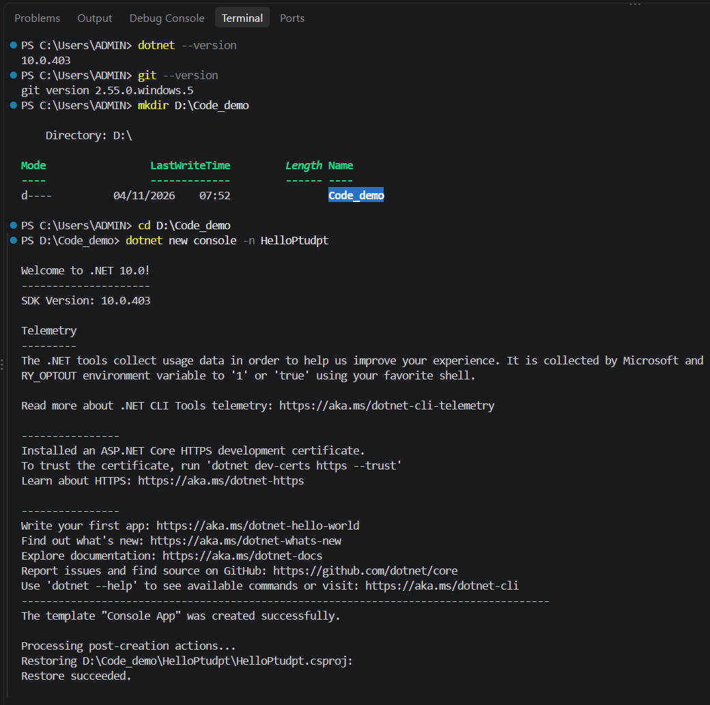

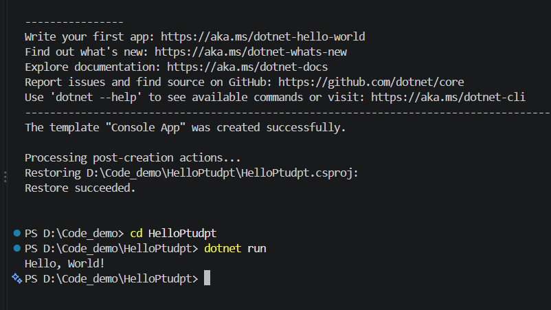

---

## 2. MepDemo – Quan sát 5 mô hình trao đổi thông điệp (Bước 7)

- Chạy toàn bộ chương trình mô phỏng 5 mô hình trao đổi thông điệp (MEP):
  ```bash
  dotnet run
  ```

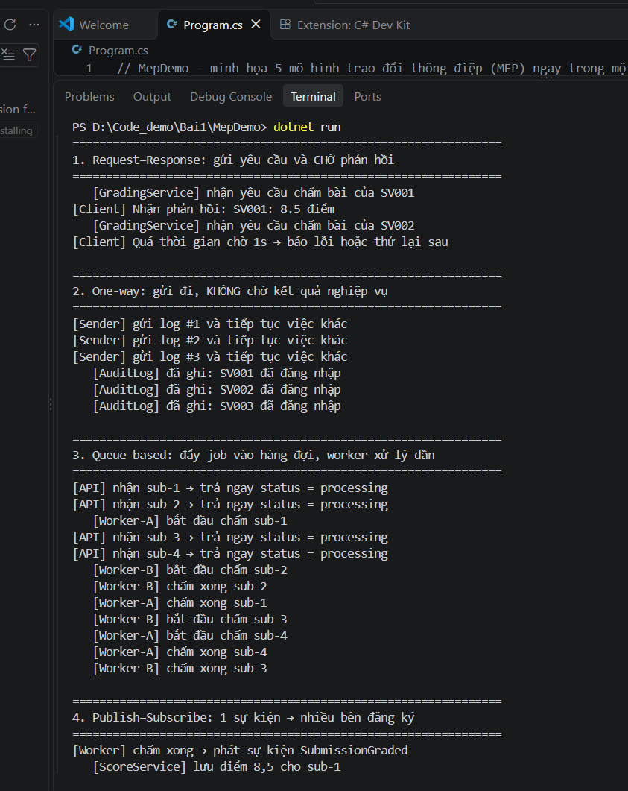

- Chạy từng mô hình riêng lẻ với tham số dòng lệnh (`dotnet run -- 1`, `dotnet run -- 3`, `dotnet run -- 4`):

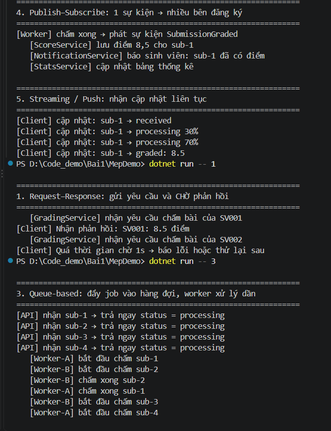

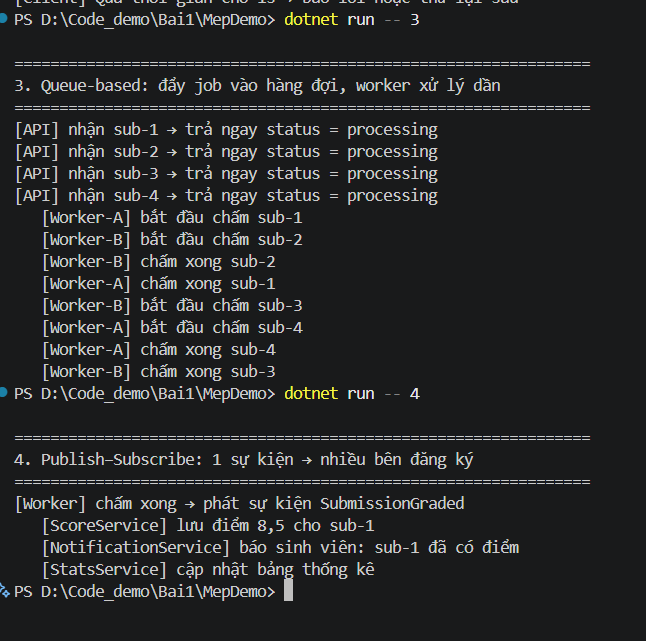

### Trả lời câu hỏi Bước 7:

1. **Ở MEP 3 (Queue-based), mỗi bài nộp `sub-x` được mấy worker xử lý?**
   - **Trả lời:** Mỗi bài nộp (`sub-x`) chỉ do **1 worker** duy nhất xử lý. Hàng đợi đóng vai trò làm bộ đệm công việc, các worker độc lập (`Worker-A`, `Worker-B`) chia nhau lấy các bài nộp ra chấm, đảm bảo không có hai worker nào xử lý trùng lặp cùng một bài nộp.

2. **Ở MEP 4 (Publish-Subscribe), một sự kiện được gửi tới mấy dịch vụ?**
   - **Trả lời:** Một sự kiện (ví dụ `SubmissionGraded` phát ra khi chấm xong) được gửi đồng thời tới **cả 3 dịch vụ** đã đăng ký lắng nghe:
     - `ScoreService`: lưu điểm số.
     - `NotificationService`: thông báo kết quả tới sinh viên.
     - `StatsService`: cập nhật dữ liệu bảng thống kê.

3. **Mô tả 1 câu ngắn gọn cho mỗi mô hình trong 5 MEP:**
   - **Request-Response (Yêu cầu - Phản hồi):** Bên gửi phát yêu cầu tới bên nhận và tạm dừng chờ phản hồi kết quả trước khi tiếp tục công việc.
   - **One-Way (Một chiều / Fire-and-forget):** Bên gửi đẩy thông điệp đi và tiếp tục ngay công việc của mình mà không cần chờ kết quả xử lý.
   - **Queue-based (Hàng đợi công việc):** Các thông điệp nhiệm vụ được đưa vào hàng đợi trung gian để các worker độc lập lần lượt lấy ra xử lý theo năng lực.
   - **Publish-Subscribe (Xuất bản - Đăng ký):** Bên phát tin đẩy sự kiện lên chủ đề (topic), tất cả các dịch vụ đăng ký theo dõi chủ đề đó đều sẽ nhận được một bản sao sự kiện.
   - **Streaming / Push (Dòng dữ liệu / Đẩy liên tục):** Kết nối được duy trì liên tục để máy chủ chủ động đẩy các gói tin cập nhật trạng thái mới về phía máy khách theo thời gian thực.

---

## 3. BasicWebApi – Chạy và tìm hiểu Web API (Bước 8)

- Biên dịch và khởi động API ở cổng 5081:
  ```bash
  dotnet build
  dotnet run --project src/BasicWebApi --urls http://localhost:5081
  ```

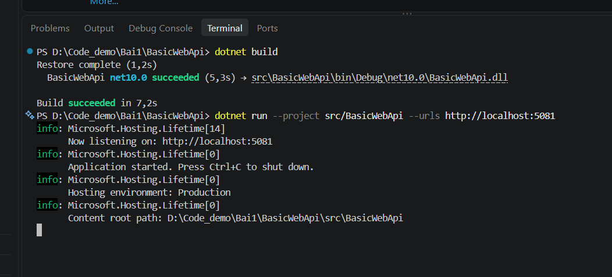

- Kiểm tra API hoạt động thông qua trình duyệt:

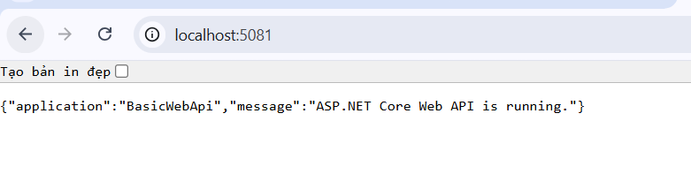

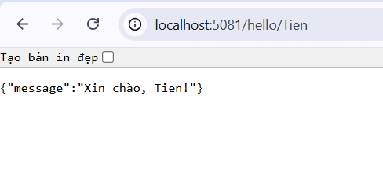

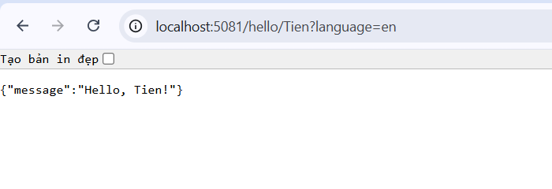

- Kiểm thử bằng tiện ích REST Client (`requests.http`):

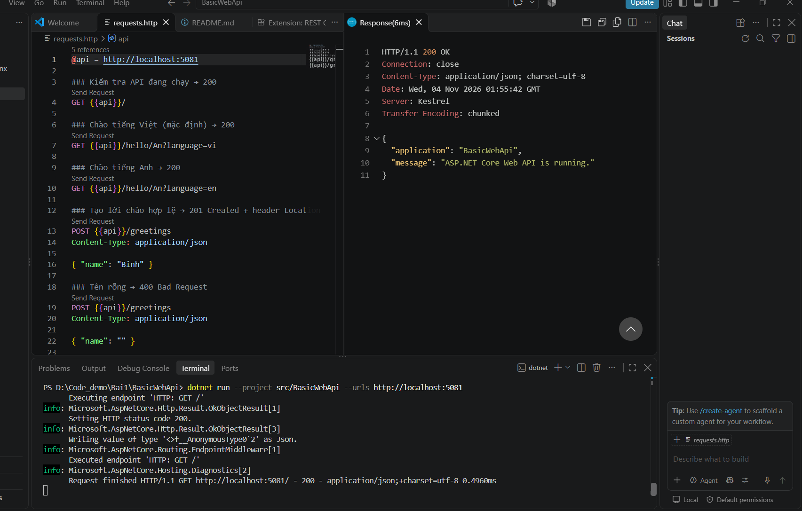

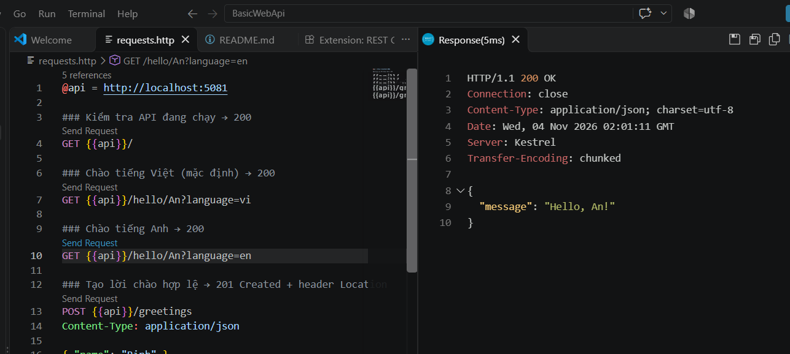

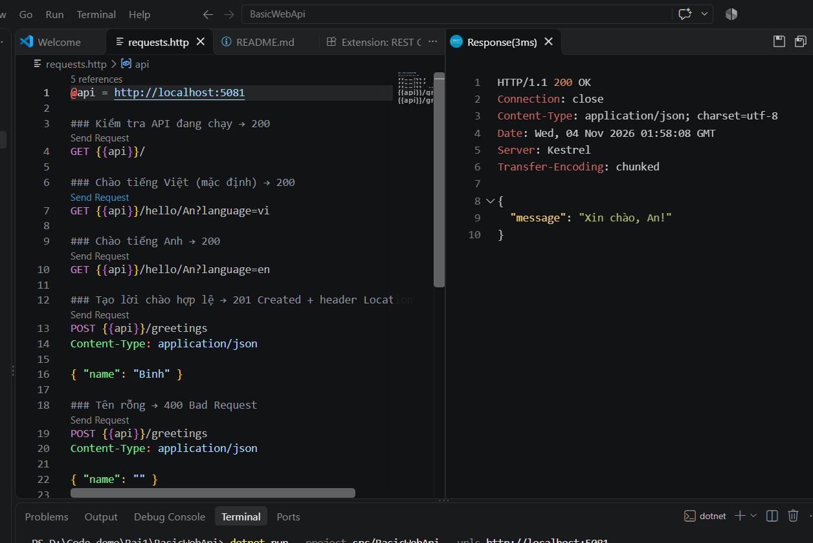

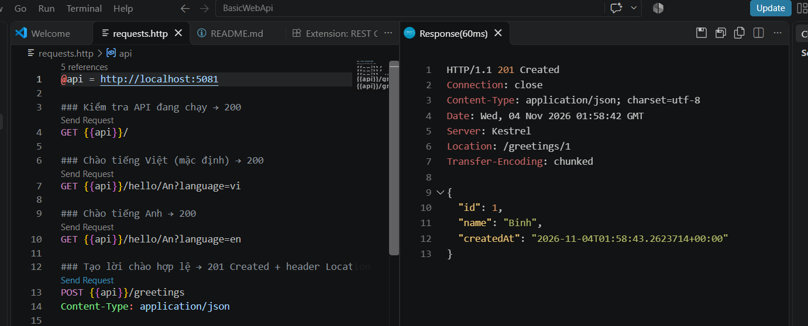

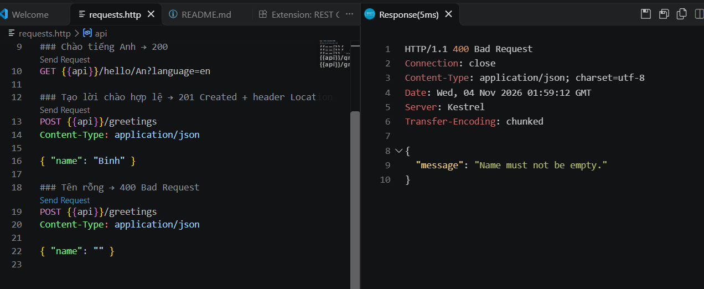

- Nhật ký request ghi nhận trên terminal của API:

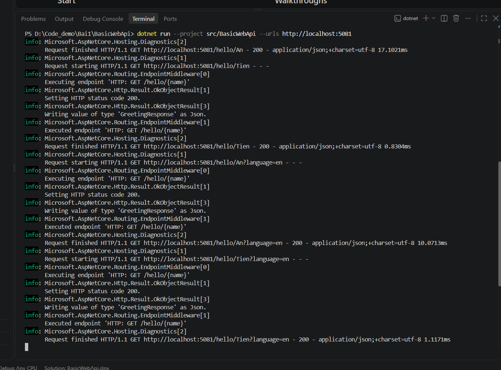

- **Tự làm (Bước 8.5):** Bổ sung ngôn ngữ tiếng Nhật (`language=ja` trả về `"Konnichiwa, {name}!"`):

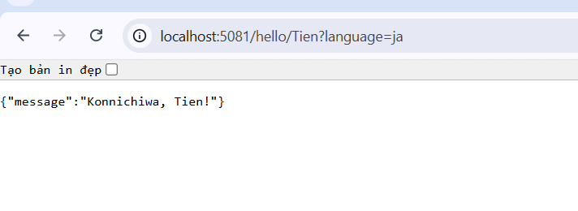

### Trả lời câu hỏi Mục 8.4:

1. **Hai dòng `builder.Services.AddSingleton...` và `var app = builder.Build();` – dòng nào phải đứng trước? Vì sao?**
   - **Trả lời:** Dòng `builder.Services.AddSingleton<GreetingService>();` phải đứng trước dòng `var app = builder.Build();`.
   - **Vì sao:** Mọi dịch vụ cần phải được đăng ký vào Dependency Injection (DI) Container trước khi ứng dụng được xây dựng và đóng gói bằng lệnh `builder.Build()`. Nếu gọi `builder.Build()` trước, ứng dụng sẽ không nhận diện được `GreetingService` khi endpoint `POST /greetings` gọi đến, dẫn đến lỗi runtime thiếu phụ thuộc.

2. **Trong `/hello/{name}?language=en`, tham số `name` lấy từ đâu, `language` lấy từ đâu?**
   - **Trả lời:**
     - Tham số `name` lấy từ **Route parameter** (nằm trực tiếp trong mẫu định tuyến URL `/hello/{name}`).
     - Tham số `language` lấy từ **Query string** (nằm phía sau dấu `?` trong URL).

3. **Vì sao POST hợp lệ trả `Results.Created` (201) chứ không phải `Results.Ok` (200)?**
   - **Trả lời:** Vì yêu cầu POST này đã tạo mới thành công một tài nguyên trên hệ thống (`greeting`). Theo chuẩn thiết kế RESTful API và quy ước của giao thức HTTP, mã trạng thái `201 Created` biểu thị một đối tượng/tài nguyên đã được khởi tạo thành công (đồng thời trả kèm theo header `Location` chứa đường dẫn truy cập tài nguyên vừa tạo), trong khi mã `200 OK` chỉ dùng cho các thao tác xử lý hoặc truy vấn thông thường.

---

## 4. MiniDistributedSystem – Hai tiến trình giao tiếp qua HTTP (Bước 9)

- Khởi chạy đồng thời 2 tiến trình: `Submission.Api` (máy chủ - port 5000) và `Submission.Client` (máy khách):
  - Terminal 1 (API): `dotnet run --project src/Submission.Api --urls http://localhost:5000`
  - Terminal 2 (Client): `dotnet run --project src/Submission.Client -- http://localhost:5000`

- Kiểm tra API qua trình duyệt:

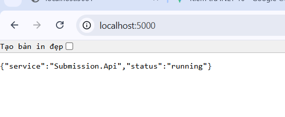

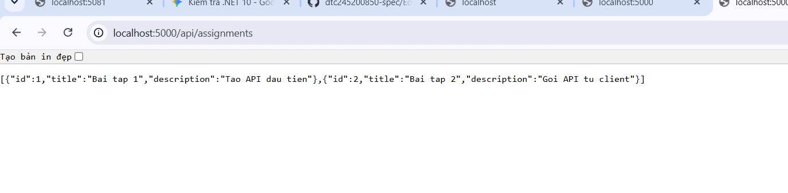

<!-- *(Ảnh minh họa chạy 2 terminal song song của MiniDistributedSystem - Bỏ comment sau khi thêm ảnh):*
 -->

### Trả lời câu hỏi Bước 9:

1. **Client gọi những endpoint nào của API? Mỗi lần gọi là một cặp request–response gồm method, URL, mã trạng thái gì?**
   - Client gọi 2 lượt đến các endpoint của API:
     - **Lần 1 — Lấy danh sách bài tập:**  
       Method & URL: `GET /api/assignments` (hoặc `http://localhost:5000/api/assignments`)  
       Response Status Code: `200 OK`
     - **Lần 2 — Nộp bài tập:**  
       Method & URL: `POST /api/submissions` (hoặc `http://localhost:5000/api/submissions`)  
       Response Status Code: `201 Created` kèm header `Location: /api/submissions/{id}`

2. **Client có tham chiếu (dùng chung) code của API không? Hai bên "thống nhất" với nhau bằng gì?**
   - **Tham chiếu code:** Không. Client hoàn toàn độc lập, không thêm project reference hay dùng chung DLL/class nào của API. Mỗi project tự định nghĩa các `record` dữ liệu của mình.
   - **Cơ chế "thống nhất":** Hai bên giao tiếp và thống nhất với nhau thông qua **Hợp đồng API (API Contract)** với định dạng chuẩn JSON truyền qua giao thức HTTP:
     - Định dạng và tên các trường trong cấu trúc dữ liệu JSON (`assignmentId`, `studentCode`, `repositoryUrl`...).
     - Đường dẫn URL và HTTP Method tương ứng (`GET`, `POST`).
     - Các mã trạng thái HTTP chuẩn (`200 OK`, `201 Created`, `400 Bad Request`).

3. **Vì sao địa chỉ API được truyền qua tham số `-- http://localhost:5000` mà không viết cứng trong code?**
   - **Tính linh hoạt (Flexibility):** Cho phép Client dễ dàng kết nối tới các môi trường khác nhau (như development, staging, production hoặc các cổng mạng khác nhau) chỉ bằng cách đổi tham số khi chạy, không cần sửa code hay biên dịch lại ứng dụng.
   - **Tách biệt cấu hình khỏi mã nguồn:** Tuân thủ nguyên tắc thiết kế ứng dụng phân tán chuẩn (Config as code / 12-Factor App), giúp ứng dụng dễ bảo trì và tự động hóa triển khai.

---

## 5. Thí nghiệm lỗi – "Phá thử" hệ thống (Bước 10)

Bảng ghi nhận kết quả 4 thí nghiệm lỗi trên `MiniDistributedSystem`:

| # | Thao tác thực hiện | Dự đoán (ghi TRƯỚC khi chạy) | Kết quả thực tế | Đúng/Sai | Giải thích nguyên nhân |
| :-: | :--- | :--- | :--- | :-: | :--- |
| **a** | Trong `Submission.Api/Program.cs`, thêm bài tập thứ 3 vào mảng `assignments`. Chạy lại API rồi chạy Client. | Client vẫn chạy bình thường và in ra cả 3 bài tập mà không cần sửa code Client. | Client nhận và in ra đủ 3 bài tập (`1: Bai tap 1`, `2: Bai tap 2`, `3: Bai tap 3`). | **Đúng** | Do Client giải mã danh sách bài tập dưới dạng mảng JSON động (`List<Assignment>`), cấu trúc dữ liệu không bị cố định số lượng phần tử nên API mở rộng dữ liệu không làm gãy Client. |
| **b** | Tắt API (`Ctrl + C` ở Terminal 1), rồi chạy Client. | Client sẽ không kết nối được và báo lỗi kết nối mạng / từ chối kết nối. | Văng ngoại lệ: `HttpRequestException: No connection could be made because the target machine actively refused it`. | **Đúng** | Trong hệ thống phân tán, hai tiến trình giao tiếp qua mạng nên sự thành công phụ thuộc vào trạng thái của máy chủ và kết nối mạng. Khác với gọi hàm nội bộ (in-memory) luôn có sẵn trong cùng tiến trình bộ nhớ. |
| **c** | Trong `Submission.Client/Program.cs`, đổi `StudentCode: "SV001"` thành `StudentCode: ""`. Chạy lại Client. | API phát hiện dữ liệu rỗng trả về `400 Bad Request`. Dòng `EnsureSuccessStatusCode()` ở Client sẽ văng ngoại lệ. | API trả mã `400 Bad Request`. Client báo lỗi: `HttpRequestException: Response status code does not indicate success: 400 (Bad Request)`. | **Đúng** | Lệnh `EnsureSuccessStatusCode()` kiểm tra mã HTTP phản hồi; nếu không thuộc dải 2xx thì ném ngoại lệ ngay. Máy chủ luôn phải tự xác thực (validate) dữ liệu vì không thể tin tưởng dữ liệu Client gửi lên. |
| **d** | Chạy API ở cổng 5050 (`--urls http://localhost:5050`), Client vẫn mặc định 5000. Sau đó sửa cho chạy được mà không sửa code. | Truyền trực tiếp địa chỉ cổng mới vào tham số dòng lệnh của Client: `dotnet run -- http://localhost:5050`. | Client kết nối thành công tới cổng 5050, lấy danh sách bài tập và nộp bài bình thường. | **Đúng** | Client được thiết kế lấy địa chỉ qua `args[0]` (`var baseUrl = args.Length > 0 ? args[0] : "http://localhost:5000";`), nhờ đó cấu hình mạng có thể ghi đè lúc chạy mà không cần sửa mã nguồn. |

<!--
### Ảnh chụp minh chứng các thí nghiệm lỗi (Bỏ comment sau khi thêm các file ảnh tương ứng vào docs/images/):

*(Ảnh minh chứng thí nghiệm a - Thêm bài tập thứ 3:)*  


*(Ảnh minh chứng thí nghiệm b - Tắt API báo lỗi kết nối:)*  


*(Ảnh minh chứng thí nghiệm c - Dữ liệu rỗng báo lỗi 400 Bad Request:)*  


*(Ảnh minh chứng thí nghiệm d - Chạy API cổng 5050 và Client đổi URL qua tham số:)*  

-->

---

## 6. Dự án EduSubmit tự làm (Bước 11 – 12)

### 6.1 Khởi tạo và lập trình giải pháp EduSubmit:
- Đã khởi tạo solution `EduSubmit` gồm:
  - `Submission.Api`: ASP.NET Core Minimal API.
  - `Submission.Client`: Console Application.
- Triển khai đầy đủ các endpoint theo đặc tả:
  - `GET /` -> `200 OK` kèm trạng thái dịch vụ.
  - `GET /api/assignments` -> `200 OK` kèm danh sách bài tập.
  - `POST /api/submissions` -> Kiểm tra hợp lệ dữ liệu, sinh mã `Guid`, trả về `201 Created` kèm header `Location`.

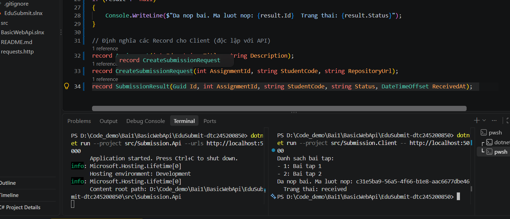

### 6.2 Bài mở rộng (Bước 12):
- **Phía API:**
  - Tạo danh sách `var submissions = new List<SubmissionResult>();` để lưu vết các lượt nộp bài trong bộ nhớ.
  - Xây dựng endpoint `GET /api/submissions/{id:guid}`: trả về `200 OK` nếu tìm thấy lượt nộp, trả về `404 Not Found` nếu không tồn tại.
- **Phía Client:**
  - Sau khi nhận phản hồi nộp bài thành công, Client tự động gọi `GET /api/submissions/{result.Id}` để truy vấn lại thông tin lượt nộp vừa tạo và in kết quả ra màn hình.

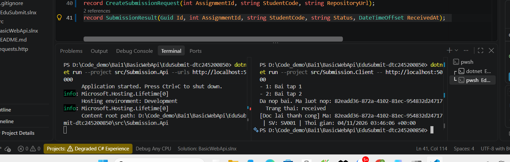

### 6.3 Kiểm thử với `requests.http`:
- Đã tạo file `requests.http` tại thư mục gốc của dự án với đủ 6 trường hợp kiểm thử:
  1. `GET /` -> `200 OK`
  2. `GET /api/assignments` -> `200 OK`
  3. `POST /api/submissions` hợp lệ -> `201 Created`
  4. `POST /api/submissions` dữ liệu rỗng -> `400 Bad Request`
  5. `GET /api/submissions/{id}` tồn tại -> `200 OK`
  6. `GET /api/submissions/{id}` không tồn tại -> `404 Not Found`

<!-- *(Ảnh minh chứng kiểm thử 6 request bằng requests.http - Bỏ comment sau khi thêm ảnh):*
 -->

### 6.4 Tự đánh giá và Luồng thông điệp:
- **Phần nào phải xem code mẫu:** Phần lớn cấu trúc chương trình được tự viết dựa trên kiến thức từ `BasicWebApi` và `MiniDistributedSystem`. Chỉ tham khảo lại code mẫu ở cú pháp trả về `Results.Created($"/api/submissions/{result.Id}", result)` và phương thức mở rộng `PostAsJsonAsync` của `HttpClient`.
- **Luồng thông điệp trong hệ thống EduSubmit:**
  ```text
  1. Lấy danh sách bài tập:
     Client ----(HTTP GET /api/assignments)----> API   : Request-Response (200 OK)

  2. Gửi lượt nộp bài mới:
     Client ----(HTTP POST /api/submissions)----> API  : Request-Response (201 Created + header Location)

  3. (Mở rộng) Đọc lại thông tin lượt nộp:
     Client ----(HTTP GET /api/submissions/{id})----> API : Request-Response (200 OK / 404 Not Found)
  ```

---

## 7. Khó khăn gặp phải và cách giải quyết

1. **Quản lý tiến trình và xung đột cổng mạng (Port In Use):**
   - *Khó khăn:* Khi chạy đồng thời nhiều dự án hoặc sau khi dừng đột ngột, tiến trình chạy ngầm vẫn giữ cổng (ví dụ cổng `5000` hoặc `5081`), khiến lần chạy tiếp theo bị báo lỗi `address already in use`.
   - *Cách giải quyết:* Dùng `Ctrl + C` để đóng đúng terminal chạy máy chủ, hoặc sử dụng cờ `--urls http://localhost:<port_khac>` để chuyển sang cổng mạng rảnh rỗi.

2. **Xác thực dữ liệu JSON từ Client gửi lên:**
   - *Khó khăn:* Cần xử lý cả trường hợp chuỗi rỗng (`""`), khoảng trắng và mã bài tập không hợp lệ (`<= 0`) trước khi khởi tạo dữ liệu nghiệp vụ.
   - *Cách giải quyết:* Sử dụng phương thức `string.IsNullOrWhiteSpace()` kết hợp điều kiện `request.AssignmentId <= 0` để trả về ngay `Results.BadRequest(...)`, bảo vệ dịch vụ phía máy chủ.

3. **Cấu hình Git và quản lý Tag khi nộp bài:**
   - *Khó khăn:* Sau khi gắn tag `bai1` lần đầu, nếu tiếp tục cập nhật file nhật ký thì tag cũ vẫn trỏ vào commit trước đó.
   - *Cách giải quyết:* Dùng cờ `-f` (`git tag -f bai1`) để ép tag di chuyển sang commit mới nhất, sau đó đẩy đè tag lên GitHub bằng lệnh `git push origin bai1 --force`.

---

## Minh chứng đẩy mã nguồn lên GitHub (Bước 13)

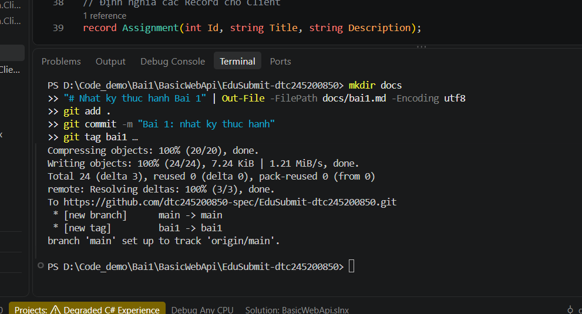
