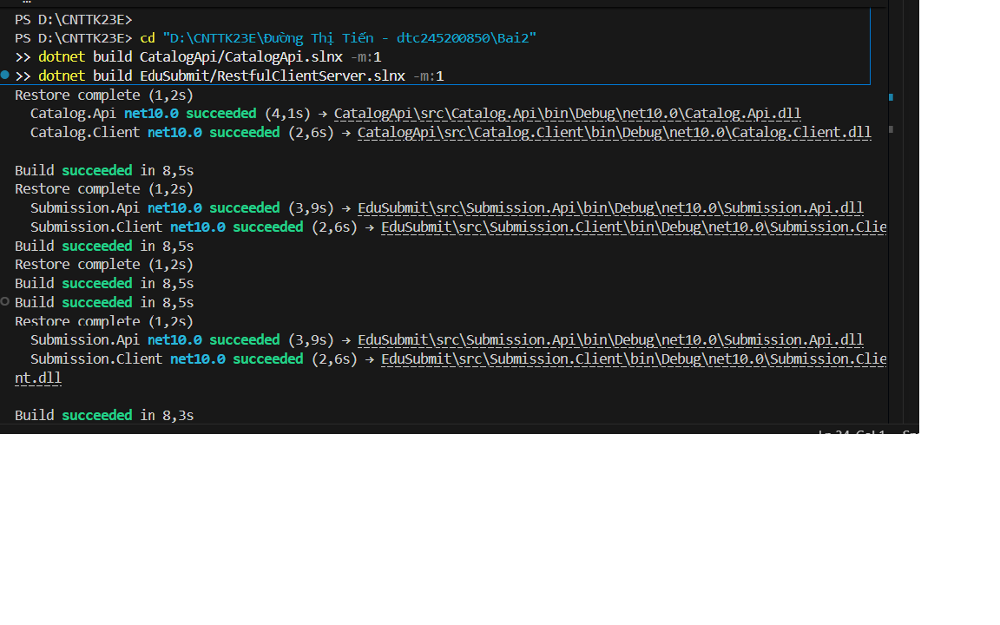
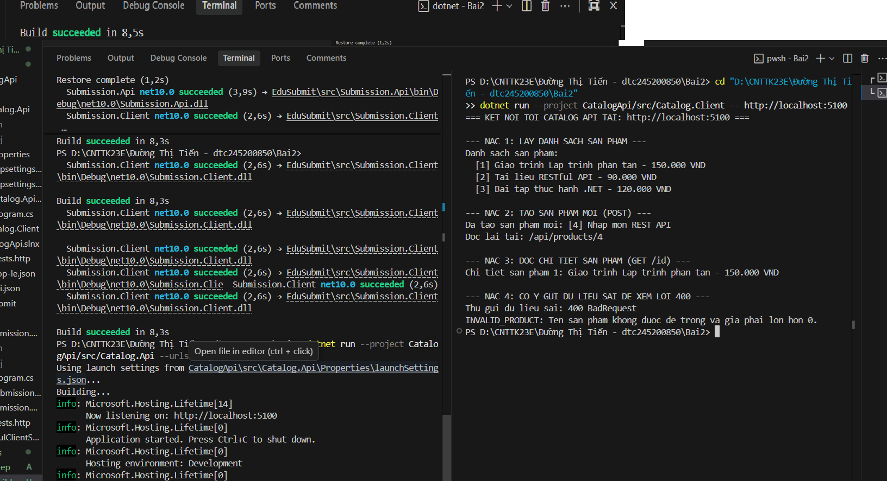
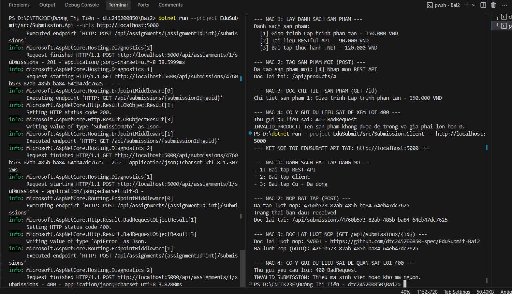
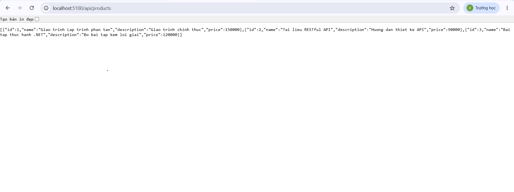

# Báo cáo thực hành Bài 2: RESTful API

- Sinh viên: Đường Thị Tiến
- Mã sinh viên: dtc245200850
- Lớp: CNTT K23E

---

## 1. Hướng dẫn chạy chương trình

### 1.1. Dự án CatalogApi (Cổng 5100)
- **Chạy Server:**
  ```powershell
  dotnet run --project CatalogApi/src/Catalog.Api --urls http://localhost:5100
  ```
- **Chạy Client:**
  ```powershell
  dotnet run --project CatalogApi/src/Catalog.Client -- http://localhost:5100
  ```
- Thử nghiệm các ca kiểm thử bằng file `CatalogApi/requests.http`.

### 1.2. Dự án EduSubmit (Cổng 5000)
- **Chạy Server:**
  ```powershell
  dotnet run --project EduSubmit/src/Submission.Api --urls http://localhost:5000
  ```
- **Chạy Client:**
  ```powershell
  dotnet run --project EduSubmit/src/Submission.Client -- http://localhost:5000
  ```
- Thử nghiệm các ca kiểm thử bằng file `EduSubmit/requests.http`.

---

## 2. Bảng phá thử (Kiểm thử lỗi & HTTP status codes)

| Ca thử | Mong đợi | Thực tế |
|---|---|---|
| **CatalogApi**: Đọc chi tiết sản phẩm không tồn tại (`GET /api/products/999`) | `404 Not Found` | `404 Not Found` kèm body `{ "code": "PRODUCT_NOT_FOUND", "message": "Khong tim thay san pham." }` |
| **CatalogApi**: Tham số ID sai kiểu số (`GET /api/products/abc`) | `404 Not Found` | `404 Not Found` (Kestrel chặn trước handler do ràng buộc `:int`, body rỗng) |
| **CatalogApi**: Tạo sản phẩm tên rỗng hoặc giá âm (`POST /api/products`) | `400 Bad Request` | `400 Bad Request` kèm body `{ "code": "INVALID_PRODUCT", "message": "Ten san pham khong duoc de trong va gia phai lon hon 0." }` |
| **CatalogApi**: Tạo sản phẩm tên quá dài > 100 ký tự (`POST /api/products`) | `400 Bad Request` | `400 Bad Request` kèm body `{ "code": "NAME_TOO_LONG", "message": "Ten san pham khong duoc vuot qua 100 ky tu." }` |
| **CatalogApi**: Tạo sản phẩm thiếu header `Content-Type` | `415 Unsupported Media Type` | `415 Unsupported Media Type` (Kestrel từ chối do không biết kiểu định dạng body) |
| **CatalogApi**: Xóa sản phẩm không tồn tại (`DELETE /api/products/999`) | `404 Not Found` | `404 Not Found` kèm body `{ "code": "PRODUCT_NOT_FOUND", "message": "Khong tim thay san pham de xoa." }` |
| **CatalogApi**: Chạy Client khi chưa bật Server API | Báo lỗi kết nối mạng | Ném ngoại lệ `HttpRequestException: Connection refused (localhost:5100)` |
| **EduSubmit**: Nộp bài thiếu thông tin (mã SV hoặc link repo rỗng) | `400 Bad Request` | `400 Bad Request` kèm body `{ "code": "INVALID_SUBMISSION", "message": "Thieu ma sinh vien hoac kho ma nguon." }` |
| **EduSubmit**: Nộp bài vào bài tập không tồn tại (`POST /api/assignments/999/submissions`) | `404 Not Found` | `404 Not Found` kèm body `{ "code": "ASSIGNMENT_NOT_FOUND", "message": "Bai tap khong ton tai." }` |
| **EduSubmit**: Nộp bài vào bài tập đã đóng hạn (`POST /api/assignments/3/submissions`) | `400 Bad Request` | `400 Bad Request` kèm body `{ "code": "ASSIGNMENT_CLOSED", "message": "Bai tap da dong, khong nhan bài nộp." }` |
| **EduSubmit**: Nộp bài trùng lặp (cùng mã SV vào 1 bài tập) | `409 Conflict` | `409 Conflict` kèm body `{ "code": "DUPLICATE_SUBMISSION", "message": "Sinh vien da nop bai tap nay." }` |
| **EduSubmit**: Đọc lượt nộp không tồn tại (`GET /api/submissions/{guid}`) | `404 Not Found` | `404 Not Found` kèm body `{ "code": "SUBMISSION_NOT_FOUND", "message": "Khong tim thay luot nop." }` |
| **EduSubmit**: Chạy Client khi chưa bật Server API | Báo lỗi kết nối mạng | Ném ngoại lệ `HttpRequestException: Connection refused (localhost:5000)` |

---

## 3. Trả lời câu hỏi lý thuyết (Slide 90)

### Câu 1: Vì sao URI dùng danh từ, còn hành động do phương thức HTTP đảm nhận?
- **Trả lời:**
  - Thiết kế RESTful coi mọi thực thể trong hệ thống là tài nguyên (Resource). Do đó URI chỉ dùng để đặt tên, định danh tài nguyên (danh từ, ví dụ `/api/products`, `/api/assignments/1/submissions`).
  - Các thao tác CRUD đã có sẵn các phương thức chuẩn của giao thức HTTP đảm nhận: `GET` (đọc), `POST` (tạo), `PUT` (thay thế), `PATCH` (sửa một phần), `DELETE` (xóa).
  - Cách làm này giúp URI ngắn gọn, nhất quán, tránh việc sinh ra hàng loạt URI tùy tiện chứa động từ (`/getProducts`, `/createProduct`, `/doSubmit`), đồng thời tận dụng được các cơ chế chuẩn của Web như caching và proxy.

### Câu 2: “Stateless” thể hiện ở đâu trong code đã viết?
- **Trả lời:**
  - Tính chất phi trạng thái (Stateless) thể hiện ở việc máy chủ không lưu bất kỳ thông tin phiên (session/conversation) nào của máy khách giữa hai lần gọi.
  - Trong code:
    - Ở máy chủ (`Catalog.Api` và `Submission.Api`), mỗi yêu cầu gửi đến đều tự chứa đầy đủ ngữ cảnh để xử lý: ID bài tập nằm trên route `{assignmentId}`, dữ liệu mã SV và URL nằm trong body DTO. Server xử lý xong là kết thúc, không lưu biến session hay cookie của client.
    - Ở máy khách (`Catalog.Client` và `Submission.Client`), mỗi lần gọi qua `HttpClient` đều đóng gói đầy đủ tham số và DTO cần thiết. Hai lần gọi liên tiếp không phụ thuộc vào trạng thái trung gian nào được lưu trên RAM của server.

### Câu 3: Vì sao client và server mỗi bên khai báo DTO riêng mà vẫn khớp nhau?
- **Trả lời:**
  - Trong hệ phân tán, client và server chạy ở hai tiến trình hoàn toàn riêng biệt (thậm chí có thể khác máy, khác ngôn ngữ lập trình), không chung bộ nhớ và không dùng chung file mã nguồn.
  - Cầu nối duy nhất giữa hai bên là thông điệp định dạng **JSON** truyền qua giao thức HTTP.
  - Khi server trả kết quả, đối tượng DTO phía server được tuần tự hóa (serialize) thành chuỗi JSON. Phía client nhận chuỗi JSON và tự giải tuần tự hóa (deserialize) vào DTO của riêng mình. Chỉ cần hai bên thống nhất đúng "hợp đồng" (tên trường và kiểu dữ liệu JSON khớp nhau, ví dụ `name`, `price`, `studentCode`), thì code hai bên tự định nghĩa DTO độc lập vẫn ghép nối chính xác.

---

## 4. Ảnh minh chứng kết quả thực hành (thư mục `images/`)

- **Ảnh 1: Kết quả build 0 lỗi cả 2 solution (`dotnet build`):**
  

- **Ảnh 2: CatalogApi chạy Server và Client đủ 4 nấc:**
  

- **Ảnh 3: EduSubmit chạy Server và Client nộp bài, đọc lại GUID:**
  

- **Ảnh 4: Kiểm thử API qua requests.http:**
  
