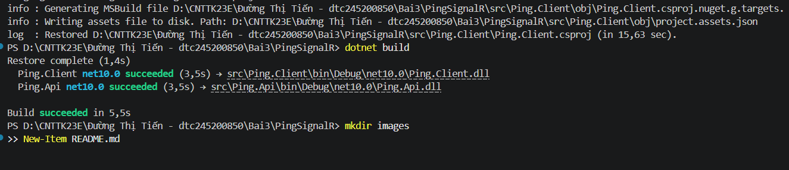
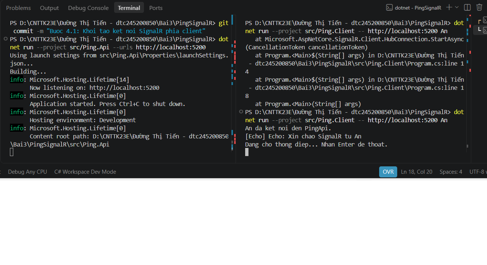
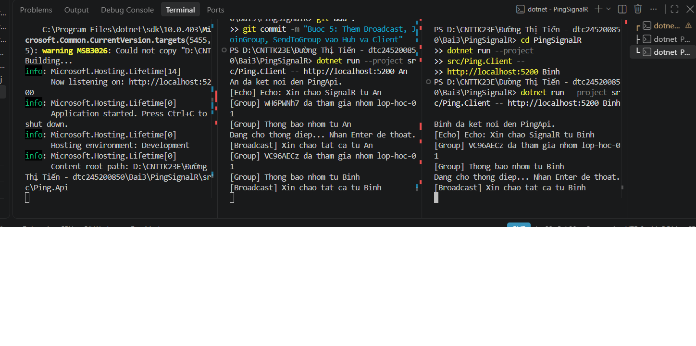
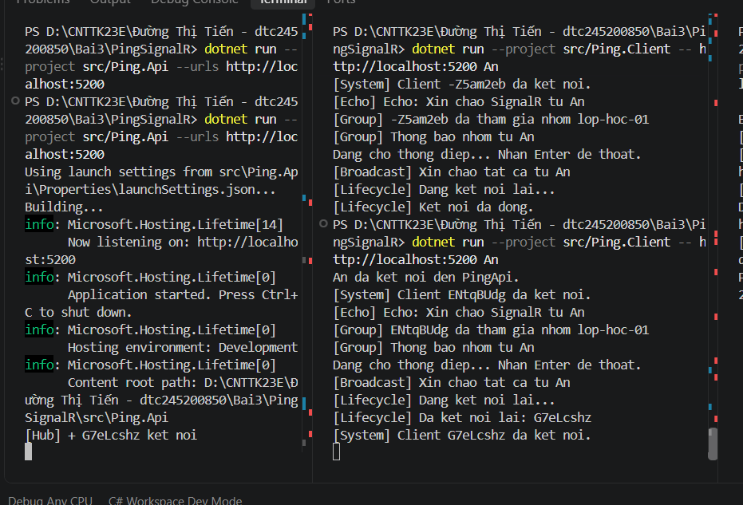
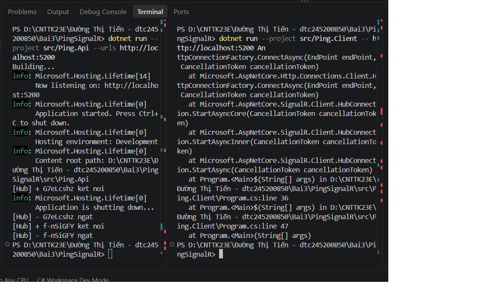
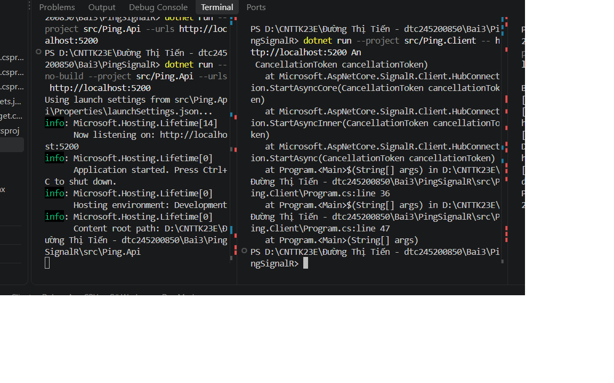
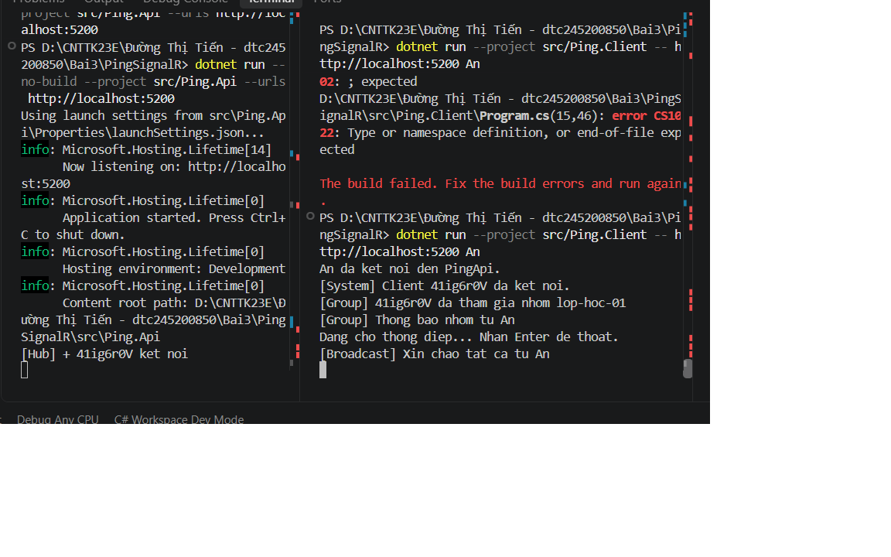

# Bài 3: Ứng dụng Ping với SignalR

- **Sinh viên:** Đường Thị Tiến
- **Mã sinh viên:** DTC245200850
- **Lớp:** CNTTK23E

---

## Minh chứng thực hành PingSignalR (7 bước)

### Bước 1: Khởi tạo Solution, cài gói SignalR Client và Build kiểm tra
- Tạo solution `PingSignalR.slnx`, project Web `Ping.Api` và Console `Ping.Client`.
- Cài đặt gói `Microsoft.AspNetCore.SignalR.Client` phiên bản `10.0.15`.

### Bước 2: Tạo Hub SignalR và kiểm tra negotiate
- Đăng ký `builder.Services.AddSignalR()` và `app.MapHub<PingHub>("/hubs/ping")`.
- Kiểm tra bước bắt tay `negotiate` bằng curl trả về `connectionId` và danh sách cơ chế truyền tải.

### Bước 3–4: Phương thức Echo và chạy máy khách
- Triển khai phương thức `Echo` trên Hub gửi tin riêng cho người gọi `Clients.Caller.SendAsync("EchoResponse", ...)`.
- Máy khách đăng ký `connection.On<string>("EchoResponse", ...)` và gọi `InvokeAsync("Echo", ...)`.

### Thử nghiệm sai tên hàm ở 2 chiều
- **Sai chiều lên (`InvokeAsync("Ech0", ...)`):** Chương trình dừng ngay và báo lỗi `HubException: Method does not exist.` (dễ phát hiện).
- **Sai chiều xuống (`On<string>("EchoRespone", ...)`):** Không lỗi biên dịch, không lỗi runtime, kết nối vẫn mở nhưng không nhận/không in thông điệp nào (khó phát hiện).
- Đã khôi phục lại đúng tên `"Echo"` và `"EchoResponse"`.

### Bước 5: Phát rộng (Broadcast) và Nhóm (Group)
- Thêm phương thức `Broadcast`, `JoinGroup`, `SendToGroup`.
- Chạy 2 máy khách An và Bình: An thấy tin Broadcast và Group của Bình, nhưng không thấy tin Echo của Bình.

### Thử thách 3 phút: Ba máy khách, một nhóm, ai nhận được thông điệp nào?
- **Tình trạng kết nối:** An và Bình ở trong nhóm `lop-hoc-01`; Chi không ở nhóm nào.

| Lời gọi | An | Bình | Chi | Phạm vi nhận |
| :--- | :---: | :---: | :---: | :--- |
| **① An gọi `Echo("hi")`** | **✓** | **✗** | **✗** | `Clients.Caller` (chỉ người gọi) |
| **② Chi gọi `SendToGroup("lop-hoc-01", "x")`** | **✓** | **✓** | **✗** | `Clients.Group("lop-hoc-01")` (chỉ thành viên nhóm) |
| **③ Bình gọi `Broadcast("y")`** | **✓** | **✓** | **✓** | `Clients.All` (mọi kết nối đang mở) |

- **Lý do câu ②:** `SendToGroup` dùng `Clients.Group("lop-hoc-01")` nên gửi tới toàn bộ thành viên trong nhóm `lop-hoc-01` (An và Bình). SignalR cho phép một kết nối gửi tin vào nhóm ngay cả khi người gửi không thuộc nhóm đó, còn Chi không nhận được tin vì Chi không ở trong nhóm `lop-hoc-01`.

### Bước 6: Vòng đời kết nối và tự động kết nối lại (Auto-Reconnect)
- Ghi đè `OnConnectedAsync` và `OnDisconnectedAsync` trên máy chủ.
- Phía máy khách cấu hình `WithAutomaticReconnect()` và lắng nghe `Reconnecting`, `Reconnected`, `Closed`.
- Thí nghiệm tắt máy chủ rồi bật lại: máy khách in `Dang ket noi lai...` rồi `Da ket noi lai` với ConnectionId mới.

---

### Bước 7: Ba thí nghiệm lỗi về kết nối phân tán

#### 1. Thí nghiệm 1: Máy chủ chưa chạy
- **Làm gì:** Tắt máy chủ `Ping.Api` ở Terminal 1, sau đó chạy máy khách `Ping.Client`.
- **Thấy gì:** Máy khách dừng ngay lập tức và văng ngoại lệ `HttpRequestException: Connection refused (localhost:5200)`.
- **Giải thích vì sao:** Lỗi xảy ra ngay tại lệnh `StartAsync()` khi cố gắng khởi tạo kết nối ban đầu tới cổng `5200` đang đóng. Cơ chế `WithAutomaticReconnect()` **chỉ hoạt động để khôi phục các kết nối đã mở thành công trước đó**, không có tác dụng thử lại khi lần kết nối đầu tiên thất bại.

#### 2. Thí nghiệm 2: Sai đường dẫn Hub
- **Làm gì:** Giữ máy chủ chạy, sửa đường dẫn trong `Ping.Client` từ `/hubs/ping` thành `/hub/ping` (thiếu chữ `s`) rồi chạy máy khách.
- **Thấy gì:** Máy khách văng ngoại lệ `HttpRequestException: Response status code does not indicate success: 404 (Not Found)`.
- **Giải thích vì sao:** Ở giai đoạn bắt tay đầu tiên (`negotiate`), SignalR Client gửi yêu cầu HTTP POST tới `/hub/ping/negotiate`. Do máy chủ chỉ ánh xạ Hub tại tuyến `MapHub<PingHub>("/hubs/ping")`, đường dẫn không khớp nên máy chủ trả về mã lỗi HTTP `404`.

#### 3. Thí nghiệm 3: Sai tên thông điệp
- **Làm gì:** Sửa tên hàm lắng nghe ở máy khách từ `On<string>("EchoResponse", ...)` thành `On<string>("EchoRespone", ...)` rồi chạy chương trình.
- **Thấy gì:** Không có lỗi biên dịch, không có ngoại lệ lúc chạy; kết nối vẫn mở và vẫn nhận được `[System]`, `[Group]`, `[Broadcast]`, nhưng **hoàn toàn im lặng và không hiển thị dòng `[Echo]`**.
- **Giải thích vì sao:** SignalR định tuyến thông điệp chiều xuống (Server $\rightarrow$ Client) theo tên sự kiện dạng chuỗi động. Khi máy chủ gửi tên `"EchoResponse"` nhưng máy khách chỉ đăng ký lắng nghe `"EchoRespone"`, máy khách mặc định bỏ qua các thông điệp không khớp tên thay vì báo lỗi. Vì vậy, đối chiếu chính xác tên chuỗi ở hai phía là việc cần kiểm tra đầu tiên khi "không nhận được tin".

