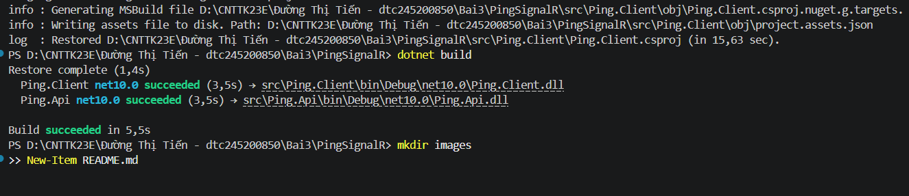
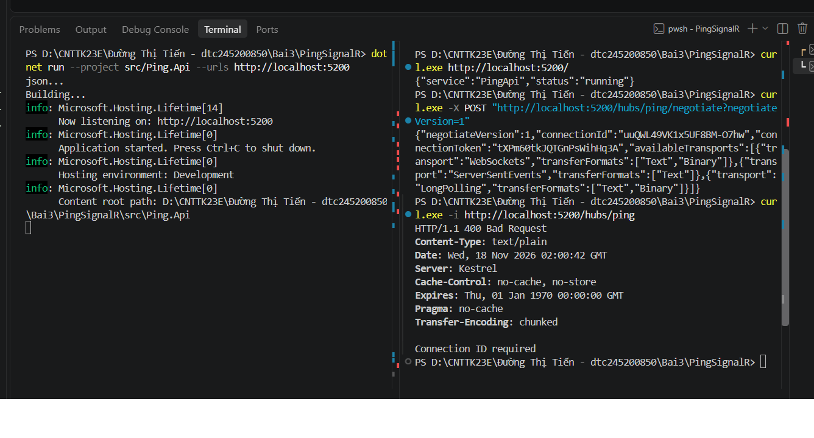
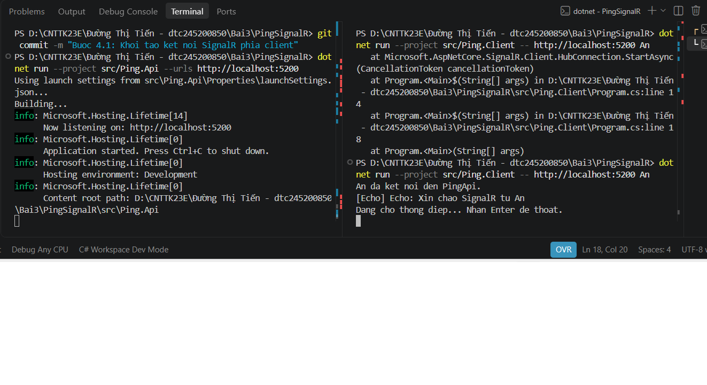
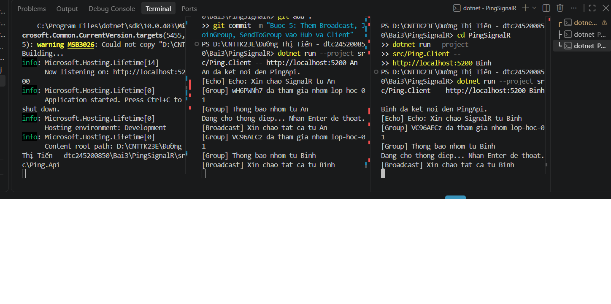
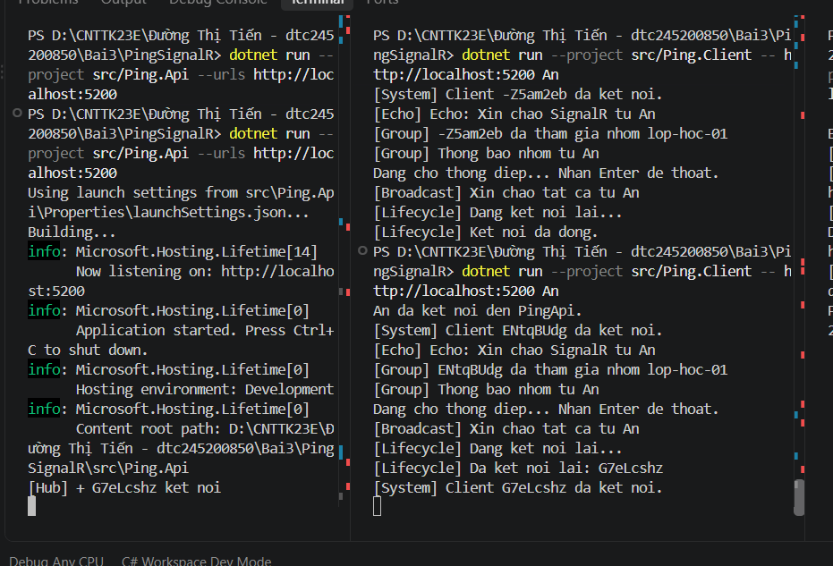
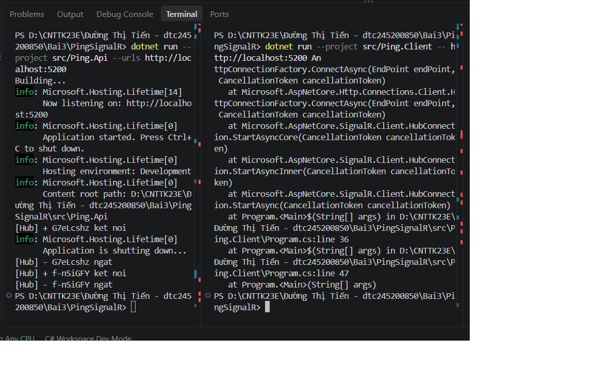
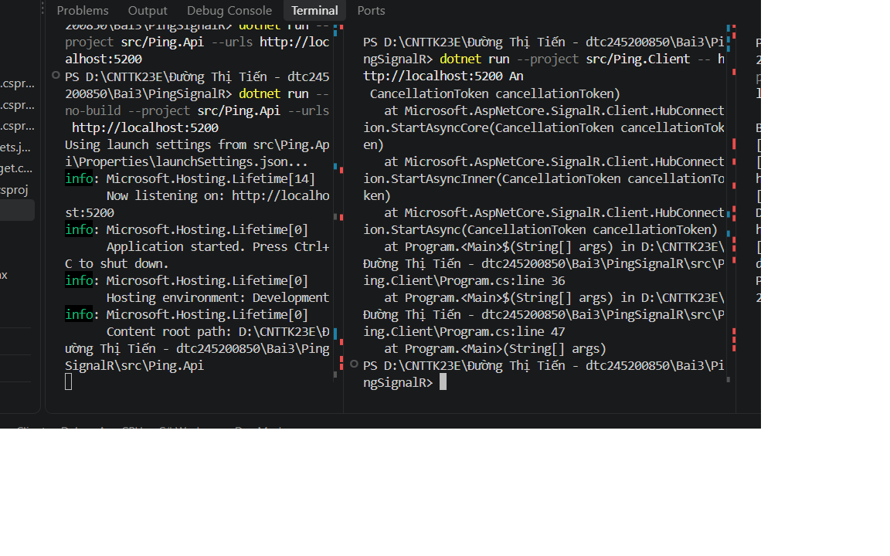
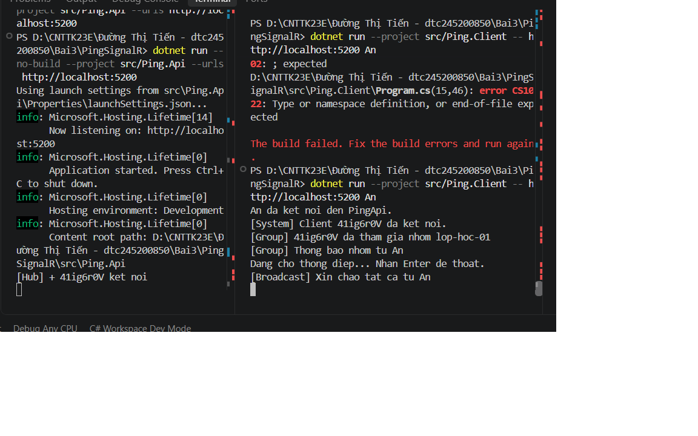

# Báo Cáo Thực Hành Bài 3: Giao Tiếp Thời Gian Thực Với SignalR


---

## Cấu trúc thư mục Bài 3

```text
Bai3/
├── README.md                      # Nhật ký thực hành & giải thích lý thuyết
├── .gitignore                     # Loại trừ bin/, obj/, log và cache tạm
├── Directory.Build.props          # Tắt SharedCompilation và cảnh báo kiểm tra bảo mật offline
├── PingSignalR/                   # Solution 1: Thực hành cơ bản SignalR (Cổng 5200)
│   ├── PingSignalR.slnx
│   ├── requests.http              # Kiểm thử negotiate và Hub Ping
│   ├── images/                    # Ảnh minh chứng chạy PingSignalR bước 1-7
│   └── src/
│       ├── Ping.Api/              # Máy chủ (cổng 5200, Hub: /hubs/ping)
│       └── Ping.Client/           # Máy khách dòng lệnh
└── RealtimeSubmissionSystem/      # Solution 2: EduSubmit Realtime (Cổng 5000)
    ├── RealtimeSubmissionSystem.slnx
    ├── requests.http              # 9 ca kiểm thử chuẩn Slide 61
    ├── Directory.Build.props
    ├── NuGet.Config
    ├── .gitignore
    └── src/
        ├── Submission.RealtimeApi/    # Máy chủ (cổng 5000, Hub: /hubs/submissions)
        └── Submission.RealtimeClient/ # Máy khách (2 kênh: REST + SignalR)
```

---

## I. Trả Lời 3 Câu Hỏi Đầu Giờ (Slide 65)

### Câu 1: Máy chủ có thể chủ động báo cho máy khách mà không cần máy khách hỏi không?
- **Trả lời:** **Có.**
- **Cơ chế:** Máy khách mở và duy trì sẵn một kết nối song công lâu dài (thông qua giao thức WebSocket dưới sự quản lý của thư viện SignalR). Khi sự kiện xảy ra trên máy chủ (ví dụ trạng thái bài nộp thay đổi), máy chủ có thể chủ động đẩy (push) dữ liệu xuống máy khách bất cứ lúc nào thông qua `Clients.Group(...).SendAsync(...)`. Khi cần gửi từ bên ngoài phạm vi xử lý của Hub (như trong Minimal API endpoint hoặc tiến trình nền/background task), máy chủ sử dụng dịch vụ `IHubContext<THub>` được nạp qua cơ chế Dependency Injection (DI).

### Câu 2: Đã có REST rồi, vì sao còn cần thêm SignalR? Hai thứ chia việc thế nào?
- **Trả lời:** 
  - **REST (Kênh yêu cầu – phản hồi):** Đóng vai trò là **nguồn sự thật (Source of Truth)**. Thích hợp cho các thao tác CRUD tường minh khởi tạo từ máy khách, có mã trạng thái HTTP rõ ràng (200, 201, 400, 404), như tạo lượt nộp (`POST /api/assignments/{id}/submissions`), lấy danh sách bài tập, hoặc lấy lại trạng thái chuẩn xác nhất của tài nguyên.
  - **SignalR (Kênh đẩy thời gian thực):** Bổ sung chiều **máy chủ báo tin (Push notification)**. Giúp thông báo ngay lập tức các sự kiện phát sinh sau đó (`received -> processing -> graded`) mà máy khách không cần phải liên tục thăm dò định kỳ (polling) gây lãng phí băng thông và tài nguyên CPU.
  - **Quy tắc chia việc:** REST tạo và đọc tài nguyên; SignalR thông báo biến động trạng thái. Hai công nghệ bổ trợ lẫn nhau, SignalR không thay thế REST.

### Câu 3: Nếu đứt mạng đúng lúc máy chủ báo "đã chấm xong" (graded) thì sao?
- **Trả lời:** 
  - Do SignalR hoạt động theo cơ chế fire-and-forget (không lưu đệm hàng đợi tin nhắn cho từng client đã ngắt kết nối), thông điệp phát trong lúc mất mạng sẽ bị **lỡ (mất)**.
  - Cơ chế `WithAutomaticReconnect()` của SignalR Client sẽ tự động tái kết nối lại với máy chủ (nhận một `ConnectionId` mới).
  - Áp dụng **quy tắc vàng: "Push để nhanh, REST để chắc"**. Khi máy khách nhận biết vừa nối lại thành công, hoặc khi quá thời gian chờ (timeout) chưa nhận được thông báo qua SignalR, máy khách sẽ chủ động gọi lại API REST: `GET /api/submissions/{id}` để đọc trạng thái chốt từ nguồn sự thật.

---

## II. Phần 1: PingSignalR (Thực hành cơ bản)

### 1. Minh chứng 7 bước thực hiện
- **Bước 1: Khởi tạo và build thành công 0 lỗi:**
  

- **Bước 2: Máy chủ ánh xạ Hub và kiểm tra negotiate qua curl:**
  

- **Bước 3–4: Phương thức Echo và máy khách nhận phản hồi:**
  

- **Bước 5: Phát rộng (Broadcast) và Nhóm (Group):**
  

- **Bước 6: Vòng đời kết nối và tự động kết nối lại (Auto-Reconnect):**
  

- **Bước 7: Ba thí nghiệm lỗi về kết nối phân tán:**
  - *Thí nghiệm 1 (Máy chủ chưa chạy):* Ném `HttpRequestException: Connection refused` do `WithAutomaticReconnect()` chỉ phục vụ kết nối đã mở.
    
  - *Thí nghiệm 2 (Sai đường dẫn Hub):* Trả về lỗi `404 Not Found` ở bước `negotiate`.
    
  - *Thí nghiệm 3 (Sai tên thông điệp):* Không ném lỗi nhưng máy khách hoàn toàn im lặng do không khớp tên sự kiện.
    

### 2. Thử thách 3 phút: Ba máy khách, một nhóm (Slide 36, 37)
- **Tình trạng kết nối:** An và Bình ở trong nhóm `lop-hoc-01`; Chi không ở nhóm nào.

| Lời gọi | An | Bình | Chi | Phạm vi nhận |
| :--- | :---: | :---: | :---: | :--- |
| **① An gọi `Echo("hi")`** | **✓** | **✗** | **✗** | `Clients.Caller` (chỉ người gọi) |
| **② Chi gọi `SendToGroup("lop-hoc-01", "x")`** | **✓** | **✓** | **✗** | `Clients.Group("lop-hoc-01")` (chỉ thành viên nhóm) |
| **③ Bình gọi `Broadcast("y")`** | **✓** | **✓** | **✓** | `Clients.All` (mọi kết nối đang mở) |

- **Giải thích câu ②:** `SendToGroup` dùng `Clients.Group("lop-hoc-01")` nên gửi tới toàn bộ thành viên trong nhóm `lop-hoc-01` (An và Bình). SignalR cho phép một kết nối gửi tin vào nhóm ngay cả khi người gửi không thuộc nhóm đó, còn Chi không nhận được tin vì Chi không ở trong nhóm `lop-hoc-01`.

---

## III. Phần 2: EduSubmit Realtime (RealtimeSubmissionSystem)

### 1. Bản thiết kế 4 câu hỏi khung thời gian thực (Slide 44, 46)
| STT | Câu hỏi thiết kế | Lựa chọn thiết kế cho EduSubmit | Mã nguồn tương ứng |
| :---: | :--- | :--- | :--- |
| **①** | **Sự kiện nào?** | Khi trạng thái lượt nộp chuyển đổi: `received` $\rightarrow$ `processing` $\rightarrow$ `graded` | `SimulateGradingAsync`, `UpdateStatusAsync` |
| **②** | **Gửi cho ai?** | Chỉ máy khách đang theo dõi đúng lượt nộp đó | `Clients.Group("submission:{id}")` |
| **③** | **Gửi kèm gì?** | Dữ liệu tối thiểu để giao diện cập nhật | `record SubmissionStatusMessage(Id, Status, UpdatedAt)` |
| **④** | **Mất kết nối thì sao?** | Gọi lại REST để lấy trạng thái mới nhất từ nguồn sự thật | `http.GetFromJsonAsync<SubmissionDto>($"/api/submissions/{id}")` |

### 2. Kết quả chạy thực tế của máy khách EduSubmit (Chuẩn 8 dòng theo Slide 57)
Khi chạy song song máy chủ `Submission.RealtimeApi` (cổng 5000) và máy khách `Submission.RealtimeClient`:

```text
Da ket noi SignalR.
Chon bai tap: 1 - Bai tap SignalR
Da tao luot nop: 2dca6c90-c087-4967-85fe-e9a4df70426a
Trang thai REST ban dau: received
Dang cho thong bao trang thai tu may chu...
Thong bao SignalR: 2dca6c90-c087-4967-85fe-e9a4df70426a -> processing luc 04:20:01
Thong bao SignalR: 2dca6c90-c087-4967-85fe-e9a4df70426a -> graded luc 04:20:03
Trang thai doc lai bang REST: graded
```

**Nhật ký song song tại máy chủ:**
```text
Now listening on: http://localhost:5000
[Hub] Rx1TDJ_6 theo doi submission:2dca6c90-c087-4967-85fe-e9a4df70426a
[Push] submission:2dca6c90-c087-4967-85fe-e9a4df70426a -> processing
[Push] submission:2dca6c90-c087-4967-85fe-e9a4df70426a -> graded
```
*Nhận xét:* 
- Hai thông báo SignalR cách nhau đúng 2 giây (sau 1 giây đổi sang `processing`, sau 2 giây tiếp theo đổi sang `graded`).
- Máy khách tự động hoàn tất và kết thúc chương trình an toàn sau khi đọc lại trạng thái `graded` từ REST.

---

## IV. Bảng 5 Thí Nghiệm Phân Tán (Bước 7 - Slide 58, 59)

| STT | Tình huống thí nghiệm | Dự đoán trước khi chạy | Kết quả chạy thực tế | Bài học phân tán rút ra |
| :---: | :--- | :--- | :--- | :--- |
| **1** | **Chạy 2 máy khách SV001 và SV002 cùng lúc** | Mỗi máy khách chỉ nhận thông báo về lượt nộp của chính mình, không thấy bài của nhau. | Mỗi máy khách chỉ nhận đúng 2 thông báo `processing` và `graded` của mã GUID lượt nộp do mình tạo. | Dùng cơ chế nhóm `submission:{id}` giúp cách ly luồng dữ liệu, đảm bảo tính riêng tư và tiết kiệm băng thông mạng. |
| **2** | **Chạy máy khách khi máy chủ chưa chạy** | Máy khách báo lỗi không kết nối được và thoát ngay. | Ném ngoại lệ `HttpRequestException: Connection refused (localhost:5000)`. | Lệnh `StartAsync()` ném lỗi ngay lập tức. `WithAutomaticReconnect()` chỉ có tác dụng khôi phục kết nối ĐÃ từng mở thành công, không giải quyết kết nối ban đầu thất bại. |
| **3** | **Sửa WithUrl thành `/hub/submissions` (thiếu 's')** | Máy chủ không tìm thấy endpoint và trả về mã lỗi 404. | Ném ngoại lệ `HttpRequestException: Response status code does not indicate success: 404 (Not Found)`. | Lỗi xảy ra ngay ở bước đàm phán `negotiate`. URL của máy khách phải khớp chính xác với `app.MapHub<THub>("/...")` trên máy chủ. |
| **4** | **Sửa On thành `"SubmissionStatusChange"` (thiếu 'd')** | Kết nối vẫn mở nhưng không in thông báo, sau 10s báo quá thời gian chờ. | Không có lỗi ngoại lệ nào được ném ra. Sau 10 giây in ra dòng: `Qua thoi gian cho thong bao graded.` và đọc lại REST: `graded`. | Tên sự kiện chiều xuống phân giải theo chuỗi động. Sai tên dẫn đến im lặng hoàn toàn. Luôn phải đối chiếu tên sự kiện hai phía khi gặp sự cố "không nhận được tin". |
| **5** | **Chờ 4 giây rồi mới gọi WatchSubmission** | Tác vụ chấm hoàn tất trước khi máy khách kịp vào nhóm, máy khách bị lỡ tin thông báo. | Máy khách không nhận được bất kỳ tin SignalR nào; khi hết 10s hoặc sau đó, gọi lại REST đọc được: `graded`. | Thông điệp SignalR mang tính tức thời (fire-and-forget). Vào nhóm muộn sẽ bị lỡ tin. Đây là minh chứng vì sao REST luôn là nguồn sự thật cuối cùng. |

---

## V. Kiểm Thử requests.http (9 Ca Đạt Chuẩn Slide 61)

File `RealtimeSubmissionSystem/requests.http` chứa đầy đủ 9 ca kiểm thử:

1. **`GET /`** $\rightarrow$ **200 OK**: `{"service":"Submission.RealtimeApi","status":"running"}`
2. **`GET /api/assignments`** $\rightarrow$ **200 OK**: Trả về danh sách bài tập đang có trên hệ thống.
3. **`POST /api/assignments/1/submissions`** $\rightarrow$ **201 Created**: Tạo lượt nộp bài, trả về Location header dạng `/api/submissions/{id}` và trạng thái ban đầu `"received"`.
4. **`GET /api/submissions/{id}`** $\rightarrow$ **200 OK**: Đọc lại lượt nộp, trạng thái tự động biến chuyển `received` $\rightarrow$ `processing` $\rightarrow$ `graded`.
5. **`POST thiếu thông tin`** $\rightarrow$ **400 Bad Request**: Trả về lỗi `INVALID_SUBMISSION`.
6. **`POST bài tập không tồn tại (99)`** $\rightarrow$ **404 Not Found**: Trả về lỗi `ASSIGNMENT_NOT_FOUND`.
7. **`GET id rỗng / không tồn tại`** $\rightarrow$ **404 Not Found**: Trả về lỗi `SUBMISSION_NOT_FOUND`.
8. **`POST /hubs/submissions/negotiate?negotiateVersion=1`** $\rightarrow$ **200 OK**: Bắt tay SignalR thành công, trả về `connectionId`, `connectionToken` và `availableTransports`.
9. **`POST /hub/submissions/negotiate` (sai tuyến)** $\rightarrow$ **404 Not Found**: Máy chủ từ chối do sai đường dẫn Hub.

---

## VI. Vận Dụng & Mở Rộng (Slide 62)

### 1. Bài tập 2: Thêm trạng thái `failed`
- **Logic máy chủ:** Kiểm tra nếu `RepositoryUrl` không bắt đầu bằng `https://` (ví dụ `http://...` hoặc đường dẫn không an toàn), tiến trình chấm nền tự động chuyển trạng thái cuối cùng thành `failed` thay vì `graded`.
- **Xử lý máy khách:** Khi nhận sự kiện với trạng thái `failed`, hiển thị dòng thông báo cảnh báo màu đỏ:
  `!!! CANH BAO: luot nop {id} cham LOI (failed)` và mở khóa chờ hoàn tất để chốt dữ liệu qua REST.

### 2. Bài tập 3: Theo dõi đồng thời nhiều lượt nộp
- Sử dụng `ConcurrentDictionary<Guid, TaskCompletionSource>` trên cùng một kết nối SignalR Client.
- Khi nhận sự kiện `SubmissionStatusChanged`, máy khách dùng `m.SubmissionId` làm khóa tra cứu để đánh thức đúng `TaskCompletionSource` tương ứng, chứng minh các luồng chấm bài không bị lẫn lộn giữa các sinh viên.

---

## VII. Trả Lời Câu Hỏi Ôn Tập & Thảo Luận (Slide 68)

### Ôn tập giáo trình Chương 3
1. **Polling khác push ở số yêu cầu và độ trễ thế nào?**
   - *Polling:* Số yêu cầu rất lớn ($N \times \text{chu kỳ}$), phần lớn là yêu cầu thừa vì dữ liệu chưa thay đổi; độ trễ phụ thuộc vào chu kỳ lặp (trung bình trễ bằng một nửa chu kỳ).
   - *Push:* Số yêu cầu/thông điệp đúng bằng số lần dữ liệu biến động; độ trễ gần như bằng 0 vì máy chủ đẩy ngay khi sự kiện phát sinh.
2. **Phân biệt 3 MEP (Message Exchange Patterns) theo hướng khởi tạo và số thông điệp:**
   - *Request-Reply:* Máy khách khởi tạo, 1 yêu cầu $\rightarrow$ 1 phản hồi.
   - *Push:* Máy chủ khởi tạo khi có sự kiện, gửi từng thông điệp đơn lẻ không định kỳ.
   - *Streaming:* Một hoặc cả hai phía khởi tạo, chuỗi liên tục nhiều thông điệp (luồng dữ liệu).
3. **WebSocket và SignalR: giao thức hay thư viện?**
   - WebSocket là giao thức truyền thông mạng 2 chiều ở tầng transport/application (RFC 6455).
   - SignalR là thư viện cấp cao đóng gói WebSocket, hỗ trợ trừu tượng hóa Hub, Quản lý nhóm (Groups), Quản lý kết nối lại, mã hóa JSON/MessagePack và cơ chế dự phòng (fallback).
4. **SignalR có những cơ chế truyền tải dự phòng nào?**
   - Thứ tự ưu tiên: 1. `WebSockets` $\rightarrow$ 2. `Server-Sent Events (SSE)` $\rightarrow$ 3. `Long Polling`.
5. **Vì sao tạo nhóm `submission:{id}` thay vì gửi tất cả?**
   - Đảm bảo tính riêng tư (sinh viên không xem được điểm/trạng thái bài của người khác) và tiết kiệm băng thông (không bắt toàn bộ client phải nhận và tự lọc tin rác).
6. **`IHubContext` cho phép làm gì?**
   - Cho phép gửi thông điệp SignalR tới Client từ bên ngoài lớp Hub (ví dụ từ Background Service, Worker, Controller, hoặc Minimal API endpoint).
7. **`On<T>` dùng để làm gì? Bỏ đi thì sao?**
   - Dùng để đăng ký hàm callback xử lý khi nhận thông điệp có tên tương ứng từ Server. Bỏ đi thì client vẫn nhận gói tin nhưng lẳng lặng bỏ qua mà không xử lý gì.
8. **REST làm gì, SignalR làm gì? Vì sao không dùng SignalR để tạo lượt nộp?**
   - REST quản lý vòng đời tài nguyên, cung cấp mã trạng thái HTTP chuẩn mực, dễ kiểm tra, xác thực, ghi log và có tính idempotent/chuẩn hóa. SignalR chỉ phục vụ luồng thông báo thời gian thực một chiều hoặc hai chiều nhẹ. Tạo tài nguyên bằng REST giúp tách biệt rõ trách nhiệm (SoC).
9. **`WithAutomaticReconnect` có tác dụng gì?**
   - Giúp client tự động thử nối lại mạng khi kết nối bị ngắt đột ngột (mặc định thử lại sau 0s, 2s, 10s, 30s).
10. **Mất kết nối đúng lúc báo graded thì làm gì?**
    - Client nối lại và gọi API REST `GET /api/submissions/{id}` để đọc trạng thái chính thức.

### Thảo luận chuyên sâu
1. **Hàng trăm SV cùng theo dõi: nhóm theo id hay phát tất cả rồi tự lọc? Cách nào tiết kiệm băng thông?**
   - Nhóm theo ID (`submission:{id}`) tối ưu băng thông vượt trội. Nếu phát tất cả cho 100 SV, mỗi thông báo nhân lên 100 lần qua mạng (gây quá tải đường truyền và lộ dữ liệu). Với nhóm theo ID, mỗi thông báo chỉ gửi đúng 1 bản tới máy khách của sinh viên sở hữu bài nộp đó.
2. **Nêu 2 tình huống polling là lựa chọn hợp lý hơn SignalR:**
   - Khi dữ liệu cực kỳ hiếm khi thay đổi hoặc không đòi hỏi tính tức thời (ví dụ kiểm tra phiên bản ứng dụng mỗi ngày một lần, tra cứu thời tiết định kỳ 30 phút).
   - Khi môi trường mạng của khách hàng bị giới hạn nghiêm ngặt (chặn WebSocket, chặn kết nối dài hạn qua proxy/firewall đặc biệt).
3. **Chạy nhiều bản sao API (scale-out) thì nhóm trong bộ nhớ gặp vấn đề gì? Sửa thế nào?**
   - *Vấn đề:* Khi chạy nhiều instance máy chủ phía sau Load Balancer, sinh viên A kết nối vào Instance 1, nhưng tác vụ chấm bài lại chạy ở Instance 2. Khi Instance 2 phát tin vào nhóm `submission:{id}`, nhóm này chỉ có trong RAM của Instance 2 nên Instance 1 (và sinh viên A) không nhận được.
   - *Cách giải quyết:* Sử dụng **SignalR Backplane** (phổ biến nhất là Redis Backplane hoặc Azure SignalR Service) để chia sẻ và đồng bộ tin nhắn qua lại giữa tất cả các instance máy chủ.
