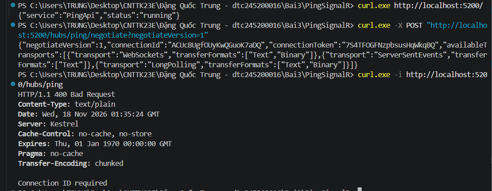
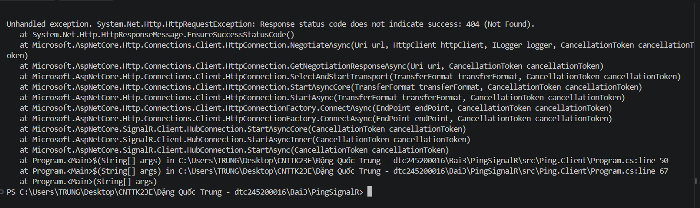
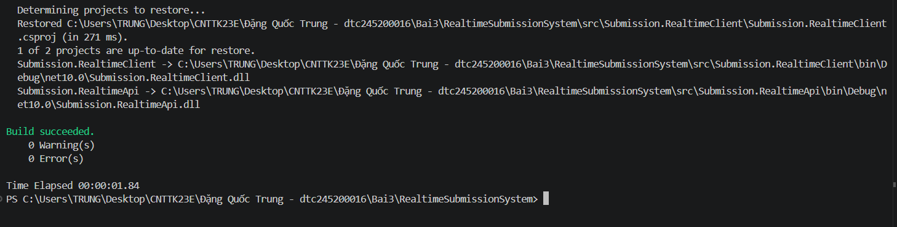
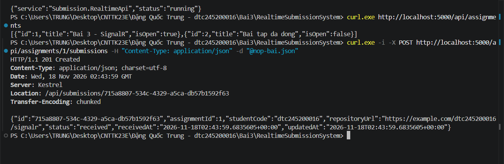
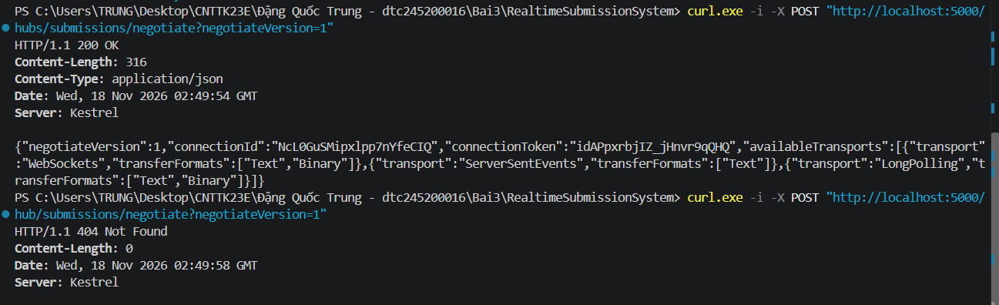

# BÀI THỰC HÀNH 3: GIAO TIẾP THỜI GIAN THỰC VỚI SIGNALR

## Thông tin sinh viên

- Họ và tên: Đặng Quốc Trung
- Mã sinh viên: dtc245200016
- Lớp: CNTT K23E
- Môn học: Phát triển ứng dụng phân tán

## Phần 1: PingSignalR

### Bước 1: Khởi tạo solution và hai project

**Kết quả:** Build thành công hai project Ping.Api và Ping.Client, không có lỗi.

**Giải thích:** Ping.Api đóng vai trò máy chủ, Ping.Client đóng vai trò máy khách. Gói Microsoft.AspNetCore.SignalR.Client phiên bản 10.0.15 giúp máy khách giao tiếp thời gian thực với máy chủ.

### Bước 2: Đăng ký SignalR và ánh xạ Hub

**Kết quả:** Máy chủ chạy thành công tại cổng 5200. Lệnh negotiate trả về connectionId và ba cơ chế truyền tải: WebSockets, ServerSentEvents và LongPolling. Truy cập trực tiếp Hub trả về 400 Bad Request.

**Giải thích:** AddSignalR() đăng ký các dịch vụ SignalR. MapHub() ánh xạ Hub vào đường dẫn /hubs/ping để máy khách có thể kết nối với máy chủ.

### Bước 3: Xây dựng phương thức Echo

**Kết quả:** Build thành công, không có lỗi. Máy chủ hoạt động tại cổng 5200.

**Giải thích:** Phương thức Echo sử dụng Clients.Caller để gửi thông điệp EchoResponse về đúng máy khách vừa gọi phương thức.

### Bước 4: Xây dựng máy khách SignalR

**Kết quả:** Máy khách kết nối thành công với máy chủ tại cổng 5200 và nhận được thông điệp [Echo] Echo: Xin chao SignalR tu Trung.

**Giải thích:** HubConnectionBuilder xây dựng kết nối đến Hub. On đăng ký nhận thông điệp từ máy chủ. StartAsync mở kết nối và InvokeAsync gọi phương thức Echo trên máy chủ. SignalR cho phép giao tiếp hai chiều theo thời gian thực.

### Bước 5: Broadcast và Group

**Kết quả:** Hai máy khách Trung và Binh kết nối thành công vào máy chủ và tham gia nhóm lop-hoc-01. Máy khách Trung nhận được thông điệp Group và Broadcast của Binh nhưng không nhận được Echo của Binh.

**Giải thích:**

- Clients.Caller: Gửi thông điệp riêng cho người gọi.
- Clients.All: Gửi thông điệp cho tất cả máy khách đang kết nối.
- Clients.Group: Gửi thông điệp cho các máy khách trong nhóm.
- Groups.AddToGroupAsync: Thêm kết nối vào nhóm.

### Bước 6: Vòng đời kết nối và tự động kết nối lại

**Kết quả:** Khi máy chủ bị tắt, máy khách hiển thị thông báo Dang ket noi lai... Sau khi máy chủ hoạt động trở lại, máy khách tự kết nối thành công với ConnectionId mới.

**Giải thích:**

- OnConnectedAsync: Xử lý khi máy khách kết nối.
- OnDisconnectedAsync: Xử lý khi máy khách ngắt kết nối.
- WithAutomaticReconnect: Cho phép tự động kết nối lại.
- Reconnecting: Thông báo đang thử kết nối lại.
- Reconnected: Thông báo kết nối lại thành công.
- Closed: Thông báo kết nối đã đóng.

Sau khi kết nối lại, ConnectionId thay đổi. Máy khách cần tham gia lại nhóm nếu muốn tiếp tục nhận thông báo nhóm. Các thông điệp bị bỏ lỡ trong lúc mất kết nối không được tự động gửi lại.

### Bước 7: Thí nghiệm ba lỗi SignalR

#### Thí nghiệm 1: Máy chủ chưa chạy

**Thực hiện:** Chạy máy khách khi máy chủ chưa hoạt động.

**Kết quả:** Xuất hiện HttpRequestException và SocketException (10061), kết nối bị từ chối tại localhost:5200.

**Giải thích:** StartAsync không thể thiết lập kết nối ban đầu. WithAutomaticReconnect chỉ hỗ trợ kết nối lại sau khi đã kết nối thành công.

#### Thí nghiệm 2: Sai đường dẫn Hub

**Thực hiện:** Thay đổi /hubs/ping thành /hub/ping.

**Kết quả:** HTTP 404 Not Found.

**Giải thích:** Đường dẫn Hub của máy khách không khớp với đường dẫn MapHub trên máy chủ.

#### Thí nghiệm 3: Sai tên thông điệp

**Thực hiện:** Thay đổi EchoResponse thành EchoRespone.

**Kết quả:** Chương trình vẫn chạy nhưng không xuất hiện thông điệp Echo.

**Giải thích:** Tên thông điệp đăng ký ở máy khách không khớp với tên thông điệp được gửi từ máy chủ.

**Kết luận:** Sau khi thực hiện ba thí nghiệm, mã nguồn được khôi phục về trạng thái đúng, build thành công và máy khách nhận lại được thông điệp Echo.

## Phần 2: EduSubmit realtime

### Bước 1: Khởi tạo solution và hai project

**Kết quả:** Khởi tạo thành công solution RealtimeSubmissionSystem và hai project Submission.RealtimeApi, Submission.RealtimeClient. Build thành công, không có lỗi.

**Giải thích:** Submission.RealtimeApi là máy chủ kết hợp REST API và SignalR. Submission.RealtimeClient là máy khách sử dụng HttpClient và SignalR để nộp bài, đọc dữ liệu và nhận thông báo theo thời gian thực.

### Bước 2: Xây dựng REST API

**Kết quả:** Máy chủ hoạt động tại cổng 5000. Lấy danh sách bài tập thành công. Yêu cầu POST trả về HTTP 201 Created, Location, trạng thái received và trường updatedAt.

**Giải thích:**

- REST API hỗ trợ tạo và đọc thông tin lượt nộp.
- UpdatedAt lưu thời điểm cập nhật trạng thái gần nhất.
- lock bảo vệ dữ liệu khi nhiều luồng cùng truy cập.
- REST là nguồn cung cấp trạng thái chính xác của lượt nộp.

### Bước 3: SubmissionHub và Group

**Kết quả:** Đường dẫn /hubs/submissions/negotiate trả về HTTP 200 OK, connectionId và các cơ chế truyền tải. Khi sử dụng sai đường dẫn Hub, máy chủ trả về HTTP 404 Not Found.

**Giải thích:**

- AddSignalR(): Đăng ký dịch vụ SignalR.
- MapHub(): Ánh xạ SubmissionHub vào đường dẫn /hubs/submissions.
- WatchSubmission(): Đăng ký theo dõi một lượt nộp bài.
- SubmissionGroups: Tạo tên nhóm riêng theo mã lượt nộp.

Việc sử dụng Group giúp gửi thông báo đến đúng nhóm máy khách, hạn chế lộ dữ liệu và tiết kiệm băng thông.
