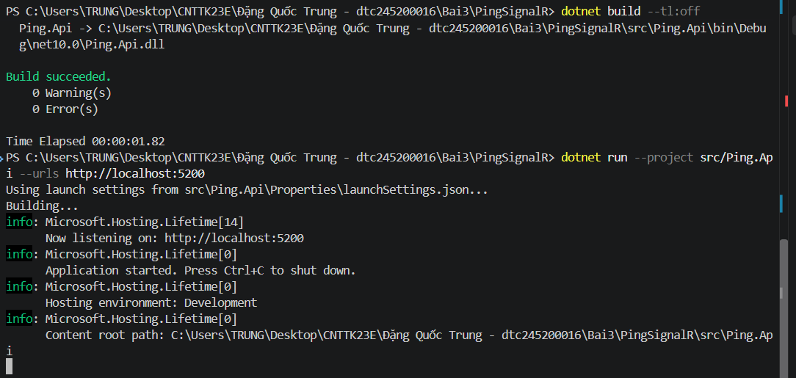

# BÀI THỰC HÀNH 3: GIAO TIẾP THỜI GIAN THỰC VỚI SIGNALR

## Thông tin sinh viên

- Họ và tên: Đặng Quốc Trung
- Mã sinh viên: dtc245200016
- Lớp: CNTT K23E
- Môn học: Phát triển ứng dụng phân tán

## Phần 1: PingSignalR

### Bước 1: Khởi tạo solution và hai project

**Kết quả:** Build thành công hai project Ping.Api và Ping.Client, không có lỗi.

**Giải thích:** Ping.Api đóng vai trò máy chủ, Ping.Client đóng vai trò máy khách. Gói Microsoft.AspNetCore.SignalR.Client phiên bản 10.0.15 giúp máy khách giao tiếp thời gian thực với máy chủ.

### Bước 2: Đăng ký SignalR và ánh xạ Hub

**Kết quả:** Máy chủ chạy thành công tại cổng 5200. Lệnh negotiate trả về connectionId và ba cơ chế truyền tải: WebSockets, ServerSentEvents và LongPolling. Truy cập trực tiếp Hub trả về 400 Bad Request.

**Giải thích:** AddSignalR() đăng ký các dịch vụ SignalR. MapHub() ánh xạ Hub vào đường dẫn /hubs/ping để máy khách có thể kết nối với máy chủ.

### Bước 3: Xây dựng phương thức Echo

**Kết quả:** Build thành công, không có lỗi. Máy chủ hoạt động tại cổng 5200.

**Giải thích:** Phương thức Echo sử dụng Clients.Caller để gửi thông điệp EchoResponse về đúng máy khách vừa gọi phương thức.
