# BÀI THỰC HÀNH 3: GIAO TIẾP THỜI GIAN THỰC VỚI SIGNALR

## Thông tin sinh viên

- Họ và tên: Đặng Quốc Trung
- Mã sinh viên: dtc245200016
- Lớp: CNTT K23E
- Môn học: Phát triển ứng dụng phân tán

## Phần 1: PingSignalR

### Bước 1: Khởi tạo solution và hai project


**Kết quả:** Build thành công hai project Ping.Api và Ping.Client, không có lỗi.

**Giải thích:** Ping.Api đóng vai trò máy chủ, Ping.Client đóng vai trò máy khách. Gói Microsoft.AspNetCore.SignalR.Client phiên bản 10.0.15 giúp máy khách giao tiếp thời gian thực với máy chủ.

### Bước 2: Đăng ký SignalR và ánh xạ Hub


**Kết quả:** Máy chủ chạy thành công tại cổng 5200. Lệnh negotiate trả về connectionId và ba cơ chế truyền tải: WebSockets, ServerSentEvents và LongPolling. Truy cập trực tiếp Hub trả về 400 Bad Request.

**Giải thích:** AddSignalR() đăng ký các dịch vụ SignalR. MapHub() ánh xạ Hub vào đường dẫn /hubs/ping để máy khách có thể kết nối với máy chủ.

### Bước 3: Xây dựng phương thức Echo


**Kết quả:** Build thành công, không có lỗi. Máy chủ hoạt động tại cổng 5200.

**Giải thích:** Phương thức Echo sử dụng Clients.Caller để gửi thông điệp EchoResponse về đúng máy khách vừa gọi phương thức.

### Bước 4: Xây dựng máy khách SignalR


**Kết quả:** Máy khách kết nối thành công với máy chủ tại cổng 5200 và nhận được thông điệp [Echo] Echo: Xin chao SignalR tu Trung.

**Giải thích:** HubConnectionBuilder xây dựng kết nối đến Hub. On đăng ký nhận thông điệp từ máy chủ. StartAsync mở kết nối và InvokeAsync gọi phương thức Echo trên máy chủ. SignalR cho phép giao tiếp hai chiều theo thời gian thực.

### Bước 5: Broadcast và Group

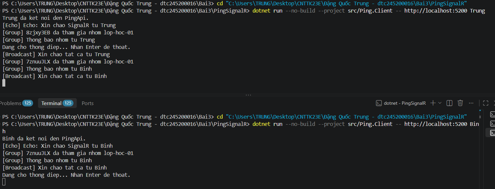

**Kết quả:** Hai máy khách Trung và Binh kết nối thành công vào máy chủ và tham gia nhóm lop-hoc-01. Máy khách Trung nhận được thông điệp Group và Broadcast của Binh nhưng không nhận được Echo của Binh.

**Giải thích:**

- Clients.Caller: Gửi thông điệp riêng cho người gọi.
- Clients.All: Gửi thông điệp cho tất cả máy khách đang kết nối.
- Clients.Group: Gửi thông điệp cho các máy khách trong nhóm.
- Groups.AddToGroupAsync: Thêm kết nối vào nhóm.

### Bước 6: Vòng đời kết nối và tự động kết nối lại


**Kết quả:** Khi máy chủ bị tắt, máy khách hiển thị thông báo Dang ket noi lai... Sau khi máy chủ hoạt động trở lại, máy khách tự kết nối thành công với ConnectionId mới.

**Giải thích:**

- OnConnectedAsync: Xử lý khi máy khách kết nối.
- OnDisconnectedAsync: Xử lý khi máy khách ngắt kết nối.
- WithAutomaticReconnect: Cho phép tự động kết nối lại.
- Reconnecting: Thông báo đang thử kết nối lại.
- Reconnected: Thông báo kết nối lại thành công.
- Closed: Thông báo kết nối đã đóng.

Sau khi kết nối lại, ConnectionId thay đổi. Máy khách cần tham gia lại nhóm nếu muốn tiếp tục nhận thông báo nhóm. Các thông điệp bị bỏ lỡ trong lúc mất kết nối không được tự động gửi lại.

### Bước 7: Thí nghiệm ba lỗi SignalR

#### Thí nghiệm 1: Máy chủ chưa chạy

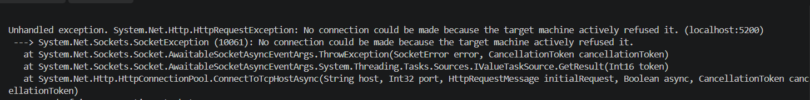

**Thực hiện:** Chạy máy khách khi máy chủ chưa hoạt động.

**Kết quả:** Xuất hiện HttpRequestException và SocketException (10061), kết nối bị từ chối tại localhost:5200.

**Giải thích:** StartAsync không thể thiết lập kết nối ban đầu. WithAutomaticReconnect chỉ hỗ trợ kết nối lại sau khi đã kết nối thành công.

#### Thí nghiệm 2: Sai đường dẫn Hub


**Thực hiện:** Thay đổi /hubs/ping thành /hub/ping.

**Kết quả:** HTTP 404 Not Found.

**Giải thích:** Đường dẫn Hub của máy khách không khớp với đường dẫn MapHub trên máy chủ.

#### Thí nghiệm 3: Sai tên thông điệp

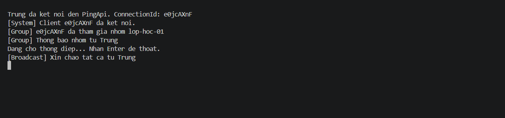

**Thực hiện:** Thay đổi EchoResponse thành EchoRespone.

**Kết quả:** Chương trình vẫn chạy nhưng không xuất hiện thông điệp Echo.

**Giải thích:** Tên thông điệp đăng ký ở máy khách không khớp với tên thông điệp được gửi từ máy chủ.

**Kết luận:** Sau khi thực hiện ba thí nghiệm, mã nguồn được khôi phục về trạng thái đúng, build thành công và máy khách nhận lại được thông điệp Echo.

## Phần 2: EduSubmit realtime

### Bước 1: Khởi tạo solution và hai project


**Kết quả:** Khởi tạo thành công solution RealtimeSubmissionSystem và hai project Submission.RealtimeApi, Submission.RealtimeClient. Build thành công, không có lỗi.

**Giải thích:** Submission.RealtimeApi là máy chủ kết hợp REST API và SignalR. Submission.RealtimeClient là máy khách sử dụng HttpClient và SignalR để nộp bài, đọc dữ liệu và nhận thông báo theo thời gian thực.

### Bước 2: Xây dựng REST API


**Kết quả:** Máy chủ hoạt động tại cổng 5000. Lấy danh sách bài tập thành công. Yêu cầu POST trả về HTTP 201 Created, Location, trạng thái received và trường updatedAt.

**Giải thích:**

- REST API hỗ trợ tạo và đọc thông tin lượt nộp.
- UpdatedAt lưu thời điểm cập nhật trạng thái gần nhất.
- lock bảo vệ dữ liệu khi nhiều luồng cùng truy cập.
- REST là nguồn cung cấp trạng thái chính xác của lượt nộp.

### Bước 3: SubmissionHub và Group


**Kết quả:** Đường dẫn /hubs/submissions/negotiate trả về HTTP 200 OK, connectionId và các cơ chế truyền tải. Khi sử dụng sai đường dẫn Hub, máy chủ trả về HTTP 404 Not Found.

**Giải thích:**

- AddSignalR(): Đăng ký dịch vụ SignalR.
- MapHub(): Ánh xạ SubmissionHub vào đường dẫn /hubs/submissions.
- WatchSubmission(): Đăng ký theo dõi một lượt nộp bài.
- SubmissionGroups: Tạo tên nhóm riêng theo mã lượt nộp.

Việc sử dụng Group giúp gửi thông báo đến đúng nhóm máy khách, hạn chế lộ dữ liệu và tiết kiệm băng thông.

### Bước 4: Mô phỏng chấm bài tự động

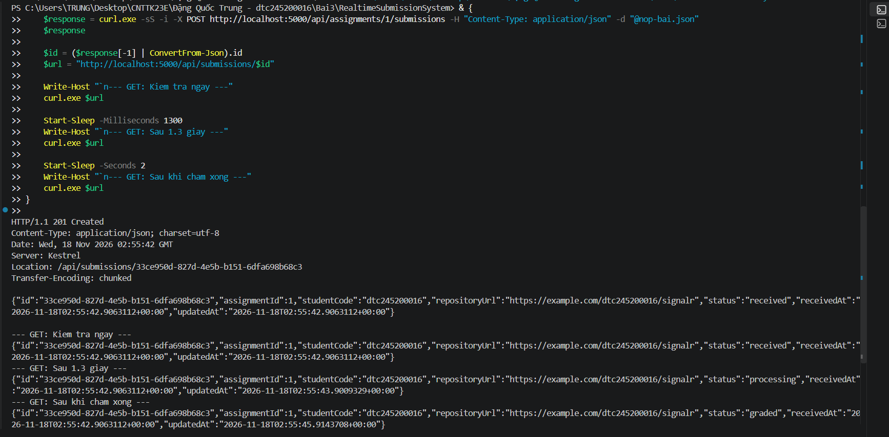

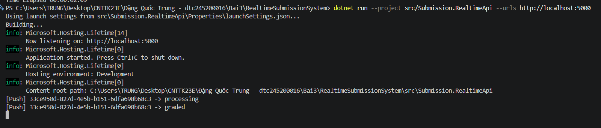

**Kết quả:** Máy chủ tiếp nhận lượt nộp và trả về HTTP 201 Created. Trạng thái tự động thay đổi từ received sang processing và graded. Terminal máy chủ hiển thị thông báo Push khi trạng thái thay đổi.

**Giải thích:**

- IHubContext: Cho phép gửi thông báo SignalR từ bên ngoài Hub.
- SimulateGradingAsync: Mô phỏng quá trình chấm bài chạy nền.
- UpdateStatusAsync: Cập nhật trạng thái và thời điểm thay đổi.
- Task.Delay: Mô phỏng thời gian chấm bài mà không chặn luồng.
- SubmissionStatusChanged: Gửi thông báo đến đúng nhóm theo dõi lượt nộp.

Máy chủ cập nhật dữ liệu trước rồi mới gửi thông báo SignalR. REST vẫn là nguồn cung cấp trạng thái chính xác của lượt nộp.

### Bước 5: Xây dựng máy khách EduSubmit

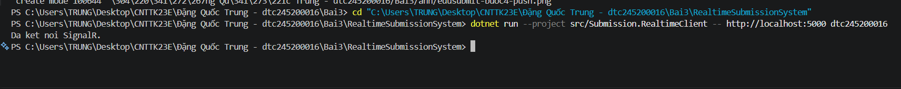

**Kết quả:** Máy khách kết nối thành công với máy chủ SignalR tại cổng 5000 và hiển thị thông báo Da ket noi SignalR.

**Giải thích:**

- HttpClient: Giao tiếp với máy chủ thông qua REST API.
- HubConnectionBuilder: Thiết lập kết nối SignalR.
- WithAutomaticReconnect: Hỗ trợ tự động kết nối lại.
- TaskCompletionSource: Chờ thông báo hoàn thành chấm bài.
- connection.On: Đăng ký nhận thông báo SubmissionStatusChanged.

Máy khách sử dụng hai kênh giao tiếp là REST API và SignalR.

### Bước 6: Nộp bài và nhận trạng thái realtime

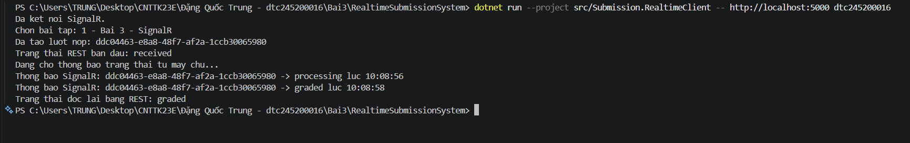

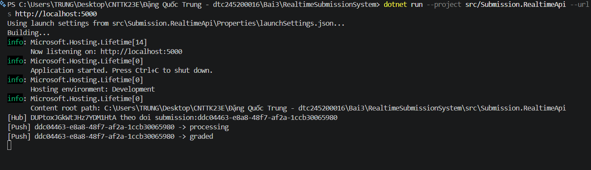

**Kết quả:** Máy khách kết nối SignalR, tạo lượt nộp bằng REST API và nhận thông báo trạng thái processing, graded từ máy chủ. Sau khi nhận thông báo hoàn thành, máy khách đọc lại trạng thái bằng REST và nhận kết quả graded.

**Giải thích:**

- GET: Lấy danh sách bài tập.
- POST: Tạo lượt nộp bài.
- WatchSubmission: Tham gia nhóm theo dõi lượt nộp.
- Task.WhenAny: Chờ thông báo hoàn thành trong tối đa 10 giây.
- SubmissionStatusChanged: Nhận thông báo thay đổi trạng thái theo thời gian thực.
- REST API: Xác nhận trạng thái cuối cùng của lượt nộp.

SignalR giúp máy khách nhận thông báo chủ động mà không cần liên tục gửi yêu cầu GET. REST vẫn là nguồn cung cấp trạng thái chính xác.

### Bước 7: Thí nghiệm hệ thống phân tán

#### Dự đoán trước khi thực hiện

- Thí nghiệm 1: Hai máy khách chỉ nhận thông báo của lượt nộp riêng.
- Thí nghiệm 2: Máy khách không thể kết nối khi máy chủ chưa chạy.
- Thí nghiệm 3: Sai đường dẫn Hub sẽ trả về lỗi 404.
- Thí nghiệm 4: Sai tên sự kiện khiến máy khách không nhận được thông báo.
- Thí nghiệm 5: Theo dõi lượt nộp quá muộn sẽ bỏ lỡ thông báo SignalR nhưng REST vẫn đọc được trạng thái graded.

#### Kết quả thực nghiệm

##### Thí nghiệm 1: Hai máy khách chạy đồng thời

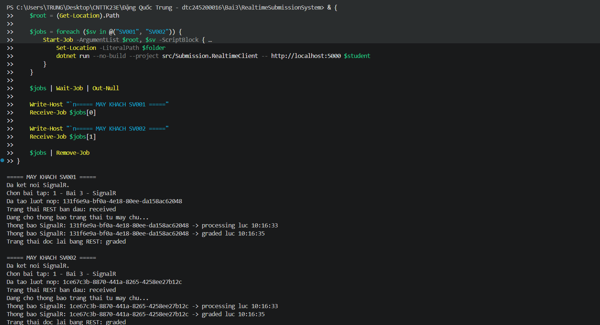

**Kết quả:** Hai máy khách SV001 và SV002 chỉ nhận được thông báo trạng thái của lượt nộp riêng.

**Giải thích:** SignalR Group giúp phân chia thông báo theo từng lượt nộp, tránh gửi nhầm thông tin giữa các máy khách.

##### Thí nghiệm 2: Máy chủ chưa chạy

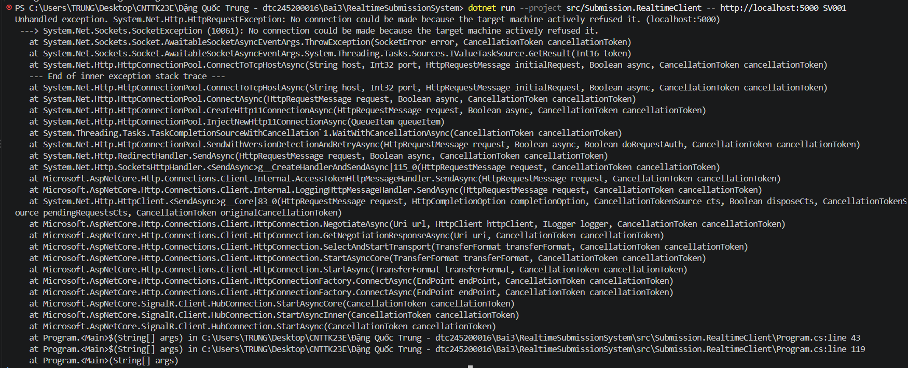

**Kết quả:** Máy khách gặp lỗi HttpRequestException và SocketException (10061) khi kết nối đến localhost:5000.

**Giải thích:** Máy chủ chưa hoạt động nên máy khách không thể thiết lập kết nối. WithAutomaticReconnect không tự động thử lại lần kết nối đầu tiên thất bại.

##### Thí nghiệm 3: Sai đường dẫn Hub

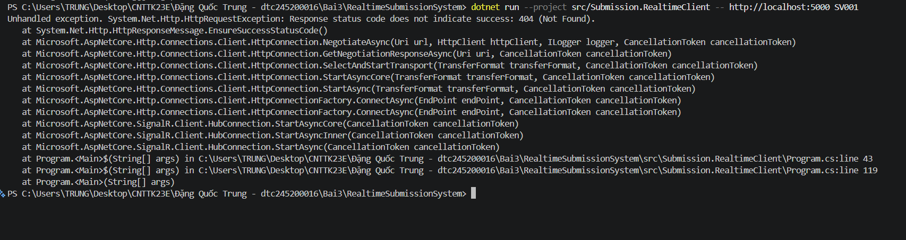

**Kết quả:** Máy khách nhận lỗi HTTP 404 Not Found.

**Giải thích:** Đường dẫn /hub/submissions không khớp với đường dẫn /hubs/submissions được khai báo trên máy chủ.

##### Thí nghiệm 4: Sai tên sự kiện SignalR

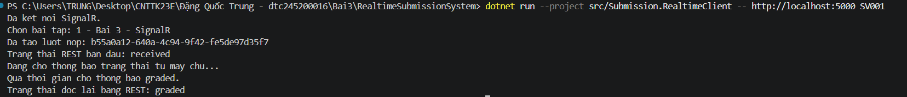

**Kết quả:** Máy khách kết nối và nộp bài thành công nhưng không nhận được thông báo SignalR. Sau 10 giây chờ, REST vẫn trả về trạng thái graded.

**Giải thích:** Tên sự kiện đăng ký trên máy khách không khớp với tên thông điệp do máy chủ gửi.

##### Thí nghiệm 5: Theo dõi lượt nộp quá muộn

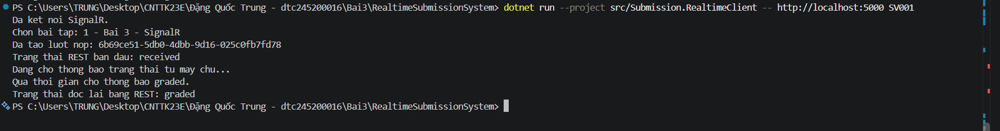

**Kết quả:** Máy khách đăng ký theo dõi sau 4 giây nên bỏ lỡ thông báo processing và graded. Tuy nhiên, khi đọc lại bằng REST, trạng thái vẫn là graded.

**Giải thích:** Các thông báo SignalR đã được gửi trước khi máy khách tham gia nhóm.

#### Kết luận

- SignalR giúp nhận thông báo theo thời gian thực.
- Group giúp gửi thông báo đến đúng đối tượng.
- Đường dẫn Hub và tên sự kiện phải khớp giữa máy chủ và máy khách.
- Thông báo thời gian thực có thể bị bỏ lỡ.
- REST vẫn là nguồn cung cấp trạng thái chính xác của hệ thống.

Sau khi hoàn thành các thí nghiệm, khôi phục code ban đầu và kiểm tra lại hoạt động của hệ thống.

### Bước 8: Hoàn thiện kiểm thử và bài tập vận dụng

Ngày 18/11/2026, hệ thống được hoàn thiện và kiểm tra lại với các nội dung sau:

- Thêm `RealtimeSubmissionSystem/requests.http` gồm đủ 10 ca kiểm thử REST và SignalR negotiate.
- Cố định cổng chạy mặc định: PingSignalR dùng `http://localhost:5200`, EduSubmit dùng `http://localhost:5000`.
- Bổ sung quy tắc chấm: `RepositoryUrl` không bắt đầu bằng `https://` sẽ kết thúc ở trạng thái `failed`.
- Bổ sung cảnh báo màu đỏ ở máy khách khi lượt nộp nhận trạng thái `failed`.
- Bổ sung chế độ `--two` để theo dõi hai lượt nộp bằng một kết nối SignalR. Mỗi GUID có một `TaskCompletionSource<string>` riêng trong `ConcurrentDictionary`.
- Xử lý rõ lỗi kết nối ban đầu khi API chưa chạy và trả mã thoát 1.
- Giữ nguyên chế độ mặc định: máy khách nộp một bài hợp lệ, nhận `processing`, `graded`, đọc lại bằng REST rồi tự thoát.

#### Kết quả build và chạy PingSignalR

- `dotnet build PingSignalR.slnx --no-restore`: thành công, 0 cảnh báo, 0 lỗi; build đủ `Ping.Api` và `Ping.Client`.
- `Ping.Api` lắng nghe thực tế tại `http://localhost:5200`.
- `Ping.Client` kết nối thành công và nhận được: `[Echo] Echo: Xin chao SignalR tu Trung`.

#### Bảng kết quả kiểm thử HTTP thực tế

Các ca dưới đây được chạy thực tế ngày 18/11/2026 với API tại `http://localhost:5000`:

| STT | Ca kiểm thử                                              | Mong đợi | Thực tế | Kết quả |
| --: | -------------------------------------------------------- | -------: | ------: | :-----: |
|   1 | `GET /`                                                  |      200 |     200 |   Đạt   |
|   2 | `GET /api/assignments`                                   |      200 |     200 |   Đạt   |
|   3 | `POST /api/assignments/1/submissions` với dữ liệu hợp lệ |      201 |     201 |   Đạt   |
|   4 | `GET /api/submissions/{id}` với ID vừa tạo               |      200 |     200 |   Đạt   |
|   5 | `POST` thiếu mã sinh viên và URL                         |      400 |     400 |   Đạt   |
|   6 | `POST /api/assignments/99/submissions`                   |      404 |     404 |   Đạt   |
|   7 | `GET` với GUID `00000000-0000-0000-0000-000000000000`    |      404 |     404 |   Đạt   |
|   8 | `POST /hubs/submissions/negotiate?negotiateVersion=1`    |      200 |     200 |   Đạt   |
|   9 | `POST /hub/submissions/negotiate?negotiateVersion=1`     |      404 |     404 |   Đạt   |
|  10 | `POST /api/assignments/999/submissions`                  |      404 |     404 |   Đạt   |

Lượt nộp của ca số 3 có ID thực tế `2d646c9e-5fd7-4a9e-8e8a-fc1b00b57047`. Kết quả tổng hợp: **10/10 ca đạt**.

#### Kết quả thực tế 8 dòng của máy khách EduSubmit

Chạy chế độ mặc định bằng `dotnet run --no-build --project src/Submission.RealtimeClient/Submission.RealtimeClient.csproj`, máy khách tự kết thúc với đúng 8 dòng:

```text
Da ket noi SignalR.
Chon bai tap: 1 - Bai 3 - SignalR
Da tao luot nop: 0af5987f-a540-4c45-8918-94c1802a436c
Trang thai REST ban dau: received
Dang cho thong bao trang thai tu may chu...
Thong bao SignalR: 0af5987f-a540-4c45-8918-94c1802a436c -> processing luc 10:40:04
Thong bao SignalR: 0af5987f-a540-4c45-8918-94c1802a436c -> graded luc 10:40:06
Trang thai doc lai bang REST: graded
```

#### Trả lời ba câu hỏi đầu giờ

1. **SignalR dùng để làm gì?** SignalR tạo kênh giao tiếp hai chiều theo thời gian thực, cho phép máy chủ chủ động đẩy thay đổi trạng thái đến máy khách thay vì máy khách phải liên tục polling.
2. **REST và SignalR có vai trò gì trong EduSubmit?** REST tạo và đọc tài nguyên, đồng thời là nguồn trạng thái cuối đáng tin cậy. SignalR thông báo nhanh các thay đổi `processing`, `graded` hoặc `failed`.
3. **Nếu mất kết nối đúng lúc nhận `graded` thì sao?** Máy khách có thể bỏ lỡ thông báo vì SignalR không tự phát lại sự kiện cũ. Sau khi kết nối lại, máy khách phải tham gia lại Group và đọc trạng thái bằng REST để đồng bộ.

#### Bài tập vận dụng 2: URL repository không an toàn

Máy chủ vẫn nhận lượt nộp hợp lệ về cấu trúc và chuyển qua `received`, `processing`. Ở bước cuối, URL không bắt đầu bằng `https://` làm trạng thái chuyển thành `failed`. Máy khách kiểm tra sự kiện này, đổi `Console.ForegroundColor` sang đỏ để in cảnh báo rồi khôi phục màu cũ.

Lệnh đã chạy thực tế:

```powershell
dotnet run --no-build --project src\Submission.RealtimeClient\Submission.RealtimeClient.csproj -- --repository=http://example.com/SV001/signalr
```

Kết quả cuối:

```text
Thong bao SignalR: b34fb14d-e992-4fa2-a5ab-3a1d61fdd4e8 -> failed luc 10:40:17
CANH BAO: Luot nop b34fb14d-e992-4fa2-a5ab-3a1d61fdd4e8 cham that bai do RepositoryUrl khong bat dau bang https://.
Trang thai doc lai bang REST: failed
```

#### Bài tập vận dụng 3: Theo dõi hai lượt nộp trên một kết nối

Chạy máy khách với tùy chọn `--two`. Chương trình chỉ tạo một `HubConnection`, sau đó tạo hai lượt nộp và gọi `WatchSubmission` cho từng GUID. `ConcurrentDictionary<Guid, TaskCompletionSource<string>>` ánh xạ đúng thông báo đến tác vụ đang chờ; vì vậy hai lượt nộp không hoàn thành nhầm lẫn nhau.

Kết quả thực tế: hai GUID `c79789ca-c46b-499e-b73f-f63107ab38c5` và `9e2993d1-b715-48b5-b269-064c85069e86` đều nhận đủ `processing`, `graded`; hai lần đọc lại REST đều trả về `graded`, máy khách tự thoát với mã 0.

#### Bài tập vận dụng 4: Chạy máy khách khi API tắt

Sau khi xác nhận cổng 5000 không còn tiến trình lắng nghe, máy khách được chạy và cho kết quả thực tế:

```text
Khong the ket noi den may chu: No connection could be made because the target machine actively refused it. (localhost:5000)
```

Máy khách kết thúc với mã 1. Lỗi xảy ra tại `StartAsync` vì kết nối ban đầu bị từ chối. `WithAutomaticReconnect` chỉ xử lý việc rớt kết nối sau khi đã kết nối thành công, không tự lặp lại lần kết nối đầu tiên thất bại.

#### Câu hỏi ôn tập và thảo luận SignalR

1. **Hub là gì?** Hub là lớp mức cao để máy khách và máy chủ gọi phương thức, gửi hoặc nhận thông điệp SignalR.
2. **Đăng ký và ánh xạ Hub thế nào?** Gọi `AddSignalR()` khi đăng ký dịch vụ và `MapHub<T>(đường_dẫn)` khi tạo endpoint.
3. **`Clients.Caller`, `Clients.All`, `Clients.Group` khác nhau thế nào?** Chúng lần lượt gửi cho người gọi, mọi kết nối và các kết nối thuộc một Group.
4. **Vì sao EduSubmit dùng Group theo submission ID?** Để mỗi máy khách chỉ nhận trạng thái của lượt nộp đang theo dõi, giảm gửi thừa và tránh lộ dữ liệu giữa các lượt nộp.
5. **Group có bền sau khi kết nối lại không?** Không nên giả định là bền; kết nối mới có ID mới và cần gọi lại `WatchSubmission`.
6. **`WithAutomaticReconnect` có bảo đảm không mất thông điệp không?** Không. Nó hỗ trợ nối lại nhưng các sự kiện phát trong thời gian mất kết nối có thể bị bỏ lỡ.
7. **Tại sao vẫn cần REST khi đã có SignalR?** SignalR phù hợp để báo thay đổi nhanh; REST dùng để tạo tài nguyên và truy vấn lại trạng thái hiện tại một cách xác định.
8. **`IHubContext` dùng khi nào?** Dùng để gửi thông điệp SignalR từ dịch vụ hoặc tác vụ nền bên ngoài lớp Hub.
9. **Tại sao dùng `ConcurrentDictionary` ở máy khách?** Callback SignalR và luồng chờ có thể truy cập đồng thời; cấu trúc này ánh xạ GUID đến bộ chờ tương ứng một cách an toàn.
10. **Nếu đăng ký theo dõi quá muộn thì sao?** Thông báo đã phát không được phát lại; máy khách phải GET bằng REST để biết trạng thái mới nhất.

#### Ảnh minh chứng cần tự chụp bổ sung

Không tạo ảnh giả. Trước khi nộp bài, cần tự chụp các màn hình sau và bổ sung liên kết ảnh thật vào README:

- Build hai solution, thể hiện đủ bốn project và `0 Warning(s)`, `0 Error(s)`.
- `requests.http` hoặc cửa sổ kiểm thử thể hiện đủ 10/10 mã HTTP thực tế.
- Ping.Api ở cổng 5200 và Ping.Client nhận dòng Echo.
- EduSubmit API ở cổng 5000 cùng 8 dòng của client mặc định.
- Bài tập 2: dòng `failed` và cảnh báo màu đỏ trên terminal.
- Bài tập 3: hai GUID cùng nhận `processing`, `graded` trên một client.
- Bài tập 4: thông báo kết nối bị từ chối khi API đã tắt.

## Minh chứng kiểm thử Bước 8

### Nộp bài hợp lệ - 201 Created

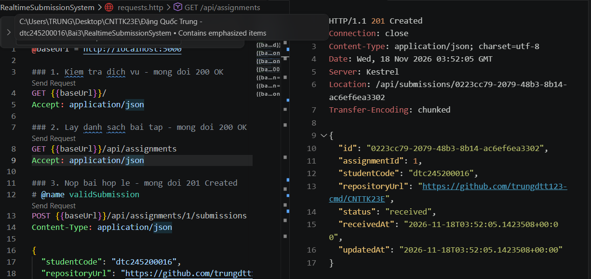

### Đọc trạng thái lượt nộp - 200 OK

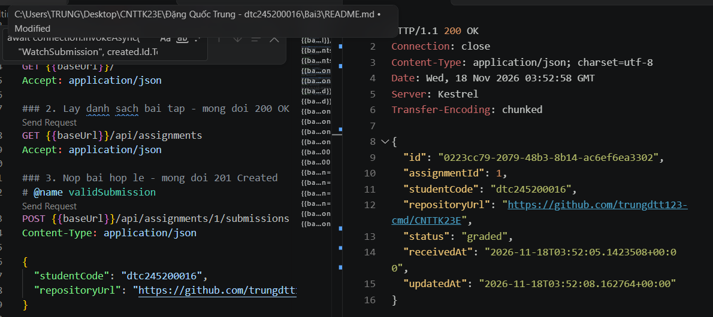

### Nộp bài thiếu dữ liệu - 400 Bad Request

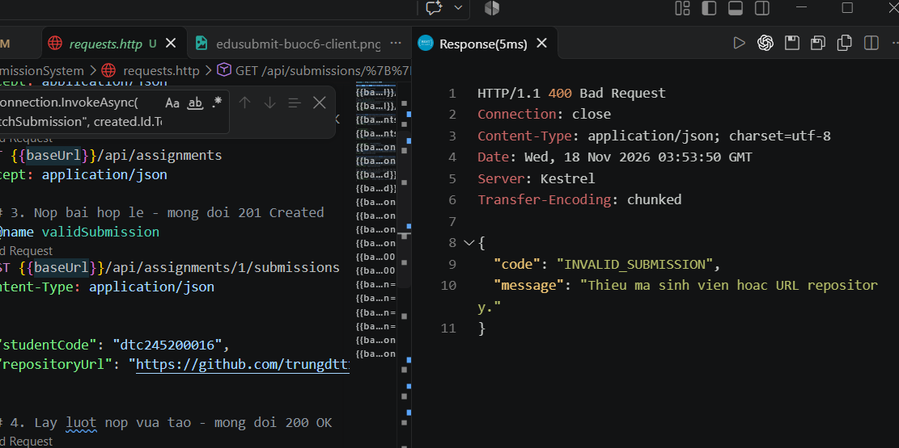

### Bài tập không tồn tại - 404 Not Found

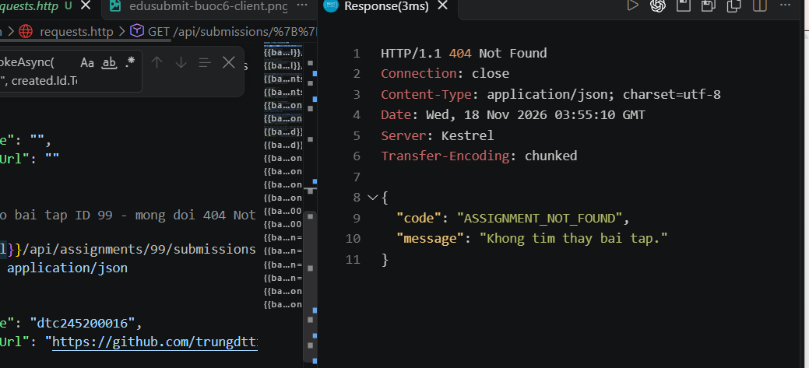

## Minh chứng bài tập vận dụng

### Bài tập 2: Trạng thái failed

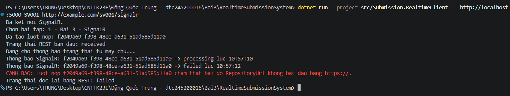

### Bài tập 3: Theo dõi hai lượt nộp

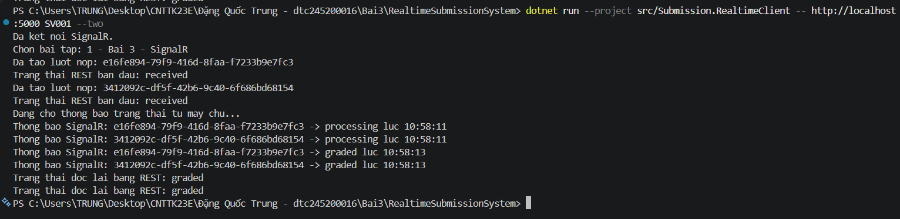

### Bài tập 4: Chạy khi máy chủ API tắt

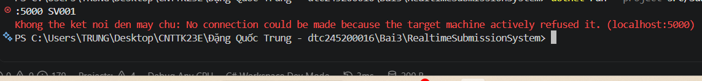
