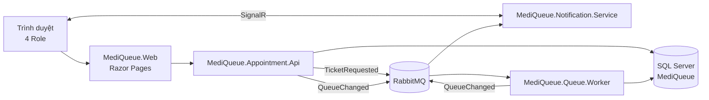

# MediQueue

**Mã đề tài:** 09  
**Tên đề tài:** Hệ thống đặt lịch khám và quản lý hàng đợi  
**Tên tiếng Anh:** Medical Appointment and Queue Management System  
**Sinh viên:** Đặng Quốc Trung — `dtc245200016`

## Quy định nộp dự án

- Dự án được phát triển xuyên suốt **9 tuần** trong thư mục `DuAn/DT09_HeThongDatLichKhamVaQuanLyHangDoi`.
- Mỗi tuần có một thư mục độc lập: `Tuan1`, `Tuan2`, ..., `Tuan9`.
- Mỗi tuần chỉ tạo **một Pull Request** cho phần việc của tuần đó; trong Pull Request được phép có nhiều commit phản ánh quá trình phát triển thực tế.
- Không gộp sản phẩm của nhiều tuần vào cùng một Pull Request và không tạo commit giả để đủ số lượng.
- Tài liệu hiện tại là sản phẩm Tuần 1 tại `DT09_HeThongDatLichKhamVaQuanLyHangDoi/Tuan1`.
- Tiêu đề Pull Request Tuần 1: `DuAn-Tuan1 - dtc245200016 - Đặng Quốc Trung`.
- Hạn nộp Tuần 1: **23h59 ngày 17/11/2026** theo giờ Việt Nam.

Việc commit, push và tạo Pull Request do sinh viên thực hiện sau khi kiểm tra; Codex không tự động thực hiện các thao tác này.

## 1. Tổng quan

MediQueue là hệ thống phân tán hỗ trợ bệnh nhân tra cứu bác sĩ, xem khung giờ còn chỗ, đặt hoặc hủy lịch khám, nhận số thứ tự và theo dõi hàng đợi theo thời gian thực. Bác sĩ điều phối lượt khám; lễ tân hỗ trợ bệnh nhân và lịch hẹn; quản trị viên quản lý dữ liệu nền và tài khoản.

Phiên bản đầu phục vụ **một cơ sở y tế** có nhiều chuyên khoa, Doctor và Room; không có mô hình chi nhánh. Mỗi Doctor thuộc đúng một Specialty, một Specialty có nhiều Doctor. Trạng thái Appointment thống nhất là `PendingNumber`, `Waiting`, `Serving`, `Completed`, `Cancelled`, `NoShow`.

Hai luồng thể hiện bản chất phân tán của đề tài:

- Yêu cầu cấp số được đưa qua RabbitMQ và xử lý bất đồng bộ bởi `MediQueue.Queue.Worker`.
- Mọi thay đổi số thứ tự hoặc lượt đang phục vụ được phát qua RabbitMQ; `MediQueue.Notification.Service` nhận sự kiện và đẩy đến client bằng SignalR.
- QueueNumber tăng riêng theo từng Doctor/ngày, không tái sử dụng và hiển thị tối thiểu ba chữ số (`001`, `002`, `003`, ...).

### 1.1 Bài toán thực tế

Trong quy trình khám ngoại trú, lịch hẹn và hàng đợi thường được theo dõi ở các bước tách rời. Patient khó biết slot nào còn chỗ hoặc hiện đang phục vụ đến lượt nào; Receptionist phải hỗ trợ nhiều thao tác thủ công; Doctor cần một danh sách chờ đúng thứ tự và cập nhật kịp thời. Khi nhiều người đặt cùng lúc, hệ thống còn phải ngăn hết chỗ, trùng lịch và cấp trùng số.

### 1.2 Lý do xây dựng

MediQueue được xây dựng để hợp nhất quy trình đặt lịch, cấp QueueNumber và điều phối hàng đợi trên một hệ thống có phân quyền. Đề tài đồng thời minh họa đúng bản chất ứng dụng phân tán: RabbitMQ tách xử lý cấp số khỏi HTTP request, Worker xử lý message idempotent và SignalR đưa thay đổi queue tới client theo thời gian thực.

### 1.3 Mục tiêu

- Giúp Patient chủ động tra cứu Doctor/slot, đặt hoặc hủy Appointment và theo dõi lượt chờ.
- Giúp Doctor điều phối đúng queue của mình và bảo đảm mỗi Doctor chỉ phục vụ một Patient tại một thời điểm.
- Giúp Receptionist hỗ trợ đặt/hủy, check-in và theo dõi queue mà không vượt quyền Doctor.
- Giúp Admin quản lý tài khoản, Specialty, Doctor, Room, slot và báo cáo tổng hợp.
- Bảo đảm consistency khi đặt lịch đồng thời, idempotency khi RabbitMQ redeliver và đồng bộ lại sau khi SignalR reconnect.

## 2. Phạm vi giai đoạn hiện tại

Đây là giai đoạn **phân tích và thiết kế nền tảng**. Repository hiện chỉ chứa tài liệu; chưa khởi tạo solution/project .NET, chưa cài package, chưa chạy SQL/Migration và chưa thay đổi database `MediQueue`.

### Yêu cầu bắt buộc của đề tài 09

1. Tra cứu bác sĩ/phòng khám và khung giờ còn chỗ.
2. Đặt, hủy và tra cứu lịch khám.
3. Cấp số bất đồng bộ qua RabbitMQ.
4. Queue Worker sinh số và cập nhật trạng thái hàng đợi.
5. Bác sĩ cập nhật lượt đang phục vụ.
6. Phát sự kiện thay đổi hàng đợi qua RabbitMQ.
7. Notification Service cập nhật client bằng SignalR.
8. Tra cứu trạng thái hàng đợi hiện tại.

### Chức năng mở rộng trong phạm vi sản phẩm

- Tự đăng ký tài khoản Patient và quản lý hồ sơ cá nhân.
- Admin quản lý tài khoản, bác sĩ, chuyên khoa, phòng khám, khung giờ và xem thống kê.
- Receptionist hỗ trợ tiếp nhận, đặt/hủy lịch và theo dõi hàng đợi.
- Lưu lịch sử lịch hẹn và nhật ký chuyển trạng thái để truy vết.
- Receptionist ghi nhận check-in như thông tin tiếp nhận; check-in không phải điều kiện cấp QueueTicket.

Các chức năng mở rộng không thay thế hoặc làm chậm luồng bắt buộc.

### Actor và trách nhiệm chính

| Actor | Trách nhiệm chính |
|---|---|
| `Patient` | Tự đăng ký, tra cứu, đặt/hủy Appointment, xem lịch sử và theo dõi queue của mình |
| `Doctor` | Xem lịch cá nhân, gọi lượt đủ điều kiện, hoàn thành hoặc xác nhận `NoShow` trong queue của mình |
| `Receptionist` | Tìm Patient, hỗ trợ đặt/hủy, ghi nhận check-in và theo dõi queue; không điều phối thay Doctor |
| `Admin` | Quản lý tài khoản, Role, Specialty, Doctor, Room, slot và báo cáo |

## 3. Công nghệ đã thống nhất

| Hạng mục | Công nghệ |
|---|---|
| Ngôn ngữ / nền tảng | C#, .NET 10 |
| Backend | ASP.NET Core Web API |
| Frontend | ASP.NET Core Razor Pages, Bootstrap 5, JavaScript |
| Dữ liệu | SQL Server `LAPTOP-AQFGUM9Q\SQLEXPRESS`, database `MediQueue` |
| ORM | Entity Framework Core |
| Xác thực / phân quyền | ASP.NET Core Identity, JWT, Role-based Authorization |
| Message broker | RabbitMQ cài trực tiếp trên Windows |
| Xử lý nền | .NET Worker Service |
| Thời gian thực | SignalR |
| Kiểm thử | xUnit, REST Client |
| Quản lý mã nguồn | Git, GitHub |

Không sử dụng Docker, Dockerfile hoặc Docker Compose.

JWT Access Token có thời hạn; phiên bản đầu chưa có Refresh Token. Client không lưu token bền vững trong `localStorage`/`sessionStorage`; SignalR bắt buộc xác thực và chỉ tham gia group sau khi backend kiểm tra quyền.

## 4. Kiến trúc logic

Các project dùng chung mô hình nghiệp vụ và hợp đồng thông qua `MediQueue.Domain`, `MediQueue.Infrastructure` và `MediQueue.Contracts`; chi tiết xem [docs/architecture.md](docs/architecture.md).

## 5. Tài liệu

| Tệp | Nội dung |
|---|---|
| [docs/requirements.md](docs/requirements.md) | Yêu cầu chức năng, phi chức năng và truy vết đề tài |
| [docs/actors.md](docs/actors.md) | Actor, phạm vi dữ liệu và ma trận phân quyền |
| [docs/use-cases.md](docs/use-cases.md) | Danh sách, đặc tả và sơ đồ Use Case |
| [docs/business-rules.md](docs/business-rules.md) | Quy tắc nghiệp vụ và state machine |
| [docs/architecture.md](docs/architecture.md) | Thành phần, luồng phân tán, RabbitMQ và SignalR |
| [docs/database.md](docs/database.md) | Thiết kế dữ liệu dự kiến và ERD |
| [docs/api.md](docs/api.md) | Thiết kế RESTful API dự kiến |
| [docs/roadmap.md](docs/roadmap.md) | Lộ trình phát triển và nộp bài trong 9 tuần |
| [docs/progress.md](docs/progress.md) | Nhật ký tiến độ thực tế |
| [AGENTS.md](AGENTS.md) | Quy tắc cho các lần làm việc tiếp theo với Codex |

## 6. Kết quả Tuần 1

Đã hoàn thành ở mức **phân tích và thiết kế**:

- Xác định phạm vi, 4 Actor, ma trận phân quyền, yêu cầu chức năng/phi chức năng và 13 Use Case.
- Truy vết đủ 8 chức năng bắt buộc và thiết kế đủ 6 RESTful API tối thiểu của đề tài 09.
- Thiết kế kiến trúc phân tán, RabbitMQ topology, Queue Worker, transactional outbox/inbox và SignalR flow.
- Thiết kế ERD, constraint, concurrency control, Activity/Sequence/State Diagram và quy tắc nghiệp vụ.
- Chuẩn hóa lộ trình 9 tuần, quy tắc một PR mỗi tuần và nhật ký tiến độ thực tế.

Chưa khởi tạo solution/project, chưa viết mã ứng dụng, chưa cài package, chưa chạy SQL/Migration, chưa thay đổi database và chưa tạo kết quả kiểm thử hay ảnh minh chứng.

## 7. Kế hoạch dự kiến Tuần 2

- Làm việc trong thư mục `Tuan2`, kế thừa toàn bộ quyết định của Tuần 1; không khởi động lại hoặc thiết kế lại dự án từ đầu.
- Dự kiến khởi tạo solution .NET 10 và các project đã chốt, thiết lập project reference và mô hình Domain/Contracts ban đầu.
- Bổ sung test project nền tảng và kiểm tra build, nhưng chưa tự chạy Migration hoặc thay đổi database nếu chưa được duyệt.
- Điều chỉnh phạm vi nếu giảng viên có yêu cầu chuyên môn riêng cho Tuần 2.

## 8. Trạng thái

- Nhánh dự án: `duan-dtc245200016`.
- Tuần nộp hiện tại: `Tuan1` — phân tích và thiết kế nền tảng.
- Pull Request Tuần 1: chưa được Codex tạo; tiêu đề phải là `DuAn-Tuan1 - dtc245200016 - Đặng Quốc Trung`.
- Các quyết định nghiệp vụ cốt lõi đã được chuẩn hóa theo xác nhận ngày 2026-11-17.
- Mã nguồn ứng dụng: chưa triển khai.
- Database có sẵn: chỉ được khảo sát hoặc thay đổi khi có yêu cầu rõ ràng ở giai đoạn sau.

