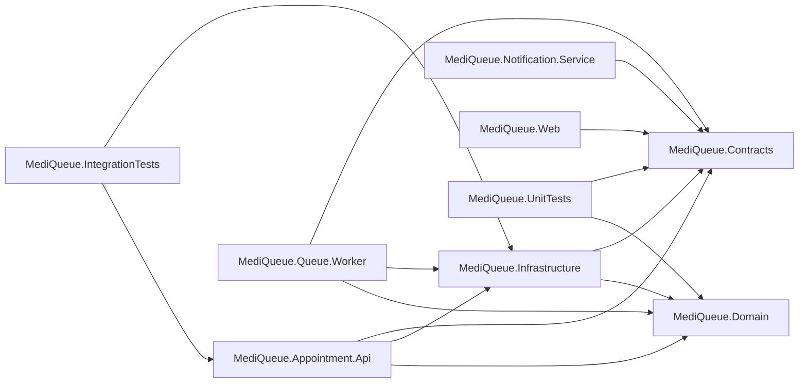
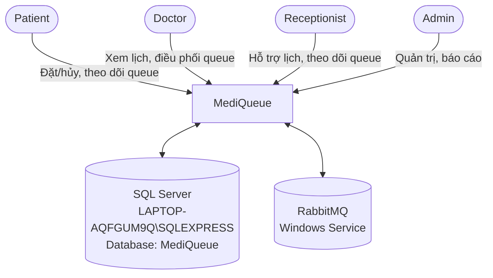
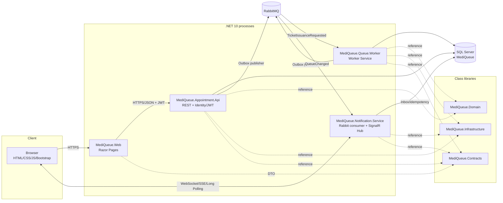
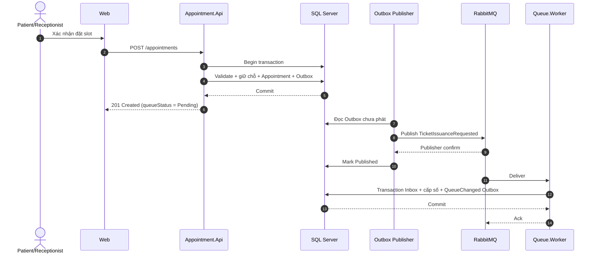
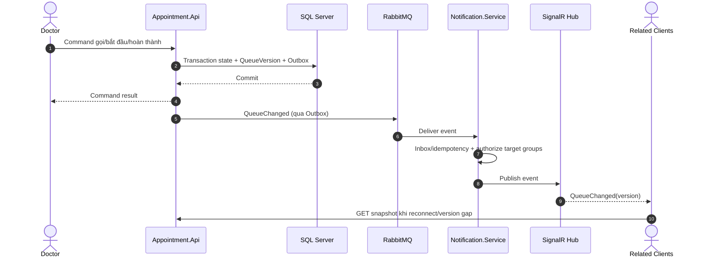
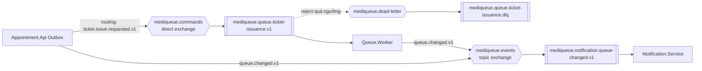
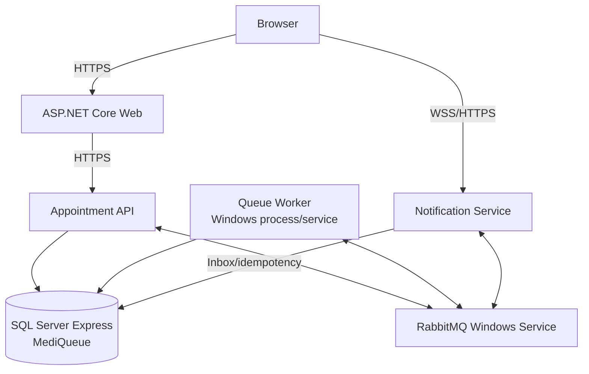

# Kiến trúc hệ thống phân tán

## 1. Mục tiêu kiến trúc

- Tách Web, API, xử lý cấp số và thông báo thời gian thực thành các tiến trình độc lập.
- Dùng RabbitMQ đúng hai yêu cầu cốt lõi: command cấp số bất đồng bộ và event thay đổi queue.
- SQL Server là nguồn dữ liệu chuẩn; SignalR chỉ phân phối thay đổi đến client.
- Bảo toàn nghiệp vụ dưới tải đồng thời và cơ chế giao message at-least-once.
- Có thể chạy trực tiếp trên Windows, không phụ thuộc Docker.
- Phục vụ một cơ sở y tế duy nhất; Specialty, Doctor và Room là dữ liệu nội bộ của cơ sở này.

### 1.1 Nền tảng đã khởi tạo trong Prompt 02.1

Solution `MediQueue.slnx` gồm chín project target `net10.0`:



`Domain` và `Contracts` không tham chiếu project khác; Web không tham chiếu Infrastructure và không truy cập trực tiếp DbContext/SQL Server. Quan hệ đã được kiểm tra không có vòng phụ thuộc.

Ba tiến trình web chạy độc lập trên Windows: API `5101/7101`, Web `5102/7102`, Notification `5103/7103` (HTTP/HTTPS). Queue Worker không mở cổng. Health endpoint chỉ chứng minh host khởi động, không đại diện cho chức năng nghiệp vụ.

Controller dùng mô hình kết hợp theo Role và theo tài nguyên nghiệp vụ. Controller mỏng: nhận request, kiểm tra quyền, gọi service/domain và trả DTO/ProblemDetails; không chứa logic nghiệp vụ, không gọi controller khác, không truy cập SQL trực tiếp. Ở giai đoạn này chỉ `HealthController` được triển khai; các controller nghiệp vụ mới là thiết kế dự kiến.

## 2. Context diagram



## 3. Container/component diagram



Các mũi tên `reference` mô tả phụ thuộc project dự kiến, không phải network call.

Phụ thuộc source code dự kiến đi một chiều: `Domain` không phụ thuộc project khác; `Contracts` không tham chiếu EF entity; `Infrastructure` tham chiếu `Domain`/`Contracts`; các executable (`Web`, `Api`, `Worker`, `Notification`) chỉ tham chiếu những thư viện cần thiết. Không tạo vòng phụ thuộc giữa các project.

## 4. Trách nhiệm thành phần

| Thành phần | Trách nhiệm | Không chịu trách nhiệm |
|---|---|---|
| `MediQueue.Web` | Razor Pages, form đăng nhập chung, dashboard theo Role, gọi API, SignalR client | Không truy cập SQL trực tiếp; không chứa invariant cốt lõi |
| `MediQueue.Appointment.Api` | Identity/JWT Access Token, authorization, Doctor/slot/Appointment, queue commands, snapshot query, outbox | Không sinh QueueNumber trong request đặt lịch; không phát Refresh Token ở v1 |
| `MediQueue.Queue.Worker` | Consume ticket request, idempotency, sinh số, tạo QueueTicket, phát QueueChanged | Không phục vụ UI/HTTP nghiệp vụ công khai |
| `MediQueue.Notification.Service` | Consume QueueChanged, lọc/nhóm connection và phát SignalR | Không là source of truth; không tự thay đổi queue |
| `MediQueue.Domain` | Entity, value object, enum, invariant/domain service thuần | Không phụ thuộc ASP.NET, EF Core, RabbitMQ |
| `MediQueue.Infrastructure` | EF Core DbContext/repository, Identity store, outbox/inbox, RabbitMQ adapters | Không chứa UI hoặc contract tùy tiện |
| `MediQueue.Contracts` | API DTO dùng chung có chọn lọc, command/event envelope có version | Không chứa EF entity hoặc secret |

## 5. Luồng đặt lịch và cấp số



## 6. Luồng cập nhật queue thời gian thực



## 7. RabbitMQ topology dự kiến

> **Đề xuất:** tên cụ thể cần xác nhận khi triển khai; semantic dưới đây là bắt buộc.



### Message envelope chung

```json
{
  "messageId": "uuid",
  "messageType": "TicketIssuanceRequested.v1",
  "occurredAtUtc": "2026-11-17T08:00:00Z",
  "correlationId": "uuid",
  "causationId": "uuid-or-null",
  "payload": {}
}
```

### Command `TicketIssuanceRequested.v1`

- `appointmentId`, `doctorId`, `slotId`, `serviceDate`.
- Không tin tuyệt đối dữ liệu message: Worker đọc lại Appointment/slot từ SQL trước khi cấp số.
- Worker tăng counter riêng `(DoctorId, ServiceDate)` từ 0 lên 1, tạo ticket `Waiting` và chuyển Appointment `PendingNumber → Waiting` trong cùng transaction.

### Event `QueueChanged.v1`

- `eventId`, `doctorId`, `serviceDate`, `queueVersion`, `changeType`.
- Có thể chứa `appointmentId`/`queueTicketId` để gửi group riêng, nhưng payload group Doctor/Patient không chứa dữ liệu ngoài scope.

## 8. Delivery guarantee, outbox và inbox

RabbitMQ cung cấp luồng at-least-once trong thiết kế này; duplicate là tình huống bình thường.

1. Producer ghi business data và `OutboxMessage` trong cùng SQL transaction.
2. Publisher đọc bản ghi chưa phát, publish persistent message và chờ publisher confirm.
3. Consumer kiểm tra unique `(MessageId, ConsumerName)` trong `InboxMessages`.
4. Consumer cập nhật nghiệp vụ, ghi Inbox và event Outbox trong cùng transaction.
5. Chỉ ack sau commit. Crash trước ack tạo redelivery nhưng Inbox biến lần xử lý sau thành no-op.
6. Retry có backoff và giới hạn; poison message tới DLQ để kiểm tra thủ công.

**Hệ quả:** không tuyên bố exactly-once end-to-end; hệ thống đạt hiệu ứng xử lý đúng một lần ở tầng nghiệp vụ nhờ idempotency và constraint.

## 9. SignalR và bảo mật kết nối

- Notification Service host Hub riêng và xác thực JWT khi negotiate/kết nối.
- Group dự kiến: `doctor:{doctorId}:date:{yyyyMMdd}` và `user:{userId}`.
- Chỉ server thêm connection vào group sau khi kiểm tra claim/scope; client không tự chọn group tùy ý.
- Không có group queue công khai; mọi connection phải xác thực. Summary chỉ chứa số đang phục vụ, số chờ và version trong phạm vi được phép.
- Chi tiết ticket cá nhân gửi group `user:{userId}`.
- JavaScript client dùng automatic reconnect với backoff; sau reconnect tải lại snapshot. Nếu Access Token hết hạn, v1 yêu cầu đăng nhập lại vì không có Refresh Token.

JWT Access Token có thời hạn và chỉ được giữ trong bộ nhớ tiến trình phía client trong phiên hoạt động để `fetch`/SignalR `accessTokenFactory`; không ghi vào `localStorage` hoặc `sessionStorage`, URL ứng dụng hay log. Với WebSocket, thư viện SignalR có thể truyền token khi negotiate/kết nối; server phải dùng HTTPS/WSS và redaction query log. Thiết kế bảo mật này phải được kiểm thử trước demo.

## 10. Nhất quán và concurrency

- Đặt lịch: transaction + conditional capacity update + `rowversion`.
- Cấp số: một `DailyQueue`/Doctor/ngày giữ counter; cập nhật trong transaction; unique index chống trùng.
- Queue command: chỉ chọn slot đã đến giờ; `call-next` chuyển trực tiếp `Waiting → Serving`; conditional transition và `rowversion` bảo vệ cạnh tranh.
- Hủy/cấp số cạnh tranh: cả hai đọc/ghi trạng thái trong transaction; Worker không cấp nếu Appointment đã Cancelled; nếu hủy sau khi ticket tạo thì hủy ticket và phát event.
- Hủy/NoShow không giảm `LastIssuedNumber`; WaitingCount/peopleAhead dùng truy vấn đếm bản ghi chứ không trừ QueueNumber.
- API không dùng cache làm nguồn quyết định capacity/queue.

## 11. Deployment topology trên Windows



Các tiến trình Web, API, Worker và Notification chạy độc lập trên Windows. Trong Development dùng `dotnet run`/launch profiles; khi demo ổn định có thể cấu hình Worker/Notification thành Windows Service hoặc quy trình khởi động được tài liệu hóa. Không tạo container.

## 12. Cấu hình và observability

- Connection string, RabbitMQ credentials và JWT signing key đặt ở User Secrets/biến môi trường, không commit.
- Structured log tối thiểu: `CorrelationId`, `UserId` (không PII thừa), `AppointmentId`, `MessageId`, `QueueVersion`.
- Health endpoint liveness tối giản đã có cho API/Web/Notification; readiness kiểm tra SQL/RabbitMQ chỉ bổ sung khi các tích hợp đó được triển khai thật.
- Audit nghiệp vụ khác application log và được lưu bền vững.

## 13. Quyết định và điểm mở

### Đã chốt

- Các project/thành phần nêu trên; .NET 10; SQL Server/EF Core; RabbitMQ; Worker; SignalR.
- RabbitMQ cho cả cấp số và event thay đổi queue.
- Một Razor Pages website, Identity/JWT và Role-based Authorization.
- Chỉ JWT Access Token có thời hạn trong v1; không Refresh Token; SignalR xác thực và kiểm tra group.
- QueueNumber riêng Doctor/ngày, bắt đầu 1, không tái sử dụng; định dạng hiển thị tối thiểu ba chữ số.
- Appointment state: `PendingNumber`, `Waiting`, `Serving`, `Completed`, `Cancelled`, `NoShow`; không có `Called` ở v1.
- Một cơ sở y tế; mỗi Doctor thuộc một Specialty; nhiều Room.
- Transactional outbox/inbox, idempotency và concurrency control được giữ trong thiết kế, triển khai theo roadmap.
- Không Docker.

### Tham số kỹ thuật sẽ chốt khi triển khai

- Tên exchange/queue cuối cùng, số lần retry/backoff và cảnh báo DLQ.
- Chứng chỉ Development và cách định tuyến HTTPS/WSS giữa các tiến trình Windows; port local đã chốt là API `5101/7101`, Web `5102/7102`, Notification `5103/7103`.
- Thời hạn cụ thể của JWT Access Token và ngưỡng timeout kết nối SignalR.

