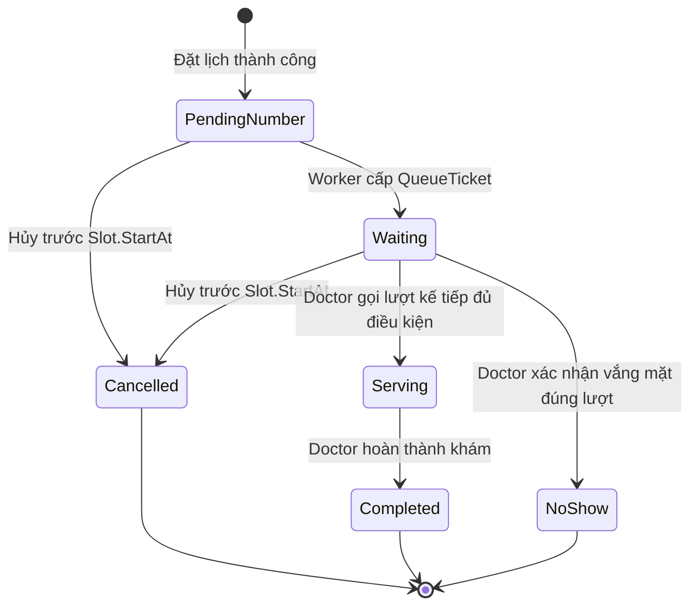
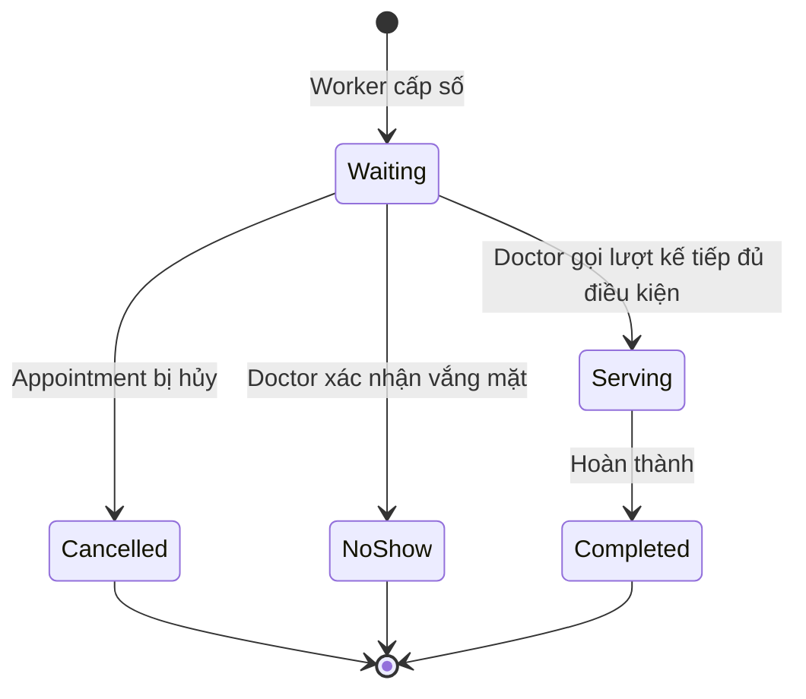

# Quy tắc nghiệp vụ

## 1. Quy ước

- Mọi quy tắc được thực thi ở backend; validation phía client chỉ hỗ trợ trải nghiệm.
- `Appointment` là lịch đã giữ chỗ; `QueueTicket` là số thứ tự được cấp bất đồng bộ.
- Ngày phục vụ và mọi điều kiện thời gian nghiệp vụ được xác định theo `Asia/Ho_Chi_Minh`; timestamp kỹ thuật lưu UTC.
- Database constraint là lớp bảo vệ cuối cho invariant có thể biểu diễn bằng dữ liệu.

## 2. Quy tắc lịch và sức chứa

| Mã | Quy tắc | Cách bảo vệ dự kiến |
|---|---|---|
| BR-APT-01 | Không đặt slot đã qua | So sánh `Slot.StartAt` với thời điểm hiện tại theo múi giờ nghiệp vụ |
| BR-APT-02 | Không đặt slot inactive/cancelled | Kiểm tra trạng thái trong transaction |
| BR-APT-03 | Không đặt slot hết chỗ | Cập nhật `BookedCount` có điều kiện `< Capacity` + concurrency token |
| BR-APT-04 | Patient không có hai Appointment active chồng thời gian | Truy vấn overlap với `SERIALIZABLE` range lock/khóa theo Patient; integration test concurrent |
| BR-APT-05 | Capacity phải lớn hơn 0; `BookedCount` nằm trong `[0, Capacity]` | Check constraint và domain validation |
| BR-APT-06 | Hủy hợp lệ giải phóng đúng một chỗ | State transition có điều kiện trong cùng transaction; hủy lặp là no-op |
| BR-APT-07 | Chỉ hủy trước `Slot.StartAt` khi chưa phục vụ | Chỉ `PendingNumber`/`Waiting` được chuyển `Cancelled`; so sánh theo giờ Việt Nam |
| BR-APT-08 | Receptionist thao tác hộ phải chỉ rõ Patient và người thực hiện | `PatientUserId`, `CreatedByUserId`, audit log |
| BR-APT-09 | Check-in chỉ là thông tin tiếp nhận | Ghi `CheckedInAtUtc/CheckedInByUserId`; không đổi trạng thái và không quyết định cấp số |

Điều kiện chồng thời gian:

```text
existing.StartAt < requested.EndAt AND requested.StartAt < existing.EndAt
```

Chỉ Appointment ở trạng thái giữ chỗ (`PendingNumber`, `Waiting`, `Serving`) tham gia kiểm tra trùng.

## 3. Quy tắc cấp số và hàng đợi

| Mã | Quy tắc | Cách bảo vệ dự kiến |
|---|---|---|
| BR-QUE-01 | Cấp số chỉ qua RabbitMQ/Queue Worker | API chỉ tạo `TicketIssuanceRequested`, không sinh QueueNumber |
| BR-QUE-02 | Một Appointment tối đa một QueueTicket | Unique index trên `QueueTickets.AppointmentId` |
| BR-QUE-03 | QueueNumber duy nhất theo Doctor/ngày | Unique index `(DoctorId, ServiceDate, QueueNumber)` |
| BR-QUE-04 | Không cấp số cho Appointment đã hủy/không hợp lệ | Worker đọc lại trạng thái trong transaction trước khi tạo |
| BR-QUE-05 | Thứ tự phục vụ theo slot rồi QueueNumber trong slot | `ORDER BY Slot.StartAt, QueueNumber`; chỉ xét `Slot.StartAt <= now` |
| BR-QUE-06 | Không gọi ticket `Cancelled`, `NoShow` hoặc `Completed` | State predicate trong command; v1 không gọi lại NoShow |
| BR-QUE-07 | Mỗi Doctor tối đa một ticket `Serving` | `DoctorId` trên QueueTicket + filtered unique index khi `Status='Serving'` |
| BR-QUE-08 | Doctor chỉ điều phối queue của mình | Authorization policy `DoctorQueueOwner` |
| BR-QUE-09 | Chuyển trạng thái phải đúng state machine | Domain method + conditional update/concurrency token |
| BR-QUE-10 | Mọi thay đổi queue tăng `Version` và phát event | DailyQueue version + transactional outbox |
| BR-QUE-11 | QueueNumber bắt đầu từ 1 mỗi Doctor/ngày, không tái sử dụng | `LastIssuedNumber` chỉ tăng; hủy/NoShow không giảm counter |
| BR-QUE-12 | Hiển thị QueueNumber tối thiểu ba chữ số | Lưu số nguyên; định dạng `D3`: 1 → `001`, 12 → `012`, 1000 → `1000` |
| BR-QUE-13 | WaitingCount/peopleAhead không suy ra bằng phép trừ số | Đếm bản ghi `Waiting` thỏa điều kiện và đứng trước theo thứ tự phục vụ |
| BR-QUE-14 | `call-next` không dùng trạng thái Called | Chuyển trực tiếp Appointment/QueueTicket `Waiting → Serving` |
| BR-QUE-15 | Chỉ Doctor xác nhận NoShow cho lượt đủ điều kiện | Lượt phải là Waiting kế tiếp, slot đã đến giờ và Doctor đang không phục vụ lượt khác |

Mỗi `DailyQueue` giữ `LastIssuedNumber`, khởi tạo 0 cho từng `(DoctorId, ServiceDate)`. Worker khóa/cập nhật hàng trong transaction, tăng một đơn vị rồi dùng giá trị mới; vì vậy số đầu ngày là 1 và số đã hủy không được tái sử dụng. Unique index vẫn là lớp bảo vệ cuối. Không dùng `MAX(QueueNumber) + 1` ngoài transaction.

## 4. Quy tắc message và thời gian thực

| Mã | Quy tắc | Cách bảo vệ dự kiến |
|---|---|---|
| BR-MSG-01 | Mọi message có `MessageId`, `OccurredAtUtc`, `CorrelationId`, version schema | Message envelope trong Contracts |
| BR-MSG-02 | Consumer idempotent với giao hàng lặp | Unique `InboxMessages(MessageId, Consumer)` |
| BR-MSG-03 | Chỉ ack sau khi transaction xử lý commit | Manual acknowledgement |
| BR-MSG-04 | Không mất message khi DB commit nhưng RabbitMQ lỗi | Transactional outbox và publisher retry |
| BR-MSG-05 | Lỗi tạm thời retry có giới hạn; poison message vào DLQ | Retry/backoff + dead-letter exchange |
| BR-RT-01 | Client không coi SignalR là nguồn dữ liệu chuẩn | SQL snapshot/API là source of truth |
| BR-RT-02 | Client bỏ event cũ/trùng | So sánh `QueueVersion`/`EventId` |
| BR-RT-03 | Reconnect phải đồng bộ lại snapshot | Automatic reconnect + `GET /queues/{doctorId}` |

## 5. Quy tắc quyền và riêng tư

| Mã | Quy tắc |
|---|---|
| BR-AUTH-01 | Chỉ Patient tự đăng ký; Role do server gán, không nhận từ form đăng ký |
| BR-AUTH-02 | Doctor và Receptionist do Admin tạo/cấp Role |
| BR-AUTH-03 | Patient chỉ truy cập Appointment/QueueTicket của mình |
| BR-AUTH-04 | Doctor chỉ xem lịch và điều phối queue liên kết với chính mình |
| BR-AUTH-05 | Receptionist chỉ dùng các endpoint hỗ trợ được cấp; thao tác phải audit |
| BR-AUTH-06 | Admin mới quản lý Role/dữ liệu nền/báo cáo |
| BR-AUTH-07 | Queue yêu cầu đăng nhập; payload Patient không chứa dữ liệu Patient khác |
| BR-AUTH-08 | SignalR xác thực JWT và server kiểm tra quyền trước khi join group |
| BR-AUTH-09 | V1 chỉ có JWT Access Token thời hạn hữu hạn, không Refresh Token và không lưu bền vững trong local/session storage |

## 6. State machine Appointment



Check-in không xuất hiện trong state machine vì chỉ là metadata tiếp nhận. `NoShow` là trạng thái kết thúc trong phiên bản đầu, không có luồng gọi lại.

## 7. State machine QueueTicket



## 8. Bảng chuyển trạng thái được phép

| Aggregate | Từ | Sang | Actor/nguồn |
|---|---|---|---|
| Appointment | — | PendingNumber | Patient/Receptionist qua API |
| Appointment | PendingNumber | Waiting | Queue Worker cấp số |
| Appointment | PendingNumber/Waiting | Cancelled | Patient/Receptionist trước Slot.StartAt |
| Appointment | Waiting | Serving | Doctor gọi lượt kế tiếp đủ điều kiện |
| Appointment | Waiting | NoShow | Doctor phụ trách xác nhận đúng lượt |
| Appointment | Serving | Completed | Doctor command |
| QueueTicket | — | Waiting | Queue Worker |
| QueueTicket | Waiting | Serving | Doctor gọi lượt kế tiếp đủ điều kiện |
| QueueTicket | Waiting | NoShow | Doctor phụ trách xác nhận đúng lượt |
| QueueTicket | Serving | Completed | Doctor |
| QueueTicket | Waiting | Cancelled | Hủy Appointment trước Slot.StartAt |

## 9. Tình huống cạnh tranh cần kiểm thử

1. Hai Patient giành chỗ cuối cùng: chỉ một request thành công.
2. Cùng Patient gửi lặp POST do retry: chỉ một Appointment.
3. Worker nhận cùng message nhiều lần: chỉ một QueueTicket.
4. Hai Worker cấp số cho cùng Doctor/ngày: số không trùng.
5. Hai thao tác gọi lượt cùng lúc: chỉ một ticket chuyển `Serving` và DailyQueue version tăng nhất quán.
6. Hủy đồng thời với cấp số: kết quả cuối không có ticket active cho Appointment đã hủy.
7. Hủy đồng thời hai lần: `BookedCount` chỉ giảm một.
8. SignalR event tới sai thứ tự/trùng: client giữ snapshot có version mới nhất.
9. RabbitMQ redeliver yêu cầu cấp số: Inbox/unique constraint giữ nguyên một QueueTicket và một QueueNumber.
10. Hủy ticket số `005`: counter tiếp tục cấp `006`, tuyệt đối không cấp lại `005`.
11. Gọi lượt khi slot tương lai đứng đầu danh sách: không chuyển sang Serving.
12. WaitingCount có khoảng trống số do hủy/NoShow: kết quả bằng số bản ghi Waiting, không bằng hiệu hai số.

## 10. Quyết định nghiệp vụ đã chốt

- QueueNumber riêng theo Doctor/ngày, bắt đầu 1, hiển thị `D3`, không tái sử dụng.
- QueueTicket được cấp ngay sau đặt lịch qua RabbitMQ/Worker; check-in độc lập với cấp số.
- Không có trạng thái `Called` trong v1; gọi lượt chuyển thẳng `Waiting → Serving`.
- Chỉ Doctor phụ trách gọi, hoàn thành và xác nhận `NoShow`; Receptionist chỉ hỗ trợ lịch/check-in/theo dõi.
- Chỉ hủy trước `Slot.StartAt` khi chưa phục vụ; v1 không gọi lại `NoShow`.
- Queue yêu cầu đăng nhập và không công khai dữ liệu Patient khác.
- Một cơ sở y tế, mỗi Doctor thuộc đúng một Department (chuyên khoa).
