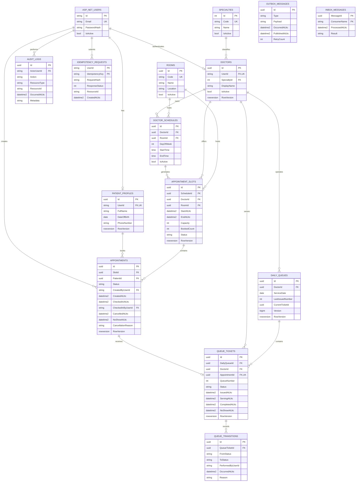

# Thiết kế cơ sở dữ liệu dự kiến

## 1. Phạm vi và nguyên tắc

Tài liệu này là thiết kế logic, **chưa phải SQL/Migration đã được thực thi**. Database `MediQueue` đã tồn tại trên `LAPTOP-AQFGUM9Q\SQLEXPRESS`; mọi thay đổi schema ở giai đoạn sau phải khảo sát hiện trạng, tạo Migration được review và chỉ chạy khi người dùng cho phép.

Nguyên tắc:

- Dùng ASP.NET Core Identity cho tài khoản/Role.
- Khóa chính dự kiến dùng `uniqueidentifier`/GUID cho aggregate và message; danh mục có thể dùng `int` nếu thống nhất khi triển khai.
- Timestamp kỹ thuật lưu UTC; `ServiceDate` và mọi quyết định ngày/giờ nghiệp vụ dùng `Asia/Ho_Chi_Minh`.
- Dùng `rowversion` cho các bảng cạnh tranh cao.
- Tránh xóa cứng danh mục đã được tham chiếu; dùng `IsActive`.
- Hệ thống chỉ có một cơ sở y tế nên không tạo `Facilities/Branches`; `Rooms` là các phòng khám trong cơ sở.
- Mỗi `Doctor` có đúng một `SpecialtyId`; một `Specialty` có nhiều Doctor.

## 2. ERD

Các bảng Identity chuẩn khác như `AspNetRoles`, `AspNetUserRoles`, claims/tokens không được vẽ đầy đủ để ERD tập trung vào nghiệp vụ.

## 3. Mô tả bảng

| Bảng | Mục đích | Ghi chú quan trọng |
|---|---|---|
| `AspNetUsers` và bảng Identity | Đăng nhập, mật khẩu, Role/claim | Bổ sung `IsActive` theo extension hoặc hồ sơ riêng; không lưu mật khẩu thuần |
| `PatientProfiles` | Hồ sơ Patient | 1–1 với user Role Patient; chỉ dữ liệu tối thiểu |
| `Doctors` | Hồ sơ và liên kết account Doctor | 1–1 `UserId`; bắt buộc thuộc đúng một Specialty |
| `Specialties` | Danh mục chuyên khoa | `Code` duy nhất, soft deactivate |
| `Rooms` | Phòng/vị trí khám | `Code` duy nhất, soft deactivate |
| `DoctorSchedules` | Quy tắc lịch làm việc định kỳ | Nguồn tạo slot; phải chống chồng Doctor/Room |
| `AppointmentSlots` | Slot cụ thể có capacity | Nơi xử lý overbooking; `BookedCount` + `RowVersion` |
| `Appointments` | Lịch đặt giữa Patient và slot | Trạng thái `PendingNumber/Waiting/Serving/Completed/Cancelled/NoShow`; check-in là metadata |
| `DailyQueues` | Aggregate queue theo Doctor/ngày | Counter khởi tạo 0, chỉ tăng, current ticket, `Version` cho realtime |
| `QueueTickets` | Số thứ tự của Appointment | 0..1 với Appointment; lưu số nguyên, UI định dạng tối thiểu ba chữ số |
| `QueueTransitions` | Lịch sử chuyển trạng thái | Audit nghiệp vụ, append-only |
| `OutboxMessages` | Message chờ publish | Ghi cùng business transaction |
| `InboxMessages` | Dấu vết message đã consume | Chống xử lý lặp theo consumer |
| `IdempotencyRequests` | Kết quả command HTTP theo user/key | Cùng key + cùng request trả kết quả cũ; payload khác bị từ chối |
| `AuditLogs` | Nhật ký thao tác quản trị/hỗ trợ | Không lưu secret/PII thừa |

## 4. Khóa và chỉ mục bắt buộc dự kiến

| Bảng | Constraint/index | Mục tiêu |
|---|---|---|
| `PatientProfiles` | UNIQUE (`UserId`) | Một user có tối đa một hồ sơ Patient |
| `Doctors` | UNIQUE (`UserId`) | Một user có tối đa một hồ sơ Doctor |
| `Specialties` | UNIQUE (`Code`) | Không trùng mã chuyên khoa |
| `Rooms` | UNIQUE (`Code`) | Không trùng mã phòng |
| `AppointmentSlots` | INDEX (`DoctorId`, `StartAtUtc`, `Status`) | Tra cứu slot Doctor theo ngày |
| `Appointments` | INDEX (`PatientId`, `Status`, `SlotId`) | Tra cứu lịch và kiểm tra overlap |
| `QueueTickets` | UNIQUE (`AppointmentId`) | Một lịch tối đa một số |
| `DailyQueues` | UNIQUE (`DoctorId`, `ServiceDate`) | Một aggregate Doctor/ngày |
| `QueueTickets` | UNIQUE (`DailyQueueId`, `QueueNumber`) | Không trùng số trong queue |
| `QueueTickets` | Filtered UNIQUE (`DoctorId`) khi `Status='Serving'` | Tối đa một lượt đang khám cho Doctor, kể cả ticket lệch ngày |
| `InboxMessages` | PK/UNIQUE (`MessageId`, `ConsumerName`) | Consumer idempotency |
| `OutboxMessages` | INDEX (`PublishedAtUtc`, `OccurredAtUtc`) | Quét message chưa phát |
| `IdempotencyRequests` | PK/UNIQUE (`UserId`, `IdempotencyKey`) | Chống tạo lặp trong phạm vi user |

Lưu ý: filtered index cụ thể phụ thuộc cách chuẩn hóa `DoctorId`/`DailyQueueId` và cách EF Core ánh xạ enum; phải kiểm chứng bằng Migration review.

## 5. Check constraint và invariant

- `AppointmentSlots.Capacity > 0`.
- `AppointmentSlots.BookedCount >= 0 AND BookedCount <= Capacity`.
- `AppointmentSlots.StartAtUtc < EndAtUtc`.
- `DoctorSchedules.StartTime < EndTime`.
- `QueueTickets.QueueNumber > 0`.
- `DailyQueues.LastIssuedNumber >= 0` và `Version >= 0`.
- `Appointments.Status` chỉ nhận `PendingNumber`, `Waiting`, `Serving`, `Completed`, `Cancelled`, `NoShow`.
- `QueueTickets.Status` chỉ nhận `Waiting`, `Serving`, `Completed`, `Cancelled`, `NoShow`.
- `CheckedInAtUtc` không làm thay đổi trạng thái và không quyết định việc cấp QueueTicket.
- `CancellationReason` chỉ áp dụng khi `Status='Cancelled'`.

## 6. Transaction boundaries

### Đặt Appointment

Một transaction bao gồm:

1. Kiểm tra slot và lịch Patient chồng thời gian.
2. Tăng `BookedCount` bằng điều kiện nguyên tử/concurrency.
3. Insert `Appointments` với trạng thái `PendingNumber`.
4. Insert `IdempotencyRequests`.
5. Insert `OutboxMessages(TicketIssuanceRequested)`.

Kiểm tra overlap phải chạy trong `SERIALIZABLE` transaction/range lock trên tập Appointment active của Patient (với index phù hợp), hoặc một cơ chế khóa theo Patient tương đương. Chỉ dùng truy vấn read-committed sẽ không ngăn hai request đồng thời vào hai slot khác nhau cùng vượt qua kiểm tra.

### Hủy Appointment

Một transaction kiểm tra thời điểm hiện tại còn trước `Slot.StartAt` theo giờ Việt Nam và trạng thái là `PendingNumber/Waiting`, sau đó conditional transition sang `Cancelled`, giảm `BookedCount` đúng một lần, hủy QueueTicket nếu có, tăng DailyQueue version và ghi outbox khi queue thay đổi. `LastIssuedNumber` không giảm nên số đã cấp không được tái sử dụng.

### Cấp số

Một transaction bao gồm Inbox check, cập nhật/tạo DailyQueue theo `(DoctorId, ServiceDate)`, tăng counter từ 0 để số đầu ngày là 1, insert QueueTicket `Waiting`, chuyển Appointment `PendingNumber → Waiting`, tăng version, insert QueueTransition, Inbox receipt và QueueChanged outbox.

### Gọi lượt, hoàn thành và NoShow

- `call-next`: chỉ chọn `Waiting` có `Slot.StartAt <= now` theo giờ Việt Nam, sắp theo `Slot.StartAt, QueueNumber`, rồi chuyển trực tiếp Appointment/QueueTicket sang `Serving`.
- `complete`: conditional transition `Serving → Completed` cho đúng Doctor.
- `no-show`: khi không có lượt Serving, chỉ lượt Waiting đầu tiên đủ điều kiện mới được chuyển sang `NoShow`; không có luồng gọi lại ở v1.
- Mọi command tăng `DailyQueues.Version`, ghi `QueueTransitions` và QueueChanged outbox trong cùng transaction.

## 7. Concurrency strategy

- `rowversion` trên Slot, Appointment, DailyQueue, QueueTicket.
- Capacity update nên có predicate `BookedCount < Capacity`; số hàng bị ảnh hưởng bằng 0 nghĩa là hết chỗ/xung đột.
- Overlap của cùng Patient cần `SERIALIZABLE` range lock hoặc khóa logic theo Patient trong transaction; retry deadlock có giới hạn và giữ nguyên idempotency key.
- Counter DailyQueue được cập nhật dưới transaction phù hợp và retry giới hạn khi deadlock/concurrency conflict.
- Redelivery cùng `MessageId` bị chặn bởi Inbox và unique `AppointmentId`; không tăng counter lần hai.
- WaitingCount/peopleAhead dùng `COUNT` trên bản ghi `Waiting` theo điều kiện/thứ tự, không lấy hiệu QueueNumber.
- Unique constraints luôn được bắt và chuyển thành lỗi nghiệp vụ/idempotent result, không lộ SQL exception ra client.
- Không dùng riêng một kiểm tra `SELECT` rồi `INSERT/UPDATE` ngoài transaction để bảo vệ invariant.

## 8. Dữ liệu danh mục và seed

Giai đoạn này không seed hoặc thay đổi database. Ở giai đoạn sau, chỉ dùng dữ liệu giả lập:

- Role cố định: `Patient`, `Doctor`, `Receptionist`, `Admin`.
- Specialty, Room, Doctor và slot mẫu không chứa dữ liệu người thật.
- Admin ban đầu phải được cấp qua quy trình an toàn, không hard-code mật khẩu trong source.

## 9. Việc phải chốt trước Migration đầu tiên

1. Khảo sát schema hiện có trong database `MediQueue` để tránh ghi đè/xung đột.
2. Kiểu khóa chính (`Guid` hay `long`) và chuẩn tên bảng/cột.
3. Slot Capacity mặc định, độ dài slot và cách sinh slot từ schedule.
4. Kiểu lưu enum (string hay int) và filtered index tương ứng sau khi xem khả năng SQL Server/EF Core.
5. Thời hạn lưu Audit/Inbox/Outbox/Idempotency và dữ liệu cá nhân giả lập.
6. Schema được khảo sát read-only trước; không xóa hoặc tạo lại database `MediQueue`.
