# Lộ trình phát triển và nộp dự án trong 9 tuần

## 1. Nguyên tắc

- Lộ trình là kế hoạch, không phải lịch sử đã thực hiện.
- Mỗi tuần làm việc trong một thư mục riêng `Tuan1` đến `Tuan9` và chỉ có một Pull Request riêng cho tuần đó.
- Một Pull Request có thể chứa nhiều commit thực tế; chỉ commit sau khi người dùng review và không làm giả lịch sử.
- Tuần sau kế thừa mã nguồn, tài liệu và quyết định của tuần trước; không làm lại dự án từ đầu và không ghi đè sản phẩm tuần đã nộp.
- Nếu giảng viên yêu cầu sửa trong quá trình review, tiếp tục commit vào đúng nhánh/PR của tuần đó thay vì mở PR mới.
- Yêu cầu bắt buộc của đề tài được ưu tiên trước chức năng mở rộng.
- Không chạy Migration hoặc thay đổi hạ tầng nếu chưa được phép rõ ràng.
- Phân bổ chức năng bên dưới là kế hoạch dự kiến và được điều chỉnh khi giảng viên có yêu cầu chuyên môn riêng; mọi điều chỉnh phải được ghi nhận trong `progress.md`.
- Đây là lộ trình phát triển nội bộ của MediQueue, không phải yêu cầu tiến độ cụ thể do giảng viên ban hành.

Tuần 1 nằm tại `DT09_HeThongDatLichKhamVaQuanLyHangDoi/Tuan1`. Tiêu đề PR bắt buộc là `DuAn-Tuan1 - dtc245200016 - Đặng Quốc Trung`; hạn nộp **23h59 ngày 17/11/2026**.

## 2. Kế hoạch theo tuần

| Tuần / thư mục | Mục tiêu | Sản phẩm bàn giao dự kiến | Tiêu chí hoàn thành |
|---|---|---|---|
| Tuần 1 / `Tuan1` | Phân tích, thiết kế, solution, MVC và EF Core Code First | Tài liệu; 9 project .NET 10; MVC host; Domain entity/invariant; Identity/DbContext/Fluent API; Migration và SQL review | Build/test/smoke test sạch; model/snapshot nhất quán; InitialCreate được áp dụng và xác minh |
| Tuần 2 / `Tuan2` | Đăng nhập, đăng ký và phân quyền | Form/login chung; Patient registration; cấp tài khoản staff; JWT Access Token; Role + ownership policies | Đúng 4 Role; không Refresh Token; authorization backend được kiểm thử |
| Tuần 3 / `Tuan3` | Quản lý danh mục | Doctor, Department, Room và các API/View quản trị liên quan | Controller/View theo nghiệp vụ; authorization và validation được kiểm thử |
| Tuần 4 / `Tuan4` | Khung giờ, đặt và hủy lịch | 6 REST endpoint bắt buộc; slot, Appointment, check-in metadata; transaction/concurrency | Test quá khứ, hết chỗ, trùng giờ, hạn hủy, ownership và tranh chỗ |
| Tuần 5 / `Tuan5` | RabbitMQ và Queue Worker | Message contracts, outbox/inbox, ticket queue, Worker cấp số, retry/DLQ | Cấp số thực sự qua RabbitMQ; duplicate không cấp trùng số |
| Tuần 6 / `Tuan6` | Hàng đợi, SignalR và Notification Service | Queue command/event; Hub xác thực; Rabbit consumer; reconnect/snapshot | Một Doctor tối đa một Serving; chỉ user có quyền nhận cập nhật |
| Tuần 7 / `Tuan7` | Hoàn thiện giao diện MVC | Views/partial theo nghiệp vụ; menu/dashboard theo 4 Role; luồng chính end-to-end | UI responsive; không thay authorization backend bằng ẩn/hiện nút |
| Tuần 8 / `Tuan8` | Kiểm thử, bảo mật và tối ưu | SQL concurrency, message idempotency, authorization, performance và hardening | Yêu cầu bắt buộc ổn định; không secret/dữ liệu thật |
| Tuần 9 / `Tuan9` | Hoàn thiện sản phẩm và báo cáo | Tài liệu chạy Windows, demo script, báo cáo và nghiệm thu | Build/test sạch; demo đủ đề tài; tài liệu nhất quán |

## 3. Milestone

```mermaid
gantt
    title Lộ trình MediQueue theo 9 tuần
    dateFormat  X
    axisFormat Tuần %s
    section Phân tích
    Tài liệu, MVC và Code First    :done, b1, 1, 1
    section Nền tảng mã nguồn
    Identity và xác thực           :b2, 2, 1
    section Chức năng bắt buộc
    Quản lý danh mục               :b3, 3, 1
    Khung giờ và Appointment API     :b4, 4, 1
    RabbitMQ và Queue Worker       :b5, 5, 1
    Queue, SignalR, Notification    :b6, 6, 1
    section Hoàn thiện
    Hoàn thiện giao diện MVC       :b7, 7, 1
    Test, bảo mật và tối ưu       :b8, 8, 1
    Sản phẩm và báo cáo           :b9, 9, 1
```



`done` ở biểu đồ chỉ thể hiện sản phẩm Tuần 1 đã hoàn thành về nội dung; không đại diện cho commit, Pull Request hoặc việc giảng viên đã nghiệm thu.

## 4. Chiến lược kiểm thử tăng dần

| Giai đoạn | Kiểm thử trọng tâm |
|---|---|
| Domain | Sáu trạng thái Appointment, overlap, capacity, queue ordering, hạn hủy/NoShow |
| API | Validation, Role/ownership, idempotency, ProblemDetails |
| Database | Constraint, rowversion, hai booking tranh chỗ, hủy lặp |
| Messaging | Duplicate không tăng số, redelivery, retry, DLQ, broker gián đoạn/outbox phục hồi |
| Realtime | Group authorization, event trùng/sai thứ tự, reconnect + snapshot |
| End-to-end | Patient đặt → Worker cấp số → Doctor gọi → SignalR cập nhật |

## 5. Rủi ro và biện pháp

| Rủi ro | Tác động | Biện pháp |
|---|---|---|
| Database có sẵn khác thiết kế | Migration xung đột/mất dữ liệu | Khảo sát read-only và backup/quy trình duyệt trước Migration |
| RabbitMQ chưa cấu hình đúng Windows | Luồng cốt lõi không chạy | Kiểm tra service/management, cấu hình ngoài source, health check |
| Duplicate message | Cấp trùng số/event lặp | Inbox, unique constraint, idempotent consumer |
| DB commit nhưng publish lỗi | Appointment không được cấp số | Transactional outbox + retry/publisher confirm |
| Overbooking đồng thời | Sai nghiệp vụ | Conditional update/rowversion + integration test |
| SignalR ngắt kết nối | UI lệch trạng thái | Auto reconnect + version + snapshot source of truth |
| JWT/SignalR lộ token | Rủi ro bảo mật | HTTPS, Access Token ngắn hạn chỉ trong bộ nhớ phiên, không local/session storage, log redaction |
| Phạm vi Admin mở rộng quá sớm | Chậm yêu cầu bắt buộc | Hoàn thành luồng đề tài 09 trước rồi mới mở rộng |

## 6. Definition of Done chung

- Requirement liên quan có test và tài liệu cập nhật.
- Build/test phù hợp giai đoạn chạy thành công.
- Không hard-code secret hoặc dùng dữ liệu bệnh nhân thật.
- Backend authorization đã kiểm tra cả Role và resource scope.
- Các luồng message xử lý duplicate/retry rõ ràng.
- QueueNumber Doctor/ngày không trùng/tái sử dụng; số chờ được đếm từ bản ghi.
- `git diff` của mỗi PR chỉ chứa thay đổi thuộc đúng thư mục `Tuan{n}`; người dùng review trước commit.

## 7. Quy tắc commit và Pull Request

Không làm giả lịch sử. Mỗi tuần chỉ mở một Pull Request nhưng được phép có nhiều commit phản ánh công việc thực tế. Chỉ commit khi một lát cắt thực sự hoàn thành và người dùng đồng ý. Commit Tuần 1 có thể là:

```text
docs: add MediQueue foundation analysis and design
```

Pull Request Tuần 1 phải có tiêu đề:

```text
DuAn-Tuan1 - dtc245200016 - Đặng Quốc Trung
```

Các commit tương lai phải nằm trong đúng thư mục tuần, không tạo commit rỗng hoặc PR bổ sung chỉ để khớp kế hoạch.

