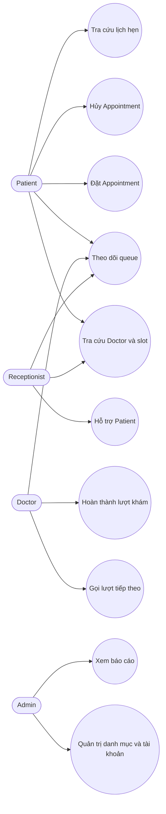
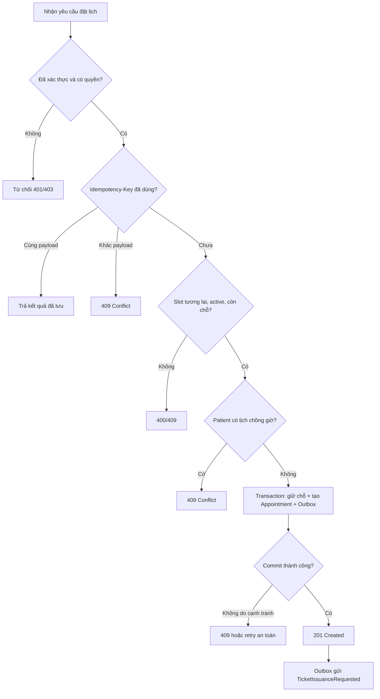
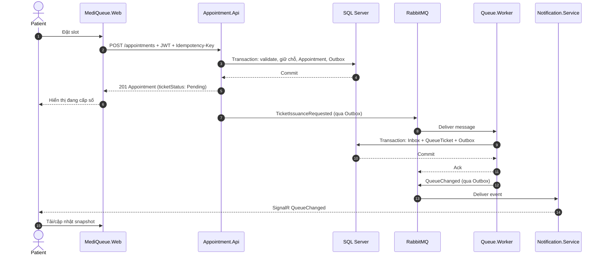

# Use Case MediQueue

## 1. Danh sách Use Case

| Mã | Use Case | Actor chính | Mức |
|---|---|---|---|
| UC-01 | Tra cứu Doctor/phòng khám | Patient, Receptionist | Bắt buộc |
| UC-02 | Xem slot còn chỗ | Patient, Receptionist | Bắt buộc |
| UC-03 | Đặt Appointment | Patient, Receptionist | Bắt buộc |
| UC-04 | Hủy Appointment | Patient, Receptionist | Bắt buộc |
| UC-05 | Cấp QueueTicket bất đồng bộ | Queue Worker | Bắt buộc |
| UC-06 | Theo dõi queue thời gian thực | Patient, Doctor, Receptionist | Bắt buộc |
| UC-07 | Gọi lượt tiếp theo | Doctor | Bắt buộc |
| UC-08 | Hoàn thành lượt khám hoặc xác nhận NoShow | Doctor | Bắt buộc |
| UC-09 | Tra cứu Appointment/queue | Patient, Doctor, Receptionist | Bắt buộc |
| UC-10 | Đăng ký/đăng nhập/phân luồng Role | Patient và các Role | Mở rộng |
| UC-11 | Quản trị dữ liệu nền/tài khoản | Admin | Mở rộng |
| UC-12 | Xem báo cáo tổng hợp | Admin | Mở rộng |
| UC-13 | Ghi nhận check-in | Receptionist | Mở rộng |

## 2. Sơ đồ Use Case tổng quan

## 3. Đặc tả Use Case bắt buộc

### UC-01 — Tra cứu Doctor/phòng khám

- **Tiền điều kiện:** Không bắt buộc đăng nhập đối với dữ liệu danh mục công khai.
- **Kích hoạt:** Người dùng nhập tên Doctor, Specialty hoặc tiêu chí tìm kiếm.
- **Luồng chính:**
  1. Web gửi bộ lọc và phân trang tới `GET /doctors`.
  2. API chuẩn hóa bộ lọc, chỉ chọn Doctor/Room đang hoạt động.
  3. API trả thông tin công khai, Specialty và nơi khám.
  4. Web hiển thị kết quả và liên kết xem slot.
- **Ngoại lệ:** Bộ lọc không hợp lệ trả `400`; không có kết quả trả danh sách rỗng, không phải `404`.
- **Hậu điều kiện:** Không thay đổi dữ liệu.

### UC-02 — Xem slot còn chỗ

- **Tiền điều kiện:** Doctor tồn tại và đang hoạt động.
- **Luồng chính:**
  1. Người dùng chọn Doctor và khoảng ngày.
  2. Web gọi `GET /doctors/{id}/slots`.
  3. API loại slot quá khứ, bị khóa/hủy hoặc đã đủ Capacity.
  4. API trả thời gian, phòng, Capacity còn lại.
- **Ngoại lệ:** Doctor không tồn tại trả `404`; khoảng ngày không hợp lệ trả `400`.
- **Lưu ý:** Dữ liệu hiển thị chỉ là snapshot; UC-03 phải kiểm tra lại trong transaction.

### UC-03 — Đặt Appointment

- **Actor:** Patient; Receptionist có thể thực hiện hộ Patient.
- **Tiền điều kiện:** Người thực hiện đã đăng nhập; Patient và slot hợp lệ.
- **Luồng chính:**
  1. Client gửi `slotId`, Patient mục tiêu (nếu Receptionist) và `Idempotency-Key`.
  2. API kiểm tra Role/ownership, thời gian, trạng thái slot và Appointment trùng giờ; kiểm tra overlap dùng transaction/khóa có thể ngăn phantom insert đồng thời.
  3. Trong transaction, API giữ một chỗ bằng cập nhật có điều kiện/concurrency token.
  4. API tạo Appointment trạng thái `PendingNumber`.
  5. API tạo outbox message `TicketIssuanceRequested` trong cùng transaction.
  6. Transaction commit; outbox publisher gửi message tới RabbitMQ.
  7. API trả `201 Created`; QueueTicket có thể chưa xuất hiện ngay.
- **Luồng thay thế/ngoại lệ:**
  - Cùng `Idempotency-Key` và cùng payload: trả lại kết quả trước đó.
  - Cùng key nhưng khác payload: `409 Conflict`.
  - Slot vừa hết chỗ hoặc concurrency conflict: `409 Conflict`.
  - Appointment trùng thời gian: `409 Conflict`.
  - Broker tạm ngừng sau commit: Appointment vẫn tồn tại; outbox retry, không tạo lại Appointment.
- **Hậu điều kiện:** Có đúng một Appointment; chỗ được giữ đúng một lần; yêu cầu cấp số sẽ được gửi ít nhất một lần.

#### Activity Diagram — đặt Appointment

### UC-04 — Hủy Appointment

- **Tiền điều kiện:** Appointment tồn tại; Patient sở hữu hoặc Receptionist được phép hỗ trợ; hiện tại còn trước `Slot.StartAt`; trạng thái là `PendingNumber` hoặc `Waiting`.
- **Luồng chính:**
  1. Client gọi `DELETE /appointments/{id}`.
  2. API kiểm tra scope và trạng thái hiện tại.
  3. Trong một transaction, chuyển Appointment sang `Cancelled`, giảm số chỗ đã giữ đúng một lần.
  4. Nếu đã có QueueTicket chưa hoàn tất, chuyển ticket sang `Cancelled`.
  5. Ghi `QueueChanged` vào outbox khi queue bị ảnh hưởng.
  6. Trả `204 No Content`.
- **Ngoại lệ:** Không tìm thấy/tránh lộ tài nguyên ngoài scope trả theo chính sách `404`; đã đến giờ slot hoặc trạng thái `Serving`/`Completed`/`NoShow` trả `409`.
- **Idempotency:** Gọi hủy lại Appointment đã hủy trả `204`, không giảm chỗ lần nữa.
- **Số đã cấp:** Nếu Appointment đã có QueueNumber thì số đó bị bỏ vĩnh viễn, không cấp lại cho lịch khác.

### UC-05 — Cấp QueueTicket bất đồng bộ

- **Actor hệ thống:** Queue Worker.
- **Tiền điều kiện:** Nhận `TicketIssuanceRequested` từ RabbitMQ.
- **Luồng chính:**
  1. Consumer kiểm tra `MessageId` trong Inbox.
  2. Tải Appointment, slot và Doctor trong transaction.
  3. Nếu Appointment đang `PendingNumber` và chưa có ticket, tăng counter riêng của Doctor/ngày; ngày mới bắt đầu từ 1.
  4. Tạo QueueTicket trạng thái `Waiting`, liên kết Appointment và chuyển Appointment `PendingNumber → Waiting`.
  5. Ghi Inbox receipt và outbox `QueueChanged` trong cùng transaction.
  6. Commit rồi ack message; outbox phát `QueueChanged` qua RabbitMQ.
- **Luồng thay thế:**
  - Message đã xử lý: ack mà không tạo ticket mới.
  - Appointment đã hủy: ghi nhận kết quả bỏ qua có lý do, không cấp số.
  - Unique/concurrency conflict: retry transaction có giới hạn, đọc lại kết quả trước khi tạo.
  - Lỗi tạm thời: nack/retry; lỗi quá ngưỡng: dead-letter và cảnh báo.
- **Hậu điều kiện:** Tối đa một ticket/Appointment, không trùng/tái sử dụng số Doctor/ngày; số nguyên được hiển thị tối thiểu ba chữ số (`001`, `002`, ...).

### UC-06 — Theo dõi queue thời gian thực

- **Tiền điều kiện:** Client đã đăng nhập bằng JWT Access Token còn hạn và có quyền theo dõi Doctor/Appointment tương ứng.
- **Luồng chính:**
  1. Client tải snapshot bằng `GET /queues/{doctorId}`.
  2. Client kết nối SignalR bằng token hợp lệ.
  3. Hub xác thực và thêm connection vào group được phép.
  4. Notification Service nhận `QueueChanged` từ RabbitMQ.
  5. Service kiểm tra idempotency, phát DTO đến group `doctor:{doctorId}` và group cá nhân liên quan.
  6. Client cập nhật UI nếu `version` mới hơn snapshot hiện có.
- **Mất kết nối:** SignalR tự reconnect với backoff; sau khi nối lại client tải snapshot mới thay vì tin rằng đã nhận đủ sự kiện.

### UC-07 — Gọi lượt tiếp theo

- **Actor:** Doctor.
- **Tiền điều kiện:** Doctor đã đăng nhập, route DoctorId thuộc chính Doctor; không có lượt `Serving` chưa kết thúc.
- **Luồng chính:**
  1. Doctor yêu cầu gọi lượt kế tiếp.
  2. API chỉ xét slot có `Slot.StartAt <= now` theo giờ Việt Nam, chọn QueueTicket `Waiting` sớm nhất theo `Slot.StartAt`, rồi `QueueNumber` trong slot.
  3. API chuyển trực tiếp QueueTicket và Appointment `Waiting → Serving`, cập nhật DailyQueue current ticket/version và ghi outbox.
  4. API trả ticket đang phục vụ; sự kiện được phát qua RabbitMQ → Notification Service → SignalR.
- **Ngoại lệ:** Không còn lượt chờ trả `409` hoặc `404` theo contract; có lượt `Serving` trả `409`; concurrency conflict được retry có giới hạn.

### UC-08 — Hoàn thành lượt khám hoặc xác nhận NoShow

- **Nhánh hoàn thành:** Ticket thuộc Doctor và đang `Serving`; Doctor chuyển QueueTicket và Appointment `Serving → Completed`.
- **Nhánh NoShow:** Không có lượt `Serving`; Doctor chọn đúng lượt `Waiting` kế tiếp đủ điều kiện (slot đã đến giờ và đứng đầu theo thứ tự phục vụ), rồi chuyển QueueTicket và Appointment sang `NoShow`.
- **Ràng buộc:** Chỉ Doctor phụ trách được thao tác; Receptionist không được hoàn thành/NoShow; phiên bản đầu không gọi lại lượt `NoShow`.
- **Hậu điều kiện:** DailyQueue current ticket/version được cập nhật; `QueueChanged` được ghi outbox và phát qua RabbitMQ.
- **Ngoại lệ:** Sai Doctor, sai trạng thái hoặc không phải lượt kế tiếp đủ điều kiện trả `404`/`409`.

### UC-09 — Tra cứu Appointment và queue

- **Luồng chính:** Actor gọi `GET /appointments/{id}` hoặc `GET /queues/{doctorId}`; API áp dụng Role + ownership/scope; trả snapshot có trạng thái, ticket và `updatedAt/version`.
- **Quyền riêng tư:** Queue không công khai cho Anonymous. Patient không nhận danh tính hoặc chi tiết của Patient khác; `waitingCount`/`peopleAhead` được đếm từ các bản ghi Waiting theo thứ tự phục vụ, không tính bằng phép trừ QueueNumber.

## 4. Use Case mở rộng tóm tắt

### UC-10 — Đăng ký/đăng nhập/phân luồng Role

Patient có thể đăng ký; Doctor/Receptionist do Admin cấp. Tất cả đăng nhập trên một form. API trả danh tính/Role hợp lệ; Web điều hướng tới dashboard tương ứng. Role không hợp lệ hoặc tài khoản bị khóa bị từ chối.

### UC-11 — Quản trị dữ liệu nền/tài khoản

Admin tạo/khóa tài khoản staff, quản lý Doctor, Specialty, Room, lịch và slot. Dữ liệu đã được tham chiếu chuyển inactive thay vì xóa cứng. Thao tác quan trọng được audit.

### UC-12 — Xem báo cáo tổng hợp

Admin xem thống kê theo khoảng thời gian, Specialty, Doctor và trạng thái. Dữ liệu phân trang/aggregate và không hiển thị thông tin cá nhân không cần thiết.

### UC-13 — Ghi nhận check-in

Receptionist tìm Appointment trong phạm vi hỗ trợ và ghi `CheckedInAtUtc`/`CheckedInByUserId`. Check-in không đổi QueueNumber, không tạo QueueTicket và không quyết định Appointment có được cấp số hay không. Thao tác lặp phải idempotent và có audit.

## 5. Sequence Diagram luồng chính

