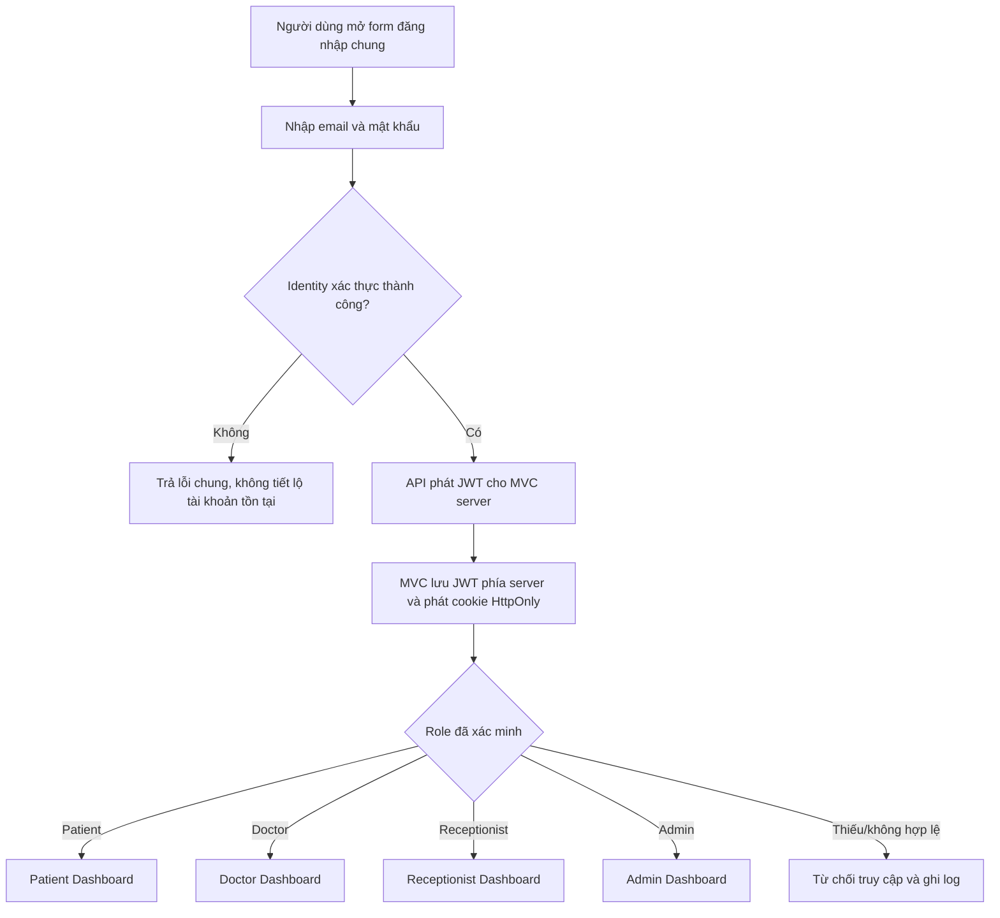

# Actor và ma trận phân quyền

## 1. Nguyên tắc chung

- Hệ thống có đúng bốn Role: `Patient`, `Doctor`, `Receptionist`, `Admin`.
- Một form đăng nhập dùng chung. Backend Identity/JWT và MVC Cookie Authentication đã triển khai; menu tài khoản đọc Role đã xác minh. Dashboard riêng theo Role chưa thuộc Prompt 03.3.1. JWT không được chuyển xuống JavaScript/browser storage.
- UI chỉ hỗ trợ trải nghiệm; API mới là điểm thực thi authorization.
- Quyền được đánh giá theo ba lớp: Role, ownership và resource scope.

## 2. Phân tích Actor

### 2.1 Patient

- Mục tiêu: chủ động tìm lịch phù hợp, đặt/hủy, nhận số và biết tiến độ chờ.
- Tự đăng ký và quản lý hồ sơ của chính mình.
- Chỉ được đọc/sửa Appointment và QueueTicket thuộc tài khoản của mình.
- Không được điều phối queue hoặc xem danh sách bệnh nhân của Doctor.

### 2.2 Doctor

- Mục tiêu: xem lịch cá nhân và điều phối đúng queue của mình.
- Tài khoản do Admin cấp và liên kết duy nhất tới hồ sơ `Doctor`.
- Gọi lượt tiếp theo trực tiếp sang `Serving`, xác nhận `Completed` hoặc `NoShow` cho lượt kế tiếp đủ điều kiện trong phạm vi DoctorId của mình.
- Không được sửa lịch/queue của Doctor khác hoặc tự quản trị Role.

### 2.3 Receptionist

- Mục tiêu: hỗ trợ tiếp nhận và xử lý lịch hẹn cho Patient.
- Tài khoản do Admin cấp.
- Có thể tìm Patient, đặt/hủy hộ, ghi nhận check-in và theo dõi queue; mọi thao tác hộ phải lưu `PerformedByUserId`.
- Không được gọi lượt, hoàn thành hoặc xác nhận `NoShow` thay Doctor.

### 2.4 Admin

- Mục tiêu: quản trị danh mục, tài khoản, lịch hoạt động và báo cáo.
- Tạo/khóa tài khoản Doctor/Receptionist và gán Role theo quy trình kiểm soát.
- Quản lý Doctor, Department, Room, schedule/slot; xem thống kê tổng hợp.
- Không mặc nhiên thao tác thay Patient/Doctor trong luồng khám; nếu cần hỗ trợ phải dùng chức năng có audit rõ ràng.

## 3. Ma trận phân quyền chức năng

Ký hiệu: `✓` được phép; `Own` chỉ dữ liệu của mình; `Scoped` chỉ dữ liệu thuộc Doctor được liên kết; `Support` thao tác hỗ trợ có audit; `—` không được phép.

| Chức năng | Patient | Doctor | Receptionist | Admin |
|---|---:|---:|---:|---:|
| Tự đăng ký | ✓ | — | — | — |
| Đăng nhập/đăng xuất chung | ✓ | ✓ | ✓ | ✓ |
| Sửa hồ sơ cá nhân | Own | Own | Own | Own |
| Tra cứu Doctor/Department/slot | ✓ | ✓ | ✓ | ✓ |
| Đặt Appointment | Own | — | Support | — |
| Hủy Appointment | Own | — | Support | — |
| Ghi nhận check-in | — | — | Support | — |
| Xem Appointment | Own | Scoped | Support | ✓ |
| Xem lịch sử Appointment | Own | Scoped | Support | ✓ |
| Xem queue snapshot | Liên quan/Own | Scoped | ✓ | ✓ |
| Xem danh sách Patient chờ | — | Scoped | ✓ | ✓ |
| Gọi lượt tiếp theo | — | Scoped | — | — |
| Gọi lượt trực tiếp sang Serving | — | Scoped | — | — |
| Hoàn thành lượt khám | — | Scoped | — | — |
| Xác nhận NoShow đủ điều kiện | — | Scoped | — | — |
| Quản lý tài khoản/Role | — | — | — | ✓ |
| Quản lý Doctor/Department/Room | — | — | — | ✓ |
| Quản lý schedule/slot | — | — | — | ✓ |
| Xem báo cáo tổng hợp | — | — | — | ✓ |

## 4. Ma trận truy cập tài nguyên API

| Tài nguyên / hành động | Anonymous | Patient | Doctor | Receptionist | Admin |
|---|---:|---:|---:|---:|---:|
| Doctor/slot danh mục — Read | ✓ | ✓ | ✓ | ✓ | ✓ |
| Auth register Patient | ✓ | — | — | — | — |
| Appointment — Create | — | Own | — | Support | — |
| Appointment — Read | — | Own | Scoped | Support | ✓ |
| Appointment — Cancel | — | Own | — | Support | — |
| Queue summary — Read | — | Own/liên quan | Scoped | ✓ | ✓ |
| Queue patient detail — Read | — | Own | Scoped | Support | ✓ |
| Queue commands | — | — | Scoped | — | — |
| Administration CRUD | — | — | — | — | ✓ |

## 5. Luồng đăng nhập và điều hướng

## 6. Chính sách authorization dự kiến

| Policy | Điều kiện |
|---|---|
| `PatientOnly` | Role là `Patient` |
| `DoctorOnly` | Role là `Doctor` và token liên kết DoctorId hợp lệ |
| `ReceptionistOnly` | Role là `Receptionist` |
| `AdminOnly` | Role là `Admin` |
| `AppointmentOwnerOrStaff` | Patient sở hữu Appointment hoặc staff có scope phù hợp |
| `DoctorQueueOwner` | DoctorId trong route trùng DoctorId liên kết với user |

Policy handler sẽ truy vấn resource khi cần thay vì tin DoctorId/PatientId do client gửi. Claim chỉ mang UserId/Role tối thiểu; backend Prompt 03.2 kiểm tra Role hiện tại và fingerprint `SecurityStamp` trên mỗi request để thu hồi bền vững.

API chỉ chấp nhận JWT Access Token còn hạn và chưa có Refresh Token. MVC giữ token trong kho in-memory phía server, dùng cookie HttpOnly/Secure và antiforgery cho POST; luồng này đã có integration test. SignalR là giai đoạn sau và phải kiểm tra Role/ownership/scope trước khi join group.

## 7. Phạm vi Tuần 2 và lộ trình sau

- Tuần 2: Identity, một login chung, Patient registration, profile/password, bốn dashboard, quản lý tài khoản/Role và danh mục Department/Room/Doctor/Patient theo Least Privilege.
- Tuần 3–4: schedule, slot, đặt/hủy lịch và check-in.
- Tuần 5–6: cấp số qua RabbitMQ, queue command, Notification Service và SignalR.
- Doctor chỉ gọi/hoàn thành/NoShow queue của mình; Receptionist chỉ hỗ trợ lịch/check-in/theo dõi. Các quyền này được thiết kế từ đầu nhưng chưa triển khai trong Tuần 2.
