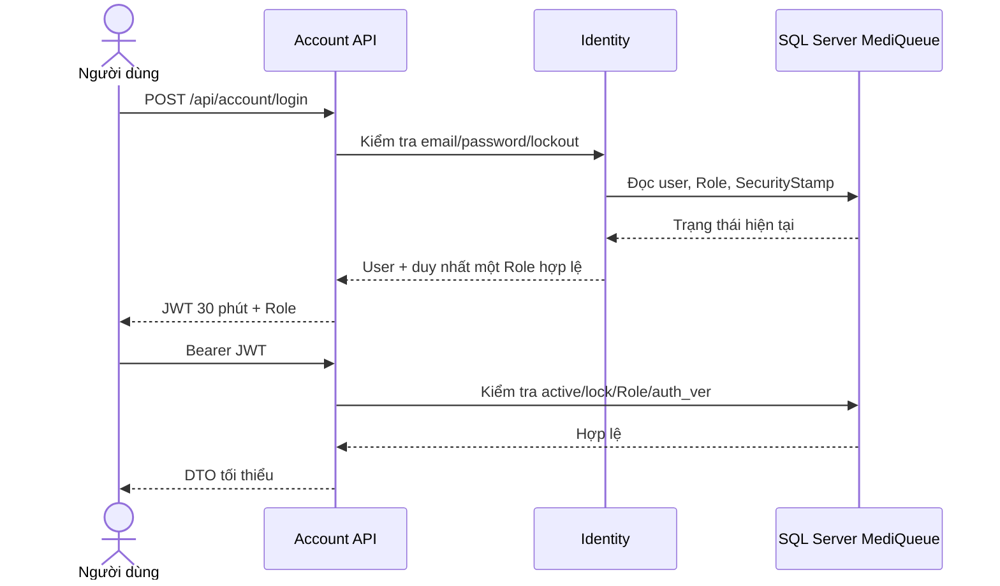
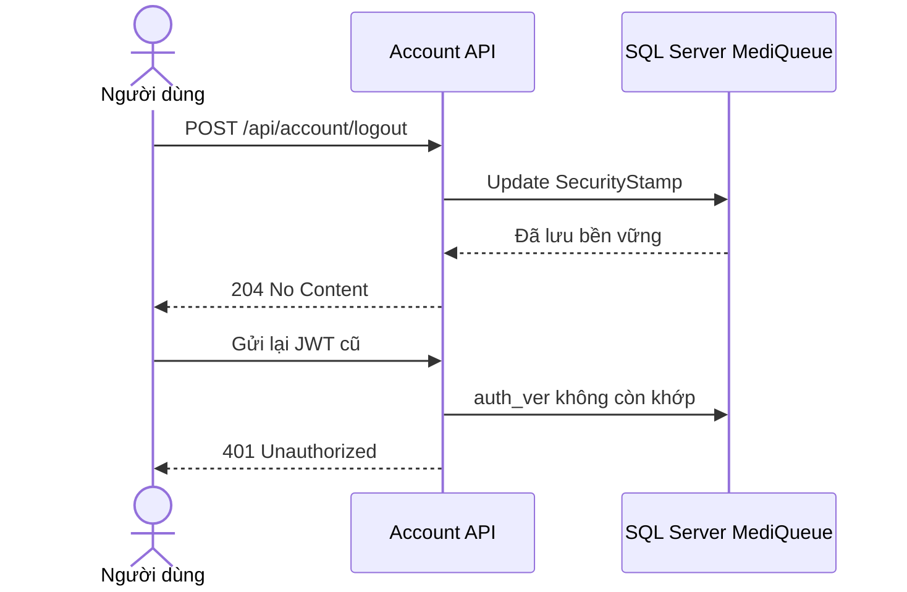

# Identity, JWT và xác thực MVC

## 1. Phạm vi đã triển khai

Prompt 03.2 triển khai backend ASP.NET Core Identity và JWT cho bốn Role chính xác: `Patient`, `Doctor`, `Receptionist`, `Admin`. Chỉ `Patient` tự đăng ký; request công khai không có trường Role. Staff/Admin chỉ được tạo qua quy trình quản trị.

Prompt 03.3.1 triển khai Web MVC thật: browser gửi form + antiforgery đến MVC; MVC gọi Account API qua HTTPS, giữ JWT trong kho phiên in-memory phía server và phát cookie bảo vệ. Prompt 03.4 dùng cùng phiên để gọi Dashboard API read-only và điều hướng bốn Role đến `/dashboard`. Web không tham chiếu Infrastructure/DbContext và không truy cập SQL Server.

Sáu endpoint thật:

| Method | Route | Xác thực | Kết quả |
|---|---|---|---|
| POST | `/api/account/register` | Anonymous, 5 request/10 phút/IP | Tạo `ApplicationUser` + Role Patient + hồ sơ Patient trong một transaction |
| POST | `/api/account/login` | Anonymous, 10 request/phút/IP | JWT Bearer và thông tin user/Role |
| POST | `/api/account/logout` | Bearer | Đổi SecurityStamp, thu hồi tất cả token hiện hành |
| GET | `/api/account/me` | Bearer | Hồ sơ tối thiểu của chính user |
| PUT | `/api/account/profile` | Bearer | Cập nhật tên/phone theo loại hồ sơ |
| POST | `/api/account/change-password` | Bearer | Đổi mật khẩu và thu hồi token cũ |

Receptionist/Admin hiện chưa có bảng profile riêng nên chỉ cập nhật `PhoneNumber`; `FullName` của hai Role này được trả `null`. Đây là giới hạn đã biết, không được che giấu bằng dữ liệu giả.

## 2. Cấu hình JWT chính thức

| Thuộc tính | Giá trị |
|---|---|
| Issuer | `MediQueue.Appointment.Api` |
| Audience | `MediQueue.Web` |
| Thuật toán | HS256 |
| Thời hạn | 30 phút |
| Clock skew | Tối đa 30 giây |
| Signing key | Base64 của ít nhất 32 byte ngẫu nhiên; User Secrets/biến môi trường |
| Refresh Token | Không có trong v1 |

Claim tối thiểu gồm `sub`, `jti`, `iat`, `role`, `auth_ver`. `auth_ver` là HMAC-SHA256 fingerprint của Identity `SecurityStamp` bằng signing key; token không chứa raw SecurityStamp. Mỗi request đã xác thực tiếp tục kiểm tra user tồn tại, `IsActive`, lockout, đúng duy nhất một Role và fingerprint còn khớp.

## 3. Luồng xác thực và thu hồi





Logout hiện thu hồi tất cả phiên/token của user, không chỉ một thiết bị. Khóa/deactivate, đổi Role hoặc đổi mật khẩu cũng làm request sau đó bị từ chối. Chưa có email confirmation, password reset và Refresh Token.

## 4. Cấu hình local không lộ secret

Chạy từ `Tuan2`. Không ghi key ra terminal, log, source hay tài liệu:

```powershell
$connection = 'Server=LAPTOP-AQFGUM9Q\SQLEXPRESS;Database=MediQueue;Trusted_Connection=True;TrustServerCertificate=True;'
dotnet user-secrets set 'ConnectionStrings:MediQueue' $connection --project .\src\MediQueue.Appointment.Api
dotnet user-secrets set 'ConnectionStrings:MediQueue' $connection --project .\src\MediQueue.Queue.Worker

$jwtBytes = New-Object byte[] 32
$rng = [Security.Cryptography.RandomNumberGenerator]::Create()
$rng.GetBytes($jwtBytes)
$rng.Dispose()
$jwtSigningKey = [Convert]::ToBase64String($jwtBytes)
dotnet user-secrets set 'Jwt:SigningKey' $jwtSigningKey --project .\src\MediQueue.Appointment.Api
Remove-Variable jwtBytes,jwtSigningKey,rng,connection
```

Không dùng `dotnet user-secrets list` trong log chia sẻ vì lệnh có thể in giá trị. API fail-fast nếu thiếu/sai issuer, audience, lifetime, algorithm hoặc signing key.

## 5. Bootstrap tường minh

Lệnh Role kiểm tra đúng database `MediQueue`, `InitialCreate` đã apply và không có pending Migration trước khi ghi. Lệnh idempotent, chỉ tạo bốn Role còn thiếu:

```powershell
dotnet run --project .\src\MediQueue.Appointment.Api -- --bootstrap-roles
```

Bootstrap Admin chỉ thực hiện khi người dùng chủ động chọn email và nhập mật khẩu hai lần trong terminal; input bị che, không nhận password qua command line:

```powershell
dotnet run --project .\src\MediQueue.Appointment.Api -- --bootstrap-admin --email admin@example.test
```

Lệnh từ chối tạo Admin thứ hai hoặc nâng cấp email đã tồn tại. Prompt 03.2 không tự tạo Admin vì người dùng chưa cung cấp email/password.

## 6. Kiểm tra thủ công

```powershell
dotnet dev-certs https --check
dotnet run --project .\src\MediQueue.Appointment.Api --launch-profile http
```

Kiểm tra `GET /health` trả 200; `GET /api/account/me` không token trả 401; request register sai validation trả `ValidationProblemDetails`. Chỉ test register/login ghi dữ liệu khi dùng database test cô lập, không tạo user test trong `MediQueue`.

Request đăng nhập minh họa:

```http
POST /api/account/login
Content-Type: application/json

{
  "email": "patient.example@example.test",
  "password": "<mat-khau-cuc-bo-khong-luu-vao-git>"
}
```

Response 200 rút gọn:

```json
{
  "accessToken": "<jwt-da-che>",
  "tokenType": "Bearer",
  "expiresAtUtc": "2026-11-19T10:30:00Z",
  "userId": "11111111-2222-3333-4444-555555555555",
  "fullName": "Bệnh nhân minh họa",
  "email": "patient.example@example.test",
  "role": "Patient"
}
```

Dùng token cục bộ để gọi `GET /api/account/me`, sau đó `POST /api/account/logout`; gửi lại token cũ phải nhận 401. Không dán token thật vào tài liệu, issue tracker hoặc cuộc trò chuyện.

SSMS read-only:

```sql
SELECT Name FROM dbo.AspNetRoles ORDER BY Name;
SELECT COUNT(*) AS UserCount FROM dbo.AspNetUsers;
SELECT MigrationId, ProductVersion FROM dbo.__EFMigrationsHistory;
```

Kết quả sau Prompt 03.2: bốn Role chính xác; `UserCount = 0` do không tự tạo Admin/user test; `InitialCreate` vẫn là Migration duy nhất.

## 7. Kiểm soát bảo mật

- Password tối thiểu 12 ký tự và tối thiểu 3 ký tự khác nhau; không trim password.
- Khóa 15 phút sau 5 lần sai; response login không tiết lộ email có tồn tại hay trạng thái lock.
- Email vừa là `UserName`, dùng unique normalized username và `RequireUniqueEmail` để chống trùng/cạnh tranh.
- Login response đặt `Cache-Control: no-store` và `Pragma: no-cache`.
- API trả DTO/`ProblemDetails`, không trả Identity/EF entity và không lộ password hash, stamp hay token trong log.
- Browser không lưu JWT trong cookie, HTML, JavaScript, URL, `localStorage` hay `sessionStorage`. JWT chỉ nằm trong `IAuthenticationSessionStore` in-memory của Web và được gắn Bearer theo từng request server-to-server.

## 8. Kiểm thử và giới hạn đã biết

- Test in-process bao phủ DTO validation, claim/expiry/HS256, issuer/audience/key/tampering và 401 khi thiếu token.
- Bootstrap Role đã chạy hai lần trên `MediQueue` để xác nhận idempotent; đây là ghi dữ liệu nghiệp vụ được cho phép, không phải test seed.
- Lifecycle register/login/profile/change-password/logout có ghi SQL chưa chạy end-to-end vì chưa có database test cô lập; không dùng `MediQueue` để tạo dữ liệu test.
- Admin đầu tiên đã được người dùng bootstrap thủ công trước Prompt 03.3.1; tài liệu không lưu email hoặc thông tin xác thực. Chưa có email verification, forgot/reset password, Refresh Token hoặc logout từng thiết bị ở API.
- MVC Cookie/UI và Dashboard theo Role đã có; CRUD quản trị chưa triển khai. Môi trường Codex hiện không nhìn thấy development certificate hợp lệ nên HTTPS smoke phải xác minh lại trong phiên Windows của sinh viên; không dùng `--clean` và ứng dụng không tắt certificate validation.

## 9. MVC Cookie và kho token phía server

| Thành phần | Cấu hình |
|---|---|
| Scheme / cookie | `MediQueueCookie` / `.MediQueue.Auth` |
| Cookie flags | `HttpOnly`, `Secure=Always`, `SameSite=Lax`, essential |
| Thời hạn | Tối đa 30 phút, không sliding, không vượt `exp` JWT |
| Antiforgery | `.MediQueue.Antiforgery`, HttpOnly, Secure, SameSite=Strict |
| Token store | Singleton in-memory, khóa bằng session ID ngẫu nhiên 256 bit, absolute expiration |
| API base URL | `https://localhost:7101/`, timeout 15 giây |
| Data Protection | Development dùng ephemeral provider; non-Development dùng key ring riêng `.data-protection` và Windows DPAPI |

Kho token in-memory và Data Protection ephemeral ở Development phù hợp một instance Windows ở v1. Restart/redeploy Web làm mất toàn bộ session; non-Development dùng key ring local bị Git loại trừ và DPAPI bảo vệ. Scale-out cần chuyển sang distributed cache/key ring dùng chung ở giai đoạn được phê duyệt. Không có retry tự động cho login/register/profile/password/logout để tránh lặp command không an toàn.

Mỗi lần truy cập nội dung riêng tư, cookie event tra session theo đúng `UserId` rồi gọi `GET /api/account/me`. Token hết hạn/bị thu hồi hoặc API trả `401/403` làm cookie/session bị loại bỏ. Controller tiếp tục ánh xạ `401` về login, `403` về access denied và lỗi mạng về trang lỗi thân thiện.

## 10. Route MVC đã triển khai

Ngoài route Account, `GET /dashboard` yêu cầu một trong bốn Role chính thức. Login thành công, hoặc người dùng đã xác thực truy cập Login/Register, đều chuyển đến Dashboard; local ReturnUrl hợp lệ vẫn được ưu tiên. Dashboard API 401 xóa phiên, 403 chuyển AccessDenied và lỗi dịch vụ hiển thị trạng thái thân thiện.

| Method | Route | Ghi chú |
|---|---|---|
| GET/POST | `/account/login` | Một form cho bốn Role; return URL chỉ chấp nhận local |
| GET/POST | `/account/register` | Chỉ tạo Patient; xóa password khỏi ModelState khi trả lỗi |
| GET/POST | `/account/profile` | Dữ liệu thật từ API; tên của Admin/Receptionist fallback email |
| GET/POST | `/account/change-password` | Thành công xóa phiên/cookie và yêu cầu đăng nhập lại |
| POST | `/account/logout` | Gọi API thu hồi rồi luôn xóa phiên local; không có GET logout |
| GET | `/account/access-denied` | Trang 403 thân thiện |
