# Dashboard theo vai trò

## 1. Phạm vi Prompt 03.4

MediQueue có một route MVC chung `GET /dashboard` và một API read-only `GET /api/dashboard/me`. Sau đăng nhập, cả bốn Role `Admin`, `Doctor`, `Receptionist`, `Patient` đều được chuyển đến route chung; backend và MVC chọn đúng payload/View từ Role đã xác minh. Không nhận `UserId`, `PatientId`, `DoctorId` hoặc Role từ query/form để quyết định dữ liệu.

Prompt 03.4 không triển khai lịch hẹn, lịch làm việc, hàng đợi hoặc CRUD danh mục. Sau Prompt 03.5, sidebar Admin có thêm liên kết thật tới Quản lý người dùng; các Role khác vẫn chỉ thấy chức năng được cấp quyền. Không dùng placeholder, `href="#"` hoặc số liệu minh họa.

## 2. Luồng dữ liệu và ranh giới tin cậy

```mermaid
sequenceDiagram
    actor U as Người dùng
    participant B as Browser
    participant W as MediQueue.Web MVC
    participant S as Token store phía server
    participant A as Appointment API
    participant D as SQL Server MediQueue
    U->>B: Đăng nhập bằng form chung
    B->>W: Cookie HttpOnly/Secure
    W->>S: Lấy JWT theo session handle
    W->>A: GET /api/dashboard/me + Bearer JWT
    A->>A: Đọc sub/role từ JWT đã xác minh
    A->>D: EF Core AsNoTracking/projection/count
    D-->>A: Dữ liệu đúng phạm vi Role
    A-->>W: DashboardResponse + no-store
    W-->>B: View theo Role, không chứa JWT
```

- Browser chỉ giữ cookie phiên và tùy chọn thu gọn sidebar `mediqueue.ui.sidebar-collapsed`.
- `DashboardApiClient` gắn Bearer cho từng `HttpRequestMessage`; không đặt token vào default header, HTML, URL, log hoặc browser storage.
- API dùng `sub` và `role` từ principal đã xác thực. Doctor/Patient chỉ truy vấn profile có `UserId` bằng `sub`.
- MVC đối chiếu Role trong cookie với Role của response; sai khác sẽ xóa phiên và từ chối truy cập.
- Response không chứa entity EF, password hash, security stamp hoặc access token; luôn có `Cache-Control: no-store`.

## 3. Dữ liệu theo Role

| Role | Dữ liệu trả về |
|---|---|
| Admin | Tổng/active của tài khoản, bác sĩ, bệnh nhân, chuyên khoa, phòng khám và phân bố tài khoản theo bốn Role |
| Doctor | Tài khoản và duy nhất hồ sơ Doctor gắn với `sub`; có empty state nếu chưa liên kết |
| Receptionist | Aggregate Doctor, Patient, Department, Room phục vụ tổng quan tiếp nhận; không trả PII danh sách |
| Patient | Tài khoản và duy nhất hồ sơ Patient gắn với `sub`; có empty state nếu chưa liên kết |

`DashboardService` dùng truy vấn tuần tự trên scoped `MediQueueDbContext`, `AsNoTracking`, projection và aggregate tại database; không dùng `Task.WhenAll`, không tải toàn bảng và không ghi dữ liệu.

## 4. Cấu trúc giao diện

- `_DashboardLayout.cshtml`: workspace xác thực, toast, main content và footer gọn.
- `_DashboardSidebar.cshtml`: active state theo route; desktop expanded/collapsed; mobile drawer.
- `_DashboardHeader.cshtml`: page title, avatar, tên, Role và account dropdown.
- `_DashboardBreadcrumb.cshtml`: đường dẫn semantic theo route.
- `_StatisticCard`, `_QuickActions`, `_DashboardState`: component dùng chung.
- `Views/Dashboard/Admin|Doctor|Receptionist|Patient.cshtml`: bốn View riêng, dùng cùng layout/design token.
- `dashboard-layout.css`, `dashboard.css`, `dashboard.js`: layout, role accent, responsive và tương tác nhẹ.

Mobile drawer có overlay, focus trap, phím Escape và trả focus về nút mở. Mọi control có focus-visible; animation tôn trọng `prefers-reduced-motion`. Màu vai trò chỉ hỗ trợ nhận biết, luôn kèm nhãn chữ tiếng Việt.

## 5. Lỗi và trạng thái rỗng

- Thiếu/mất phiên hoặc API 401: xóa session/cookie local và yêu cầu đăng nhập lại.
- API 403: chuyển trang từ chối truy cập.
- Timeout/API unavailable/response không phù hợp Role: hiển thị lỗi thân thiện, không bỏ qua authorization.
- Chưa có Doctor/Patient profile: hiển thị empty state, không tạo dữ liệu giả.
- Module nghiệp vụ chưa triển khai: mô tả trung thực trong welcome banner và không tạo menu giả.

## 6. Kiểm thử

- Unit test xác minh label/accent bốn Role và fallback an toàn.
- API integration test dùng authentication/service test double cô lập, không phải production endpoint: anonymous 401, bốn Role hợp lệ, Role sai 403, payload đúng phạm vi, `no-store`, không lộ trường Identity nhạy cảm và query không ghi đè danh tính.
- MVC integration test dùng typed-client test double: login redirect bốn Role, render đúng View/layout/menu, 401/403/unavailable, static assets và regression Account flow.
- JWT hết hạn, sai chữ ký, sai issuer/audience và thu hồi tiếp tục được bảo vệ bởi bộ test Authentication kế thừa.
- Database phát triển chỉ được kiểm tra aggregate bằng truy vấn read-only; không tạo user fixture và không ghi `MediQueue`.

## 7. Chạy thử thủ công

1. Cấu hình secrets theo [authentication.md](authentication.md), sau đó chạy API và Web bằng profile HTTPS.
2. Mở `https://localhost:7102/account/login`, đăng nhập bằng tài khoản hợp lệ.
3. Xác minh redirect `/dashboard`, sidebar/header/breadcrumb và nội dung đúng Role.
4. Thu gọn/mở rộng sidebar; tải lại để kiểm tra tùy chọn UI. Ở viewport nhỏ, kiểm tra drawer, overlay, Escape và focus.
5. Kiểm tra account dropdown, Hồ sơ, Đổi mật khẩu và Logout POST.
6. Không dùng mật khẩu Admin trong script, log hoặc automated test.

SQL Server chính thức vẫn là `LAPTOP-AQFGUM9Q\SQLEXPRESS`, database `MediQueue`. Prompt 03.4 không tạo Migration, không thay schema và không seed dữ liệu.
