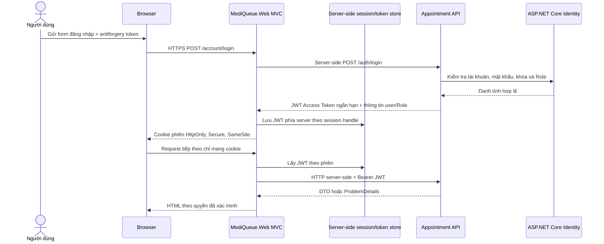

# Kế hoạch phát triển MediQueue Tuần 2

## 1. Tổng quan

Tuần 2 kế thừa nguyên trạng nền tảng Tuần 1 từ commit `dcee864` và tập trung vào Identity, Authentication, Authorization, dashboard theo vai trò và các danh mục quản trị. Prompt 03.2 đã hoàn thành backend Login/Register/JWT; Prompt 03.3.1 đã hoàn thành MVC Cookie, session JWT phía server và UI account; Prompt 03.4 đã hoàn thành shared workspace và bốn Dashboard theo Role mà không thay đổi schema. CRUD/RabbitMQ/SignalR tiếp tục theo lộ trình.

- Sản phẩm: MediQueue — Medical Appointment and Queue Management System.
- Sinh viên: Đặng Quốc Trung — `dtc245200016`.
- Nhánh: `duan-tuan2-dtc245200016`.
- Thư mục: `DT09_HeThongDatLichKhamVaQuanLyHangDoi/Tuan2`.
- Commit nguồn duy nhất: `dcee864`.
- PR Tuần 2 dự kiến: `DuAn-Tuan2 - dtc245200016 - Đặng Quốc Trung`.
- Mỗi tuần chỉ có một Pull Request, nhưng có thể có nhiều commit phản ánh công việc thực tế.

## 2. Phạm vi và chức năng

### 2.1 Phạm vi chính của Tuần 2

1. ASP.NET Core Identity và bốn Role cố định.
2. JWT Access Token cho Web API; không Refresh Token ở v1.
3. Một form đăng nhập chung; chỉ Patient tự đăng ký.
4. MVC Cookie Authentication và phiên JWT phía server.
5. Đăng xuất, đổi mật khẩu, xem/cập nhật hồ sơ cá nhân.
6. Điều hướng và dashboard cho Admin, Doctor, Receptionist, Patient.
7. Admin quản lý tài khoản, khóa/mở khóa và Role theo quy trình kiểm soát.
8. Quản lý Department, Room, Doctor và tra cứu Patient.
9. `GET /doctors`, search, filter và pagination.
10. Kiểm thử Authentication, Authorization, ownership và các nghiệp vụ danh mục.

### 2.2 Mục tiêu mở rộng, chỉ làm khi phần chính ổn định

- DoctorSchedule, TimeSlot và `GET /doctors/{id}/slots`.
- Không đưa đặt/hủy lịch, RabbitMQ, cấp QueueNumber hoặc SignalR queue vào Tuần 2.

### 2.3 Hiện trạng sau Prompt 03.4

- Đã có `AccountController`, service, DTO, JWT validation và lệnh bootstrap tường minh; không có placeholder.
- Không thêm package, Migration hoặc schema; không hard-code tài khoản/mật khẩu.
- Dùng duy nhất database `MediQueue` trong 9 tuần; không tạo database theo tuần.
- Đã triển khai MVC Cookie flow, typed Account/Dashboard API client, token store in-memory, account pages, shared dashboard layout và bốn View theo Role; chưa triển khai CRUD danh mục, RabbitMQ hoặc SignalR nghiệp vụ.

## 3. Kiến trúc Authentication

Quy tắc thiết kế:

- Browser không nhận JWT và JavaScript không đọc JWT; cấm `localStorage`, `sessionStorage`, URL và log.
- MVC dùng Cookie Authentication. Cookie chứa authentication ticket/handle được Data Protection bảo vệ; JWT được giữ trong `IAuthenticationSessionStore` in-memory phía server.
- Cookie dùng `HttpOnly`, `Secure`, `SameSite=Lax` hoặc chặt hơn theo luồng thực tế; state-changing form bắt buộc antiforgery.
- MVC gọi API bằng `HttpClient` phía server và gắn Bearer token ở delegating handler/service; Web không tham chiếu DbContext.
- Thời hạn cookie không vượt quá JWT. Không sliding expiration vượt hạn token; hết hạn hoặc thiếu phiên thì xóa cookie và yêu cầu đăng nhập lại.
- Logout xóa cookie và token server-side. Đổi mật khẩu, khóa tài khoản hoặc đổi Role phải làm mất hiệu lực phiên theo chiến lược security stamp/session revocation được chốt trước triển khai.
- API không tin Role, PatientId hoặc DoctorId do client gửi; luôn xác minh claim, trạng thái tài khoản và ownership/resource scope.
- Ẩn menu chỉ là UI; API policy mới là ranh giới bảo mật.
- SignalR là giai đoạn sau. Cách cấp quyền kết nối phải giữ nguyên nguyên tắc không lộ JWT cho JavaScript và chỉ server cho phép join group.

## 4. Bảng phân quyền và phạm vi tuần

Ký hiệu: `W2` là mục tiêu Tuần 2; `Sau` là lộ trình các tuần sau; `Scoped` yêu cầu kiểm tra ownership/phạm vi tài nguyên.

| Nghiệp vụ | Patient | Doctor | Receptionist | Admin | Giai đoạn |
|---|---|---|---|---|---|
| Tự đăng ký | ✓ | — | — | — | W2 |
| Đăng nhập/đăng xuất/đổi mật khẩu | ✓ | ✓ | ✓ | ✓ | W2 |
| Xem/cập nhật hồ sơ được phép | Own | Own | Own | Own | W2 |
| Xem dashboard theo Role | ✓ | ✓ | ✓ | ✓ | W2 |
| Tra cứu Doctor/Department/Room | ✓ | ✓ | ✓ | ✓ | W2 |
| Quản lý tài khoản, Role, khóa/mở khóa | — | — | — | ✓ | W2 |
| Quản lý Department/Room/Doctor | — | — | — | ✓ | W2 |
| Tra cứu Patient | Own | Scoped | Scoped | Scoped | W2 |
| Xem lịch làm việc của mình | — | Own | Scoped | ✓ | Mở rộng W2/Sau |
| Đặt/hủy lịch | Own | — | Scoped | — | Sau |
| Check-in | — | — | Scoped | — | Sau |
| Theo dõi queue | Own | Own | Scoped | Scoped | Sau |
| Gọi/hoàn thành/NoShow | — | Own | — | — | Sau |

Nguyên tắc Least Privilege: quyền mặc định là từ chối; Admin không mặc nhiên thay Doctor/Patient trong luồng khám; truy cập nhạy cảm cần audit và chỉ trả dữ liệu tối thiểu.

## 5. Controller dự kiến theo nghiệp vụ

| Controller | Host | Trách nhiệm dự kiến |
|---|---|---|
| `HomeController` | MVC | Trang chủ và lỗi nền tảng; đã có |
| `HealthController` | API | Liveness nền tảng; đã có |
| `AccountController` | MVC/API | Login, register Patient, logout, password, profile/token issuance |
| `DashboardController` | MVC/API | Tổng hợp dữ liệu dashboard theo quyền |
| `UsersController` | MVC/API | Quản lý tài khoản, Role, khóa/mở khóa |
| `DepartmentsController` | MVC/API | Danh mục chuyên khoa |
| `RoomsController` | MVC/API | Danh mục phòng khám |
| `DoctorsController` | MVC/API | Quản lý/tra cứu bác sĩ và `GET /doctors` |
| `PatientsController` | MVC/API | Hồ sơ và tra cứu Patient có scope |

Giai đoạn sau mới bổ sung `DoctorSchedulesController`, `TimeSlotsController`, `AppointmentsController`, `QueuesController`. MVC controller kế thừa `Controller`, dùng ViewModel và HTTP service; API controller kế thừa `ControllerBase`, dùng `[ApiController]`, DTO, validation, policy và `ProblemDetails`. Không chia controller theo Role và không để controller gọi controller.

## 6. Chiến lược database Tuần 2

- `MediQueue` trên `LAPTOP-AQFGUM9Q\SQLEXPRESS` là database duy nhất của dự án trong 9 tuần.
- Không tạo database theo tuần; không xóa/tạo lại database.
- `Appointment.Api` và `Queue.Worker` có `UserSecretsId` riêng cho `Tuan2`; không sao chép giá trị secret Tuần 1.
- Không commit connection string, JWT signing key hoặc credential. Chỉ cấu hình qua User Secrets/biến môi trường sau khi đích được duyệt.
- Runtime không tự migrate. Mọi Migration mới phải được review; không sửa `InitialCreate` đã áp dụng.
- Write integration test phải dùng database test cô lập có exact-target guard và cleanup an toàn. Không bao giờ dùng `MediQueue` cho dữ liệu test.
- Test đọc database hiện tại chỉ chạy khi có `ConnectionStrings__MediQueue`; nếu không có thì skip rõ ràng, không fallback sang database khác.

## 7. UI/UX Design System

| Token | Giá trị |
|---|---|
| Primary | `#2563EB` |
| Secondary | `#0D9488` |
| Background | `#F8FAFC` |
| Surface | `#FFFFFF` |
| Text | `#0F172A` |
| Muted Text | `#64748B` |
| Success | `#16A34A` |
| Warning | `#F59E0B` |
| Error | `#DC2626` |

Giao diện tiếng Việt, responsive, Bootstrap 5 và CSS tùy chỉnh; dùng chung layout/sidebar/header/breadcrumb/component. Prompt 03.4 chỉ hiển thị liên kết hoạt động và dữ liệu Dashboard thật; có loading/denied/error/empty state, keyboard focus và reduced motion. Không dùng template thương mại trái phép và không dùng ẩn nút thay cho authorization.

## 8. Kế hoạch Prompt và commit

| Prompt | Kết quả dự kiến | Commit đề xuất |
|---|---|---|
| 03.1.1 | Khởi tạo/rà soát nền tảng Tuần 2 | `chore(tuan2): initialize week two foundation` |
| 03.2 | Identity và JWT backend | `feat(tuan2): implement identity and JWT authentication` |
| 03.3.1 | MVC Authentication/Authorization + premium UI | `feat(tuan2): implement MVC authentication and authorization` |
| 03.4 | Shared layout và dashboard Role | `feat(tuan2): implement premium layout and role-based dashboards` |
| 03.5 | User management | `feat(tuan2): implement user management` |
| 03.6 | Department và Room | `feat(tuan2): implement department and room management` |
| 03.7 | Doctor và Patient | `feat(tuan2): implement doctor and patient management` |
| 03.8 | Test, security, documentation | `test(tuan2): validate authentication and catalog modules` |
| 03.9 (tùy chọn) | Schedule và TimeSlot | `feat(tuan2): implement doctor schedules and time slots` |

## 9. Test Strategy và tiêu chí nghiệm thu

### 9.1 Test Strategy

- Unit: policy/invariant, token expiry mapping, pagination/filter validation, ViewModel mapping.
- Integration API: login/register, tài khoản khóa, Role/ownership, `401/403/404`, ProblemDetails, không nhận Role từ client.
- Integration MVC: cookie attributes, antiforgery, redirect dashboard, expired session, logout và access denied.
- Persistence: chỉ đọc `MediQueue`; write test chỉ trên database test cô lập được cấu hình tường minh và có guard.
- Security: không lộ JWT/secret/PII qua HTML, JavaScript, URL hoặc log; CSRF và session fixation.
- UI: responsive, keyboard/focus, validation, loading/empty/error, static assets.
- Regression: restore/build/test/format, health/smoke test cho bốn process.

### 9.2 Tiêu chí nghiệm thu Tuần 2

- Đúng 9 project, dependency direction và MVC/API boundary.
- Đúng bốn Role; chỉ Patient tự đăng ký; staff do Admin cấp.
- API dùng JWT, MVC dùng Cookie; JWT không xuất hiện ở browser storage/JavaScript.
- Backend kiểm tra Role + ownership/scope; các trường hợp từ chối có test.
- CRUD/danh mục có validation, search/filter/pagination và audit cần thiết.
- Không thay đổi ngoài `Tuan2`, không secret, không Docker, không tự migrate.
- Build không lỗi; test/format/smoke được báo cáo trung thực.

## 10. Rủi ro kỹ thuật

| Rủi ro | Tác động | Giảm thiểu |
|---|---|---|
| Cookie sống lâu hơn JWT | Phiên lỗi hoặc quyền cũ kéo dài | Đồng bộ expiry, không sliding quá hạn, re-login |
| Role/lock thay đổi khi token còn hạn | Quyền cũ tạm còn hiệu lực | Token ngắn hạn + security stamp/session revocation |
| JWT lộ cho browser/log | Chiếm phiên | Token store server-side, redaction, HTTPS, HttpOnly cookie |
| CSRF trên MVC form | Thao tác trái phép | Antiforgery + SameSite + kiểm tra Origin khi phù hợp |
| Ghi dữ liệu test vào database chính | Làm bẩn dữ liệu thật | DB test cô lập, secret riêng, exact-target guard |
| Phình phạm vi CRUD/UI | Trễ phần bảo mật cốt lõi | Làm prompt theo thứ tự, ưu tiên auth/test |
| Authorization chỉ ở UI | Truy cập trái phép qua API | Policy/resource handler tại API và integration test |

## 11. Quyết định đã chốt trong Prompt 03.2

1. Dùng duy nhất database `MediQueue` trong 9 tuần; không database theo tuần.
2. JWT issuer `MediQueue.Appointment.Api`, audience `MediQueue.Web`, lifetime 30 phút, HS256 với key ngẫu nhiên tối thiểu 256 bit và clock skew tối đa 30 giây.
3. Bootstrap Role/Admin chỉ qua lệnh tường minh; password Admin nhập ẩn, không qua argument/log/source.
4. Thu hồi bền vững bằng fingerprint của Identity `SecurityStamp`; logout/đổi mật khẩu/khóa/đổi Role làm token không còn hợp lệ khi server kiểm tra.
5. V1 không Refresh Token; MVC Cookie/token store phía server đã triển khai ở Prompt 03.3.1.

## 12. Checklist phát triển

- [x] Kế thừa tracked files từ đúng commit `dcee864`.
- [x] Giữ nguyên 9 project, Domain, EF model và Migration.
- [x] Tách `UserSecretsId` của API/Worker cho Tuần 2.
- [x] Thiết kế auth, phân quyền, database, UI/UX và test.
- [x] Sinh viên xác nhận các quyết định mục 11.
- [x] Prompt 03.2: Identity/JWT backend.
- [x] Prompt 03.3.1: MVC Cookie, server-side JWT session và UI account.
- [x] Prompt 03.4: premium shared layout và Dashboard theo bốn Role.
- [ ] Prompt 03.5–03.7: tài khoản và danh mục.
- [ ] Prompt 03.8: security/test/documentation gate.
- [ ] Prompt 03.9 chỉ khi phạm vi chính đã hoàn thành.

