# Lộ trình phát triển 9 buổi

## 1. Nguyên tắc

- Lộ trình là kế hoạch, không phải lịch sử đã thực hiện.
- Mỗi buổi tạo một lát cắt có thể kiểm chứng; chỉ commit sau khi người dùng review.
- Yêu cầu bắt buộc của đề tài được ưu tiên trước chức năng mở rộng.
- Không chạy Migration hoặc thay đổi hạ tầng nếu chưa được phép rõ ràng.

## 2. Kế hoạch theo buổi

| Buổi | Mục tiêu | Sản phẩm bàn giao dự kiến | Tiêu chí hoàn thành |
|---|---|---|---|
| 1 | Phân tích và thiết kế nền tảng | README, AGENTS, requirements, actors, use cases, business rules, architecture, database, API, roadmap, progress | Truy vết đủ 8 yêu cầu bắt buộc; Mermaid và Git status được kiểm tra |
| 2 | Khởi tạo solution và Domain | 7 project đúng kiến trúc; reference; entity/enum/value object; test project | Build .NET 10 thành công; chưa cần chức năng UI hoàn chỉnh |
| 3 | Infrastructure, Identity và dữ liệu | Khảo sát schema read-only; DbContext, Identity Role, mapping, Migration được review | Không xóa/tạo lại database; chỉ áp dụng Migration sau phê duyệt; login chung và Access Token hoạt động |
| 4 | Doctor/slot và Appointment API | 6 REST endpoint bắt buộc; trạng thái `PendingNumber`; check-in metadata; concurrency; `.http` | Test quá khứ, hết chỗ, trùng giờ, hạn hủy, ownership và hai request tranh chỗ |
| 5 | RabbitMQ và Queue Worker | Message contracts, outbox/inbox, ticket queue, Worker cấp số, DLQ | Request cấp số thực sự qua RabbitMQ; duplicate không cấp số trùng |
| 6 | Queue command và event | call-next trực tiếp Serving, complete, NoShow; QueueChanged; state/audit | Không gọi slot tương lai; một Doctor tối đa một Serving; NoShow đúng lượt; event có version |
| 7 | Notification Service và SignalR | Hub xác thực Access Token, Rabbit consumer, group authorization, reconnect/snapshot | Chỉ user đăng nhập nhận cập nhật; reconnect không mất trạng thái; không rò dữ liệu queue |
| 8 | Razor Pages cho 4 Role | Login chung, Patient/Doctor/Receptionist/Admin dashboards, luồng bắt buộc end-to-end | Backend authorization được kiểm thử; UI responsive và lỗi rõ ràng |
| 9 | Hoàn thiện và nghiệm thu | Admin mở rộng hợp lý, báo cáo, test, tài liệu chạy Windows, demo script | Build/test sạch; demo đủ đề tài; không secret/dữ liệu thật; tài liệu đồng bộ |

## 3. Milestone

```mermaid
gantt
    title Lộ trình MediQueue theo 9 buổi
    dateFormat  X
    axisFormat Buổi %s
    section Phân tích
    Tài liệu nền tảng              :done, b1, 1, 1
    section Nền tảng mã nguồn
    Solution và Domain             :b2, 2, 1
    Infrastructure và Identity     :b3, 3, 1
    section Chức năng bắt buộc
    Appointment API                :b4, 4, 1
    RabbitMQ và Queue Worker       :b5, 5, 1
    Queue command và event         :b6, 6, 1
    SignalR Notification           :b7, 7, 1
    section Hoàn thiện
    Razor Pages bốn Role           :b8, 8, 1
    Test, demo và tài liệu         :b9, 9, 1
```



`done` ở biểu đồ chỉ thể hiện mục tiêu của Prompt 01 sau khi bộ tài liệu được review; không đại diện cho commit hay buổi học đã được giảng viên nghiệm thu.

## 4. Chiến lược kiểm thử tăng dần

| Giai đoạn | Kiểm thử trọng tâm |
|---|---|
| Domain | Sáu trạng thái Appointment, overlap, capacity, queue ordering, hạn hủy/NoShow |
| API | Validation, Role/ownership, idempotency, ProblemDetails |
| Database | Constraint, rowversion, hai booking tranh chỗ, hủy lặp |
| Messaging | Duplicate không tăng số, redelivery, retry, DLQ, broker gián đoạn/outbox phục hồi |
| Realtime | Group authorization, event trùng/sai thứ tự, reconnect + snapshot |
| End-to-end | Patient đặt → Worker cấp số → Doctor gọi → SignalR cập nhật |

## 5. Rủi ro và biện pháp

| Rủi ro | Tác động | Biện pháp |
|---|---|---|
| Database có sẵn khác thiết kế | Migration xung đột/mất dữ liệu | Khảo sát read-only và backup/quy trình duyệt trước Migration |
| RabbitMQ chưa cấu hình đúng Windows | Luồng cốt lõi không chạy | Kiểm tra service/management, cấu hình ngoài source, health check |
| Duplicate message | Cấp trùng số/event lặp | Inbox, unique constraint, idempotent consumer |
| DB commit nhưng publish lỗi | Appointment không được cấp số | Transactional outbox + retry/publisher confirm |
| Overbooking đồng thời | Sai nghiệp vụ | Conditional update/rowversion + integration test |
| SignalR ngắt kết nối | UI lệch trạng thái | Auto reconnect + version + snapshot source of truth |
| JWT/SignalR lộ token | Rủi ro bảo mật | HTTPS, Access Token ngắn hạn chỉ trong bộ nhớ phiên, không local/session storage, log redaction |
| Phạm vi Admin mở rộng quá sớm | Chậm yêu cầu bắt buộc | Hoàn thành luồng đề tài 09 trước rồi mới mở rộng |

## 6. Definition of Done chung

- Requirement liên quan có test và tài liệu cập nhật.
- Build/test phù hợp giai đoạn chạy thành công.
- Không hard-code secret hoặc dùng dữ liệu bệnh nhân thật.
- Backend authorization đã kiểm tra cả Role và resource scope.
- Các luồng message xử lý duplicate/retry rõ ràng.
- QueueNumber Doctor/ngày không trùng/tái sử dụng; số chờ được đếm từ bản ghi.
- `git diff` chỉ chứa thay đổi trong `DuAn`; người dùng review trước commit.

## 7. Đề xuất nhịp commit

Không làm giả lịch sử. Chỉ commit khi một lát cắt thực sự hoàn thành và người dùng đồng ý. Commit đầu tiên có thể là:

```text
docs: add MediQueue foundation analysis and design
```

Các commit tương lai nên phản ánh đúng sản phẩm từng buổi, không tạo commit rỗng chỉ để khớp kế hoạch.

